# NOONA PLUS — مخططات ERD

مولدة آلياً من النموذج الموحد `tools/model`. تعرض كل صفحة جداول الحزمة بأعمدة المفاتيح (PK/FK/UK) والحالة، مع الجداول الخارجية المرتبطة. التفاصيل الكاملة للأعمدة في [قاموس البيانات](../data-dictionary/README.md).

> ملاحظة: علاقة `TENANT_ID` مع `PLT_TENANT` موجودة في كل جدول مملوك للمؤسسة وحذفت من الرسومات لتبقى مقروءة.

| # | الحزمة | Package | الجداول | المخطط |
|---:|---|---|---:|---|
| 01 | نواة المنصة والمؤسسات والترخيص | Platform Core, Tenancy, Licensing & Companies | 70 | [p01_plt](p01_plt.md) |
| 02 | الهيكل التنظيمي والهوية والأمن | Organization Structure, Identity & Security | 37 | [p02_sec](p02_sec.md) |
| 03 | سير العمل والطلبات والاعتمادات والتفويض | Workflow, Requests, Approvals & Delegation | 27 | [p03_wf](p03_wf.md) |
| 04 | إدارة المستندات والأرشفة | Document Management & Archive | 31 | [p04_dms](p04_dms.md) |
| 05 | المراسلات والإشعارات والتدقيق | Correspondence, Notifications & Audit | 26 | [p05_cor](p05_cor.md) |
| 06 | البيانات المرجعية المشتركة والأطراف | Shared Reference Data & Global Party Model | 29 | [p06_ref](p06_ref.md) |
| 07 | المحاسبة العامة والمحرك المحاسبي | General Ledger & Accounting Engine | 41 | [p07_gl](p07_gl.md) |
| 08 | العملاء والحسابات المدينة | Customers & Accounts Receivable | 19 | [p08_ar](p08_ar.md) |
| 09 | الموردون والحسابات الدائنة | Suppliers & Accounts Payable | 12 | [p09_ap](p09_ap.md) |
| 10 | النقدية والبنوك | Cash & Banks | 13 | [p10_csh](p10_csh.md) |
| 11 | المخزون والبيانات السلعية | Inventory & Item Master | 25 | [p11_inv](p11_inv.md) |
| 12 | المشتريات | Procurement | 17 | [p12_pur](p12_pur.md) |
| 13 | المبيعات ونقاط البيع | Sales & Point of Sale | 34 | [p13_sal](p13_sal.md) |
| 14 | الأصول الثابتة | Fixed Assets | 11 | [p14_fa](p14_fa.md) |
| 15 | المشروعات والمقاولات والإنشاءات | Projects, Contracting & Construction | 18 | [p15_prj](p15_prj.md) |
| 16 | التطوير العقاري وبيع الوحدات | Real Estate Development & Unit Sales | 17 | [p16_re](p16_re.md) |
| 17 | إدارة الأملاك والإيجارات والضيافة | Property Management, Leasing & Hospitality | 25 | [p17_prp](p17_prp.md) |
| 18 | الصيانة وإدارة المرافق | Maintenance & Facility Management | 11 | [p18_mnt](p18_mnt.md) |
| 19 | الموارد البشرية | Human Resources | 24 | [p19_hr](p19_hr.md) |
| 20 | الرواتب | Payroll | 16 | [p20_pay](p20_pay.md) |
| 21 | التصنيع | Manufacturing | 14 | [p21_mfg](p21_mfg.md) |
| 22 | التقارير وذكاء الأعمال | Reporting & Business Intelligence | 10 | [p22_bi](p22_bi.md) |
| 23 | ORDS وواجهات API والتكاملات | ORDS, APIs & Integrations | 13 | [p23_api](p23_api.md) |
| 24 | الذكاء الاصطناعي و RAG والوكلاء | AI, RAG & Agents | 15 | [p24_ai](p24_ai.md) |
| 25 | حزم الدول والتوطين والضرائب | Country Packs, Localization & Tax Engine | 15 | [p25_loc](p25_loc.md) |
| 26 | الاختبار الشامل وضمان الجودة | Quality Assurance & Traceability | 7 | [p26_qa](p26_qa.md) |
| 27 | ترحيل البيانات | Data Migration | 6 | [p27_mig](p27_mig.md) |
| 28 | الإطلاق التجريبي | Pilot Launch | 4 | [p28_pil](p28_pil.md) |
| 29 | النشر الإنتاجي والإصدارات | Deployment & Release Management | 6 | [p29_dep](p29_dep.md) |
| 30 | التشغيل والدعم والتطوير المستمر | Operations, Support & Continuous Improvement | 12 | [p30_ops](p30_ops.md) |
| 31 | المستشفيات والمراكز الطبية | Hospital & Clinics | 40 | [p31_his](p31_his.md) |
| 32 | مراكز خدمة السيارات | Auto Service Centers | 10 | [p32_aut](p32_aut.md) |
| 33 | النقل والشحن والترحيل | Transport & Logistics | 12 | [p33_trn](p33_trn.md) |

**الإجمالي: 667 جدول.**

## خريطة اعتماديات الحزم

السهم من الحزمة إلى الحزمة التي تعتمد عليها (3 علاقات FK أو أكثر، دون Tenant/Company/Currency).

```mermaid
flowchart LR
  PLT["01 PLT<br/>Platform Core, Tenancy, Licensing & Companies"]
  SEC["02 SEC<br/>Organization Structure, Identity & Security"]
  WF["03 WF<br/>Workflow, Requests, Approvals & Delegation"]
  DMS["04 DMS<br/>Document Management & Archive"]
  COR["05 COR<br/>Correspondence, Notifications & Audit"]
  REF["06 REF<br/>Shared Reference Data & Global Party Model"]
  GL["07 GL<br/>General Ledger & Accounting Engine"]
  AR["08 AR<br/>Customers & Accounts Receivable"]
  AP["09 AP<br/>Suppliers & Accounts Payable"]
  CSH["10 CSH<br/>Cash & Banks"]
  INV["11 INV<br/>Inventory & Item Master"]
  PUR["12 PUR<br/>Procurement"]
  SAL["13 SAL<br/>Sales & Point of Sale"]
  FA["14 FA<br/>Fixed Assets"]
  PRJ["15 PRJ<br/>Projects, Contracting & Construction"]
  RE["16 RE<br/>Real Estate Development & Unit Sales"]
  PRP["17 PRP<br/>Property Management, Leasing & Hospitality"]
  MNT["18 MNT<br/>Maintenance & Facility Management"]
  HR["19 HR<br/>Human Resources"]
  PAY["20 PAY<br/>Payroll"]
  MFG["21 MFG<br/>Manufacturing"]
  BI["22 BI<br/>Reporting & Business Intelligence"]
  API["23 API<br/>ORDS, APIs & Integrations"]
  AI["24 AI<br/>AI, RAG & Agents"]
  LOC["25 LOC<br/>Country Packs, Localization & Tax Engine"]
  QA["26 QA<br/>Quality Assurance & Traceability"]
  MIG["27 MIG<br/>Data Migration"]
  PIL["28 PIL<br/>Pilot Launch"]
  DEP["29 DEP<br/>Deployment & Release Management"]
  OPS["30 OPS<br/>Operations, Support & Continuous Improvement"]
  HIS["31 HIS<br/>Hospital & Clinics"]
  AUT["32 AUT<br/>Auto Service Centers"]
  TRN["33 TRN<br/>Transport & Logistics"]
  AI --> DMS
  AI --> SEC
  AP --> CSH
  AP --> GL
  AP --> INV
  AP --> LOC
  AP --> PRJ
  AP --> PUR
  AP --> REF
  AP --> WF
  API --> SEC
  AR --> CSH
  AR --> GL
  AR --> REF
  AR --> WF
  AUT --> AR
  AUT --> INV
  BI --> SEC
  COR --> REF
  COR --> SEC
  COR --> WF
  CSH --> GL
  CSH --> REF
  CSH --> WF
  DMS --> REF
  DMS --> SEC
  DMS --> WF
  FA --> DMS
  FA --> GL
  FA --> HR
  FA --> PLT
  FA --> WF
  GL --> PLT
  GL --> PRJ
  GL --> REF
  GL --> SEC
  GL --> WF
  HIS --> GL
  HIS --> INV
  HR --> DMS
  HR --> REF
  HR --> SEC
  HR --> WF
  INV --> GL
  INV --> LOC
  INV --> PLT
  INV --> REF
  INV --> WF
  LOC --> DMS
  LOC --> GL
  LOC --> REF
  MFG --> GL
  MFG --> INV
  MNT --> AP
  MNT --> FA
  MNT --> INV
  MNT --> RE
  MNT --> WF
  OPS --> PLT
  PAY --> CSH
  PAY --> GL
  PAY --> HR
  PAY --> REF
  PLT --> DMS
  PLT --> GL
  PLT --> LOC
  PLT --> REF
  PLT --> SEC
  PRJ --> DMS
  PRJ --> GL
  PRJ --> REF
  PRJ --> WF
  PRP --> AR
  PRP --> DMS
  PRP --> GL
  PRP --> RE
  PRP --> REF
  PRP --> SAL
  PRP --> WF
  PUR --> AP
  PUR --> GL
  PUR --> INV
  PUR --> PRJ
  PUR --> SEC
  PUR --> WF
  RE --> AR
  RE --> DMS
  RE --> GL
  RE --> PRJ
  RE --> REF
  RE --> WF
  REF --> PLT
  SAL --> AR
  SAL --> CSH
  SAL --> GL
  SAL --> INV
  SAL --> LOC
  SAL --> PRJ
  SAL --> REF
  SAL --> SEC
  SAL --> WF
  SEC --> HR
  SEC --> PLT
  SEC --> REF
  SEC --> WF
  WF --> REF
  WF --> SEC
```

## المخطط العام (العمود الفقري للنظام)

تم حذف علاقات COMPANY_ID و BRANCH_ID والمستخدمين المتكررة من هذا المخطط فقط لتبقى العلاقات الجوهرية مقروءة.

```mermaid
erDiagram
  PLT_TENANT {
    NUMBER ID PK
  }
  PLT_SUBSCRIPTION {
    NUMBER ID PK
  }
  PLT_ENTITLEMENT {
    NUMBER ID PK
  }
  ORG_BUSINESS_GROUP {
    NUMBER ID PK
  }
  ORG_COMPANY {
    NUMBER ID PK
  }
  ORG_BRANCH {
    NUMBER ID PK
  }
  ORG_UNIT {
    NUMBER ID PK
  }
  ORG_POSITION {
    NUMBER ID PK
  }
  ORG_POSITION_ASSIGNMENT {
    NUMBER ID PK
  }
  PTY_PARTY {
    NUMBER ID PK
  }
  HR_EMPLOYEE {
    NUMBER ID PK
  }
  HR_EMPLOYMENT {
    NUMBER ID PK
  }
  SEC_USER {
    NUMBER ID PK
  }
  SEC_USER_MEMBERSHIP {
    NUMBER ID PK
  }
  SEC_ROLE {
    NUMBER ID PK
  }
  SEC_ROLE_GRANT {
    NUMBER ID PK
  }
  WF_INSTANCE {
    NUMBER ID PK
  }
  WF_TASK {
    NUMBER ID PK
  }
  DLG_DELEGATION {
    NUMBER ID PK
  }
  DMS_DOCUMENT {
    NUMBER ID PK
  }
  DMS_DOCUMENT_VERSION {
    NUMBER ID PK
  }
  DMS_DOCUMENT_LINK {
    NUMBER ID PK
  }
  COR_CORRESPONDENCE {
    NUMBER ID PK
  }
  COR_RECIPIENT {
    NUMBER ID PK
  }
  GL_LEDGER {
    NUMBER ID PK
  }
  GL_ACCOUNT {
    NUMBER ID PK
  }
  GL_PERIOD {
    NUMBER ID PK
  }
  GL_JOURNAL {
    NUMBER ID PK
  }
  GL_JOURNAL_LINE {
    NUMBER ID PK
  }
  ACE_ACCOUNTING_EVENT {
    NUMBER ID PK
  }
  AR_CUSTOMER_ACCOUNT {
    NUMBER ID PK
  }
  AR_OPEN_ITEM {
    NUMBER ID PK
  }
  AP_SUPPLIER_ACCOUNT {
    NUMBER ID PK
  }
  AP_OPEN_ITEM {
    NUMBER ID PK
  }
  SAL_INVOICE {
    NUMBER ID PK
  }
  PUR_ORDER {
    NUMBER ID PK
  }
  INV_ITEM {
    NUMBER ID PK
  }
  INV_TRANSACTION {
    NUMBER ID PK
  }
  PRJ_PROJECT {
    NUMBER ID PK
  }
  RE_UNIT {
    NUMBER ID PK
  }
  PRP_LEASE {
    NUMBER ID PK
  }
  ACE_ACCOUNTING_EVENT |o--o{ GL_JOURNAL : "ACCOUNTING_EVENT_ID"
  ACE_ACCOUNTING_EVENT |o--o{ INV_TRANSACTION : "ACCOUNTING_EVENT_ID"
  ACE_ACCOUNTING_EVENT |o--o{ SAL_INVOICE : "ACCOUNTING_EVENT_ID"
  AP_SUPPLIER_ACCOUNT ||--o{ AP_OPEN_ITEM : "SUPPLIER_ACCOUNT_ID"
  AP_SUPPLIER_ACCOUNT ||--o{ PUR_ORDER : "SUPPLIER_ACCOUNT_ID"
  AR_CUSTOMER_ACCOUNT |o--o{ PRJ_PROJECT : "CUSTOMER_ACCOUNT_ID"
  AR_CUSTOMER_ACCOUNT ||--o{ AR_OPEN_ITEM : "CUSTOMER_ACCOUNT_ID"
  AR_CUSTOMER_ACCOUNT ||--o{ PRP_LEASE : "CUSTOMER_ACCOUNT_ID"
  AR_CUSTOMER_ACCOUNT ||--o{ SAL_INVOICE : "CUSTOMER_ACCOUNT_ID"
  COR_CORRESPONDENCE ||--o{ COR_RECIPIENT : "CORRESPONDENCE_ID"
  DLG_DELEGATION |o--o{ COR_RECIPIENT : "DELEGATION_ID"
  DLG_DELEGATION |o--o{ WF_TASK : "DELEGATION_ID"
  DMS_DOCUMENT |o--o{ HR_EMPLOYEE : "PHOTO_DOCUMENT_ID"
  DMS_DOCUMENT |o--o{ ORG_COMPANY : "LOGO_DOCUMENT_ID"
  DMS_DOCUMENT |o--o{ ORG_COMPANY : "SEAL_DOCUMENT_ID"
  DMS_DOCUMENT |o--o{ PRP_LEASE : "SIGNED_DOCUMENT_ID"
  DMS_DOCUMENT |o--o{ SAL_INVOICE : "LEGAL_DOCUMENT_ID"
  DMS_DOCUMENT ||--o{ DMS_DOCUMENT_LINK : "DOCUMENT_ID"
  DMS_DOCUMENT ||--o{ DMS_DOCUMENT_VERSION : "DOCUMENT_ID"
  DMS_DOCUMENT_VERSION |o--o{ DMS_DOCUMENT : "CURRENT_VERSION_ID"
  DMS_DOCUMENT_VERSION |o--o{ DMS_DOCUMENT_LINK : "PINNED_VERSION_ID"
  GL_ACCOUNT |o--o{ AP_SUPPLIER_ACCOUNT : "PAYABLE_ACCOUNT_ID"
  GL_ACCOUNT |o--o{ AP_SUPPLIER_ACCOUNT : "PREPAYMENT_ACCOUNT_ID"
  GL_ACCOUNT |o--o{ AR_CUSTOMER_ACCOUNT : "ADVANCE_ACCOUNT_ID"
  GL_ACCOUNT |o--o{ AR_CUSTOMER_ACCOUNT : "RECEIVABLE_ACCOUNT_ID"
  GL_ACCOUNT |o--o{ GL_LEDGER : "FX_GAIN_ACCOUNT_ID"
  GL_ACCOUNT |o--o{ GL_LEDGER : "FX_LOSS_ACCOUNT_ID"
  GL_ACCOUNT |o--o{ GL_LEDGER : "RETAINED_EARNINGS_ACCOUNT_ID"
  GL_ACCOUNT |o--o{ GL_LEDGER : "ROUNDING_ACCOUNT_ID"
  GL_ACCOUNT |o--o{ GL_LEDGER : "SUSPENSE_ACCOUNT_ID"
  GL_ACCOUNT |o--o{ GL_LEDGER : "UNREALIZED_FX_ACCOUNT_ID"
  GL_ACCOUNT ||--o{ GL_JOURNAL_LINE : "ACCOUNT_ID"
  GL_JOURNAL |o--o{ ACE_ACCOUNTING_EVENT : "JOURNAL_ID"
  GL_JOURNAL |o--o{ AR_OPEN_ITEM : "GL_JOURNAL_ID"
  GL_JOURNAL ||--o{ GL_JOURNAL_LINE : "JOURNAL_ID"
  GL_LEDGER |o--o{ ACE_ACCOUNTING_EVENT : "LEDGER_ID"
  GL_LEDGER ||--o{ GL_JOURNAL : "LEDGER_ID"
  GL_PERIOD ||--o{ GL_JOURNAL : "PERIOD_ID"
  HR_EMPLOYEE |o--o{ AR_CUSTOMER_ACCOUNT : "SALES_REP_EMPLOYEE_ID"
  HR_EMPLOYEE |o--o{ HR_EMPLOYMENT : "MANAGER_EMPLOYEE_ID"
  HR_EMPLOYEE |o--o{ PRJ_PROJECT : "MANAGER_EMPLOYEE_ID"
  HR_EMPLOYEE |o--o{ SEC_USER_MEMBERSHIP : "EMPLOYEE_ID"
  HR_EMPLOYEE ||--o{ HR_EMPLOYMENT : "EMPLOYEE_ID"
  HR_EMPLOYMENT ||--o{ ORG_POSITION_ASSIGNMENT : "EMPLOYMENT_ID"
  INV_ITEM |o--o{ GL_JOURNAL_LINE : "ITEM_ID"
  INV_ITEM |o--o{ RE_UNIT : "ITEM_ID"
  INV_TRANSACTION |o--o{ SAL_INVOICE : "INV_TRANSACTION_ID"
  ORG_BRANCH |o--o{ PTY_PARTY : "OWNER_BRANCH_ID"
  ORG_BRANCH |o--o{ SEC_USER_MEMBERSHIP : "DEFAULT_BRANCH_ID"
  ORG_BUSINESS_GROUP |o--o{ ORG_COMPANY : "BUSINESS_GROUP_ID"
  ORG_BUSINESS_GROUP |o--o{ PTY_PARTY : "OWNER_GROUP_ID"
  ORG_COMPANY |o--o{ INV_ITEM : "OWNER_COMPANY_ID"
  ORG_COMPANY |o--o{ PTY_PARTY : "OWNER_COMPANY_ID"
  ORG_COMPANY |o--o{ SEC_USER_MEMBERSHIP : "DEFAULT_COMPANY_ID"
  ORG_POSITION |o--o{ COR_RECIPIENT : "POSITION_ID"
  ORG_POSITION |o--o{ DLG_DELEGATION : "GRANTOR_POSITION_ID"
  ORG_POSITION |o--o{ ORG_BRANCH : "MANAGER_POSITION_ID"
  ORG_POSITION |o--o{ ORG_UNIT : "HEAD_POSITION_ID"
  ORG_POSITION |o--o{ PRJ_PROJECT : "MANAGER_POSITION_ID"
  ORG_POSITION |o--o{ WF_TASK : "ASSIGNEE_POSITION_ID"
  ORG_POSITION ||--o{ ORG_POSITION_ASSIGNMENT : "POSITION_ID"
  ORG_UNIT |o--o{ COR_CORRESPONDENCE : "OWNER_UNIT_ID"
  ORG_UNIT |o--o{ DMS_DOCUMENT : "OWNER_UNIT_ID"
  ORG_UNIT |o--o{ GL_JOURNAL_LINE : "ORG_UNIT_ID"
  ORG_UNIT |o--o{ HR_EMPLOYMENT : "ORG_UNIT_ID"
  ORG_UNIT ||--o{ ORG_POSITION : "ORG_UNIT_ID"
  PLT_SUBSCRIPTION |o--o{ PLT_ENTITLEMENT : "SUBSCRIPTION_ID"
  PRJ_PROJECT |o--o{ AR_OPEN_ITEM : "PROJECT_ID"
  PRJ_PROJECT |o--o{ GL_JOURNAL_LINE : "PROJECT_ID"
  PRJ_PROJECT |o--o{ ORG_POSITION : "PROJECT_ID"
  PRJ_PROJECT |o--o{ PUR_ORDER : "PROJECT_ID"
  PRJ_PROJECT |o--o{ SAL_INVOICE : "PROJECT_ID"
  PTY_PARTY |o--o{ COR_CORRESPONDENCE : "EXTERNAL_PARTY_ID"
  PTY_PARTY |o--o{ GL_JOURNAL_LINE : "PARTY_ID"
  PTY_PARTY |o--o{ RE_UNIT : "OWNER_PARTY_ID"
  PTY_PARTY |o--o{ SEC_USER_MEMBERSHIP : "PERSON_PARTY_ID"
  PTY_PARTY ||--o{ PRP_LEASE : "LESSEE_PARTY_ID"
  PTY_PARTY ||--o| HR_EMPLOYEE : "PERSON_PARTY_ID"
  RE_UNIT |o--o{ AR_OPEN_ITEM : "UNIT_ID"
  RE_UNIT |o--o{ GL_JOURNAL_LINE : "UNIT_ID"
  SEC_ROLE ||--o{ SEC_ROLE_GRANT : "ROLE_ID"
  SEC_USER ||--o| SEC_USER_MEMBERSHIP : "USER_ID"
  SEC_USER_MEMBERSHIP ||--o{ COR_RECIPIENT : "MEMBERSHIP_ID"
  SEC_USER_MEMBERSHIP ||--o{ SEC_ROLE_GRANT : "MEMBERSHIP_ID"
  WF_INSTANCE |o--o{ DLG_DELEGATION : "WF_INSTANCE_ID"
  WF_INSTANCE |o--o{ GL_JOURNAL : "WF_INSTANCE_ID"
  WF_INSTANCE |o--o{ INV_TRANSACTION : "WF_INSTANCE_ID"
  WF_INSTANCE |o--o{ PRJ_PROJECT : "WF_INSTANCE_ID"
  WF_INSTANCE |o--o{ PRP_LEASE : "WF_INSTANCE_ID"
  WF_INSTANCE |o--o{ PUR_ORDER : "WF_INSTANCE_ID"
  WF_INSTANCE |o--o{ SAL_INVOICE : "WF_INSTANCE_ID"
  WF_INSTANCE ||--o{ WF_TASK : "INSTANCE_ID"
```

نسخ SVG لكل المخططات في المجلد [svg](svg/).

