# ERD — الحزمة 02: الهيكل التنظيمي والهوية والأمن

**Organization Structure, Identity & Security** · الحزمة البرمجية `NOONA_SECURITY_PKG` · عدد الجداول: **37**

الشجرة التنظيمية غير محدودة المستويات والوظائف والمناصب والتعيينات واللجان، ثم الهوية والعضوية والجلسات والأدوار والصلاحيات الذرية RESOURCE.ACTION ونطاق البيانات وفصل المهام والوصول المؤقت. القرار: Explicit Deny → Classification → SoD → Context → Allow → Default Deny.

الجداول الخارجية المرتبطة (من حزم أخرى): `GL_COST_CENTER`, `HR_EMPLOYEE`, `HR_EMPLOYMENT`, `ORG_BRANCH`, `ORG_BUSINESS_SITE`, `ORG_COMPANY`, `PRJ_PROJECT`, `PTY_PARTY`, `REF_CURRENCY`, `REF_ENTITY_TYPE`, `REF_LANGUAGE`, `WF_EXCEPTION`, `WF_INSTANCE`

```mermaid
erDiagram
  ORG_STRUCTURE {
    NUMBER ID PK
    NUMBER TENANT_ID FK,UK
    NUMBER COMPANY_ID FK,UK
    VARCHAR2 CODE UK
    VARCHAR2 NAME_AR
  }
  ORG_STRUCTURE_VERSION {
    NUMBER ID PK
    NUMBER TENANT_ID FK
    NUMBER COMPANY_ID FK
    NUMBER STRUCTURE_ID FK,UK
    NUMBER VERSION_NO UK
    VARCHAR2 STATUS_CODE
    NUMBER WF_INSTANCE_ID FK
  }
  ORG_UNIT {
    NUMBER ID PK
    NUMBER TENANT_ID FK,UK
    NUMBER COMPANY_ID FK
    VARCHAR2 CODE UK
    VARCHAR2 NAME_AR
    NUMBER STRUCTURE_VERSION_ID FK,UK
    NUMBER PARENT_UNIT_ID FK
    NUMBER BRANCH_ID FK
    NUMBER SITE_ID FK
    NUMBER HEAD_POSITION_ID FK
    NUMBER COST_CENTER_ID FK
    VARCHAR2 STATUS_CODE
  }
  ORG_JOB_FAMILY {
    NUMBER ID PK
    NUMBER TENANT_ID FK,UK
    VARCHAR2 CODE UK
    VARCHAR2 NAME_AR
    NUMBER PARENT_FAMILY_ID FK
  }
  ORG_GRADE {
    NUMBER ID PK
    NUMBER TENANT_ID FK,UK
    VARCHAR2 CODE UK
    VARCHAR2 NAME_AR
    VARCHAR2 CURRENCY_CODE FK
  }
  ORG_JOB {
    NUMBER ID PK
    NUMBER TENANT_ID FK,UK
    VARCHAR2 CODE UK
    VARCHAR2 NAME_AR
    NUMBER JOB_FAMILY_ID FK
    NUMBER GRADE_ID FK
    NUMBER COMPANY_ID FK
    VARCHAR2 STATUS_CODE
  }
  ORG_POSITION {
    NUMBER ID PK
    NUMBER TENANT_ID FK,UK
    NUMBER COMPANY_ID FK,UK
    VARCHAR2 CODE UK
    VARCHAR2 NAME_AR
    NUMBER ORG_UNIT_ID FK
    NUMBER JOB_ID FK
    NUMBER GRADE_ID FK
    NUMBER BRANCH_ID FK
    NUMBER SITE_ID FK
    NUMBER COST_CENTER_ID FK
    NUMBER PROJECT_ID FK
    NUMBER REPORTS_TO_POSITION_ID FK
    VARCHAR2 STATUS_CODE
  }
  ORG_POSITION_ASSIGNMENT {
    NUMBER ID PK
    NUMBER TENANT_ID FK
    NUMBER EMPLOYMENT_ID FK
    NUMBER POSITION_ID FK
    VARCHAR2 STATUS_CODE
  }
  ORG_COMMITTEE {
    NUMBER ID PK
    NUMBER TENANT_ID FK,UK
    VARCHAR2 CODE UK
    VARCHAR2 NAME_AR
    NUMBER OWNER_COMPANY_ID FK
    VARCHAR2 STATUS_CODE
  }
  ORG_COMMITTEE_MEMBER {
    NUMBER ID PK
    NUMBER TENANT_ID FK
    NUMBER COMMITTEE_ID FK
    NUMBER EMPLOYEE_ID FK
    NUMBER POSITION_ID FK
    NUMBER EXTERNAL_PARTY_ID FK
    NUMBER ALTERNATE_FOR_ID FK
  }
  ORG_DYNAMIC_GROUP {
    NUMBER ID PK
    NUMBER TENANT_ID FK,UK
    VARCHAR2 CODE UK
    VARCHAR2 NAME_AR
    VARCHAR2 STATUS_CODE
  }
  ORG_RESTRUCTURE {
    NUMBER ID PK
    NUMBER TENANT_ID FK,UK
    NUMBER COMPANY_ID FK
    VARCHAR2 REQUEST_NO UK
    NUMBER FROM_VERSION_ID FK
    NUMBER TO_VERSION_ID FK
    VARCHAR2 STATUS_CODE
    NUMBER WF_INSTANCE_ID FK
  }
  SEC_USER {
    NUMBER ID PK
    RAW PUBLIC_ID UK
    VARCHAR2 USERNAME UK
    NUMBER AUTH_PROVIDER_ID FK
    VARCHAR2 PREFERRED_LANGUAGE FK
    NUMBER SPONSOR_USER_ID FK
    VARCHAR2 STATUS_CODE
  }
  SEC_LOGIN_NAME_HIST {
    NUMBER ID PK
    NUMBER USER_ID FK
  }
  SEC_AUTH_PROVIDER {
    NUMBER ID PK
    NUMBER TENANT_ID FK,UK
    VARCHAR2 CODE UK
    VARCHAR2 NAME_AR
    VARCHAR2 STATUS_CODE
  }
  SEC_CREDENTIAL {
    NUMBER ID PK
    NUMBER USER_ID FK
    VARCHAR2 STATUS_CODE
  }
  SEC_MFA_FACTOR {
    NUMBER ID PK
    NUMBER USER_ID FK
    VARCHAR2 STATUS_CODE
  }
  SEC_DEVICE {
    NUMBER ID PK
    NUMBER USER_ID FK,UK
    VARCHAR2 DEVICE_FINGERPRINT UK
    VARCHAR2 STATUS_CODE
  }
  SEC_USER_MEMBERSHIP {
    NUMBER ID PK
    NUMBER TENANT_ID FK,UK
    NUMBER USER_ID FK,UK
    NUMBER PERSON_PARTY_ID FK
    NUMBER EMPLOYEE_ID FK
    NUMBER DEFAULT_COMPANY_ID FK
    NUMBER DEFAULT_BRANCH_ID FK
    VARCHAR2 STATUS_CODE
  }
  SEC_SESSION {
    NUMBER ID PK
    NUMBER TENANT_ID FK
    NUMBER USER_ID FK
    NUMBER MEMBERSHIP_ID FK
    NUMBER COMPANY_ID FK
    NUMBER BRANCH_ID FK
    VARCHAR2 LANGUAGE_CODE FK
    NUMBER DEVICE_ID FK
    VARCHAR2 STATUS_CODE
  }
  SEC_LOGIN_ATTEMPT {
    NUMBER ID PK
    NUMBER USER_ID FK
  }
  SEC_PERMISSION {
    NUMBER ID PK
    VARCHAR2 NAME_AR
    VARCHAR2 PERMISSION_CODE UK
  }
  SEC_ROLE {
    NUMBER ID PK
    NUMBER TENANT_ID FK,UK
    VARCHAR2 CODE UK
    VARCHAR2 NAME_AR
    NUMBER SOURCE_TEMPLATE_ID FK
    VARCHAR2 STATUS_CODE
  }
  SEC_ROLE_PERMISSION {
    NUMBER ID PK
    NUMBER TENANT_ID FK
    NUMBER ROLE_ID FK,UK
    NUMBER PERMISSION_ID FK,UK
  }
  SEC_ROLE_COMPOSITE {
    NUMBER ID PK
    NUMBER TENANT_ID FK
    NUMBER PARENT_ROLE_ID FK,UK
    NUMBER CHILD_ROLE_ID FK,UK
  }
  SEC_ROLE_GRANT {
    NUMBER ID PK
    NUMBER TENANT_ID FK
    NUMBER MEMBERSHIP_ID FK
    NUMBER ROLE_ID FK
    VARCHAR2 STATUS_CODE
  }
  SEC_DATA_SCOPE {
    NUMBER ID PK
    NUMBER TENANT_ID FK
    NUMBER ROLE_GRANT_ID FK
    NUMBER COMPANY_ID FK
  }
  SEC_FIELD_POLICY {
    NUMBER ID PK
    NUMBER TENANT_ID FK,UK
    VARCHAR2 TABLE_NAME UK
    VARCHAR2 COLUMN_NAME UK
    NUMBER ROLE_ID FK,UK
  }
  SEC_SOD_RULE {
    NUMBER ID PK
    NUMBER TENANT_ID FK,UK
    VARCHAR2 CODE UK
    VARCHAR2 NAME_AR
    NUMBER PERMISSION_A_ID FK
    NUMBER PERMISSION_B_ID FK
  }
  SEC_SOD_VIOLATION {
    NUMBER ID PK
    NUMBER TENANT_ID FK
    NUMBER SOD_RULE_ID FK
    NUMBER MEMBERSHIP_ID FK
    VARCHAR2 ENTITY_TYPE FK
    NUMBER EXCEPTION_ID FK
    VARCHAR2 STATUS_CODE
  }
  SEC_ACCESS_REQUEST {
    NUMBER ID PK
    NUMBER TENANT_ID FK
    NUMBER MEMBERSHIP_ID FK
    NUMBER ROLE_ID FK
    NUMBER ROLE_GRANT_ID FK
    VARCHAR2 STATUS_CODE
    NUMBER WF_INSTANCE_ID FK
  }
  SEC_ACCESS_REVIEW {
    NUMBER ID PK
    NUMBER TENANT_ID FK,UK
    VARCHAR2 CODE UK
    VARCHAR2 NAME_AR
    VARCHAR2 STATUS_CODE
  }
  SEC_ACCESS_REVIEW_ITEM {
    NUMBER ID PK
    NUMBER TENANT_ID FK
    NUMBER ACCESS_REVIEW_ID FK
    NUMBER ROLE_GRANT_ID FK
    NUMBER REVIEWER_MEMBER_ID FK
    VARCHAR2 STATUS_CODE
  }
  SEC_BREAK_GLASS {
    NUMBER ID PK
    NUMBER TENANT_ID FK
    NUMBER MEMBERSHIP_ID FK
    VARCHAR2 STATUS_CODE
  }
  SEC_RISK {
    NUMBER ID PK
    NUMBER TENANT_ID FK,UK
    VARCHAR2 CODE UK
    VARCHAR2 STATUS_CODE
  }
  SEC_INCIDENT {
    NUMBER ID PK
    NUMBER TENANT_ID FK,UK
    VARCHAR2 INCIDENT_NO UK
    VARCHAR2 STATUS_CODE
  }
  SEC_DATA_SUBJECT_REQUEST {
    NUMBER ID PK
    NUMBER TENANT_ID FK,UK
    VARCHAR2 REQUEST_NO UK
    NUMBER PARTY_ID FK
    VARCHAR2 STATUS_CODE
  }
  ORG_COMPANY {
    NUMBER ID PK
  }
  WF_INSTANCE {
    NUMBER ID PK
  }
  ORG_BRANCH {
    NUMBER ID PK
  }
  ORG_BUSINESS_SITE {
    NUMBER ID PK
  }
  GL_COST_CENTER {
    NUMBER ID PK
  }
  REF_CURRENCY {
    NUMBER ID PK
  }
  PRJ_PROJECT {
    NUMBER ID PK
  }
  HR_EMPLOYMENT {
    NUMBER ID PK
  }
  HR_EMPLOYEE {
    NUMBER ID PK
  }
  PTY_PARTY {
    NUMBER ID PK
  }
  REF_LANGUAGE {
    NUMBER ID PK
  }
  REF_ENTITY_TYPE {
    NUMBER ID PK
  }
  WF_EXCEPTION {
    NUMBER ID PK
  }
  GL_COST_CENTER |o--o{ ORG_POSITION : "COST_CENTER_ID"
  GL_COST_CENTER |o--o{ ORG_UNIT : "COST_CENTER_ID"
  HR_EMPLOYEE |o--o{ ORG_COMMITTEE_MEMBER : "EMPLOYEE_ID"
  HR_EMPLOYEE |o--o{ SEC_USER_MEMBERSHIP : "EMPLOYEE_ID"
  HR_EMPLOYMENT ||--o{ ORG_POSITION_ASSIGNMENT : "EMPLOYMENT_ID"
  ORG_BRANCH |o--o{ ORG_POSITION : "BRANCH_ID"
  ORG_BRANCH |o--o{ ORG_UNIT : "BRANCH_ID"
  ORG_BRANCH |o--o{ SEC_SESSION : "BRANCH_ID"
  ORG_BRANCH |o--o{ SEC_USER_MEMBERSHIP : "DEFAULT_BRANCH_ID"
  ORG_BUSINESS_SITE |o--o{ ORG_POSITION : "SITE_ID"
  ORG_BUSINESS_SITE |o--o{ ORG_UNIT : "SITE_ID"
  ORG_COMMITTEE ||--o{ ORG_COMMITTEE_MEMBER : "COMMITTEE_ID"
  ORG_COMMITTEE_MEMBER |o--o{ ORG_COMMITTEE_MEMBER : "ALTERNATE_FOR_ID"
  ORG_COMPANY |o--o{ ORG_COMMITTEE : "OWNER_COMPANY_ID"
  ORG_COMPANY |o--o{ ORG_JOB : "COMPANY_ID"
  ORG_COMPANY |o--o{ SEC_DATA_SCOPE : "COMPANY_ID"
  ORG_COMPANY |o--o{ SEC_SESSION : "COMPANY_ID"
  ORG_COMPANY |o--o{ SEC_USER_MEMBERSHIP : "DEFAULT_COMPANY_ID"
  ORG_COMPANY ||--o{ ORG_POSITION : "COMPANY_ID"
  ORG_COMPANY ||--o{ ORG_RESTRUCTURE : "COMPANY_ID"
  ORG_COMPANY ||--o{ ORG_STRUCTURE : "COMPANY_ID"
  ORG_COMPANY ||--o{ ORG_STRUCTURE_VERSION : "COMPANY_ID"
  ORG_COMPANY ||--o{ ORG_UNIT : "COMPANY_ID"
  ORG_GRADE |o--o{ ORG_JOB : "GRADE_ID"
  ORG_GRADE |o--o{ ORG_POSITION : "GRADE_ID"
  ORG_JOB ||--o{ ORG_POSITION : "JOB_ID"
  ORG_JOB_FAMILY |o--o{ ORG_JOB : "JOB_FAMILY_ID"
  ORG_JOB_FAMILY |o--o{ ORG_JOB_FAMILY : "PARENT_FAMILY_ID"
  ORG_POSITION |o--o{ ORG_COMMITTEE_MEMBER : "POSITION_ID"
  ORG_POSITION |o--o{ ORG_POSITION : "REPORTS_TO_POSITION_ID"
  ORG_POSITION |o--o{ ORG_UNIT : "HEAD_POSITION_ID"
  ORG_POSITION ||--o{ ORG_POSITION_ASSIGNMENT : "POSITION_ID"
  ORG_STRUCTURE ||--o{ ORG_STRUCTURE_VERSION : "STRUCTURE_ID"
  ORG_STRUCTURE_VERSION |o--o{ ORG_RESTRUCTURE : "FROM_VERSION_ID"
  ORG_STRUCTURE_VERSION |o--o{ ORG_RESTRUCTURE : "TO_VERSION_ID"
  ORG_STRUCTURE_VERSION ||--o{ ORG_UNIT : "STRUCTURE_VERSION_ID"
  ORG_UNIT |o--o{ ORG_UNIT : "PARENT_UNIT_ID"
  ORG_UNIT ||--o{ ORG_POSITION : "ORG_UNIT_ID"
  PRJ_PROJECT |o--o{ ORG_POSITION : "PROJECT_ID"
  PTY_PARTY |o--o{ ORG_COMMITTEE_MEMBER : "EXTERNAL_PARTY_ID"
  PTY_PARTY |o--o{ SEC_DATA_SUBJECT_REQUEST : "PARTY_ID"
  PTY_PARTY |o--o{ SEC_USER_MEMBERSHIP : "PERSON_PARTY_ID"
  REF_CURRENCY |o--o{ ORG_GRADE : "CURRENCY_CODE"
  REF_ENTITY_TYPE |o--o{ SEC_SOD_VIOLATION : "ENTITY_TYPE"
  REF_LANGUAGE |o--o{ SEC_SESSION : "LANGUAGE_CODE"
  REF_LANGUAGE ||--o{ SEC_USER : "PREFERRED_LANGUAGE"
  SEC_ACCESS_REVIEW ||--o{ SEC_ACCESS_REVIEW_ITEM : "ACCESS_REVIEW_ID"
  SEC_AUTH_PROVIDER |o--o{ SEC_USER : "AUTH_PROVIDER_ID"
  SEC_DEVICE |o--o{ SEC_SESSION : "DEVICE_ID"
  SEC_PERMISSION ||--o{ SEC_ROLE_PERMISSION : "PERMISSION_ID"
  SEC_PERMISSION ||--o{ SEC_SOD_RULE : "PERMISSION_A_ID"
  SEC_PERMISSION ||--o{ SEC_SOD_RULE : "PERMISSION_B_ID"
  SEC_ROLE |o--o{ SEC_FIELD_POLICY : "ROLE_ID"
  SEC_ROLE |o--o{ SEC_ROLE : "SOURCE_TEMPLATE_ID"
  SEC_ROLE ||--o{ SEC_ACCESS_REQUEST : "ROLE_ID"
  SEC_ROLE ||--o{ SEC_ROLE_COMPOSITE : "CHILD_ROLE_ID"
  SEC_ROLE ||--o{ SEC_ROLE_COMPOSITE : "PARENT_ROLE_ID"
  SEC_ROLE ||--o{ SEC_ROLE_GRANT : "ROLE_ID"
  SEC_ROLE ||--o{ SEC_ROLE_PERMISSION : "ROLE_ID"
  SEC_ROLE_GRANT |o--o{ SEC_ACCESS_REQUEST : "ROLE_GRANT_ID"
  SEC_ROLE_GRANT ||--o{ SEC_ACCESS_REVIEW_ITEM : "ROLE_GRANT_ID"
  SEC_ROLE_GRANT ||--o{ SEC_DATA_SCOPE : "ROLE_GRANT_ID"
  SEC_SOD_RULE ||--o{ SEC_SOD_VIOLATION : "SOD_RULE_ID"
  SEC_USER |o--o{ SEC_LOGIN_ATTEMPT : "USER_ID"
  SEC_USER |o--o{ SEC_USER : "SPONSOR_USER_ID"
  SEC_USER ||--o{ SEC_CREDENTIAL : "USER_ID"
  SEC_USER ||--o{ SEC_DEVICE : "USER_ID"
  SEC_USER ||--o{ SEC_LOGIN_NAME_HIST : "USER_ID"
  SEC_USER ||--o{ SEC_MFA_FACTOR : "USER_ID"
  SEC_USER ||--o{ SEC_SESSION : "USER_ID"
  SEC_USER ||--o| SEC_USER_MEMBERSHIP : "USER_ID"
  SEC_USER_MEMBERSHIP |o--o{ SEC_SESSION : "MEMBERSHIP_ID"
  SEC_USER_MEMBERSHIP ||--o{ SEC_ACCESS_REQUEST : "MEMBERSHIP_ID"
  SEC_USER_MEMBERSHIP ||--o{ SEC_ACCESS_REVIEW_ITEM : "REVIEWER_MEMBER_ID"
  SEC_USER_MEMBERSHIP ||--o{ SEC_BREAK_GLASS : "MEMBERSHIP_ID"
  SEC_USER_MEMBERSHIP ||--o{ SEC_ROLE_GRANT : "MEMBERSHIP_ID"
  SEC_USER_MEMBERSHIP ||--o{ SEC_SOD_VIOLATION : "MEMBERSHIP_ID"
  WF_EXCEPTION |o--o{ SEC_SOD_VIOLATION : "EXCEPTION_ID"
  WF_INSTANCE |o--o{ ORG_RESTRUCTURE : "WF_INSTANCE_ID"
  WF_INSTANCE |o--o{ ORG_STRUCTURE_VERSION : "WF_INSTANCE_ID"
  WF_INSTANCE |o--o{ SEC_ACCESS_REQUEST : "WF_INSTANCE_ID"
```

## الجداول

| الجدول | الاسم العربي | English | النطاق |
|---|---|---|---|
| `ORG_STRUCTURE` | الهياكل التنظيمية | Organizational Structures | C |
| `ORG_STRUCTURE_VERSION` | إصدارات الهيكل التنظيمي | Structure Versions | C |
| `ORG_UNIT` | الوحدات التنظيمية | Organizational Units | C |
| `ORG_JOB_FAMILY` | العائلات الوظيفية | Job Families | T |
| `ORG_GRADE` | الدرجات الوظيفية | Grades | T |
| `ORG_JOB` | الدليل الوظيفي | Job Catalog | T |
| `ORG_POSITION` | المناصب | Positions | C |
| `ORG_POSITION_ASSIGNMENT` | تعيينات المناصب | Position Assignments | T |
| `ORG_COMMITTEE` | اللجان والمجالس وفرق العمل | Committees & Councils | T |
| `ORG_COMMITTEE_MEMBER` | أعضاء اللجان | Committee Members | T |
| `ORG_DYNAMIC_GROUP` | المجموعات الديناميكية | Dynamic Groups | T |
| `ORG_RESTRUCTURE` | طلبات إعادة الهيكلة | Restructuring Requests | C |
| `SEC_USER` | حسابات المستخدمين | User Accounts | G |
| `SEC_LOGIN_NAME_HIST` | سجل أسماء الدخول | Login Name History | G |
| `SEC_AUTH_PROVIDER` | مزودو المصادقة | Authentication Providers | TO |
| `SEC_CREDENTIAL` | بيانات الاعتماد المحلية | Local Credentials | G |
| `SEC_MFA_FACTOR` | عوامل التحقق المتعدد | MFA Factors | G |
| `SEC_DEVICE` | الأجهزة الموثوقة | Trusted Devices | G |
| `SEC_USER_MEMBERSHIP` | عضوية المستخدمين في المؤسسات | User Tenant Memberships | T |
| `SEC_SESSION` | جلسات المستخدمين | User Sessions | TO |
| `SEC_LOGIN_ATTEMPT` | محاولات الدخول | Login Attempts | G |
| `SEC_PERMISSION` | الصلاحيات الذرية | Permissions | G |
| `SEC_ROLE` | الأدوار | Roles | TO |
| `SEC_ROLE_PERMISSION` | صلاحيات الأدوار | Role Permissions | TO |
| `SEC_ROLE_COMPOSITE` | الأدوار المركبة | Composite Roles | TO |
| `SEC_ROLE_GRANT` | منح الأدوار | Role Grants | T |
| `SEC_DATA_SCOPE` | نطاقات البيانات | Data Scopes | T |
| `SEC_FIELD_POLICY` | سياسات حماية الحقول | Field Protection Policies | TO |
| `SEC_SOD_RULE` | قواعد فصل المهام | Segregation of Duties Rules | TO |
| `SEC_SOD_VIOLATION` | مخالفات فصل المهام | SoD Violations | T |
| `SEC_ACCESS_REQUEST` | طلبات الوصول المؤقت | Access Requests | T |
| `SEC_ACCESS_REVIEW` | حملات مراجعة الصلاحيات | Access Certification Campaigns | T |
| `SEC_ACCESS_REVIEW_ITEM` | بنود مراجعة الصلاحيات | Access Review Items | T |
| `SEC_BREAK_GLASS` | وصول الطوارئ | Break-Glass Access | T |
| `SEC_RISK` | سجل المخاطر الأمنية | Security Risk Register | TO |
| `SEC_INCIDENT` | الحوادث الأمنية | Security Incidents | TO |
| `SEC_DATA_SUBJECT_REQUEST` | طلبات أصحاب البيانات | Data Subject Requests | T |
