# ERD — الحزمة 03: سير العمل والطلبات والاعتمادات والتفويض

**Workflow, Requests, Approvals & Delegation** · الحزمة البرمجية `NOONA_WORKFLOW_PKG` · عدد الجداول: **27**

محرك Workflow مركزي يفصل Definition/Version/Instance/Task/Action، وطبقة إدارة الطلبات والاستثناءات ومصفوفة السلطة وقوائم العمل وSLA، ومحرك التفويض المركزي (NOONA_DELEGATION_PKG) بنطاقه وحدوده وسجل التصرفات المنفذة بالنيابة.

الجداول الخارجية المرتبطة (من حزم أخرى): `DMS_SIGNATURE`, `HR_LEAVE_REQUEST`, `ORG_BRANCH`, `ORG_COMPANY`, `ORG_GRADE`, `ORG_JOB`, `ORG_POSITION`, `PRJ_PROJECT`, `REF_COUNTRY`, `REF_CURRENCY`, `REF_ENTITY_TYPE`, `SEC_ROLE`, `SEC_SESSION`, `SEC_USER_MEMBERSHIP`

```mermaid
erDiagram
  WF_BUSINESS_CALENDAR {
    NUMBER ID PK
    NUMBER TENANT_ID FK,UK
    VARCHAR2 CODE UK
    VARCHAR2 NAME_AR
    VARCHAR2 COUNTRY_CODE FK
    NUMBER COMPANY_ID FK
    NUMBER BRANCH_ID FK
  }
  WF_CALENDAR_HOLIDAY {
    NUMBER ID PK
    NUMBER TENANT_ID FK
    NUMBER CALENDAR_ID FK,UK
    DATE HOLIDAY_DATE UK
    VARCHAR2 NAME_AR
  }
  WF_SLA_POLICY {
    NUMBER ID PK
    NUMBER TENANT_ID FK,UK
    VARCHAR2 CODE UK
    VARCHAR2 NAME_AR
    NUMBER CALENDAR_ID FK
  }
  WF_RULE {
    NUMBER ID PK
    NUMBER TENANT_ID FK,UK
    VARCHAR2 CODE UK
    VARCHAR2 NAME_AR
    NUMBER VERSION_NO UK
    VARCHAR2 STATUS_CODE
  }
  WF_DEFINITION {
    NUMBER ID PK
    NUMBER TENANT_ID FK,UK
    VARCHAR2 CODE UK
    VARCHAR2 NAME_AR
    VARCHAR2 OBJECT_TYPE FK
    NUMBER REQUEST_TYPE_ID FK
    VARCHAR2 COUNTRY_CODE FK
  }
  WF_DEFINITION_VERSION {
    NUMBER ID PK
    NUMBER TENANT_ID FK
    NUMBER DEFINITION_ID FK,UK
    NUMBER VERSION_NO UK
    VARCHAR2 STATUS_CODE
  }
  WF_STEP_DEF {
    NUMBER ID PK
    NUMBER TENANT_ID FK
    VARCHAR2 NAME_AR
    NUMBER VERSION_ID FK,UK
    VARCHAR2 STEP_CODE UK
    NUMBER QUEUE_ID FK
    NUMBER SLA_POLICY_ID FK
    NUMBER SUB_DEFINITION_ID FK
  }
  WF_TRANSITION_DEF {
    NUMBER ID PK
    NUMBER TENANT_ID FK
    NUMBER VERSION_ID FK
    NUMBER FROM_STEP_ID FK
    NUMBER TO_STEP_ID FK
    NUMBER RULE_ID FK
  }
  WF_QUEUE {
    NUMBER ID PK
    NUMBER TENANT_ID FK,UK
    VARCHAR2 CODE UK
    VARCHAR2 NAME_AR
    NUMBER COMPANY_ID FK
    NUMBER SUPERVISOR_MEMBER_ID FK
  }
  WF_QUEUE_MEMBER {
    NUMBER ID PK
    NUMBER TENANT_ID FK
    NUMBER QUEUE_ID FK
    NUMBER MEMBERSHIP_ID FK
    NUMBER ROLE_ID FK
    NUMBER POSITION_ID FK
  }
  WF_AUTHORITY_MATRIX {
    NUMBER ID PK
    NUMBER TENANT_ID FK
    NUMBER COMPANY_ID FK
    NUMBER BRANCH_ID FK
    VARCHAR2 TRANSACTION_TYPE FK
    NUMBER POSITION_ID FK
    NUMBER JOB_ID FK
    NUMBER GRADE_ID FK
    NUMBER PROJECT_ID FK
    VARCHAR2 CURRENCY_CODE FK
    VARCHAR2 STATUS_CODE
  }
  WF_INSTANCE {
    NUMBER ID PK
    NUMBER TENANT_ID FK,UK
    NUMBER VERSION_ID FK
    NUMBER COMPANY_ID FK
    VARCHAR2 OBJECT_TYPE FK
    NUMBER REQUEST_ID FK
    NUMBER PARENT_INSTANCE_ID FK
    VARCHAR2 IDEMPOTENCY_KEY UK
    NUMBER INITIATOR_MEMBER_ID FK
    VARCHAR2 STATUS_CODE
  }
  WF_TASK {
    NUMBER ID PK
    NUMBER TENANT_ID FK
    NUMBER INSTANCE_ID FK
    NUMBER STEP_ID FK
    NUMBER ASSIGNEE_MEMBER_ID FK
    NUMBER ORIGINAL_MEMBER_ID FK
    NUMBER ASSIGNEE_POSITION_ID FK
    NUMBER QUEUE_ID FK
    NUMBER DELEGATION_ID FK
    VARCHAR2 STATUS_CODE
  }
  WF_TASK_ACTION {
    NUMBER ID PK
    NUMBER TENANT_ID FK
    NUMBER TASK_ID FK
    NUMBER ACTOR_MEMBER_ID FK
    NUMBER ON_BEHALF_MEMBER_ID FK
    NUMBER DELEGATION_ID FK
    NUMBER ACTOR_POSITION_ID FK
    NUMBER TARGET_MEMBER_ID FK
    NUMBER SIGNATURE_ID FK
    NUMBER SESSION_ID FK
  }
  WF_ESCALATION {
    NUMBER ID PK
    NUMBER TENANT_ID FK
    NUMBER TASK_ID FK
    NUMBER TARGET_MEMBER_ID FK
  }
  WF_REQUEST_TYPE {
    NUMBER ID PK
    NUMBER TENANT_ID FK,UK
    VARCHAR2 CODE UK
    VARCHAR2 NAME_AR
    NUMBER VERSION_NO UK
    VARCHAR2 COUNTRY_CODE FK
    VARCHAR2 STATUS_CODE
  }
  WF_REQUEST {
    NUMBER ID PK
    RAW PUBLIC_ID UK
    NUMBER TENANT_ID FK,UK
    NUMBER BRANCH_ID FK
    VARCHAR2 REQUEST_NO UK
    NUMBER REQUEST_TYPE_ID FK
    NUMBER COMPANY_ID FK
    NUMBER REQUESTER_MEMBER_ID FK
    NUMBER REQUESTER_POSITION_ID FK
    VARCHAR2 CURRENCY_CODE FK
    NUMBER PARENT_REQUEST_ID FK
    VARCHAR2 RESULT_ENTITY_TYPE FK
    VARCHAR2 STATUS_CODE
  }
  WF_APPROVAL_CONDITION {
    NUMBER ID PK
    NUMBER TENANT_ID FK
    NUMBER INSTANCE_ID FK
    NUMBER TASK_ACTION_ID FK
    VARCHAR2 STATUS_CODE
  }
  WF_EXCEPTION {
    NUMBER ID PK
    NUMBER TENANT_ID FK,UK
    VARCHAR2 EXCEPTION_NO UK
    NUMBER OWNER_MEMBER_ID FK
    VARCHAR2 ENTITY_TYPE FK
    VARCHAR2 STATUS_CODE
    NUMBER WF_INSTANCE_ID FK
  }
  WF_ATTESTATION {
    NUMBER ID PK
    NUMBER TENANT_ID FK
    NUMBER MEMBERSHIP_ID FK
    VARCHAR2 ENTITY_TYPE FK
  }
  DLG_POLICY {
    NUMBER ID PK
    NUMBER TENANT_ID FK,UK
    VARCHAR2 CODE UK
    VARCHAR2 NAME_AR
    VARCHAR2 COUNTRY_CODE FK
  }
  DLG_TEMPLATE {
    NUMBER ID PK
    NUMBER TENANT_ID FK,UK
    VARCHAR2 CODE UK
    VARCHAR2 NAME_AR
    NUMBER POLICY_ID FK
    NUMBER VERSION_NO UK
    VARCHAR2 STATUS_CODE
  }
  DLG_DELEGATION {
    NUMBER ID PK
    RAW PUBLIC_ID UK
    NUMBER TENANT_ID FK,UK
    VARCHAR2 DELEGATION_NO UK
    NUMBER TEMPLATE_ID FK
    NUMBER GRANTOR_MEMBER_ID FK
    NUMBER GRANTOR_POSITION_ID FK
    NUMBER DELEGATE_MEMBER_ID FK
    NUMBER PARENT_DELEGATION_ID FK
    NUMBER VERSION_NO UK
    NUMBER PREVIOUS_VERSION_ID FK
    NUMBER LEAVE_REQUEST_ID FK
    VARCHAR2 STATUS_CODE
    NUMBER WF_INSTANCE_ID FK
  }
  DLG_SCOPE {
    NUMBER ID PK
    NUMBER TENANT_ID FK
    NUMBER DELEGATION_ID FK
  }
  DLG_LIMIT {
    NUMBER ID PK
    NUMBER TENANT_ID FK
    NUMBER DELEGATION_ID FK
    VARCHAR2 CURRENCY_CODE FK
  }
  DLG_EXERCISE_EVENT {
    NUMBER ID PK
    NUMBER TENANT_ID FK
    NUMBER DELEGATION_ID FK
    NUMBER ACTOR_MEMBER_ID FK
    NUMBER AUTHORITY_MEMBER_ID FK
    VARCHAR2 ENTITY_TYPE FK
    NUMBER TASK_ID FK
    VARCHAR2 CURRENCY_CODE FK
  }
  DLG_REVIEW {
    NUMBER ID PK
    NUMBER TENANT_ID FK
    NUMBER DELEGATION_ID FK
    NUMBER REVIEWER_MEMBER_ID FK
    VARCHAR2 STATUS_CODE
  }
  REF_COUNTRY {
    NUMBER ID PK
  }
  ORG_COMPANY {
    NUMBER ID PK
  }
  ORG_BRANCH {
    NUMBER ID PK
  }
  REF_ENTITY_TYPE {
    NUMBER ID PK
  }
  SEC_USER_MEMBERSHIP {
    NUMBER ID PK
  }
  SEC_ROLE {
    NUMBER ID PK
  }
  ORG_POSITION {
    NUMBER ID PK
  }
  ORG_JOB {
    NUMBER ID PK
  }
  ORG_GRADE {
    NUMBER ID PK
  }
  PRJ_PROJECT {
    NUMBER ID PK
  }
  REF_CURRENCY {
    NUMBER ID PK
  }
  DMS_SIGNATURE {
    NUMBER ID PK
  }
  SEC_SESSION {
    NUMBER ID PK
  }
  HR_LEAVE_REQUEST {
    NUMBER ID PK
  }
  DLG_DELEGATION |o--o{ DLG_DELEGATION : "PARENT_DELEGATION_ID"
  DLG_DELEGATION |o--o{ DLG_DELEGATION : "PREVIOUS_VERSION_ID"
  DLG_DELEGATION |o--o{ WF_TASK : "DELEGATION_ID"
  DLG_DELEGATION |o--o{ WF_TASK_ACTION : "DELEGATION_ID"
  DLG_DELEGATION ||--o{ DLG_EXERCISE_EVENT : "DELEGATION_ID"
  DLG_DELEGATION ||--o{ DLG_LIMIT : "DELEGATION_ID"
  DLG_DELEGATION ||--o{ DLG_REVIEW : "DELEGATION_ID"
  DLG_DELEGATION ||--o{ DLG_SCOPE : "DELEGATION_ID"
  DLG_POLICY |o--o{ DLG_TEMPLATE : "POLICY_ID"
  DLG_TEMPLATE |o--o{ DLG_DELEGATION : "TEMPLATE_ID"
  DMS_SIGNATURE |o--o{ WF_TASK_ACTION : "SIGNATURE_ID"
  HR_LEAVE_REQUEST |o--o{ DLG_DELEGATION : "LEAVE_REQUEST_ID"
  ORG_BRANCH |o--o{ WF_AUTHORITY_MATRIX : "BRANCH_ID"
  ORG_BRANCH |o--o{ WF_BUSINESS_CALENDAR : "BRANCH_ID"
  ORG_BRANCH |o--o{ WF_REQUEST : "BRANCH_ID"
  ORG_COMPANY |o--o{ WF_AUTHORITY_MATRIX : "COMPANY_ID"
  ORG_COMPANY |o--o{ WF_BUSINESS_CALENDAR : "COMPANY_ID"
  ORG_COMPANY |o--o{ WF_INSTANCE : "COMPANY_ID"
  ORG_COMPANY |o--o{ WF_QUEUE : "COMPANY_ID"
  ORG_COMPANY |o--o{ WF_REQUEST : "COMPANY_ID"
  ORG_GRADE |o--o{ WF_AUTHORITY_MATRIX : "GRADE_ID"
  ORG_JOB |o--o{ WF_AUTHORITY_MATRIX : "JOB_ID"
  ORG_POSITION |o--o{ DLG_DELEGATION : "GRANTOR_POSITION_ID"
  ORG_POSITION |o--o{ WF_AUTHORITY_MATRIX : "POSITION_ID"
  ORG_POSITION |o--o{ WF_QUEUE_MEMBER : "POSITION_ID"
  ORG_POSITION |o--o{ WF_REQUEST : "REQUESTER_POSITION_ID"
  ORG_POSITION |o--o{ WF_TASK : "ASSIGNEE_POSITION_ID"
  ORG_POSITION |o--o{ WF_TASK_ACTION : "ACTOR_POSITION_ID"
  PRJ_PROJECT |o--o{ WF_AUTHORITY_MATRIX : "PROJECT_ID"
  REF_COUNTRY |o--o{ DLG_POLICY : "COUNTRY_CODE"
  REF_COUNTRY |o--o{ WF_BUSINESS_CALENDAR : "COUNTRY_CODE"
  REF_COUNTRY |o--o{ WF_DEFINITION : "COUNTRY_CODE"
  REF_COUNTRY |o--o{ WF_REQUEST_TYPE : "COUNTRY_CODE"
  REF_CURRENCY |o--o{ DLG_EXERCISE_EVENT : "CURRENCY_CODE"
  REF_CURRENCY |o--o{ WF_AUTHORITY_MATRIX : "CURRENCY_CODE"
  REF_CURRENCY |o--o{ WF_REQUEST : "CURRENCY_CODE"
  REF_CURRENCY ||--o{ DLG_LIMIT : "CURRENCY_CODE"
  REF_ENTITY_TYPE |o--o{ DLG_EXERCISE_EVENT : "ENTITY_TYPE"
  REF_ENTITY_TYPE |o--o{ WF_ATTESTATION : "ENTITY_TYPE"
  REF_ENTITY_TYPE |o--o{ WF_DEFINITION : "OBJECT_TYPE"
  REF_ENTITY_TYPE |o--o{ WF_EXCEPTION : "ENTITY_TYPE"
  REF_ENTITY_TYPE |o--o{ WF_REQUEST : "RESULT_ENTITY_TYPE"
  REF_ENTITY_TYPE ||--o{ WF_AUTHORITY_MATRIX : "TRANSACTION_TYPE"
  REF_ENTITY_TYPE ||--o{ WF_INSTANCE : "OBJECT_TYPE"
  SEC_ROLE |o--o{ WF_QUEUE_MEMBER : "ROLE_ID"
  SEC_SESSION |o--o{ WF_TASK_ACTION : "SESSION_ID"
  SEC_USER_MEMBERSHIP |o--o{ DLG_REVIEW : "REVIEWER_MEMBER_ID"
  SEC_USER_MEMBERSHIP |o--o{ WF_ESCALATION : "TARGET_MEMBER_ID"
  SEC_USER_MEMBERSHIP |o--o{ WF_INSTANCE : "INITIATOR_MEMBER_ID"
  SEC_USER_MEMBERSHIP |o--o{ WF_QUEUE : "SUPERVISOR_MEMBER_ID"
  SEC_USER_MEMBERSHIP |o--o{ WF_QUEUE_MEMBER : "MEMBERSHIP_ID"
  SEC_USER_MEMBERSHIP |o--o{ WF_TASK : "ASSIGNEE_MEMBER_ID"
  SEC_USER_MEMBERSHIP |o--o{ WF_TASK : "ORIGINAL_MEMBER_ID"
  SEC_USER_MEMBERSHIP |o--o{ WF_TASK_ACTION : "ON_BEHALF_MEMBER_ID"
  SEC_USER_MEMBERSHIP |o--o{ WF_TASK_ACTION : "TARGET_MEMBER_ID"
  SEC_USER_MEMBERSHIP ||--o{ DLG_DELEGATION : "DELEGATE_MEMBER_ID"
  SEC_USER_MEMBERSHIP ||--o{ DLG_DELEGATION : "GRANTOR_MEMBER_ID"
  SEC_USER_MEMBERSHIP ||--o{ DLG_EXERCISE_EVENT : "ACTOR_MEMBER_ID"
  SEC_USER_MEMBERSHIP ||--o{ DLG_EXERCISE_EVENT : "AUTHORITY_MEMBER_ID"
  SEC_USER_MEMBERSHIP ||--o{ WF_ATTESTATION : "MEMBERSHIP_ID"
  SEC_USER_MEMBERSHIP ||--o{ WF_EXCEPTION : "OWNER_MEMBER_ID"
  SEC_USER_MEMBERSHIP ||--o{ WF_REQUEST : "REQUESTER_MEMBER_ID"
  SEC_USER_MEMBERSHIP ||--o{ WF_TASK_ACTION : "ACTOR_MEMBER_ID"
  WF_BUSINESS_CALENDAR |o--o{ WF_SLA_POLICY : "CALENDAR_ID"
  WF_BUSINESS_CALENDAR ||--o{ WF_CALENDAR_HOLIDAY : "CALENDAR_ID"
  WF_DEFINITION |o--o{ WF_STEP_DEF : "SUB_DEFINITION_ID"
  WF_DEFINITION ||--o{ WF_DEFINITION_VERSION : "DEFINITION_ID"
  WF_DEFINITION_VERSION ||--o{ WF_INSTANCE : "VERSION_ID"
  WF_DEFINITION_VERSION ||--o{ WF_STEP_DEF : "VERSION_ID"
  WF_DEFINITION_VERSION ||--o{ WF_TRANSITION_DEF : "VERSION_ID"
  WF_INSTANCE |o--o{ DLG_DELEGATION : "WF_INSTANCE_ID"
  WF_INSTANCE |o--o{ WF_EXCEPTION : "WF_INSTANCE_ID"
  WF_INSTANCE |o--o{ WF_INSTANCE : "PARENT_INSTANCE_ID"
  WF_INSTANCE ||--o{ WF_APPROVAL_CONDITION : "INSTANCE_ID"
  WF_INSTANCE ||--o{ WF_TASK : "INSTANCE_ID"
  WF_QUEUE |o--o{ WF_STEP_DEF : "QUEUE_ID"
  WF_QUEUE |o--o{ WF_TASK : "QUEUE_ID"
  WF_QUEUE ||--o{ WF_QUEUE_MEMBER : "QUEUE_ID"
  WF_REQUEST |o--o{ WF_INSTANCE : "REQUEST_ID"
  WF_REQUEST |o--o{ WF_REQUEST : "PARENT_REQUEST_ID"
  WF_REQUEST_TYPE |o--o{ WF_DEFINITION : "REQUEST_TYPE_ID"
  WF_REQUEST_TYPE ||--o{ WF_REQUEST : "REQUEST_TYPE_ID"
  WF_RULE |o--o{ WF_TRANSITION_DEF : "RULE_ID"
  WF_SLA_POLICY |o--o{ WF_STEP_DEF : "SLA_POLICY_ID"
  WF_STEP_DEF ||--o{ WF_TASK : "STEP_ID"
  WF_STEP_DEF ||--o{ WF_TRANSITION_DEF : "FROM_STEP_ID"
  WF_STEP_DEF ||--o{ WF_TRANSITION_DEF : "TO_STEP_ID"
  WF_TASK |o--o{ DLG_EXERCISE_EVENT : "TASK_ID"
  WF_TASK ||--o{ WF_ESCALATION : "TASK_ID"
  WF_TASK ||--o{ WF_TASK_ACTION : "TASK_ID"
  WF_TASK_ACTION |o--o{ WF_APPROVAL_CONDITION : "TASK_ACTION_ID"
```

## الجداول

| الجدول | الاسم العربي | English | النطاق |
|---|---|---|---|
| `WF_BUSINESS_CALENDAR` | تقويمات العمل | Business Calendars | TO |
| `WF_CALENDAR_HOLIDAY` | العطلات الرسمية | Calendar Holidays | TO |
| `WF_SLA_POLICY` | سياسات SLA | SLA Policies | TO |
| `WF_RULE` | قواعد الشروط | Workflow Rules | TO |
| `WF_DEFINITION` | تعريفات المسارات | Workflow Definitions | TO |
| `WF_DEFINITION_VERSION` | إصدارات المسارات | Workflow Definition Versions | TO |
| `WF_STEP_DEF` | خطوات المسار | Workflow Step Definitions | TO |
| `WF_TRANSITION_DEF` | انتقالات المسار | Workflow Transitions | TO |
| `WF_QUEUE` | قوائم العمل المشتركة | Work Queues | T |
| `WF_QUEUE_MEMBER` | أعضاء قوائم العمل | Queue Members | T |
| `WF_AUTHORITY_MATRIX` | مصفوفة السلطة | Authority Matrix | T |
| `WF_INSTANCE` | مسارات قيد التشغيل | Workflow Instances | T |
| `WF_TASK` | المهام | Workflow Tasks | T |
| `WF_TASK_ACTION` | قرارات المهام | Task Actions / Decisions | T |
| `WF_ESCALATION` | التصعيدات | Escalations | T |
| `WF_REQUEST_TYPE` | أنواع الطلبات | Request Types | TO |
| `WF_REQUEST` | الطلبات | Requests | T |
| `WF_APPROVAL_CONDITION` | شروط الموافقة | Conditional Approval Obligations | T |
| `WF_EXCEPTION` | سجل الاستثناءات | Policy Exceptions | T |
| `WF_ATTESTATION` | الإقرارات | Attestations | T |
| `DLG_POLICY` | سياسات التفويض | Delegation Policies | TO |
| `DLG_TEMPLATE` | قوالب التفويض | Delegation Templates | TO |
| `DLG_DELEGATION` | التفويضات | Delegations | T |
| `DLG_SCOPE` | نطاق التفويض | Delegation Scope | T |
| `DLG_LIMIT` | حدود التفويض المالية | Delegation Limits | T |
| `DLG_EXERCISE_EVENT` | التصرفات المنفذة بالتفويض | Delegation Exercise Events | T |
| `DLG_REVIEW` | المراجعة اللاحقة للتفويض | Delegation Reviews | T |
