# ERD — الحزمة 04: إدارة المستندات والأرشفة

**Document Management & Archive** · الحزمة البرمجية `NOONA_DMS_PKG` · عدد الجداول: **27**

محرك DMS مركزي (BR-004): المستند سجل عمل وهوية ثابتة، والإصدارات 1..n غير قابلة للمحو، والمحتوى الثنائي في SecureFiles أو Object Storage، والربط بكيانات ERP عبر Document Link منضبط بسجل الأنواع، مع ACL والسرية والاحتفاظ والحجز القانوني والتوقيع.

الجداول الخارجية المرتبطة (من حزم أخرى): `DLG_DELEGATION`, `ORG_BRANCH`, `ORG_COMPANY`, `ORG_UNIT`, `PTY_PARTY`, `REF_COUNTRY`, `REF_ENTITY_TYPE`, `REF_LANGUAGE`, `SEC_SESSION`, `SEC_USER_MEMBERSHIP`, `WF_INSTANCE`, `WF_TASK`

```mermaid
erDiagram
  DMS_CATEGORY {
    NUMBER ID PK
    NUMBER TENANT_ID FK,UK
    VARCHAR2 CODE UK
    VARCHAR2 NAME_AR
    NUMBER PARENT_CATEGORY_ID FK
  }
  DMS_RETENTION_POLICY {
    NUMBER ID PK
    NUMBER TENANT_ID FK,UK
    VARCHAR2 CODE UK
    VARCHAR2 NAME_AR
    VARCHAR2 COUNTRY_CODE FK
    VARCHAR2 STATUS_CODE
  }
  DMS_DOCUMENT_TYPE {
    NUMBER ID PK
    NUMBER TENANT_ID FK,UK
    VARCHAR2 CODE UK
    VARCHAR2 NAME_AR
    NUMBER CATEGORY_ID FK
    NUMBER RETENTION_POLICY_ID FK
  }
  DMS_METADATA_FIELD {
    NUMBER ID PK
    NUMBER TENANT_ID FK
    VARCHAR2 NAME_AR
    NUMBER DOCUMENT_TYPE_ID FK,UK
    VARCHAR2 FIELD_CODE UK
    NUMBER VERSION_NO UK
  }
  DMS_TAG {
    NUMBER ID PK
    NUMBER TENANT_ID FK,UK
    VARCHAR2 CODE UK
    VARCHAR2 NAME_AR
  }
  DMS_ARCHIVE_RULE {
    NUMBER ID PK
    NUMBER TENANT_ID FK
    NUMBER COMPANY_ID FK,UK
    VARCHAR2 ENTITY_TYPE UK
    NUMBER DOCUMENT_TYPE_ID FK
  }
  DMS_DOCUMENT {
    NUMBER ID PK
    RAW PUBLIC_ID UK
    NUMBER TENANT_ID FK
    NUMBER BRANCH_ID FK
    NUMBER COMPANY_ID FK
    NUMBER DOCUMENT_TYPE_ID FK
    VARCHAR2 LANGUAGE_CODE FK
    NUMBER OWNER_MEMBER_ID FK
    NUMBER OWNER_UNIT_ID FK
    NUMBER CURRENT_VERSION_ID FK
    NUMBER RETENTION_POLICY_ID FK
    NUMBER CHECKED_OUT_BY_MEMBER_ID FK
    NUMBER SOURCE_TEMPLATE_ID FK
    VARCHAR2 STATUS_CODE
  }
  DMS_FILE_CONTENT {
    NUMBER ID PK
    NUMBER TENANT_ID FK
    VARCHAR2 STATUS_CODE
  }
  DMS_DOCUMENT_VERSION {
    NUMBER ID PK
    NUMBER TENANT_ID FK
    NUMBER DOCUMENT_ID FK,UK
    NUMBER VERSION_NO UK
    NUMBER CONTENT_ID FK
    NUMBER SOURCE_VERSION_ID FK
    NUMBER UPLOADED_BY_MEMBER_ID FK
    VARCHAR2 STATUS_CODE
  }
  DMS_METADATA_VALUE {
    NUMBER ID PK
    NUMBER TENANT_ID FK
    NUMBER DOCUMENT_ID FK,UK
    NUMBER FIELD_ID FK,UK
  }
  DMS_METADATA_REVISION {
    NUMBER ID PK
    NUMBER TENANT_ID FK
    NUMBER DOCUMENT_ID FK
  }
  DMS_DOCUMENT_TAG {
    NUMBER ID PK
    NUMBER TENANT_ID FK
    NUMBER DOCUMENT_ID FK,UK
    NUMBER TAG_ID FK,UK
  }
  DMS_DOCUMENT_LINK {
    NUMBER ID PK
    NUMBER TENANT_ID FK,UK
    NUMBER DOCUMENT_ID FK,UK
    VARCHAR2 ENTITY_TYPE FK,UK
    NUMBER ENTITY_ID UK
    NUMBER COMPANY_ID FK
    VARCHAR2 LINK_ROLE UK
    NUMBER PINNED_VERSION_ID FK
    VARCHAR2 STATUS_CODE
  }
  DMS_ACL {
    NUMBER ID PK
    NUMBER TENANT_ID FK
    NUMBER DOCUMENT_ID FK,UK
    VARCHAR2 PRINCIPAL_TYPE UK
    NUMBER PRINCIPAL_ID UK
    VARCHAR2 PERMISSION_CODE UK
  }
  DMS_SHARE {
    NUMBER ID PK
    NUMBER TENANT_ID FK
    NUMBER DOCUMENT_ID FK
    NUMBER VERSION_ID FK
    NUMBER RECIPIENT_MEMBER_ID FK
    VARCHAR2 TOKEN_HASH UK
    VARCHAR2 STATUS_CODE
  }
  DMS_COMMENT {
    NUMBER ID PK
    NUMBER TENANT_ID FK
    NUMBER DOCUMENT_ID FK
    NUMBER VERSION_ID FK
    NUMBER PARENT_COMMENT_ID FK
    NUMBER AUTHOR_MEMBER_ID FK
  }
  DMS_OCR_TEXT {
    NUMBER ID PK
    NUMBER TENANT_ID FK
    NUMBER VERSION_ID FK,UK
    VARCHAR2 LANGUAGE_CODE FK
    VARCHAR2 STATUS_CODE
  }
  DMS_TEMPLATE {
    NUMBER ID PK
    NUMBER TENANT_ID FK,UK
    VARCHAR2 CODE UK
    VARCHAR2 NAME_AR
    NUMBER DOCUMENT_TYPE_ID FK
    NUMBER VERSION_NO UK
    NUMBER TEMPLATE_CONTENT_ID FK
    VARCHAR2 STATUS_CODE
  }
  DMS_UPLOAD_SESSION {
    NUMBER ID PK
    NUMBER TENANT_ID FK,UK
    NUMBER MEMBERSHIP_ID FK
    NUMBER DOCUMENT_ID FK
    VARCHAR2 IDEMPOTENCY_KEY UK
    VARCHAR2 STATUS_CODE
  }
  DMS_SIGNATURE_REQUEST {
    NUMBER ID PK
    NUMBER TENANT_ID FK
    NUMBER VERSION_ID FK
    NUMBER WF_TASK_ID FK
    VARCHAR2 STATUS_CODE
  }
  DMS_SIGNATURE {
    NUMBER ID PK
    NUMBER TENANT_ID FK
    NUMBER REQUEST_ID FK
    NUMBER VERSION_ID FK
    NUMBER SIGNER_MEMBER_ID FK
    NUMBER SIGNER_PARTY_ID FK
    NUMBER DELEGATION_ID FK
    NUMBER SESSION_ID FK
  }
  DMS_LEGAL_HOLD {
    NUMBER ID PK
    NUMBER TENANT_ID FK,UK
    VARCHAR2 HOLD_NO UK
    VARCHAR2 STATUS_CODE
  }
  DMS_LEGAL_HOLD_ITEM {
    NUMBER ID PK
    NUMBER TENANT_ID FK
    NUMBER LEGAL_HOLD_ID FK
    NUMBER DOCUMENT_ID FK
    VARCHAR2 ENTITY_TYPE FK
  }
  DMS_DISPOSAL_BATCH {
    NUMBER ID PK
    NUMBER TENANT_ID FK,UK
    VARCHAR2 BATCH_NO UK
    NUMBER CERTIFICATE_DOCUMENT_ID FK
    VARCHAR2 STATUS_CODE
    NUMBER WF_INSTANCE_ID FK
  }
  DMS_DISPOSAL_ITEM {
    NUMBER ID PK
    NUMBER TENANT_ID FK
    NUMBER BATCH_ID FK
    NUMBER DOCUMENT_ID FK
    VARCHAR2 STATUS_CODE
  }
  DMS_ACCESS_LOG {
    NUMBER ID PK
    NUMBER TENANT_ID FK
    NUMBER DOCUMENT_ID FK
    NUMBER VERSION_ID FK
    NUMBER MEMBERSHIP_ID FK
    NUMBER DELEGATION_ID FK
    NUMBER SESSION_ID FK
  }
  DMS_STORAGE_USAGE {
    NUMBER ID PK
    NUMBER TENANT_ID FK,UK
    DATE MEASURED_ON UK
    VARCHAR2 STORAGE_MEDIUM UK
  }
  REF_COUNTRY {
    NUMBER ID PK
  }
  ORG_COMPANY {
    NUMBER ID PK
  }
  ORG_BRANCH {
    NUMBER ID PK
  }
  REF_LANGUAGE {
    NUMBER ID PK
  }
  SEC_USER_MEMBERSHIP {
    NUMBER ID PK
  }
  ORG_UNIT {
    NUMBER ID PK
  }
  REF_ENTITY_TYPE {
    NUMBER ID PK
  }
  WF_TASK {
    NUMBER ID PK
  }
  PTY_PARTY {
    NUMBER ID PK
  }
  DLG_DELEGATION {
    NUMBER ID PK
  }
  SEC_SESSION {
    NUMBER ID PK
  }
  WF_INSTANCE {
    NUMBER ID PK
  }
  DLG_DELEGATION |o--o{ DMS_ACCESS_LOG : "DELEGATION_ID"
  DLG_DELEGATION |o--o{ DMS_SIGNATURE : "DELEGATION_ID"
  DMS_CATEGORY |o--o{ DMS_CATEGORY : "PARENT_CATEGORY_ID"
  DMS_CATEGORY |o--o{ DMS_DOCUMENT_TYPE : "CATEGORY_ID"
  DMS_COMMENT |o--o{ DMS_COMMENT : "PARENT_COMMENT_ID"
  DMS_DISPOSAL_BATCH ||--o{ DMS_DISPOSAL_ITEM : "BATCH_ID"
  DMS_DOCUMENT |o--o{ DMS_DISPOSAL_BATCH : "CERTIFICATE_DOCUMENT_ID"
  DMS_DOCUMENT |o--o{ DMS_LEGAL_HOLD_ITEM : "DOCUMENT_ID"
  DMS_DOCUMENT |o--o{ DMS_UPLOAD_SESSION : "DOCUMENT_ID"
  DMS_DOCUMENT ||--o{ DMS_ACCESS_LOG : "DOCUMENT_ID"
  DMS_DOCUMENT ||--o{ DMS_ACL : "DOCUMENT_ID"
  DMS_DOCUMENT ||--o{ DMS_COMMENT : "DOCUMENT_ID"
  DMS_DOCUMENT ||--o{ DMS_DISPOSAL_ITEM : "DOCUMENT_ID"
  DMS_DOCUMENT ||--o{ DMS_DOCUMENT_LINK : "DOCUMENT_ID"
  DMS_DOCUMENT ||--o{ DMS_DOCUMENT_TAG : "DOCUMENT_ID"
  DMS_DOCUMENT ||--o{ DMS_DOCUMENT_VERSION : "DOCUMENT_ID"
  DMS_DOCUMENT ||--o{ DMS_METADATA_REVISION : "DOCUMENT_ID"
  DMS_DOCUMENT ||--o{ DMS_METADATA_VALUE : "DOCUMENT_ID"
  DMS_DOCUMENT ||--o{ DMS_SHARE : "DOCUMENT_ID"
  DMS_DOCUMENT_TYPE |o--o{ DMS_TEMPLATE : "DOCUMENT_TYPE_ID"
  DMS_DOCUMENT_TYPE ||--o{ DMS_ARCHIVE_RULE : "DOCUMENT_TYPE_ID"
  DMS_DOCUMENT_TYPE ||--o{ DMS_DOCUMENT : "DOCUMENT_TYPE_ID"
  DMS_DOCUMENT_TYPE ||--o{ DMS_METADATA_FIELD : "DOCUMENT_TYPE_ID"
  DMS_DOCUMENT_VERSION |o--o{ DMS_ACCESS_LOG : "VERSION_ID"
  DMS_DOCUMENT_VERSION |o--o{ DMS_COMMENT : "VERSION_ID"
  DMS_DOCUMENT_VERSION |o--o{ DMS_DOCUMENT : "CURRENT_VERSION_ID"
  DMS_DOCUMENT_VERSION |o--o{ DMS_DOCUMENT_LINK : "PINNED_VERSION_ID"
  DMS_DOCUMENT_VERSION |o--o{ DMS_DOCUMENT_VERSION : "SOURCE_VERSION_ID"
  DMS_DOCUMENT_VERSION |o--o{ DMS_SHARE : "VERSION_ID"
  DMS_DOCUMENT_VERSION ||--o{ DMS_SIGNATURE : "VERSION_ID"
  DMS_DOCUMENT_VERSION ||--o{ DMS_SIGNATURE_REQUEST : "VERSION_ID"
  DMS_DOCUMENT_VERSION ||--o| DMS_OCR_TEXT : "VERSION_ID"
  DMS_FILE_CONTENT |o--o{ DMS_DOCUMENT_VERSION : "CONTENT_ID"
  DMS_FILE_CONTENT |o--o{ DMS_TEMPLATE : "TEMPLATE_CONTENT_ID"
  DMS_LEGAL_HOLD ||--o{ DMS_LEGAL_HOLD_ITEM : "LEGAL_HOLD_ID"
  DMS_METADATA_FIELD ||--o{ DMS_METADATA_VALUE : "FIELD_ID"
  DMS_RETENTION_POLICY |o--o{ DMS_DOCUMENT : "RETENTION_POLICY_ID"
  DMS_RETENTION_POLICY |o--o{ DMS_DOCUMENT_TYPE : "RETENTION_POLICY_ID"
  DMS_SIGNATURE_REQUEST |o--o{ DMS_SIGNATURE : "REQUEST_ID"
  DMS_TAG ||--o{ DMS_DOCUMENT_TAG : "TAG_ID"
  DMS_TEMPLATE |o--o{ DMS_DOCUMENT : "SOURCE_TEMPLATE_ID"
  ORG_BRANCH |o--o{ DMS_DOCUMENT : "BRANCH_ID"
  ORG_COMPANY |o--o{ DMS_DOCUMENT : "COMPANY_ID"
  ORG_COMPANY |o--o{ DMS_DOCUMENT_LINK : "COMPANY_ID"
  ORG_COMPANY ||--o{ DMS_ARCHIVE_RULE : "COMPANY_ID"
  ORG_UNIT |o--o{ DMS_DOCUMENT : "OWNER_UNIT_ID"
  PTY_PARTY |o--o{ DMS_SIGNATURE : "SIGNER_PARTY_ID"
  REF_COUNTRY |o--o{ DMS_RETENTION_POLICY : "COUNTRY_CODE"
  REF_ENTITY_TYPE |o--o{ DMS_LEGAL_HOLD_ITEM : "ENTITY_TYPE"
  REF_ENTITY_TYPE ||--o{ DMS_DOCUMENT_LINK : "ENTITY_TYPE"
  REF_LANGUAGE |o--o{ DMS_DOCUMENT : "LANGUAGE_CODE"
  REF_LANGUAGE |o--o{ DMS_OCR_TEXT : "LANGUAGE_CODE"
  SEC_SESSION |o--o{ DMS_ACCESS_LOG : "SESSION_ID"
  SEC_SESSION |o--o{ DMS_SIGNATURE : "SESSION_ID"
  SEC_USER_MEMBERSHIP |o--o{ DMS_ACCESS_LOG : "MEMBERSHIP_ID"
  SEC_USER_MEMBERSHIP |o--o{ DMS_DOCUMENT : "CHECKED_OUT_BY_MEMBER_ID"
  SEC_USER_MEMBERSHIP |o--o{ DMS_DOCUMENT : "OWNER_MEMBER_ID"
  SEC_USER_MEMBERSHIP |o--o{ DMS_DOCUMENT_VERSION : "UPLOADED_BY_MEMBER_ID"
  SEC_USER_MEMBERSHIP |o--o{ DMS_SHARE : "RECIPIENT_MEMBER_ID"
  SEC_USER_MEMBERSHIP |o--o{ DMS_SIGNATURE : "SIGNER_MEMBER_ID"
  SEC_USER_MEMBERSHIP ||--o{ DMS_COMMENT : "AUTHOR_MEMBER_ID"
  SEC_USER_MEMBERSHIP ||--o{ DMS_UPLOAD_SESSION : "MEMBERSHIP_ID"
  WF_INSTANCE |o--o{ DMS_DISPOSAL_BATCH : "WF_INSTANCE_ID"
  WF_TASK |o--o{ DMS_SIGNATURE_REQUEST : "WF_TASK_ID"
```

## الجداول

| الجدول | الاسم العربي | English | النطاق |
|---|---|---|---|
| `DMS_CATEGORY` | فئات المستندات | Document Categories | TO |
| `DMS_RETENTION_POLICY` | سياسات الاحتفاظ | Retention Policies | TO |
| `DMS_DOCUMENT_TYPE` | أنواع المستندات وسياساتها | Document Types & Policies | TO |
| `DMS_METADATA_FIELD` | حقول البيانات الوصفية | Metadata Field Definitions | TO |
| `DMS_TAG` | الوسوم | Tags | T |
| `DMS_ARCHIVE_RULE` | قواعد الأرشفة | Archiving Rules | C |
| `DMS_DOCUMENT` | المستندات | Documents | T |
| `DMS_FILE_CONTENT` | محتوى الملفات | File Content | T |
| `DMS_DOCUMENT_VERSION` | إصدارات المستندات | Document Versions | T |
| `DMS_METADATA_VALUE` | قيم البيانات الوصفية | Document Metadata Values | T |
| `DMS_METADATA_REVISION` | سجل تعديل البيانات الوصفية | Metadata Revisions | T |
| `DMS_DOCUMENT_TAG` | وسوم المستند | Document Tags | T |
| `DMS_DOCUMENT_LINK` | روابط المستندات بكيانات ERP | Document Links | T |
| `DMS_ACL` | قوائم التحكم في الوصول | Document ACL | T |
| `DMS_SHARE` | مشاركات المستندات | Document Shares | T |
| `DMS_COMMENT` | تعليقات المستندات | Document Comments | T |
| `DMS_OCR_TEXT` | النص المستخرج OCR | Extracted Text (OCR) | T |
| `DMS_TEMPLATE` | قوالب توليد المستندات | Document Templates | TO |
| `DMS_UPLOAD_SESSION` | جلسات الرفع | Upload Sessions | T |
| `DMS_SIGNATURE_REQUEST` | طلبات التوقيع | Signature Requests | T |
| `DMS_SIGNATURE` | التوقيعات | Signatures | T |
| `DMS_LEGAL_HOLD` | الحجوزات القانونية | Legal Holds | T |
| `DMS_LEGAL_HOLD_ITEM` | عناصر الحجز القانوني | Legal Hold Items | T |
| `DMS_DISPOSAL_BATCH` | دفعات الإتلاف | Disposal Batches | T |
| `DMS_DISPOSAL_ITEM` | عناصر الإتلاف | Disposal Items | T |
| `DMS_ACCESS_LOG` | سجل الوصول للمستندات | Document Access Log | T |
| `DMS_STORAGE_USAGE` | استهلاك التخزين | Storage Usage | T |
