# ERD — الحزمة 05: المراسلات والإشعارات والتدقيق

**Correspondence, Notifications & Audit** · الحزمة البرمجية `NOONA_CORRESPONDENCE_PKG` · عدد الجداول: **26**

المراسلات الواردة والصادرة والداخلية مع فصل الجهة المقصودة عن المستلم الفعلي، وسجل تسليم مستقل لكل مستلم بأبعاد التسليم/الاطلاع/الإجراء/العرض، والتداول والتعليمات والأولوية؛ ومحرك الإشعارات المركزي (NOONA_NOTIFICATION_PKG)؛ وسجل التدقيق المركزي غير القابل للتعديل (NOONA_AUDIT_PKG).

الجداول الخارجية المرتبطة (من حزم أخرى): `DLG_DELEGATION`, `DMS_DOCUMENT`, `DMS_RETENTION_POLICY`, `ORG_BRANCH`, `ORG_COMPANY`, `ORG_POSITION`, `ORG_UNIT`, `PTY_PARTY`, `REF_ENTITY_TYPE`, `REF_LANGUAGE`, `SEC_INCIDENT`, `SEC_ROLE`, `SEC_SESSION`, `SEC_USER`, `SEC_USER_MEMBERSHIP`, `WF_DEFINITION`, `WF_SLA_POLICY`, `WF_TASK`

```mermaid
erDiagram
  COR_INSTRUCTION {
    NUMBER ID PK
    NUMBER TENANT_ID FK,UK
    VARCHAR2 CODE UK
    VARCHAR2 NAME_AR
    NUMBER VERSION_NO UK
    NUMBER DEFAULT_SLA_POLICY_ID FK
  }
  COR_TYPE {
    NUMBER ID PK
    NUMBER TENANT_ID FK,UK
    VARCHAR2 CODE UK
    VARCHAR2 NAME_AR
    NUMBER WF_DEFINITION_ID FK
    NUMBER RETENTION_POLICY_ID FK
  }
  COR_PRIORITY_POLICY {
    NUMBER ID PK
    NUMBER TENANT_ID FK,UK
    NUMBER COR_TYPE_ID FK,UK
    VARCHAR2 PRIORITY_CODE UK
    NUMBER SLA_POLICY_ID FK
    DATE EFFECTIVE_FROM UK
  }
  COR_CORRESPONDENCE {
    NUMBER ID PK
    RAW PUBLIC_ID UK
    NUMBER TENANT_ID FK
    NUMBER BRANCH_ID FK
    NUMBER COMPANY_ID FK
    NUMBER COR_TYPE_ID FK
    VARCHAR2 CORRESPONDENCE_NO UK
    VARCHAR2 LANGUAGE_CODE FK
    NUMBER OWNER_UNIT_ID FK
    NUMBER AUTHOR_MEMBER_ID FK
    NUMBER EXTERNAL_PARTY_ID FK
    NUMBER THREAD_ID FK
    NUMBER PARENT_ID FK
    NUMBER ORIGINAL_ID FK
    VARCHAR2 STATUS_CODE
  }
  COR_PARTY {
    NUMBER ID PK
    NUMBER TENANT_ID FK
    NUMBER CORRESPONDENCE_ID FK
    NUMBER PARTY_ID FK
  }
  COR_ADDRESSEE {
    NUMBER ID PK
    NUMBER TENANT_ID FK
    NUMBER CORRESPONDENCE_ID FK
    NUMBER INSTRUCTION_ID FK
  }
  COR_RECIPIENT {
    NUMBER ID PK
    NUMBER TENANT_ID FK,UK
    NUMBER CORRESPONDENCE_ID FK
    NUMBER ADDRESSEE_ID FK
    NUMBER MEMBERSHIP_ID FK
    NUMBER POSITION_ID FK
    NUMBER DELEGATION_ID FK
    NUMBER ORIGINAL_MEMBER_ID FK
    NUMBER INSTRUCTION_ID FK
    VARCHAR2 IDEMPOTENCY_KEY UK
  }
  COR_RECIPIENT_EVENT {
    NUMBER ID PK
    NUMBER TENANT_ID FK
    NUMBER RECIPIENT_ID FK
    NUMBER ACTOR_MEMBER_ID FK
    NUMBER DELEGATION_ID FK
    NUMBER SESSION_ID FK
  }
  COR_CIRCULATION {
    NUMBER ID PK
    NUMBER TENANT_ID FK
    NUMBER CORRESPONDENCE_ID FK
    NUMBER PARENT_CIRCULATION_ID FK
    NUMBER FROM_MEMBER_ID FK
    NUMBER TO_MEMBER_ID FK
    NUMBER INSTRUCTION_ID FK
    NUMBER WF_TASK_ID FK
    VARCHAR2 RESULT_ENTITY_TYPE FK
    VARCHAR2 STATUS_CODE
  }
  COR_CIRCULATION_NOTE {
    NUMBER ID PK
    NUMBER TENANT_ID FK
    NUMBER CIRCULATION_ID FK
    NUMBER AUTHOR_MEMBER_ID FK
  }
  COR_DUE_CHANGE {
    NUMBER ID PK
    NUMBER TENANT_ID FK
    NUMBER CORRESPONDENCE_ID FK
    NUMBER RECIPIENT_ID FK
  }
  COR_DISPATCH {
    NUMBER ID PK
    NUMBER TENANT_ID FK,UK
    NUMBER CORRESPONDENCE_ID FK
    NUMBER PROOF_DOCUMENT_ID FK
    VARCHAR2 IDEMPOTENCY_KEY UK
    VARCHAR2 STATUS_CODE
  }
  COR_POLICY {
    NUMBER ID PK
    NUMBER TENANT_ID FK
    NUMBER COMPANY_ID FK,UK
  }
  COR_MAIL_PROFILE {
    NUMBER ID PK
    NUMBER TENANT_ID FK
    NUMBER COMPANY_ID FK,UK
  }
  COR_CASE_FILE {
    NUMBER ID PK
    NUMBER TENANT_ID FK,UK
    VARCHAR2 CODE UK
    VARCHAR2 NAME_AR
    NUMBER COMPANY_ID FK
    NUMBER OWNER_UNIT_ID FK
    VARCHAR2 STATUS_CODE
  }
  COR_CASE_LINK {
    NUMBER ID PK
    NUMBER TENANT_ID FK
    NUMBER CASE_FILE_ID FK,UK
    NUMBER CORRESPONDENCE_ID FK,UK
  }
  NTF_EVENT_TYPE {
    NUMBER ID PK
    NUMBER TENANT_ID FK,UK
    VARCHAR2 CODE UK
    VARCHAR2 NAME_AR
  }
  NTF_TEMPLATE {
    NUMBER ID PK
    NUMBER TENANT_ID FK,UK
    NUMBER EVENT_TYPE_ID FK,UK
    VARCHAR2 CHANNEL UK
    VARCHAR2 LANGUAGE_CODE FK,UK
    NUMBER VERSION_NO UK
    VARCHAR2 STATUS_CODE
  }
  NTF_RULE {
    NUMBER ID PK
    NUMBER TENANT_ID FK
    NUMBER EVENT_TYPE_ID FK
    NUMBER COMPANY_ID FK
  }
  NTF_USER_PREFERENCE {
    NUMBER ID PK
    NUMBER TENANT_ID FK,UK
    NUMBER MEMBERSHIP_ID FK,UK
    NUMBER EVENT_TYPE_ID FK,UK
    VARCHAR2 CHANNEL UK
  }
  NTF_NOTIFICATION {
    NUMBER ID PK
    NUMBER TENANT_ID FK,UK
    NUMBER EVENT_TYPE_ID FK
    NUMBER MEMBERSHIP_ID FK
    NUMBER USER_ID FK
    VARCHAR2 SOURCE_ENTITY_TYPE FK
    VARCHAR2 IDEMPOTENCY_KEY UK
    NUMBER TEMPLATE_ID FK
    VARCHAR2 STATUS_CODE
  }
  NTF_DELIVERY {
    NUMBER ID PK
    NUMBER TENANT_ID FK
    NUMBER NOTIFICATION_ID FK
    VARCHAR2 STATUS_CODE
  }
  AUD_EVENT {
    NUMBER ID PK
    NUMBER TENANT_ID FK
    VARCHAR2 ENTITY_TYPE FK
    NUMBER ACTOR_USER_ID FK
    NUMBER MEMBERSHIP_ID FK
    NUMBER ON_BEHALF_MEMBER_ID FK
    NUMBER DELEGATION_ID FK
    NUMBER COMPANY_ID FK
    NUMBER SESSION_ID FK
  }
  AUD_HASH_ANCHOR {
    NUMBER ID PK
    NUMBER TENANT_ID FK
  }
  AUD_ALERT_RULE {
    NUMBER ID PK
    NUMBER TENANT_ID FK,UK
    VARCHAR2 CODE UK
    VARCHAR2 NAME_AR
    NUMBER NOTIFY_ROLE_ID FK
  }
  AUD_ALERT {
    NUMBER ID PK
    NUMBER TENANT_ID FK
    NUMBER ALERT_RULE_ID FK
    NUMBER AUDIT_EVENT_ID FK
    NUMBER SECURITY_INCIDENT_ID FK
    VARCHAR2 STATUS_CODE
  }
  WF_SLA_POLICY {
    NUMBER ID PK
  }
  WF_DEFINITION {
    NUMBER ID PK
  }
  DMS_RETENTION_POLICY {
    NUMBER ID PK
  }
  ORG_BRANCH {
    NUMBER ID PK
  }
  ORG_COMPANY {
    NUMBER ID PK
  }
  REF_LANGUAGE {
    NUMBER ID PK
  }
  ORG_UNIT {
    NUMBER ID PK
  }
  SEC_USER_MEMBERSHIP {
    NUMBER ID PK
  }
  PTY_PARTY {
    NUMBER ID PK
  }
  ORG_POSITION {
    NUMBER ID PK
  }
  DLG_DELEGATION {
    NUMBER ID PK
  }
  SEC_SESSION {
    NUMBER ID PK
  }
  WF_TASK {
    NUMBER ID PK
  }
  REF_ENTITY_TYPE {
    NUMBER ID PK
  }
  DMS_DOCUMENT {
    NUMBER ID PK
  }
  SEC_USER {
    NUMBER ID PK
  }
  SEC_ROLE {
    NUMBER ID PK
  }
  SEC_INCIDENT {
    NUMBER ID PK
  }
  AUD_ALERT_RULE ||--o{ AUD_ALERT : "ALERT_RULE_ID"
  AUD_EVENT |o--o{ AUD_ALERT : "AUDIT_EVENT_ID"
  COR_ADDRESSEE ||--o{ COR_RECIPIENT : "ADDRESSEE_ID"
  COR_CASE_FILE ||--o{ COR_CASE_LINK : "CASE_FILE_ID"
  COR_CIRCULATION |o--o{ COR_CIRCULATION : "PARENT_CIRCULATION_ID"
  COR_CIRCULATION ||--o{ COR_CIRCULATION_NOTE : "CIRCULATION_ID"
  COR_CORRESPONDENCE |o--o{ COR_CORRESPONDENCE : "ORIGINAL_ID"
  COR_CORRESPONDENCE |o--o{ COR_CORRESPONDENCE : "PARENT_ID"
  COR_CORRESPONDENCE |o--o{ COR_CORRESPONDENCE : "THREAD_ID"
  COR_CORRESPONDENCE ||--o{ COR_ADDRESSEE : "CORRESPONDENCE_ID"
  COR_CORRESPONDENCE ||--o{ COR_CASE_LINK : "CORRESPONDENCE_ID"
  COR_CORRESPONDENCE ||--o{ COR_CIRCULATION : "CORRESPONDENCE_ID"
  COR_CORRESPONDENCE ||--o{ COR_DISPATCH : "CORRESPONDENCE_ID"
  COR_CORRESPONDENCE ||--o{ COR_DUE_CHANGE : "CORRESPONDENCE_ID"
  COR_CORRESPONDENCE ||--o{ COR_PARTY : "CORRESPONDENCE_ID"
  COR_CORRESPONDENCE ||--o{ COR_RECIPIENT : "CORRESPONDENCE_ID"
  COR_INSTRUCTION |o--o{ COR_ADDRESSEE : "INSTRUCTION_ID"
  COR_INSTRUCTION |o--o{ COR_CIRCULATION : "INSTRUCTION_ID"
  COR_INSTRUCTION |o--o{ COR_RECIPIENT : "INSTRUCTION_ID"
  COR_RECIPIENT |o--o{ COR_DUE_CHANGE : "RECIPIENT_ID"
  COR_RECIPIENT ||--o{ COR_RECIPIENT_EVENT : "RECIPIENT_ID"
  COR_TYPE |o--o{ COR_PRIORITY_POLICY : "COR_TYPE_ID"
  COR_TYPE ||--o{ COR_CORRESPONDENCE : "COR_TYPE_ID"
  DLG_DELEGATION |o--o{ AUD_EVENT : "DELEGATION_ID"
  DLG_DELEGATION |o--o{ COR_RECIPIENT : "DELEGATION_ID"
  DLG_DELEGATION |o--o{ COR_RECIPIENT_EVENT : "DELEGATION_ID"
  DMS_DOCUMENT |o--o{ COR_DISPATCH : "PROOF_DOCUMENT_ID"
  DMS_RETENTION_POLICY |o--o{ COR_TYPE : "RETENTION_POLICY_ID"
  NTF_EVENT_TYPE |o--o{ NTF_USER_PREFERENCE : "EVENT_TYPE_ID"
  NTF_EVENT_TYPE ||--o{ NTF_NOTIFICATION : "EVENT_TYPE_ID"
  NTF_EVENT_TYPE ||--o{ NTF_RULE : "EVENT_TYPE_ID"
  NTF_EVENT_TYPE ||--o{ NTF_TEMPLATE : "EVENT_TYPE_ID"
  NTF_NOTIFICATION ||--o{ NTF_DELIVERY : "NOTIFICATION_ID"
  NTF_TEMPLATE |o--o{ NTF_NOTIFICATION : "TEMPLATE_ID"
  ORG_BRANCH |o--o{ COR_CORRESPONDENCE : "BRANCH_ID"
  ORG_COMPANY |o--o{ AUD_EVENT : "COMPANY_ID"
  ORG_COMPANY |o--o{ COR_CASE_FILE : "COMPANY_ID"
  ORG_COMPANY |o--o{ NTF_RULE : "COMPANY_ID"
  ORG_COMPANY ||--o{ COR_CORRESPONDENCE : "COMPANY_ID"
  ORG_COMPANY ||--o| COR_MAIL_PROFILE : "COMPANY_ID"
  ORG_COMPANY ||--o| COR_POLICY : "COMPANY_ID"
  ORG_POSITION |o--o{ COR_RECIPIENT : "POSITION_ID"
  ORG_UNIT |o--o{ COR_CASE_FILE : "OWNER_UNIT_ID"
  ORG_UNIT |o--o{ COR_CORRESPONDENCE : "OWNER_UNIT_ID"
  PTY_PARTY |o--o{ COR_CORRESPONDENCE : "EXTERNAL_PARTY_ID"
  PTY_PARTY |o--o{ COR_PARTY : "PARTY_ID"
  REF_ENTITY_TYPE |o--o{ AUD_EVENT : "ENTITY_TYPE"
  REF_ENTITY_TYPE |o--o{ COR_CIRCULATION : "RESULT_ENTITY_TYPE"
  REF_ENTITY_TYPE |o--o{ NTF_NOTIFICATION : "SOURCE_ENTITY_TYPE"
  REF_LANGUAGE |o--o{ COR_CORRESPONDENCE : "LANGUAGE_CODE"
  REF_LANGUAGE ||--o{ NTF_TEMPLATE : "LANGUAGE_CODE"
  SEC_INCIDENT |o--o{ AUD_ALERT : "SECURITY_INCIDENT_ID"
  SEC_ROLE |o--o{ AUD_ALERT_RULE : "NOTIFY_ROLE_ID"
  SEC_SESSION |o--o{ AUD_EVENT : "SESSION_ID"
  SEC_SESSION |o--o{ COR_RECIPIENT_EVENT : "SESSION_ID"
  SEC_USER |o--o{ AUD_EVENT : "ACTOR_USER_ID"
  SEC_USER |o--o{ NTF_NOTIFICATION : "USER_ID"
  SEC_USER_MEMBERSHIP |o--o{ AUD_EVENT : "MEMBERSHIP_ID"
  SEC_USER_MEMBERSHIP |o--o{ AUD_EVENT : "ON_BEHALF_MEMBER_ID"
  SEC_USER_MEMBERSHIP |o--o{ COR_CIRCULATION : "FROM_MEMBER_ID"
  SEC_USER_MEMBERSHIP |o--o{ COR_CIRCULATION : "TO_MEMBER_ID"
  SEC_USER_MEMBERSHIP |o--o{ COR_CORRESPONDENCE : "AUTHOR_MEMBER_ID"
  SEC_USER_MEMBERSHIP |o--o{ COR_RECIPIENT : "ORIGINAL_MEMBER_ID"
  SEC_USER_MEMBERSHIP |o--o{ COR_RECIPIENT_EVENT : "ACTOR_MEMBER_ID"
  SEC_USER_MEMBERSHIP |o--o{ NTF_NOTIFICATION : "MEMBERSHIP_ID"
  SEC_USER_MEMBERSHIP ||--o{ COR_CIRCULATION_NOTE : "AUTHOR_MEMBER_ID"
  SEC_USER_MEMBERSHIP ||--o{ COR_RECIPIENT : "MEMBERSHIP_ID"
  SEC_USER_MEMBERSHIP ||--o{ NTF_USER_PREFERENCE : "MEMBERSHIP_ID"
  WF_DEFINITION |o--o{ COR_TYPE : "WF_DEFINITION_ID"
  WF_SLA_POLICY |o--o{ COR_INSTRUCTION : "DEFAULT_SLA_POLICY_ID"
  WF_SLA_POLICY ||--o{ COR_PRIORITY_POLICY : "SLA_POLICY_ID"
  WF_TASK |o--o{ COR_CIRCULATION : "WF_TASK_ID"
```

## الجداول

| الجدول | الاسم العربي | English | النطاق |
|---|---|---|---|
| `COR_INSTRUCTION` | قاموس تعليمات المراسلات | Correspondence Instructions | TO |
| `COR_TYPE` | أنواع المراسلات | Correspondence Types | TO |
| `COR_PRIORITY_POLICY` | سياسات الأولوية والمهل | Priority Policies | TO |
| `COR_CORRESPONDENCE` | المراسلات | Correspondence | T |
| `COR_PARTY` | أطراف المراسلة الخارجية | Correspondence External Parties | T |
| `COR_ADDRESSEE` | الجهات المخاطبة | Intended Addressees | T |
| `COR_RECIPIENT` | سجلات تسليم المستلمين | Recipient Delivery Records | T |
| `COR_RECIPIENT_EVENT` | أحداث المستلمين | Recipient Events | T |
| `COR_CIRCULATION` | محطات تداول المراسلة | Circulation Stations | T |
| `COR_CIRCULATION_NOTE` | تعليقات التداول | Circulation Notes | T |
| `COR_DUE_CHANGE` | تغييرات المواعيد والأولوية | Due Date & Priority Changes | T |
| `COR_DISPATCH` | محاولات الإرسال الخارجي | Outbound Dispatch Attempts | T |
| `COR_POLICY` | سياسة المراسلات الداخلية | Internal Correspondence Policy | C |
| `COR_MAIL_PROFILE` | بريد الشركة للمراسلات الخارجية | Correspondence Mail Profile | C |
| `COR_CASE_FILE` | ملفات القضايا | Case Files | T |
| `COR_CASE_LINK` | ربط المراسلات بالقضايا | Case File Links | T |
| `NTF_EVENT_TYPE` | أنواع أحداث الإشعار | Notification Event Types | TO |
| `NTF_TEMPLATE` | قوالب الإشعارات | Notification Templates | TO |
| `NTF_RULE` | قواعد الإشعار | Notification Rules | T |
| `NTF_USER_PREFERENCE` | تفضيلات الإشعار | Notification Preferences | T |
| `NTF_NOTIFICATION` | الإشعارات | Notifications | TO |
| `NTF_DELIVERY` | محاولات تسليم الإشعارات | Notification Deliveries | TO |
| `AUD_EVENT` | سجل التدقيق المركزي | Audit Events | TO |
| `AUD_HASH_ANCHOR` | نقاط تثبيت سلسلة التدقيق | Audit Hash Anchors | TO |
| `AUD_ALERT_RULE` | قواعد تنبيهات الرقابة | Audit Alert Rules | TO |
| `AUD_ALERT` | تنبيهات الرقابة | Audit Alerts | TO |
