# ERD — الحزمة 06: البيانات المرجعية المشتركة والأطراف

**Shared Reference Data & Global Party Model** · الحزمة البرمجية `NOONA_REFERENCE_PKG` · عدد الجداول: **29**

اللغات والدول والعملات وأسعار الصرف والتسلسلات والقيم المرجعية القابلة للإعداد (BR-008)، ونموذج الطرف الموحد Global Party الذي يمنع تكرار الأشخاص والجهات بين العملاء والموردين والموظفين.

الجداول الخارجية المرتبطة (من حزم أخرى): `DMS_DOCUMENT`, `ORG_BRANCH`, `ORG_BUSINESS_GROUP`, `ORG_BUSINESS_SITE`, `ORG_COMPANY`, `WF_INSTANCE`

```mermaid
erDiagram
  REF_LANGUAGE {
    NUMBER ID PK
    VARCHAR2 NAME_AR
    VARCHAR2 LANGUAGE_CODE UK
  }
  REF_CURRENCY {
    NUMBER ID PK
    VARCHAR2 NAME_AR
    VARCHAR2 CURRENCY_CODE UK
  }
  REF_COUNTRY {
    NUMBER ID PK
    VARCHAR2 NAME_AR
    VARCHAR2 COUNTRY_CODE UK
    VARCHAR2 ISO3_CODE UK
    VARCHAR2 DEFAULT_CURRENCY FK
    VARCHAR2 DEFAULT_LANGUAGE FK
  }
  REF_CITY {
    NUMBER ID PK
    VARCHAR2 CODE UK
    VARCHAR2 NAME_AR
    VARCHAR2 COUNTRY_CODE FK,UK
    NUMBER PARENT_CITY_ID FK
  }
  REF_TIMEZONE {
    NUMBER ID PK
    VARCHAR2 TIMEZONE_CODE UK
    VARCHAR2 NAME_AR
  }
  REF_ENTITY_TYPE {
    NUMBER ID PK
    VARCHAR2 NAME_AR
    VARCHAR2 ENTITY_TYPE_CODE UK
  }
  REF_LOOKUP_TYPE {
    NUMBER ID PK
    NUMBER TENANT_ID FK,UK
    VARCHAR2 NAME_AR
    VARCHAR2 LOOKUP_TYPE UK
  }
  REF_LOOKUP_VALUE {
    NUMBER ID PK
    NUMBER TENANT_ID FK,UK
    VARCHAR2 NAME_AR
    VARCHAR2 LOOKUP_TYPE UK
    VARCHAR2 LOOKUP_CODE UK
    NUMBER PARENT_VALUE_ID FK
  }
  REF_TRANSLATION {
    NUMBER ID PK
    NUMBER TENANT_ID FK,UK
    VARCHAR2 TABLE_NAME UK
    NUMBER ROW_ID UK
    VARCHAR2 COLUMN_NAME UK
    VARCHAR2 LANGUAGE_CODE FK,UK
  }
  REF_RATE_TYPE {
    NUMBER ID PK
    NUMBER TENANT_ID FK,UK
    VARCHAR2 CODE UK
    VARCHAR2 NAME_AR
  }
  REF_EXCHANGE_RATE {
    NUMBER ID PK
    NUMBER TENANT_ID FK,UK
    NUMBER COMPANY_ID FK,UK
    NUMBER RATE_TYPE_ID FK,UK
    VARCHAR2 FROM_CURRENCY FK,UK
    VARCHAR2 TO_CURRENCY FK,UK
    TIMESTAMP EFFECTIVE_AT UK
    VARCHAR2 STATUS_CODE
  }
  REF_DOC_SEQUENCE {
    NUMBER ID PK
    NUMBER TENANT_ID FK,UK
    NUMBER COMPANY_ID FK,UK
    NUMBER BRANCH_ID FK,UK
    VARCHAR2 DOC_TYPE_CODE UK
    NUMBER FISCAL_YEAR UK
  }
  REF_DOC_NUMBER_LOG {
    NUMBER ID PK
    NUMBER TENANT_ID FK,UK
    NUMBER SEQUENCE_ID FK,UK
    VARCHAR2 ALLOCATED_NO UK
    VARCHAR2 ENTITY_TYPE FK
  }
  REF_PAYMENT_TERM {
    NUMBER ID PK
    NUMBER TENANT_ID FK,UK
    VARCHAR2 CODE UK
    VARCHAR2 NAME_AR
  }
  REF_PAYMENT_TERM_LINE {
    NUMBER ID PK
    NUMBER TENANT_ID FK
    NUMBER PAYMENT_TERM_ID FK,UK
    NUMBER LINE_NO UK
  }
  REF_PAYMENT_METHOD {
    NUMBER ID PK
    NUMBER TENANT_ID FK,UK
    VARCHAR2 CODE UK
    VARCHAR2 NAME_AR
  }
  REF_BANK {
    NUMBER ID PK
    NUMBER TENANT_ID FK,UK
    VARCHAR2 CODE UK
    VARCHAR2 NAME_AR
    VARCHAR2 COUNTRY_CODE FK
  }
  PTY_PARTY {
    NUMBER ID PK
    RAW PUBLIC_ID UK
    NUMBER TENANT_ID FK,UK
    VARCHAR2 PARTY_NO UK
    NUMBER OWNER_GROUP_ID FK
    NUMBER OWNER_COMPANY_ID FK
    NUMBER OWNER_BRANCH_ID FK
    VARCHAR2 COUNTRY_CODE FK
    VARCHAR2 PREFERRED_LANGUAGE FK
    NUMBER MERGED_INTO_PARTY_ID FK
    VARCHAR2 STATUS_CODE
  }
  PTY_PERSON {
    NUMBER ID PK
    NUMBER TENANT_ID FK,UK
    NUMBER PARTY_ID FK,UK
    VARCHAR2 NATIONALITY FK
  }
  PTY_ORGANIZATION {
    NUMBER ID PK
    NUMBER TENANT_ID FK,UK
    NUMBER PARTY_ID FK,UK
  }
  PTY_IDENTIFICATION {
    NUMBER ID PK
    NUMBER TENANT_ID FK,UK
    NUMBER PARTY_ID FK
    VARCHAR2 ID_TYPE_CODE UK
    VARCHAR2 ID_NUMBER_HASH UK
    VARCHAR2 ISSUING_COUNTRY FK
    NUMBER DOCUMENT_ID FK
    VARCHAR2 STATUS_CODE
  }
  PTY_PARTY_ROLE {
    NUMBER ID PK
    NUMBER TENANT_ID FK,UK
    NUMBER PARTY_ID FK,UK
    VARCHAR2 ROLE_CODE UK
    NUMBER COMPANY_ID FK,UK
    VARCHAR2 STATUS_CODE
  }
  PTY_RELATIONSHIP {
    NUMBER ID PK
    NUMBER TENANT_ID FK
    NUMBER FROM_PARTY_ID FK
    NUMBER TO_PARTY_ID FK
  }
  PTY_ALIAS {
    NUMBER ID PK
    NUMBER TENANT_ID FK
    NUMBER PARTY_ID FK
    NUMBER SOURCE_PARTY_ID FK
  }
  PTY_MERGE_REQUEST {
    NUMBER ID PK
    NUMBER TENANT_ID FK
    NUMBER SURVIVOR_PARTY_ID FK
    NUMBER MERGED_PARTY_ID FK
    VARCHAR2 STATUS_CODE
    NUMBER WF_INSTANCE_ID FK
  }
  PTY_BANK_ACCOUNT {
    NUMBER ID PK
    NUMBER TENANT_ID FK
    NUMBER PARTY_ID FK
    NUMBER BANK_ID FK
    VARCHAR2 CURRENCY_CODE FK
    VARCHAR2 STATUS_CODE
  }
  REF_ADDRESS {
    NUMBER ID PK
    NUMBER TENANT_ID FK
    NUMBER COMPANY_ID FK
    NUMBER BRANCH_ID FK
    NUMBER SITE_ID FK
    NUMBER PARTY_ID FK
    VARCHAR2 COUNTRY_CODE FK
    NUMBER CITY_ID FK
  }
  REF_CONTACT {
    NUMBER ID PK
    NUMBER TENANT_ID FK
    NUMBER COMPANY_ID FK
    NUMBER BRANCH_ID FK
    NUMBER SITE_ID FK
    NUMBER PARTY_ID FK
    VARCHAR2 LANGUAGE_CODE FK
  }
  REF_RECORD_SHARE {
    NUMBER ID PK
    NUMBER TENANT_ID FK,UK
    VARCHAR2 ENTITY_TYPE FK,UK
    NUMBER ENTITY_ID UK
    NUMBER COMPANY_ID FK,UK
  }
  ORG_COMPANY {
    NUMBER ID PK
  }
  ORG_BRANCH {
    NUMBER ID PK
  }
  ORG_BUSINESS_GROUP {
    NUMBER ID PK
  }
  DMS_DOCUMENT {
    NUMBER ID PK
  }
  WF_INSTANCE {
    NUMBER ID PK
  }
  ORG_BUSINESS_SITE {
    NUMBER ID PK
  }
  DMS_DOCUMENT |o--o{ PTY_IDENTIFICATION : "DOCUMENT_ID"
  ORG_BRANCH |o--o{ PTY_PARTY : "OWNER_BRANCH_ID"
  ORG_BRANCH |o--o{ REF_ADDRESS : "BRANCH_ID"
  ORG_BRANCH |o--o{ REF_CONTACT : "BRANCH_ID"
  ORG_BRANCH |o--o{ REF_DOC_SEQUENCE : "BRANCH_ID"
  ORG_BUSINESS_GROUP |o--o{ PTY_PARTY : "OWNER_GROUP_ID"
  ORG_BUSINESS_SITE |o--o{ REF_ADDRESS : "SITE_ID"
  ORG_BUSINESS_SITE |o--o{ REF_CONTACT : "SITE_ID"
  ORG_COMPANY |o--o{ PTY_PARTY : "OWNER_COMPANY_ID"
  ORG_COMPANY |o--o{ PTY_PARTY_ROLE : "COMPANY_ID"
  ORG_COMPANY |o--o{ REF_ADDRESS : "COMPANY_ID"
  ORG_COMPANY |o--o{ REF_CONTACT : "COMPANY_ID"
  ORG_COMPANY ||--o{ REF_DOC_SEQUENCE : "COMPANY_ID"
  ORG_COMPANY ||--o{ REF_EXCHANGE_RATE : "COMPANY_ID"
  ORG_COMPANY ||--o{ REF_RECORD_SHARE : "COMPANY_ID"
  PTY_PARTY |o--o{ PTY_ALIAS : "SOURCE_PARTY_ID"
  PTY_PARTY |o--o{ PTY_PARTY : "MERGED_INTO_PARTY_ID"
  PTY_PARTY |o--o{ REF_ADDRESS : "PARTY_ID"
  PTY_PARTY |o--o{ REF_CONTACT : "PARTY_ID"
  PTY_PARTY ||--o{ PTY_ALIAS : "PARTY_ID"
  PTY_PARTY ||--o{ PTY_BANK_ACCOUNT : "PARTY_ID"
  PTY_PARTY ||--o{ PTY_IDENTIFICATION : "PARTY_ID"
  PTY_PARTY ||--o{ PTY_MERGE_REQUEST : "MERGED_PARTY_ID"
  PTY_PARTY ||--o{ PTY_MERGE_REQUEST : "SURVIVOR_PARTY_ID"
  PTY_PARTY ||--o{ PTY_PARTY_ROLE : "PARTY_ID"
  PTY_PARTY ||--o{ PTY_RELATIONSHIP : "FROM_PARTY_ID"
  PTY_PARTY ||--o{ PTY_RELATIONSHIP : "TO_PARTY_ID"
  PTY_PARTY ||--o| PTY_ORGANIZATION : "PARTY_ID"
  PTY_PARTY ||--o| PTY_PERSON : "PARTY_ID"
  REF_BANK |o--o{ PTY_BANK_ACCOUNT : "BANK_ID"
  REF_CITY |o--o{ REF_ADDRESS : "CITY_ID"
  REF_CITY |o--o{ REF_CITY : "PARENT_CITY_ID"
  REF_COUNTRY |o--o{ PTY_IDENTIFICATION : "ISSUING_COUNTRY"
  REF_COUNTRY |o--o{ PTY_PARTY : "COUNTRY_CODE"
  REF_COUNTRY |o--o{ PTY_PERSON : "NATIONALITY"
  REF_COUNTRY ||--o{ REF_ADDRESS : "COUNTRY_CODE"
  REF_COUNTRY ||--o{ REF_BANK : "COUNTRY_CODE"
  REF_COUNTRY ||--o{ REF_CITY : "COUNTRY_CODE"
  REF_CURRENCY |o--o{ PTY_BANK_ACCOUNT : "CURRENCY_CODE"
  REF_CURRENCY |o--o{ REF_COUNTRY : "DEFAULT_CURRENCY"
  REF_CURRENCY ||--o{ REF_EXCHANGE_RATE : "FROM_CURRENCY"
  REF_CURRENCY ||--o{ REF_EXCHANGE_RATE : "TO_CURRENCY"
  REF_DOC_SEQUENCE ||--o{ REF_DOC_NUMBER_LOG : "SEQUENCE_ID"
  REF_ENTITY_TYPE |o--o{ REF_DOC_NUMBER_LOG : "ENTITY_TYPE"
  REF_ENTITY_TYPE ||--o{ REF_RECORD_SHARE : "ENTITY_TYPE"
  REF_LANGUAGE |o--o{ PTY_PARTY : "PREFERRED_LANGUAGE"
  REF_LANGUAGE |o--o{ REF_CONTACT : "LANGUAGE_CODE"
  REF_LANGUAGE |o--o{ REF_COUNTRY : "DEFAULT_LANGUAGE"
  REF_LANGUAGE ||--o{ REF_TRANSLATION : "LANGUAGE_CODE"
  REF_LOOKUP_VALUE |o--o{ REF_LOOKUP_VALUE : "PARENT_VALUE_ID"
  REF_PAYMENT_TERM ||--o{ REF_PAYMENT_TERM_LINE : "PAYMENT_TERM_ID"
  REF_RATE_TYPE ||--o{ REF_EXCHANGE_RATE : "RATE_TYPE_ID"
  WF_INSTANCE |o--o{ PTY_MERGE_REQUEST : "WF_INSTANCE_ID"
```

## الجداول

| الجدول | الاسم العربي | English | النطاق |
|---|---|---|---|
| `REF_LANGUAGE` | اللغات | Languages | G |
| `REF_CURRENCY` | العملات | Currencies | G |
| `REF_COUNTRY` | الدول | Countries | G |
| `REF_CITY` | المدن والمناطق | Cities / Regions | G |
| `REF_TIMEZONE` | المناطق الزمنية | Time Zones | G |
| `REF_ENTITY_TYPE` | سجل أنواع الكيانات | Entity Type Registry | G |
| `REF_LOOKUP_TYPE` | أنواع القوائم المرجعية | Lookup Types | TO |
| `REF_LOOKUP_VALUE` | قيم القوائم المرجعية | Lookup Values | TO |
| `REF_TRANSLATION` | الترجمات الإضافية | Translations | TO |
| `REF_RATE_TYPE` | أنواع أسعار الصرف | Exchange Rate Types | T |
| `REF_EXCHANGE_RATE` | أسعار الصرف | Exchange Rates | C |
| `REF_DOC_SEQUENCE` | تسلسلات ترقيم المستندات | Document Sequences | C |
| `REF_DOC_NUMBER_LOG` | سجل الأرقام المخصصة | Document Number Allocation Log | T |
| `REF_PAYMENT_TERM` | شروط الدفع | Payment Terms | T |
| `REF_PAYMENT_TERM_LINE` | أقساط شرط الدفع | Payment Term Installments | T |
| `REF_PAYMENT_METHOD` | طرق الدفع | Payment Methods | T |
| `REF_BANK` | البنوك | Banks | TO |
| `PTY_PARTY` | الأطراف (الهوية الموحدة) | Party | T |
| `PTY_PERSON` | بيانات الشخص الطبيعي | Person | T |
| `PTY_ORGANIZATION` | بيانات الجهة الاعتبارية | Organization | T |
| `PTY_IDENTIFICATION` | وثائق هوية الطرف | Party Identifications | T |
| `PTY_PARTY_ROLE` | أدوار الطرف | Party Roles | T |
| `PTY_RELATIONSHIP` | العلاقات بين الأطراف | Party Relationships | T |
| `PTY_ALIAS` | الأسماء البديلة للطرف | Party Aliases | T |
| `PTY_MERGE_REQUEST` | طلبات دمج الأطراف | Party Merge Requests | T |
| `PTY_BANK_ACCOUNT` | الحسابات البنكية للأطراف | Party Bank Accounts | T |
| `REF_ADDRESS` | العناوين | Addresses | T |
| `REF_CONTACT` | جهات ووسائل الاتصال | Contacts | T |
| `REF_RECORD_SHARE` | مشاركة البيانات الأساسية بين الشركات | Master Data Sharing | T |
