# ERD — الحزمة 08: العملاء والحسابات المدينة

**Customers & Accounts Receivable** · الحزمة البرمجية `NOONA_AR_PKG` · عدد الجداول: **19**

العميل دور على Party المركزي، وحساب العميل مستقل لكل شركة. الذمم تنشأ من الفواتير والإيجارات والأقساط بعد الترحيل، والتحصيل يخصص بما لا يتجاوز المتاح، والرصيد يحسب من حركات موثقة.

الجداول الخارجية المرتبطة (من حزم أخرى): `ACE_ACCOUNTING_EVENT`, `COR_CORRESPONDENCE`, `CSH_BANK_ACCOUNT`, `CSH_CASH_BOX`, `CSH_CHEQUE`, `CSH_TRANSACTION`, `DMS_DOCUMENT`, `GL_ACCOUNT`, `GL_JOURNAL`, `GL_PERIOD`, `HR_EMPLOYEE`, `LOC_TAX_CODE`, `NTF_NOTIFICATION`, `ORG_BRANCH`, `ORG_COMPANY`, `PRJ_PROJECT`, `PTY_PARTY`, `REF_ADDRESS`, `REF_CURRENCY`, `REF_ENTITY_TYPE`, `REF_PAYMENT_METHOD`, `REF_PAYMENT_TERM`, `RE_UNIT`, `SAL_ORDER`, `SAL_PRICE_LIST`, `SEC_USER_MEMBERSHIP`, `WF_INSTANCE`

```mermaid
erDiagram
  AR_CUSTOMER {
    NUMBER ID PK
    RAW PUBLIC_ID UK
    NUMBER TENANT_ID FK,UK
    NUMBER PARTY_ID FK,UK
    VARCHAR2 CUSTOMER_NO UK
    NUMBER CUSTOMER_GROUP_PARTY_ID FK
    VARCHAR2 STATUS_CODE
  }
  AR_CUSTOMER_ACCOUNT {
    NUMBER ID PK
    NUMBER TENANT_ID FK,UK
    NUMBER COMPANY_ID FK,UK
    NUMBER CUSTOMER_ID FK,UK
    VARCHAR2 ACCOUNT_NO UK
    VARCHAR2 CURRENCY_CODE FK
    NUMBER PAYMENT_TERM_ID FK
    NUMBER RECEIVABLE_ACCOUNT_ID FK
    NUMBER ADVANCE_ACCOUNT_ID FK
    NUMBER PRICE_LIST_ID FK
    NUMBER SALES_REP_EMPLOYEE_ID FK
    NUMBER DEFAULT_TAX_CODE_ID FK
    NUMBER DUNNING_LEVEL_ID FK
    VARCHAR2 STATUS_CODE
  }
  AR_CUSTOMER_SITE {
    NUMBER ID PK
    NUMBER TENANT_ID FK
    NUMBER COMPANY_ID FK
    NUMBER CUSTOMER_ACCOUNT_ID FK
    NUMBER ADDRESS_ID FK
  }
  AR_CREDIT_LIMIT {
    NUMBER ID PK
    NUMBER TENANT_ID FK
    NUMBER COMPANY_ID FK
    NUMBER CUSTOMER_ACCOUNT_ID FK
    NUMBER CUSTOMER_GROUP_PARTY_ID FK
    VARCHAR2 CURRENCY_CODE FK
  }
  AR_CREDIT_OVERRIDE {
    NUMBER ID PK
    NUMBER TENANT_ID FK
    NUMBER COMPANY_ID FK
    NUMBER CUSTOMER_ACCOUNT_ID FK
    NUMBER SALES_ORDER_ID FK
    VARCHAR2 CURRENCY_CODE FK
    VARCHAR2 STATUS_CODE
    NUMBER WF_INSTANCE_ID FK
  }
  AR_CREDIT_HOLD {
    NUMBER ID PK
    NUMBER TENANT_ID FK
    NUMBER COMPANY_ID FK
    NUMBER CUSTOMER_ACCOUNT_ID FK
    VARCHAR2 STATUS_CODE
  }
  AR_OPEN_ITEM {
    NUMBER ID PK
    NUMBER TENANT_ID FK
    NUMBER COMPANY_ID FK
    NUMBER BRANCH_ID FK
    VARCHAR2 SOURCE_ENTITY_TYPE FK
    VARCHAR2 CURRENCY_CODE FK
    NUMBER CUSTOMER_ACCOUNT_ID FK
    VARCHAR2 DOC_NO
    NUMBER PROJECT_ID FK
    NUMBER UNIT_ID FK
    NUMBER DISPUTE_ID FK
    NUMBER GL_JOURNAL_ID FK
    VARCHAR2 STATUS_CODE
  }
  AR_RECEIPT {
    NUMBER ID PK
    RAW PUBLIC_ID UK
    NUMBER TENANT_ID FK,UK
    NUMBER COMPANY_ID FK,UK
    NUMBER BRANCH_ID FK
    VARCHAR2 DOC_NO UK
    VARCHAR2 CURRENCY_CODE FK
    NUMBER CUSTOMER_ACCOUNT_ID FK
    NUMBER PAYMENT_METHOD_ID FK
    NUMBER CASH_TRANSACTION_ID FK
    NUMBER CHEQUE_ID FK
    NUMBER CASH_BOX_ID FK
    NUMBER BANK_ACCOUNT_ID FK
    VARCHAR2 STATUS_CODE
    NUMBER ACCOUNTING_EVENT_ID FK
  }
  AR_RECEIPT_APPLICATION {
    NUMBER ID PK
    NUMBER TENANT_ID FK
    NUMBER COMPANY_ID FK
    NUMBER RECEIPT_ID FK
    NUMBER OPEN_ITEM_ID FK
    NUMBER REVERSAL_OF_ID FK
    NUMBER ACCOUNTING_EVENT_ID FK
    VARCHAR2 STATUS_CODE
  }
  AR_ADJUSTMENT {
    NUMBER ID PK
    NUMBER TENANT_ID FK,UK
    NUMBER COMPANY_ID FK,UK
    VARCHAR2 DOC_NO UK
    NUMBER OPEN_ITEM_ID FK
    NUMBER EXPENSE_ACCOUNT_ID FK
    VARCHAR2 STATUS_CODE
    NUMBER WF_INSTANCE_ID FK
    NUMBER ACCOUNTING_EVENT_ID FK
  }
  AR_DISPUTE {
    NUMBER ID PK
    NUMBER TENANT_ID FK
    NUMBER COMPANY_ID FK
    NUMBER CUSTOMER_ACCOUNT_ID FK
    NUMBER OWNER_MEMBER_ID FK
    VARCHAR2 STATUS_CODE
  }
  AR_PAYMENT_PROMISE {
    NUMBER ID PK
    NUMBER TENANT_ID FK
    NUMBER COMPANY_ID FK
    NUMBER CUSTOMER_ACCOUNT_ID FK
    NUMBER COLLECTOR_MEMBER_ID FK
    VARCHAR2 STATUS_CODE
  }
  AR_DUNNING_LEVEL {
    NUMBER ID PK
    NUMBER TENANT_ID FK,UK
    NUMBER COMPANY_ID FK,UK
    VARCHAR2 CODE UK
    VARCHAR2 NAME_AR
  }
  AR_DUNNING_RUN {
    NUMBER ID PK
    NUMBER TENANT_ID FK
    NUMBER COMPANY_ID FK
    VARCHAR2 STATUS_CODE
  }
  AR_DUNNING_LETTER {
    NUMBER ID PK
    NUMBER TENANT_ID FK
    NUMBER COMPANY_ID FK
    NUMBER DUNNING_RUN_ID FK
    NUMBER CUSTOMER_ACCOUNT_ID FK
    NUMBER DUNNING_LEVEL_ID FK
    NUMBER CORRESPONDENCE_ID FK
    NUMBER NOTIFICATION_ID FK
    VARCHAR2 STATUS_CODE
  }
  AR_AGING_BUCKET {
    NUMBER ID PK
    NUMBER TENANT_ID FK,UK
    VARCHAR2 CODE UK
    VARCHAR2 NAME_AR
    VARCHAR2 BUCKET_SET UK
  }
  AR_STATEMENT_RUN {
    NUMBER ID PK
    NUMBER TENANT_ID FK
    NUMBER COMPANY_ID FK
    NUMBER CUSTOMER_ACCOUNT_ID FK
    NUMBER DOCUMENT_ID FK
    VARCHAR2 STATUS_CODE
  }
  AR_PROVISION {
    NUMBER ID PK
    NUMBER TENANT_ID FK
    NUMBER COMPANY_ID FK
    NUMBER PERIOD_ID FK
    VARCHAR2 STATUS_CODE
    NUMBER ACCOUNTING_EVENT_ID FK
  }
  AR_REFUND {
    NUMBER ID PK
    NUMBER TENANT_ID FK,UK
    NUMBER COMPANY_ID FK,UK
    VARCHAR2 DOC_NO UK
    NUMBER CUSTOMER_ACCOUNT_ID FK
    NUMBER RECEIPT_ID FK
    NUMBER CREDIT_ITEM_ID FK
    VARCHAR2 CURRENCY_CODE FK
    NUMBER CASH_TRANSACTION_ID FK
    VARCHAR2 STATUS_CODE
    NUMBER WF_INSTANCE_ID FK
    NUMBER ACCOUNTING_EVENT_ID FK
  }
  PTY_PARTY {
    NUMBER ID PK
  }
  ORG_COMPANY {
    NUMBER ID PK
  }
  REF_CURRENCY {
    NUMBER ID PK
  }
  REF_PAYMENT_TERM {
    NUMBER ID PK
  }
  GL_ACCOUNT {
    NUMBER ID PK
  }
  SAL_PRICE_LIST {
    NUMBER ID PK
  }
  HR_EMPLOYEE {
    NUMBER ID PK
  }
  LOC_TAX_CODE {
    NUMBER ID PK
  }
  REF_ADDRESS {
    NUMBER ID PK
  }
  SAL_ORDER {
    NUMBER ID PK
  }
  WF_INSTANCE {
    NUMBER ID PK
  }
  ORG_BRANCH {
    NUMBER ID PK
  }
  REF_ENTITY_TYPE {
    NUMBER ID PK
  }
  PRJ_PROJECT {
    NUMBER ID PK
  }
  RE_UNIT {
    NUMBER ID PK
  }
  GL_JOURNAL {
    NUMBER ID PK
  }
  REF_PAYMENT_METHOD {
    NUMBER ID PK
  }
  CSH_TRANSACTION {
    NUMBER ID PK
  }
  CSH_CHEQUE {
    NUMBER ID PK
  }
  CSH_CASH_BOX {
    NUMBER ID PK
  }
  CSH_BANK_ACCOUNT {
    NUMBER ID PK
  }
  ACE_ACCOUNTING_EVENT {
    NUMBER ID PK
  }
  SEC_USER_MEMBERSHIP {
    NUMBER ID PK
  }
  COR_CORRESPONDENCE {
    NUMBER ID PK
  }
  NTF_NOTIFICATION {
    NUMBER ID PK
  }
  DMS_DOCUMENT {
    NUMBER ID PK
  }
  GL_PERIOD {
    NUMBER ID PK
  }
  ACE_ACCOUNTING_EVENT |o--o{ AR_ADJUSTMENT : "ACCOUNTING_EVENT_ID"
  ACE_ACCOUNTING_EVENT |o--o{ AR_PROVISION : "ACCOUNTING_EVENT_ID"
  ACE_ACCOUNTING_EVENT |o--o{ AR_RECEIPT : "ACCOUNTING_EVENT_ID"
  ACE_ACCOUNTING_EVENT |o--o{ AR_RECEIPT_APPLICATION : "ACCOUNTING_EVENT_ID"
  ACE_ACCOUNTING_EVENT |o--o{ AR_REFUND : "ACCOUNTING_EVENT_ID"
  AR_CUSTOMER ||--o{ AR_CUSTOMER_ACCOUNT : "CUSTOMER_ID"
  AR_CUSTOMER_ACCOUNT |o--o{ AR_CREDIT_LIMIT : "CUSTOMER_ACCOUNT_ID"
  AR_CUSTOMER_ACCOUNT ||--o{ AR_CREDIT_HOLD : "CUSTOMER_ACCOUNT_ID"
  AR_CUSTOMER_ACCOUNT ||--o{ AR_CREDIT_OVERRIDE : "CUSTOMER_ACCOUNT_ID"
  AR_CUSTOMER_ACCOUNT ||--o{ AR_CUSTOMER_SITE : "CUSTOMER_ACCOUNT_ID"
  AR_CUSTOMER_ACCOUNT ||--o{ AR_DISPUTE : "CUSTOMER_ACCOUNT_ID"
  AR_CUSTOMER_ACCOUNT ||--o{ AR_DUNNING_LETTER : "CUSTOMER_ACCOUNT_ID"
  AR_CUSTOMER_ACCOUNT ||--o{ AR_OPEN_ITEM : "CUSTOMER_ACCOUNT_ID"
  AR_CUSTOMER_ACCOUNT ||--o{ AR_PAYMENT_PROMISE : "CUSTOMER_ACCOUNT_ID"
  AR_CUSTOMER_ACCOUNT ||--o{ AR_RECEIPT : "CUSTOMER_ACCOUNT_ID"
  AR_CUSTOMER_ACCOUNT ||--o{ AR_REFUND : "CUSTOMER_ACCOUNT_ID"
  AR_CUSTOMER_ACCOUNT ||--o{ AR_STATEMENT_RUN : "CUSTOMER_ACCOUNT_ID"
  AR_DISPUTE |o--o{ AR_OPEN_ITEM : "DISPUTE_ID"
  AR_DUNNING_LEVEL |o--o{ AR_CUSTOMER_ACCOUNT : "DUNNING_LEVEL_ID"
  AR_DUNNING_LEVEL ||--o{ AR_DUNNING_LETTER : "DUNNING_LEVEL_ID"
  AR_DUNNING_RUN ||--o{ AR_DUNNING_LETTER : "DUNNING_RUN_ID"
  AR_OPEN_ITEM |o--o{ AR_REFUND : "CREDIT_ITEM_ID"
  AR_OPEN_ITEM ||--o{ AR_ADJUSTMENT : "OPEN_ITEM_ID"
  AR_OPEN_ITEM ||--o{ AR_RECEIPT_APPLICATION : "OPEN_ITEM_ID"
  AR_RECEIPT |o--o{ AR_REFUND : "RECEIPT_ID"
  AR_RECEIPT ||--o{ AR_RECEIPT_APPLICATION : "RECEIPT_ID"
  AR_RECEIPT_APPLICATION |o--o{ AR_RECEIPT_APPLICATION : "REVERSAL_OF_ID"
  COR_CORRESPONDENCE |o--o{ AR_DUNNING_LETTER : "CORRESPONDENCE_ID"
  CSH_BANK_ACCOUNT |o--o{ AR_RECEIPT : "BANK_ACCOUNT_ID"
  CSH_CASH_BOX |o--o{ AR_RECEIPT : "CASH_BOX_ID"
  CSH_CHEQUE |o--o{ AR_RECEIPT : "CHEQUE_ID"
  CSH_TRANSACTION |o--o{ AR_RECEIPT : "CASH_TRANSACTION_ID"
  CSH_TRANSACTION |o--o{ AR_REFUND : "CASH_TRANSACTION_ID"
  DMS_DOCUMENT |o--o{ AR_STATEMENT_RUN : "DOCUMENT_ID"
  GL_ACCOUNT |o--o{ AR_ADJUSTMENT : "EXPENSE_ACCOUNT_ID"
  GL_ACCOUNT |o--o{ AR_CUSTOMER_ACCOUNT : "ADVANCE_ACCOUNT_ID"
  GL_ACCOUNT |o--o{ AR_CUSTOMER_ACCOUNT : "RECEIVABLE_ACCOUNT_ID"
  GL_JOURNAL |o--o{ AR_OPEN_ITEM : "GL_JOURNAL_ID"
  GL_PERIOD ||--o{ AR_PROVISION : "PERIOD_ID"
  HR_EMPLOYEE |o--o{ AR_CUSTOMER_ACCOUNT : "SALES_REP_EMPLOYEE_ID"
  LOC_TAX_CODE |o--o{ AR_CUSTOMER_ACCOUNT : "DEFAULT_TAX_CODE_ID"
  NTF_NOTIFICATION |o--o{ AR_DUNNING_LETTER : "NOTIFICATION_ID"
  ORG_BRANCH |o--o{ AR_OPEN_ITEM : "BRANCH_ID"
  ORG_BRANCH |o--o{ AR_RECEIPT : "BRANCH_ID"
  ORG_COMPANY ||--o{ AR_ADJUSTMENT : "COMPANY_ID"
  ORG_COMPANY ||--o{ AR_CREDIT_HOLD : "COMPANY_ID"
  ORG_COMPANY ||--o{ AR_CREDIT_LIMIT : "COMPANY_ID"
  ORG_COMPANY ||--o{ AR_CREDIT_OVERRIDE : "COMPANY_ID"
  ORG_COMPANY ||--o{ AR_CUSTOMER_ACCOUNT : "COMPANY_ID"
  ORG_COMPANY ||--o{ AR_CUSTOMER_SITE : "COMPANY_ID"
  ORG_COMPANY ||--o{ AR_DISPUTE : "COMPANY_ID"
  ORG_COMPANY ||--o{ AR_DUNNING_LETTER : "COMPANY_ID"
  ORG_COMPANY ||--o{ AR_DUNNING_LEVEL : "COMPANY_ID"
  ORG_COMPANY ||--o{ AR_DUNNING_RUN : "COMPANY_ID"
  ORG_COMPANY ||--o{ AR_OPEN_ITEM : "COMPANY_ID"
  ORG_COMPANY ||--o{ AR_PAYMENT_PROMISE : "COMPANY_ID"
  ORG_COMPANY ||--o{ AR_PROVISION : "COMPANY_ID"
  ORG_COMPANY ||--o{ AR_RECEIPT : "COMPANY_ID"
  ORG_COMPANY ||--o{ AR_RECEIPT_APPLICATION : "COMPANY_ID"
  ORG_COMPANY ||--o{ AR_REFUND : "COMPANY_ID"
  ORG_COMPANY ||--o{ AR_STATEMENT_RUN : "COMPANY_ID"
  PRJ_PROJECT |o--o{ AR_OPEN_ITEM : "PROJECT_ID"
  PTY_PARTY |o--o{ AR_CREDIT_LIMIT : "CUSTOMER_GROUP_PARTY_ID"
  PTY_PARTY |o--o{ AR_CUSTOMER : "CUSTOMER_GROUP_PARTY_ID"
  PTY_PARTY ||--o| AR_CUSTOMER : "PARTY_ID"
  REF_ADDRESS ||--o{ AR_CUSTOMER_SITE : "ADDRESS_ID"
  REF_CURRENCY ||--o{ AR_CREDIT_LIMIT : "CURRENCY_CODE"
  REF_CURRENCY ||--o{ AR_CREDIT_OVERRIDE : "CURRENCY_CODE"
  REF_CURRENCY ||--o{ AR_CUSTOMER_ACCOUNT : "CURRENCY_CODE"
  REF_CURRENCY ||--o{ AR_OPEN_ITEM : "CURRENCY_CODE"
  REF_CURRENCY ||--o{ AR_RECEIPT : "CURRENCY_CODE"
  REF_CURRENCY ||--o{ AR_REFUND : "CURRENCY_CODE"
  REF_ENTITY_TYPE |o--o{ AR_OPEN_ITEM : "SOURCE_ENTITY_TYPE"
  REF_PAYMENT_METHOD ||--o{ AR_RECEIPT : "PAYMENT_METHOD_ID"
  REF_PAYMENT_TERM |o--o{ AR_CUSTOMER_ACCOUNT : "PAYMENT_TERM_ID"
  RE_UNIT |o--o{ AR_OPEN_ITEM : "UNIT_ID"
  SAL_ORDER |o--o{ AR_CREDIT_OVERRIDE : "SALES_ORDER_ID"
  SAL_PRICE_LIST |o--o{ AR_CUSTOMER_ACCOUNT : "PRICE_LIST_ID"
  SEC_USER_MEMBERSHIP |o--o{ AR_DISPUTE : "OWNER_MEMBER_ID"
  SEC_USER_MEMBERSHIP |o--o{ AR_PAYMENT_PROMISE : "COLLECTOR_MEMBER_ID"
  WF_INSTANCE |o--o{ AR_ADJUSTMENT : "WF_INSTANCE_ID"
  WF_INSTANCE |o--o{ AR_CREDIT_OVERRIDE : "WF_INSTANCE_ID"
  WF_INSTANCE |o--o{ AR_REFUND : "WF_INSTANCE_ID"
```

## الجداول

| الجدول | الاسم العربي | English | النطاق |
|---|---|---|---|
| `AR_CUSTOMER` | العملاء | Customers | T |
| `AR_CUSTOMER_ACCOUNT` | حسابات العملاء لكل شركة | Customer Accounts | C |
| `AR_CUSTOMER_SITE` | مواقع العميل | Customer Sites | C |
| `AR_CREDIT_LIMIT` | حدود الائتمان | Credit Limits | C |
| `AR_CREDIT_OVERRIDE` | تجاوزات حد الائتمان | Credit Limit Overrides | C |
| `AR_CREDIT_HOLD` | إيقافات العملاء | Customer Holds | C |
| `AR_OPEN_ITEM` | الذمم المدينة | Receivable Open Items | C |
| `AR_RECEIPT` | المقبوضات | Customer Receipts | C |
| `AR_RECEIPT_APPLICATION` | تخصيص المقبوضات | Receipt Applications | C |
| `AR_ADJUSTMENT` | تسويات الذمم والشطب | AR Adjustments & Write-offs | C |
| `AR_DISPUTE` | نزاعات العملاء | Customer Disputes | C |
| `AR_PAYMENT_PROMISE` | وعود الدفع | Promises to Pay | C |
| `AR_DUNNING_LEVEL` | مستويات التحصيل | Dunning Levels | C |
| `AR_DUNNING_RUN` | عمليات التحصيل | Dunning Runs | C |
| `AR_DUNNING_LETTER` | رسائل المطالبة | Dunning Letters | C |
| `AR_AGING_BUCKET` | شرائح الأعمار | Aging Buckets | TO |
| `AR_STATEMENT_RUN` | كشوف حساب العملاء | Customer Statement Runs | C |
| `AR_PROVISION` | مخصصات الديون المشكوك فيها | Doubtful Debt Provisions | C |
| `AR_REFUND` | ردود المبالغ للعملاء | Customer Refunds | C |
