# ERD — الحزمة 09: الموردون والحسابات الدائنة

**Suppliers & Accounts Payable** · الحزمة البرمجية `NOONA_AP_PKG` · عدد الجداول: **12**

المورد دور على Party المركزي مع حساب لكل شركة؛ الفواتير والمستخلصات والالتزامات، والمطابقة الثلاثية، وجدولة الدفع والحجوزات والضمانات والاستقطاع، مع Maker-Checker على بيانات البنك.

الجداول الخارجية المرتبطة (من حزم أخرى): `ACE_ACCOUNTING_EVENT`, `CSH_BANK_ACCOUNT`, `CSH_CHEQUE`, `CSH_TRANSACTION`, `DMS_DOCUMENT`, `FA_ASSET`, `GL_ACCOUNT`, `GL_COST_CENTER`, `INV_ITEM`, `INV_UOM`, `LOC_TAX_CODE`, `ORG_BRANCH`, `ORG_COMPANY`, `PRJ_CONTRACT`, `PRJ_PROGRESS_CLAIM`, `PRJ_PROJECT`, `PRJ_WBS`, `PTY_BANK_ACCOUNT`, `PTY_PARTY`, `PUR_ORDER`, `PUR_ORDER_LINE`, `PUR_RECEIPT_LINE`, `REF_ADDRESS`, `REF_CURRENCY`, `REF_PAYMENT_METHOD`, `REF_PAYMENT_TERM`, `WF_EXCEPTION`, `WF_INSTANCE`

```mermaid
erDiagram
  AP_SUPPLIER {
    NUMBER ID PK
    RAW PUBLIC_ID UK
    NUMBER TENANT_ID FK,UK
    NUMBER PARTY_ID FK,UK
    VARCHAR2 SUPPLIER_NO UK
    VARCHAR2 STATUS_CODE
  }
  AP_SUPPLIER_ACCOUNT {
    NUMBER ID PK
    NUMBER TENANT_ID FK,UK
    NUMBER COMPANY_ID FK,UK
    NUMBER SUPPLIER_ID FK,UK
    VARCHAR2 ACCOUNT_NO UK
    VARCHAR2 CURRENCY_CODE FK
    NUMBER PAYMENT_TERM_ID FK
    NUMBER PAYABLE_ACCOUNT_ID FK
    NUMBER PREPAYMENT_ACCOUNT_ID FK
    NUMBER DEFAULT_BANK_ACCOUNT_ID FK
    NUMBER WITHHOLDING_TAX_CODE_ID FK
    NUMBER DEFAULT_TAX_CODE_ID FK
    VARCHAR2 STATUS_CODE
  }
  AP_SUPPLIER_SITE {
    NUMBER ID PK
    NUMBER TENANT_ID FK
    NUMBER COMPANY_ID FK
    NUMBER SUPPLIER_ACCOUNT_ID FK
    NUMBER ADDRESS_ID FK
  }
  AP_INVOICE {
    NUMBER ID PK
    RAW PUBLIC_ID UK
    NUMBER TENANT_ID FK,UK
    NUMBER COMPANY_ID FK,UK
    NUMBER BRANCH_ID FK
    VARCHAR2 DOC_NO UK
    VARCHAR2 CURRENCY_CODE FK
    NUMBER SUPPLIER_ACCOUNT_ID FK,UK
    VARCHAR2 INVOICE_TYPE UK
    VARCHAR2 SUPPLIER_INVOICE_NO UK
    NUMBER PURCHASE_ORDER_ID FK
    NUMBER PROJECT_CONTRACT_ID FK
    NUMBER PROGRESS_CLAIM_ID FK
    NUMBER ORIGINAL_INVOICE_ID FK
    NUMBER PAYMENT_TERM_ID FK
    VARCHAR2 STATUS_CODE
    NUMBER WF_INSTANCE_ID FK
    NUMBER ACCOUNTING_EVENT_ID FK
  }
  AP_INVOICE_LINE {
    NUMBER ID PK
    NUMBER TENANT_ID FK
    NUMBER COMPANY_ID FK
    NUMBER INVOICE_ID FK,UK
    NUMBER LINE_NO UK
    NUMBER ITEM_ID FK
    NUMBER UOM_ID FK
    NUMBER TAX_CODE_ID FK
    NUMBER EXPENSE_ACCOUNT_ID FK
    NUMBER PO_LINE_ID FK
    NUMBER RECEIPT_LINE_ID FK
    NUMBER COST_CENTER_ID FK
    NUMBER PROJECT_ID FK
    NUMBER WBS_ID FK
    NUMBER ASSET_ID FK
  }
  AP_INVOICE_MATCH {
    NUMBER ID PK
    NUMBER TENANT_ID FK
    NUMBER COMPANY_ID FK
    NUMBER INVOICE_LINE_ID FK
    NUMBER PO_LINE_ID FK
    NUMBER RECEIPT_LINE_ID FK
    NUMBER OVERRIDE_EXCEPTION_ID FK
    VARCHAR2 STATUS_CODE
  }
  AP_HOLD {
    NUMBER ID PK
    NUMBER TENANT_ID FK
    NUMBER COMPANY_ID FK
    NUMBER INVOICE_ID FK
    NUMBER SUPPLIER_ACCOUNT_ID FK
    VARCHAR2 STATUS_CODE
  }
  AP_OPEN_ITEM {
    NUMBER ID PK
    NUMBER TENANT_ID FK
    NUMBER COMPANY_ID FK
    NUMBER BRANCH_ID FK
    VARCHAR2 CURRENCY_CODE FK
    NUMBER SUPPLIER_ACCOUNT_ID FK
    NUMBER INVOICE_ID FK
    VARCHAR2 DOC_NO
    VARCHAR2 STATUS_CODE
  }
  AP_PAYMENT_BATCH {
    NUMBER ID PK
    NUMBER TENANT_ID FK,UK
    NUMBER COMPANY_ID FK,UK
    VARCHAR2 DOC_NO UK
    NUMBER BANK_ACCOUNT_ID FK
    VARCHAR2 CURRENCY_CODE FK
    NUMBER BANK_FILE_DOCUMENT_ID FK
    VARCHAR2 STATUS_CODE
    NUMBER WF_INSTANCE_ID FK
  }
  AP_PAYMENT {
    NUMBER ID PK
    RAW PUBLIC_ID UK
    NUMBER TENANT_ID FK,UK
    NUMBER COMPANY_ID FK,UK
    NUMBER BRANCH_ID FK
    VARCHAR2 DOC_NO UK
    VARCHAR2 CURRENCY_CODE FK
    NUMBER SUPPLIER_ACCOUNT_ID FK
    NUMBER BATCH_ID FK
    NUMBER PAYMENT_METHOD_ID FK
    NUMBER PAYEE_BANK_ACCOUNT_ID FK
    NUMBER COMPANY_BANK_ACCOUNT_ID FK
    NUMBER CASH_TRANSACTION_ID FK
    NUMBER CHEQUE_ID FK
    VARCHAR2 STATUS_CODE
    NUMBER WF_INSTANCE_ID FK
    NUMBER ACCOUNTING_EVENT_ID FK
  }
  AP_PAYMENT_APPLICATION {
    NUMBER ID PK
    NUMBER TENANT_ID FK
    NUMBER COMPANY_ID FK
    NUMBER PAYMENT_ID FK
    NUMBER OPEN_ITEM_ID FK
    NUMBER REVERSAL_OF_ID FK
    NUMBER ACCOUNTING_EVENT_ID FK
    VARCHAR2 STATUS_CODE
  }
  AP_RETENTION {
    NUMBER ID PK
    NUMBER TENANT_ID FK
    NUMBER COMPANY_ID FK
    VARCHAR2 CURRENCY_CODE FK
    NUMBER SUPPLIER_ACCOUNT_ID FK
    NUMBER PROJECT_CONTRACT_ID FK
    NUMBER INVOICE_ID FK
    VARCHAR2 STATUS_CODE
  }
  PTY_PARTY {
    NUMBER ID PK
  }
  ORG_COMPANY {
    NUMBER ID PK
  }
  REF_CURRENCY {
    NUMBER ID PK
  }
  REF_PAYMENT_TERM {
    NUMBER ID PK
  }
  GL_ACCOUNT {
    NUMBER ID PK
  }
  PTY_BANK_ACCOUNT {
    NUMBER ID PK
  }
  LOC_TAX_CODE {
    NUMBER ID PK
  }
  REF_ADDRESS {
    NUMBER ID PK
  }
  ORG_BRANCH {
    NUMBER ID PK
  }
  PUR_ORDER {
    NUMBER ID PK
  }
  PRJ_CONTRACT {
    NUMBER ID PK
  }
  PRJ_PROGRESS_CLAIM {
    NUMBER ID PK
  }
  WF_INSTANCE {
    NUMBER ID PK
  }
  ACE_ACCOUNTING_EVENT {
    NUMBER ID PK
  }
  INV_ITEM {
    NUMBER ID PK
  }
  INV_UOM {
    NUMBER ID PK
  }
  PUR_ORDER_LINE {
    NUMBER ID PK
  }
  PUR_RECEIPT_LINE {
    NUMBER ID PK
  }
  GL_COST_CENTER {
    NUMBER ID PK
  }
  PRJ_PROJECT {
    NUMBER ID PK
  }
  PRJ_WBS {
    NUMBER ID PK
  }
  FA_ASSET {
    NUMBER ID PK
  }
  WF_EXCEPTION {
    NUMBER ID PK
  }
  CSH_BANK_ACCOUNT {
    NUMBER ID PK
  }
  DMS_DOCUMENT {
    NUMBER ID PK
  }
  REF_PAYMENT_METHOD {
    NUMBER ID PK
  }
  CSH_TRANSACTION {
    NUMBER ID PK
  }
  CSH_CHEQUE {
    NUMBER ID PK
  }
  ACE_ACCOUNTING_EVENT |o--o{ AP_INVOICE : "ACCOUNTING_EVENT_ID"
  ACE_ACCOUNTING_EVENT |o--o{ AP_PAYMENT : "ACCOUNTING_EVENT_ID"
  ACE_ACCOUNTING_EVENT |o--o{ AP_PAYMENT_APPLICATION : "ACCOUNTING_EVENT_ID"
  AP_INVOICE |o--o{ AP_HOLD : "INVOICE_ID"
  AP_INVOICE |o--o{ AP_INVOICE : "ORIGINAL_INVOICE_ID"
  AP_INVOICE |o--o{ AP_OPEN_ITEM : "INVOICE_ID"
  AP_INVOICE |o--o{ AP_RETENTION : "INVOICE_ID"
  AP_INVOICE ||--o{ AP_INVOICE_LINE : "INVOICE_ID"
  AP_INVOICE_LINE ||--o{ AP_INVOICE_MATCH : "INVOICE_LINE_ID"
  AP_OPEN_ITEM ||--o{ AP_PAYMENT_APPLICATION : "OPEN_ITEM_ID"
  AP_PAYMENT ||--o{ AP_PAYMENT_APPLICATION : "PAYMENT_ID"
  AP_PAYMENT_APPLICATION |o--o{ AP_PAYMENT_APPLICATION : "REVERSAL_OF_ID"
  AP_PAYMENT_BATCH |o--o{ AP_PAYMENT : "BATCH_ID"
  AP_SUPPLIER ||--o{ AP_SUPPLIER_ACCOUNT : "SUPPLIER_ID"
  AP_SUPPLIER_ACCOUNT |o--o{ AP_HOLD : "SUPPLIER_ACCOUNT_ID"
  AP_SUPPLIER_ACCOUNT ||--o{ AP_INVOICE : "SUPPLIER_ACCOUNT_ID"
  AP_SUPPLIER_ACCOUNT ||--o{ AP_OPEN_ITEM : "SUPPLIER_ACCOUNT_ID"
  AP_SUPPLIER_ACCOUNT ||--o{ AP_PAYMENT : "SUPPLIER_ACCOUNT_ID"
  AP_SUPPLIER_ACCOUNT ||--o{ AP_RETENTION : "SUPPLIER_ACCOUNT_ID"
  AP_SUPPLIER_ACCOUNT ||--o{ AP_SUPPLIER_SITE : "SUPPLIER_ACCOUNT_ID"
  CSH_BANK_ACCOUNT |o--o{ AP_PAYMENT : "COMPANY_BANK_ACCOUNT_ID"
  CSH_BANK_ACCOUNT |o--o{ AP_PAYMENT_BATCH : "BANK_ACCOUNT_ID"
  CSH_CHEQUE |o--o{ AP_PAYMENT : "CHEQUE_ID"
  CSH_TRANSACTION |o--o{ AP_PAYMENT : "CASH_TRANSACTION_ID"
  DMS_DOCUMENT |o--o{ AP_PAYMENT_BATCH : "BANK_FILE_DOCUMENT_ID"
  FA_ASSET |o--o{ AP_INVOICE_LINE : "ASSET_ID"
  GL_ACCOUNT |o--o{ AP_INVOICE_LINE : "EXPENSE_ACCOUNT_ID"
  GL_ACCOUNT |o--o{ AP_SUPPLIER_ACCOUNT : "PAYABLE_ACCOUNT_ID"
  GL_ACCOUNT |o--o{ AP_SUPPLIER_ACCOUNT : "PREPAYMENT_ACCOUNT_ID"
  GL_COST_CENTER |o--o{ AP_INVOICE_LINE : "COST_CENTER_ID"
  INV_ITEM |o--o{ AP_INVOICE_LINE : "ITEM_ID"
  INV_UOM |o--o{ AP_INVOICE_LINE : "UOM_ID"
  LOC_TAX_CODE |o--o{ AP_INVOICE_LINE : "TAX_CODE_ID"
  LOC_TAX_CODE |o--o{ AP_SUPPLIER_ACCOUNT : "DEFAULT_TAX_CODE_ID"
  LOC_TAX_CODE |o--o{ AP_SUPPLIER_ACCOUNT : "WITHHOLDING_TAX_CODE_ID"
  ORG_BRANCH |o--o{ AP_INVOICE : "BRANCH_ID"
  ORG_BRANCH |o--o{ AP_OPEN_ITEM : "BRANCH_ID"
  ORG_BRANCH |o--o{ AP_PAYMENT : "BRANCH_ID"
  ORG_COMPANY ||--o{ AP_HOLD : "COMPANY_ID"
  ORG_COMPANY ||--o{ AP_INVOICE : "COMPANY_ID"
  ORG_COMPANY ||--o{ AP_INVOICE_LINE : "COMPANY_ID"
  ORG_COMPANY ||--o{ AP_INVOICE_MATCH : "COMPANY_ID"
  ORG_COMPANY ||--o{ AP_OPEN_ITEM : "COMPANY_ID"
  ORG_COMPANY ||--o{ AP_PAYMENT : "COMPANY_ID"
  ORG_COMPANY ||--o{ AP_PAYMENT_APPLICATION : "COMPANY_ID"
  ORG_COMPANY ||--o{ AP_PAYMENT_BATCH : "COMPANY_ID"
  ORG_COMPANY ||--o{ AP_RETENTION : "COMPANY_ID"
  ORG_COMPANY ||--o{ AP_SUPPLIER_ACCOUNT : "COMPANY_ID"
  ORG_COMPANY ||--o{ AP_SUPPLIER_SITE : "COMPANY_ID"
  PRJ_CONTRACT |o--o{ AP_INVOICE : "PROJECT_CONTRACT_ID"
  PRJ_CONTRACT |o--o{ AP_RETENTION : "PROJECT_CONTRACT_ID"
  PRJ_PROGRESS_CLAIM |o--o{ AP_INVOICE : "PROGRESS_CLAIM_ID"
  PRJ_PROJECT |o--o{ AP_INVOICE_LINE : "PROJECT_ID"
  PRJ_WBS |o--o{ AP_INVOICE_LINE : "WBS_ID"
  PTY_BANK_ACCOUNT |o--o{ AP_PAYMENT : "PAYEE_BANK_ACCOUNT_ID"
  PTY_BANK_ACCOUNT |o--o{ AP_SUPPLIER_ACCOUNT : "DEFAULT_BANK_ACCOUNT_ID"
  PTY_PARTY ||--o| AP_SUPPLIER : "PARTY_ID"
  PUR_ORDER |o--o{ AP_INVOICE : "PURCHASE_ORDER_ID"
  PUR_ORDER_LINE |o--o{ AP_INVOICE_LINE : "PO_LINE_ID"
  PUR_ORDER_LINE |o--o{ AP_INVOICE_MATCH : "PO_LINE_ID"
  PUR_RECEIPT_LINE |o--o{ AP_INVOICE_LINE : "RECEIPT_LINE_ID"
  PUR_RECEIPT_LINE |o--o{ AP_INVOICE_MATCH : "RECEIPT_LINE_ID"
  REF_ADDRESS ||--o{ AP_SUPPLIER_SITE : "ADDRESS_ID"
  REF_CURRENCY ||--o{ AP_INVOICE : "CURRENCY_CODE"
  REF_CURRENCY ||--o{ AP_OPEN_ITEM : "CURRENCY_CODE"
  REF_CURRENCY ||--o{ AP_PAYMENT : "CURRENCY_CODE"
  REF_CURRENCY ||--o{ AP_PAYMENT_BATCH : "CURRENCY_CODE"
  REF_CURRENCY ||--o{ AP_RETENTION : "CURRENCY_CODE"
  REF_CURRENCY ||--o{ AP_SUPPLIER_ACCOUNT : "CURRENCY_CODE"
  REF_PAYMENT_METHOD ||--o{ AP_PAYMENT : "PAYMENT_METHOD_ID"
  REF_PAYMENT_TERM |o--o{ AP_INVOICE : "PAYMENT_TERM_ID"
  REF_PAYMENT_TERM |o--o{ AP_SUPPLIER_ACCOUNT : "PAYMENT_TERM_ID"
  WF_EXCEPTION |o--o{ AP_INVOICE_MATCH : "OVERRIDE_EXCEPTION_ID"
  WF_INSTANCE |o--o{ AP_INVOICE : "WF_INSTANCE_ID"
  WF_INSTANCE |o--o{ AP_PAYMENT : "WF_INSTANCE_ID"
  WF_INSTANCE |o--o{ AP_PAYMENT_BATCH : "WF_INSTANCE_ID"
```

## الجداول

| الجدول | الاسم العربي | English | النطاق |
|---|---|---|---|
| `AP_SUPPLIER` | الموردون | Suppliers | T |
| `AP_SUPPLIER_ACCOUNT` | حسابات الموردين لكل شركة | Supplier Accounts | C |
| `AP_SUPPLIER_SITE` | مواقع المورد | Supplier Sites | C |
| `AP_INVOICE` | فواتير الموردين | Supplier Invoices | C |
| `AP_INVOICE_LINE` | أسطر فواتير الموردين | Supplier Invoice Lines | C |
| `AP_INVOICE_MATCH` | نتائج المطابقة الثلاثية | Three-Way Match Results | C |
| `AP_HOLD` | حجوزات الدفع | Payment Holds | C |
| `AP_OPEN_ITEM` | الذمم الدائنة | Payable Open Items | C |
| `AP_PAYMENT_BATCH` | دفعات السداد المقترحة | Payment Batches / Proposals | C |
| `AP_PAYMENT` | مدفوعات الموردين | Supplier Payments | C |
| `AP_PAYMENT_APPLICATION` | تخصيص المدفوعات | Payment Applications | C |
| `AP_RETENTION` | المحتجزات والضمانات | Retention Balances | C |
