# ERD — الحزمة 10: النقدية والبنوك

**Cash & Banks** · الحزمة البرمجية `NOONA_CASH_PKG` · عدد الجداول: **13**

حسابات الشركة البنكية والصناديق والعهد، وسندات القبض والصرف والتحويلات والشيكات، واستيراد كشوف البنوك والتسوية البنكية مع فصل اعتماد الطلب عن نجاح التسوية.

الجداول الخارجية المرتبطة (من حزم أخرى): `ACE_ACCOUNTING_EVENT`, `DMS_DOCUMENT`, `GL_ACCOUNT`, `GL_COST_CENTER`, `GL_INTERCOMPANY_TXN`, `HR_EMPLOYEE`, `LOC_TAX_CODE`, `ORG_BRANCH`, `ORG_COMPANY`, `PRJ_PROJECT`, `PTY_PARTY`, `REF_BANK`, `REF_CURRENCY`, `REF_ENTITY_TYPE`, `WF_INSTANCE`

```mermaid
erDiagram
  CSH_BANK_ACCOUNT {
    NUMBER ID PK
    NUMBER TENANT_ID FK,UK
    NUMBER COMPANY_ID FK,UK
    NUMBER BRANCH_ID FK
    VARCHAR2 CODE UK
    VARCHAR2 NAME_AR
    NUMBER BANK_ID FK
    VARCHAR2 CURRENCY_CODE FK
    NUMBER GL_ACCOUNT_ID FK
    NUMBER CLEARING_ACCOUNT_ID FK
    VARCHAR2 STATUS_CODE
  }
  CSH_CASH_BOX {
    NUMBER ID PK
    NUMBER TENANT_ID FK,UK
    NUMBER COMPANY_ID FK,UK
    NUMBER BRANCH_ID FK
    VARCHAR2 CODE UK
    VARCHAR2 NAME_AR
    VARCHAR2 CURRENCY_CODE FK
    NUMBER CUSTODIAN_EMPLOYEE_ID FK
    NUMBER GL_ACCOUNT_ID FK
    VARCHAR2 STATUS_CODE
  }
  CSH_TRANSACTION {
    NUMBER ID PK
    RAW PUBLIC_ID UK
    NUMBER TENANT_ID FK,UK
    NUMBER COMPANY_ID FK,UK
    NUMBER BRANCH_ID FK
    VARCHAR2 DOC_NO UK
    VARCHAR2 SOURCE_ENTITY_TYPE FK
    VARCHAR2 CURRENCY_CODE FK
    NUMBER BANK_ACCOUNT_ID FK
    NUMBER CASH_BOX_ID FK
    NUMBER COUNTERPARTY_PARTY_ID FK
    NUMBER TRANSFER_ID FK
    NUMBER CHEQUE_ID FK
    VARCHAR2 STATUS_CODE
    NUMBER WF_INSTANCE_ID FK
    NUMBER ACCOUNTING_EVENT_ID FK
  }
  CSH_TRANSACTION_LINE {
    NUMBER ID PK
    NUMBER TENANT_ID FK
    NUMBER COMPANY_ID FK
    NUMBER TRANSACTION_ID FK,UK
    NUMBER LINE_NO UK
    NUMBER ACCOUNT_ID FK
    NUMBER TAX_CODE_ID FK
    NUMBER COST_CENTER_ID FK
    NUMBER PROJECT_ID FK
  }
  CSH_TRANSFER {
    NUMBER ID PK
    NUMBER TENANT_ID FK,UK
    VARCHAR2 CURRENCY_CODE FK
    VARCHAR2 TRANSFER_NO UK
    NUMBER FROM_COMPANY_ID FK
    NUMBER TO_COMPANY_ID FK
    NUMBER FROM_BANK_ACCOUNT_ID FK
    NUMBER FROM_CASH_BOX_ID FK
    NUMBER TO_BANK_ACCOUNT_ID FK
    NUMBER TO_CASH_BOX_ID FK
    NUMBER TRANSIT_ACCOUNT_ID FK
    NUMBER INTERCOMPANY_TXN_ID FK
    VARCHAR2 STATUS_CODE
    NUMBER WF_INSTANCE_ID FK
  }
  CSH_CHEQUE_BOOK {
    NUMBER ID PK
    NUMBER TENANT_ID FK
    NUMBER COMPANY_ID FK
    NUMBER BANK_ACCOUNT_ID FK
    VARCHAR2 STATUS_CODE
  }
  CSH_CHEQUE {
    NUMBER ID PK
    NUMBER TENANT_ID FK
    NUMBER COMPANY_ID FK
    VARCHAR2 CURRENCY_CODE FK
    NUMBER CHEQUE_BOOK_ID FK
    NUMBER BANK_ACCOUNT_ID FK
    NUMBER DRAWEE_BANK_ID FK
    NUMBER PARTY_ID FK
    VARCHAR2 STATUS_CODE
  }
  CSH_BANK_STATEMENT {
    NUMBER ID PK
    NUMBER TENANT_ID FK
    NUMBER COMPANY_ID FK
    NUMBER BANK_ACCOUNT_ID FK
    VARCHAR2 FILE_HASH UK
    NUMBER DOCUMENT_ID FK
    VARCHAR2 STATUS_CODE
  }
  CSH_BANK_STATEMENT_LINE {
    NUMBER ID PK
    NUMBER TENANT_ID FK,UK
    NUMBER COMPANY_ID FK
    NUMBER STATEMENT_ID FK,UK
    NUMBER LINE_NO UK
    VARCHAR2 LINE_HASH UK
    VARCHAR2 STATUS_CODE
  }
  CSH_RECON_RULE {
    NUMBER ID PK
    NUMBER TENANT_ID FK,UK
    NUMBER COMPANY_ID FK,UK
    VARCHAR2 CODE UK
    VARCHAR2 NAME_AR
    NUMBER BANK_ACCOUNT_ID FK
  }
  CSH_RECONCILIATION {
    NUMBER ID PK
    NUMBER TENANT_ID FK,UK
    NUMBER COMPANY_ID FK
    NUMBER BANK_ACCOUNT_ID FK,UK
    DATE CUTOFF_DATE UK
    VARCHAR2 STATUS_CODE
    NUMBER WF_INSTANCE_ID FK
  }
  CSH_RECON_MATCH {
    NUMBER ID PK
    NUMBER TENANT_ID FK
    NUMBER COMPANY_ID FK
    NUMBER RECONCILIATION_ID FK
    NUMBER STATEMENT_LINE_ID FK
    NUMBER TRANSACTION_ID FK
    VARCHAR2 STATUS_CODE
  }
  CSH_PETTY_CASH_CLAIM {
    NUMBER ID PK
    NUMBER TENANT_ID FK,UK
    NUMBER COMPANY_ID FK,UK
    VARCHAR2 DOC_NO UK
    NUMBER CASH_BOX_ID FK
    NUMBER EMPLOYEE_ID FK
    VARCHAR2 CURRENCY_CODE FK
    VARCHAR2 STATUS_CODE
    NUMBER WF_INSTANCE_ID FK
    NUMBER ACCOUNTING_EVENT_ID FK
  }
  ORG_COMPANY {
    NUMBER ID PK
  }
  ORG_BRANCH {
    NUMBER ID PK
  }
  REF_BANK {
    NUMBER ID PK
  }
  REF_CURRENCY {
    NUMBER ID PK
  }
  GL_ACCOUNT {
    NUMBER ID PK
  }
  HR_EMPLOYEE {
    NUMBER ID PK
  }
  REF_ENTITY_TYPE {
    NUMBER ID PK
  }
  PTY_PARTY {
    NUMBER ID PK
  }
  WF_INSTANCE {
    NUMBER ID PK
  }
  ACE_ACCOUNTING_EVENT {
    NUMBER ID PK
  }
  LOC_TAX_CODE {
    NUMBER ID PK
  }
  GL_COST_CENTER {
    NUMBER ID PK
  }
  PRJ_PROJECT {
    NUMBER ID PK
  }
  GL_INTERCOMPANY_TXN {
    NUMBER ID PK
  }
  DMS_DOCUMENT {
    NUMBER ID PK
  }
  ACE_ACCOUNTING_EVENT |o--o{ CSH_PETTY_CASH_CLAIM : "ACCOUNTING_EVENT_ID"
  ACE_ACCOUNTING_EVENT |o--o{ CSH_TRANSACTION : "ACCOUNTING_EVENT_ID"
  CSH_BANK_ACCOUNT |o--o{ CSH_CHEQUE : "BANK_ACCOUNT_ID"
  CSH_BANK_ACCOUNT |o--o{ CSH_RECON_RULE : "BANK_ACCOUNT_ID"
  CSH_BANK_ACCOUNT |o--o{ CSH_TRANSACTION : "BANK_ACCOUNT_ID"
  CSH_BANK_ACCOUNT |o--o{ CSH_TRANSFER : "FROM_BANK_ACCOUNT_ID"
  CSH_BANK_ACCOUNT |o--o{ CSH_TRANSFER : "TO_BANK_ACCOUNT_ID"
  CSH_BANK_ACCOUNT ||--o{ CSH_BANK_STATEMENT : "BANK_ACCOUNT_ID"
  CSH_BANK_ACCOUNT ||--o{ CSH_CHEQUE_BOOK : "BANK_ACCOUNT_ID"
  CSH_BANK_ACCOUNT ||--o{ CSH_RECONCILIATION : "BANK_ACCOUNT_ID"
  CSH_BANK_STATEMENT ||--o{ CSH_BANK_STATEMENT_LINE : "STATEMENT_ID"
  CSH_BANK_STATEMENT_LINE ||--o{ CSH_RECON_MATCH : "STATEMENT_LINE_ID"
  CSH_CASH_BOX |o--o{ CSH_TRANSACTION : "CASH_BOX_ID"
  CSH_CASH_BOX |o--o{ CSH_TRANSFER : "FROM_CASH_BOX_ID"
  CSH_CASH_BOX |o--o{ CSH_TRANSFER : "TO_CASH_BOX_ID"
  CSH_CASH_BOX ||--o{ CSH_PETTY_CASH_CLAIM : "CASH_BOX_ID"
  CSH_CHEQUE |o--o{ CSH_TRANSACTION : "CHEQUE_ID"
  CSH_CHEQUE_BOOK |o--o{ CSH_CHEQUE : "CHEQUE_BOOK_ID"
  CSH_RECONCILIATION |o--o{ CSH_RECON_MATCH : "RECONCILIATION_ID"
  CSH_TRANSACTION |o--o{ CSH_RECON_MATCH : "TRANSACTION_ID"
  CSH_TRANSACTION ||--o{ CSH_TRANSACTION_LINE : "TRANSACTION_ID"
  CSH_TRANSFER |o--o{ CSH_TRANSACTION : "TRANSFER_ID"
  DMS_DOCUMENT |o--o{ CSH_BANK_STATEMENT : "DOCUMENT_ID"
  GL_ACCOUNT |o--o{ CSH_BANK_ACCOUNT : "CLEARING_ACCOUNT_ID"
  GL_ACCOUNT |o--o{ CSH_TRANSFER : "TRANSIT_ACCOUNT_ID"
  GL_ACCOUNT ||--o{ CSH_BANK_ACCOUNT : "GL_ACCOUNT_ID"
  GL_ACCOUNT ||--o{ CSH_CASH_BOX : "GL_ACCOUNT_ID"
  GL_ACCOUNT ||--o{ CSH_TRANSACTION_LINE : "ACCOUNT_ID"
  GL_COST_CENTER |o--o{ CSH_TRANSACTION_LINE : "COST_CENTER_ID"
  GL_INTERCOMPANY_TXN |o--o{ CSH_TRANSFER : "INTERCOMPANY_TXN_ID"
  HR_EMPLOYEE |o--o{ CSH_CASH_BOX : "CUSTODIAN_EMPLOYEE_ID"
  HR_EMPLOYEE |o--o{ CSH_PETTY_CASH_CLAIM : "EMPLOYEE_ID"
  LOC_TAX_CODE |o--o{ CSH_TRANSACTION_LINE : "TAX_CODE_ID"
  ORG_BRANCH |o--o{ CSH_BANK_ACCOUNT : "BRANCH_ID"
  ORG_BRANCH |o--o{ CSH_CASH_BOX : "BRANCH_ID"
  ORG_BRANCH |o--o{ CSH_TRANSACTION : "BRANCH_ID"
  ORG_COMPANY ||--o{ CSH_BANK_ACCOUNT : "COMPANY_ID"
  ORG_COMPANY ||--o{ CSH_BANK_STATEMENT : "COMPANY_ID"
  ORG_COMPANY ||--o{ CSH_BANK_STATEMENT_LINE : "COMPANY_ID"
  ORG_COMPANY ||--o{ CSH_CASH_BOX : "COMPANY_ID"
  ORG_COMPANY ||--o{ CSH_CHEQUE : "COMPANY_ID"
  ORG_COMPANY ||--o{ CSH_CHEQUE_BOOK : "COMPANY_ID"
  ORG_COMPANY ||--o{ CSH_PETTY_CASH_CLAIM : "COMPANY_ID"
  ORG_COMPANY ||--o{ CSH_RECONCILIATION : "COMPANY_ID"
  ORG_COMPANY ||--o{ CSH_RECON_MATCH : "COMPANY_ID"
  ORG_COMPANY ||--o{ CSH_RECON_RULE : "COMPANY_ID"
  ORG_COMPANY ||--o{ CSH_TRANSACTION : "COMPANY_ID"
  ORG_COMPANY ||--o{ CSH_TRANSACTION_LINE : "COMPANY_ID"
  ORG_COMPANY ||--o{ CSH_TRANSFER : "FROM_COMPANY_ID"
  ORG_COMPANY ||--o{ CSH_TRANSFER : "TO_COMPANY_ID"
  PRJ_PROJECT |o--o{ CSH_TRANSACTION_LINE : "PROJECT_ID"
  PTY_PARTY |o--o{ CSH_CHEQUE : "PARTY_ID"
  PTY_PARTY |o--o{ CSH_TRANSACTION : "COUNTERPARTY_PARTY_ID"
  REF_BANK |o--o{ CSH_CHEQUE : "DRAWEE_BANK_ID"
  REF_BANK ||--o{ CSH_BANK_ACCOUNT : "BANK_ID"
  REF_CURRENCY ||--o{ CSH_BANK_ACCOUNT : "CURRENCY_CODE"
  REF_CURRENCY ||--o{ CSH_CASH_BOX : "CURRENCY_CODE"
  REF_CURRENCY ||--o{ CSH_CHEQUE : "CURRENCY_CODE"
  REF_CURRENCY ||--o{ CSH_PETTY_CASH_CLAIM : "CURRENCY_CODE"
  REF_CURRENCY ||--o{ CSH_TRANSACTION : "CURRENCY_CODE"
  REF_CURRENCY ||--o{ CSH_TRANSFER : "CURRENCY_CODE"
  REF_ENTITY_TYPE |o--o{ CSH_TRANSACTION : "SOURCE_ENTITY_TYPE"
  WF_INSTANCE |o--o{ CSH_PETTY_CASH_CLAIM : "WF_INSTANCE_ID"
  WF_INSTANCE |o--o{ CSH_RECONCILIATION : "WF_INSTANCE_ID"
  WF_INSTANCE |o--o{ CSH_TRANSACTION : "WF_INSTANCE_ID"
  WF_INSTANCE |o--o{ CSH_TRANSFER : "WF_INSTANCE_ID"
```

## الجداول

| الجدول | الاسم العربي | English | النطاق |
|---|---|---|---|
| `CSH_BANK_ACCOUNT` | حسابات الشركة البنكية | Company Bank Accounts | C |
| `CSH_CASH_BOX` | الصناديق والعهد | Cash Boxes & Petty Cash | C |
| `CSH_TRANSACTION` | حركات النقدية والبنوك | Cash & Bank Transactions | C |
| `CSH_TRANSACTION_LINE` | توزيع الحركة على الحسابات | Transaction GL Distribution | C |
| `CSH_TRANSFER` | التحويلات الداخلية | Internal Transfers | T |
| `CSH_CHEQUE_BOOK` | دفاتر الشيكات | Cheque Books | C |
| `CSH_CHEQUE` | الشيكات | Cheques | C |
| `CSH_BANK_STATEMENT` | كشوف البنوك | Bank Statements | C |
| `CSH_BANK_STATEMENT_LINE` | أسطر كشف البنك | Bank Statement Lines | C |
| `CSH_RECON_RULE` | قواعد المطابقة البنكية | Bank Matching Rules | C |
| `CSH_RECONCILIATION` | التسويات البنكية | Bank Reconciliations | C |
| `CSH_RECON_MATCH` | مطابقات أسطر الكشف | Reconciliation Matches | C |
| `CSH_PETTY_CASH_CLAIM` | مطالبات العهد النثرية | Petty Cash Claims | C |
