# ERD — الحزمة 11: المخزون والبيانات السلعية

**Inventory & Item Master** · الحزمة البرمجية `NOONA_INVENTORY_PKG` · عدد الجداول: **23**

الأصناف والوحدات وتحويلاتها المؤرخة، والمستودعات والمواقع، وتتبع Lot/Serial/Expiry، وحركات المخزون غير القابلة للتعديل (تصحح بعكس)، والحجوزات، وطبقات تكلفة FIFO والمتوسط المرجح، والجرد.

الجداول الخارجية المرتبطة (من حزم أخرى): `ACE_ACCOUNTING_EVENT`, `AP_INVOICE`, `GL_ACCOUNT`, `HR_EMPLOYEE`, `LOC_TAX_CODE`, `ORG_BRANCH`, `ORG_BUSINESS_SITE`, `ORG_COMPANY`, `PRJ_PROJECT`, `REF_COUNTRY`, `REF_CURRENCY`, `REF_ENTITY_TYPE`, `SEC_USER_MEMBERSHIP`, `WF_INSTANCE`

```mermaid
erDiagram
  INV_UOM_CLASS {
    NUMBER ID PK
    NUMBER TENANT_ID FK,UK
    VARCHAR2 CODE UK
    VARCHAR2 NAME_AR
  }
  INV_UOM {
    NUMBER ID PK
    NUMBER TENANT_ID FK,UK
    VARCHAR2 CODE UK
    VARCHAR2 NAME_AR
    NUMBER UOM_CLASS_ID FK
  }
  INV_UOM_CONVERSION {
    NUMBER ID PK
    NUMBER TENANT_ID FK,UK
    NUMBER ITEM_ID FK,UK
    NUMBER FROM_UOM_ID FK,UK
    NUMBER TO_UOM_ID FK,UK
    NUMBER VERSION_NO UK
  }
  INV_ITEM_CATEGORY {
    NUMBER ID PK
    NUMBER TENANT_ID FK,UK
    VARCHAR2 CODE UK
    VARCHAR2 NAME_AR
    NUMBER PARENT_CATEGORY_ID FK
    NUMBER DEFAULT_TAX_CODE_ID FK
  }
  INV_ITEM {
    NUMBER ID PK
    RAW PUBLIC_ID UK
    NUMBER TENANT_ID FK,UK
    VARCHAR2 NAME_AR
    VARCHAR2 ITEM_NO UK
    NUMBER CATEGORY_ID FK
    NUMBER BASE_UOM_ID FK
    NUMBER OWNER_COMPANY_ID FK
    VARCHAR2 STATUS_CODE
  }
  INV_ITEM_BARCODE {
    NUMBER ID PK
    NUMBER TENANT_ID FK,UK
    NUMBER ITEM_ID FK
    VARCHAR2 BARCODE UK
    NUMBER UOM_ID FK
  }
  INV_ITEM_COMPANY {
    NUMBER ID PK
    NUMBER TENANT_ID FK,UK
    NUMBER COMPANY_ID FK,UK
    NUMBER ITEM_ID FK,UK
    NUMBER INVENTORY_ACCOUNT_ID FK
    NUMBER COGS_ACCOUNT_ID FK
    NUMBER REVENUE_ACCOUNT_ID FK
    NUMBER PURCHASE_TAX_CODE_ID FK
    NUMBER SALES_TAX_CODE_ID FK
  }
  INV_WAREHOUSE {
    NUMBER ID PK
    NUMBER TENANT_ID FK,UK
    NUMBER COMPANY_ID FK,UK
    NUMBER BRANCH_ID FK
    VARCHAR2 CODE UK
    VARCHAR2 NAME_AR
    NUMBER SITE_ID FK
    NUMBER MANAGER_EMPLOYEE_ID FK
    NUMBER PROJECT_ID FK
    VARCHAR2 STATUS_CODE
  }
  INV_LOCATION {
    NUMBER ID PK
    NUMBER TENANT_ID FK
    NUMBER COMPANY_ID FK
    VARCHAR2 CODE UK
    VARCHAR2 NAME_AR
    NUMBER WAREHOUSE_ID FK,UK
    NUMBER PARENT_LOCATION_ID FK
  }
  INV_LOT {
    NUMBER ID PK
    NUMBER TENANT_ID FK,UK
    NUMBER ITEM_ID FK,UK
    VARCHAR2 LOT_NO UK
    VARCHAR2 ORIGIN_COUNTRY FK
    VARCHAR2 STATUS_CODE
  }
  INV_SERIAL {
    NUMBER ID PK
    NUMBER TENANT_ID FK,UK
    NUMBER ITEM_ID FK,UK
    VARCHAR2 SERIAL_NO UK
    NUMBER LOT_ID FK
    NUMBER OWNER_COMPANY_ID FK
    NUMBER CURRENT_WAREHOUSE_ID FK
    NUMBER CURRENT_LOCATION_ID FK
    VARCHAR2 STATUS_CODE
  }
  INV_TXN_TYPE {
    NUMBER ID PK
    NUMBER TENANT_ID FK,UK
    VARCHAR2 CODE UK
    VARCHAR2 NAME_AR
  }
  INV_TRANSACTION {
    NUMBER ID PK
    RAW PUBLIC_ID UK
    NUMBER TENANT_ID FK,UK
    NUMBER COMPANY_ID FK,UK
    NUMBER BRANCH_ID FK
    VARCHAR2 DOC_NO UK
    VARCHAR2 SOURCE_ENTITY_TYPE FK
    NUMBER TXN_TYPE_ID FK
    NUMBER WAREHOUSE_ID FK
    NUMBER TO_WAREHOUSE_ID FK
    NUMBER TRANSFER_ORDER_ID FK
    NUMBER REVERSAL_OF_ID FK
    VARCHAR2 IDEMPOTENCY_KEY UK
    VARCHAR2 STATUS_CODE
    NUMBER WF_INSTANCE_ID FK
    NUMBER ACCOUNTING_EVENT_ID FK
  }
  INV_TRANSACTION_LINE {
    NUMBER ID PK
    NUMBER TENANT_ID FK
    NUMBER COMPANY_ID FK
    NUMBER TRANSACTION_ID FK,UK
    NUMBER LINE_NO UK
    NUMBER ITEM_ID FK
    NUMBER LOCATION_ID FK
    NUMBER LOT_ID FK
    NUMBER SERIAL_ID FK
    NUMBER UOM_ID FK
    NUMBER CONVERSION_ID FK
    NUMBER COST_LAYER_ID FK
    NUMBER PROJECT_ID FK
  }
  INV_ONHAND {
    NUMBER ID PK
    NUMBER TENANT_ID FK,UK
    NUMBER COMPANY_ID FK
    NUMBER ITEM_ID FK,UK
    NUMBER WAREHOUSE_ID FK,UK
    NUMBER LOCATION_ID FK,UK
    NUMBER LOT_ID FK,UK
    NUMBER SERIAL_ID FK,UK
    VARCHAR2 STOCK_STATUS UK
    NUMBER LAST_TXN_LINE_ID FK
  }
  INV_RESERVATION {
    NUMBER ID PK
    NUMBER TENANT_ID FK
    NUMBER COMPANY_ID FK
    VARCHAR2 SOURCE_ENTITY_TYPE FK
    NUMBER ITEM_ID FK
    NUMBER WAREHOUSE_ID FK
    NUMBER LOT_ID FK
    NUMBER SERIAL_ID FK
    NUMBER OWNER_MEMBER_ID FK
    VARCHAR2 STATUS_CODE
  }
  INV_COST_LAYER {
    NUMBER ID PK
    NUMBER TENANT_ID FK
    NUMBER COMPANY_ID FK
    NUMBER ITEM_ID FK
    NUMBER WAREHOUSE_ID FK
    NUMBER RECEIPT_TXN_LINE_ID FK
    VARCHAR2 STATUS_CODE
  }
  INV_ITEM_COST {
    NUMBER ID PK
    NUMBER TENANT_ID FK,UK
    NUMBER COMPANY_ID FK,UK
    NUMBER ITEM_ID FK,UK
    NUMBER WAREHOUSE_ID FK,UK
    VARCHAR2 CURRENCY_CODE FK
    NUMBER LAST_TXN_LINE_ID FK
  }
  INV_COST_ADJUSTMENT {
    NUMBER ID PK
    NUMBER TENANT_ID FK,UK
    NUMBER COMPANY_ID FK,UK
    VARCHAR2 DOC_NO UK
    NUMBER RECEIPT_TXN_ID FK
    NUMBER AP_INVOICE_ID FK
    VARCHAR2 STATUS_CODE
    NUMBER WF_INSTANCE_ID FK
    NUMBER ACCOUNTING_EVENT_ID FK
  }
  INV_TRANSFER_ORDER {
    NUMBER ID PK
    NUMBER TENANT_ID FK,UK
    NUMBER COMPANY_ID FK,UK
    VARCHAR2 DOC_NO UK
    NUMBER FROM_WAREHOUSE_ID FK
    NUMBER TO_WAREHOUSE_ID FK
    NUMBER TO_COMPANY_ID FK
    NUMBER TRANSIT_WAREHOUSE_ID FK
    VARCHAR2 STATUS_CODE
    NUMBER WF_INSTANCE_ID FK
  }
  INV_TRANSFER_ORDER_LINE {
    NUMBER ID PK
    NUMBER TENANT_ID FK
    NUMBER COMPANY_ID FK
    NUMBER TRANSFER_ORDER_ID FK,UK
    NUMBER LINE_NO UK
    NUMBER ITEM_ID FK
    NUMBER UOM_ID FK
  }
  INV_COUNT {
    NUMBER ID PK
    NUMBER TENANT_ID FK,UK
    NUMBER COMPANY_ID FK,UK
    VARCHAR2 DOC_NO UK
    NUMBER WAREHOUSE_ID FK
    NUMBER VARIANCE_TXN_ID FK
    VARCHAR2 STATUS_CODE
    NUMBER WF_INSTANCE_ID FK
    NUMBER ACCOUNTING_EVENT_ID FK
  }
  INV_COUNT_LINE {
    NUMBER ID PK
    NUMBER TENANT_ID FK
    NUMBER COMPANY_ID FK
    NUMBER COUNT_ID FK
    NUMBER ITEM_ID FK
    NUMBER LOCATION_ID FK
    NUMBER LOT_ID FK
    NUMBER SERIAL_ID FK
  }
  LOC_TAX_CODE {
    NUMBER ID PK
  }
  ORG_COMPANY {
    NUMBER ID PK
  }
  GL_ACCOUNT {
    NUMBER ID PK
  }
  ORG_BRANCH {
    NUMBER ID PK
  }
  ORG_BUSINESS_SITE {
    NUMBER ID PK
  }
  HR_EMPLOYEE {
    NUMBER ID PK
  }
  PRJ_PROJECT {
    NUMBER ID PK
  }
  REF_COUNTRY {
    NUMBER ID PK
  }
  REF_ENTITY_TYPE {
    NUMBER ID PK
  }
  WF_INSTANCE {
    NUMBER ID PK
  }
  ACE_ACCOUNTING_EVENT {
    NUMBER ID PK
  }
  SEC_USER_MEMBERSHIP {
    NUMBER ID PK
  }
  REF_CURRENCY {
    NUMBER ID PK
  }
  AP_INVOICE {
    NUMBER ID PK
  }
  ACE_ACCOUNTING_EVENT |o--o{ INV_COST_ADJUSTMENT : "ACCOUNTING_EVENT_ID"
  ACE_ACCOUNTING_EVENT |o--o{ INV_COUNT : "ACCOUNTING_EVENT_ID"
  ACE_ACCOUNTING_EVENT |o--o{ INV_TRANSACTION : "ACCOUNTING_EVENT_ID"
  AP_INVOICE |o--o{ INV_COST_ADJUSTMENT : "AP_INVOICE_ID"
  GL_ACCOUNT |o--o{ INV_ITEM_COMPANY : "COGS_ACCOUNT_ID"
  GL_ACCOUNT |o--o{ INV_ITEM_COMPANY : "INVENTORY_ACCOUNT_ID"
  GL_ACCOUNT |o--o{ INV_ITEM_COMPANY : "REVENUE_ACCOUNT_ID"
  HR_EMPLOYEE |o--o{ INV_WAREHOUSE : "MANAGER_EMPLOYEE_ID"
  INV_COST_LAYER |o--o{ INV_TRANSACTION_LINE : "COST_LAYER_ID"
  INV_COUNT ||--o{ INV_COUNT_LINE : "COUNT_ID"
  INV_ITEM |o--o{ INV_UOM_CONVERSION : "ITEM_ID"
  INV_ITEM ||--o{ INV_COST_LAYER : "ITEM_ID"
  INV_ITEM ||--o{ INV_COUNT_LINE : "ITEM_ID"
  INV_ITEM ||--o{ INV_ITEM_BARCODE : "ITEM_ID"
  INV_ITEM ||--o{ INV_ITEM_COMPANY : "ITEM_ID"
  INV_ITEM ||--o{ INV_ITEM_COST : "ITEM_ID"
  INV_ITEM ||--o{ INV_LOT : "ITEM_ID"
  INV_ITEM ||--o{ INV_ONHAND : "ITEM_ID"
  INV_ITEM ||--o{ INV_RESERVATION : "ITEM_ID"
  INV_ITEM ||--o{ INV_SERIAL : "ITEM_ID"
  INV_ITEM ||--o{ INV_TRANSACTION_LINE : "ITEM_ID"
  INV_ITEM ||--o{ INV_TRANSFER_ORDER_LINE : "ITEM_ID"
  INV_ITEM_CATEGORY |o--o{ INV_ITEM_CATEGORY : "PARENT_CATEGORY_ID"
  INV_ITEM_CATEGORY ||--o{ INV_ITEM : "CATEGORY_ID"
  INV_LOCATION |o--o{ INV_COUNT_LINE : "LOCATION_ID"
  INV_LOCATION |o--o{ INV_LOCATION : "PARENT_LOCATION_ID"
  INV_LOCATION |o--o{ INV_ONHAND : "LOCATION_ID"
  INV_LOCATION |o--o{ INV_SERIAL : "CURRENT_LOCATION_ID"
  INV_LOCATION |o--o{ INV_TRANSACTION_LINE : "LOCATION_ID"
  INV_LOT |o--o{ INV_COUNT_LINE : "LOT_ID"
  INV_LOT |o--o{ INV_ONHAND : "LOT_ID"
  INV_LOT |o--o{ INV_RESERVATION : "LOT_ID"
  INV_LOT |o--o{ INV_SERIAL : "LOT_ID"
  INV_LOT |o--o{ INV_TRANSACTION_LINE : "LOT_ID"
  INV_SERIAL |o--o{ INV_COUNT_LINE : "SERIAL_ID"
  INV_SERIAL |o--o{ INV_ONHAND : "SERIAL_ID"
  INV_SERIAL |o--o{ INV_RESERVATION : "SERIAL_ID"
  INV_SERIAL |o--o{ INV_TRANSACTION_LINE : "SERIAL_ID"
  INV_TRANSACTION |o--o{ INV_COST_ADJUSTMENT : "RECEIPT_TXN_ID"
  INV_TRANSACTION |o--o{ INV_COUNT : "VARIANCE_TXN_ID"
  INV_TRANSACTION |o--o{ INV_TRANSACTION : "REVERSAL_OF_ID"
  INV_TRANSACTION ||--o{ INV_TRANSACTION_LINE : "TRANSACTION_ID"
  INV_TRANSACTION_LINE |o--o{ INV_ITEM_COST : "LAST_TXN_LINE_ID"
  INV_TRANSACTION_LINE |o--o{ INV_ONHAND : "LAST_TXN_LINE_ID"
  INV_TRANSACTION_LINE ||--o{ INV_COST_LAYER : "RECEIPT_TXN_LINE_ID"
  INV_TRANSFER_ORDER |o--o{ INV_TRANSACTION : "TRANSFER_ORDER_ID"
  INV_TRANSFER_ORDER ||--o{ INV_TRANSFER_ORDER_LINE : "TRANSFER_ORDER_ID"
  INV_TXN_TYPE ||--o{ INV_TRANSACTION : "TXN_TYPE_ID"
  INV_UOM |o--o{ INV_ITEM_BARCODE : "UOM_ID"
  INV_UOM ||--o{ INV_ITEM : "BASE_UOM_ID"
  INV_UOM ||--o{ INV_TRANSACTION_LINE : "UOM_ID"
  INV_UOM ||--o{ INV_TRANSFER_ORDER_LINE : "UOM_ID"
  INV_UOM ||--o{ INV_UOM_CONVERSION : "FROM_UOM_ID"
  INV_UOM ||--o{ INV_UOM_CONVERSION : "TO_UOM_ID"
  INV_UOM_CLASS ||--o{ INV_UOM : "UOM_CLASS_ID"
  INV_UOM_CONVERSION |o--o{ INV_TRANSACTION_LINE : "CONVERSION_ID"
  INV_WAREHOUSE |o--o{ INV_COST_LAYER : "WAREHOUSE_ID"
  INV_WAREHOUSE |o--o{ INV_ITEM_COST : "WAREHOUSE_ID"
  INV_WAREHOUSE |o--o{ INV_SERIAL : "CURRENT_WAREHOUSE_ID"
  INV_WAREHOUSE |o--o{ INV_TRANSACTION : "TO_WAREHOUSE_ID"
  INV_WAREHOUSE |o--o{ INV_TRANSFER_ORDER : "TRANSIT_WAREHOUSE_ID"
  INV_WAREHOUSE ||--o{ INV_COUNT : "WAREHOUSE_ID"
  INV_WAREHOUSE ||--o{ INV_LOCATION : "WAREHOUSE_ID"
  INV_WAREHOUSE ||--o{ INV_ONHAND : "WAREHOUSE_ID"
  INV_WAREHOUSE ||--o{ INV_RESERVATION : "WAREHOUSE_ID"
  INV_WAREHOUSE ||--o{ INV_TRANSACTION : "WAREHOUSE_ID"
  INV_WAREHOUSE ||--o{ INV_TRANSFER_ORDER : "FROM_WAREHOUSE_ID"
  INV_WAREHOUSE ||--o{ INV_TRANSFER_ORDER : "TO_WAREHOUSE_ID"
  LOC_TAX_CODE |o--o{ INV_ITEM_CATEGORY : "DEFAULT_TAX_CODE_ID"
  LOC_TAX_CODE |o--o{ INV_ITEM_COMPANY : "PURCHASE_TAX_CODE_ID"
  LOC_TAX_CODE |o--o{ INV_ITEM_COMPANY : "SALES_TAX_CODE_ID"
  ORG_BRANCH |o--o{ INV_TRANSACTION : "BRANCH_ID"
  ORG_BRANCH |o--o{ INV_WAREHOUSE : "BRANCH_ID"
  ORG_BUSINESS_SITE |o--o{ INV_WAREHOUSE : "SITE_ID"
  ORG_COMPANY |o--o{ INV_ITEM : "OWNER_COMPANY_ID"
  ORG_COMPANY |o--o{ INV_SERIAL : "OWNER_COMPANY_ID"
  ORG_COMPANY |o--o{ INV_TRANSFER_ORDER : "TO_COMPANY_ID"
  ORG_COMPANY ||--o{ INV_COST_ADJUSTMENT : "COMPANY_ID"
  ORG_COMPANY ||--o{ INV_COST_LAYER : "COMPANY_ID"
  ORG_COMPANY ||--o{ INV_COUNT : "COMPANY_ID"
  ORG_COMPANY ||--o{ INV_COUNT_LINE : "COMPANY_ID"
  ORG_COMPANY ||--o{ INV_ITEM_COMPANY : "COMPANY_ID"
  ORG_COMPANY ||--o{ INV_ITEM_COST : "COMPANY_ID"
  ORG_COMPANY ||--o{ INV_LOCATION : "COMPANY_ID"
  ORG_COMPANY ||--o{ INV_ONHAND : "COMPANY_ID"
  ORG_COMPANY ||--o{ INV_RESERVATION : "COMPANY_ID"
  ORG_COMPANY ||--o{ INV_TRANSACTION : "COMPANY_ID"
  ORG_COMPANY ||--o{ INV_TRANSACTION_LINE : "COMPANY_ID"
  ORG_COMPANY ||--o{ INV_TRANSFER_ORDER : "COMPANY_ID"
  ORG_COMPANY ||--o{ INV_TRANSFER_ORDER_LINE : "COMPANY_ID"
  ORG_COMPANY ||--o{ INV_WAREHOUSE : "COMPANY_ID"
  PRJ_PROJECT |o--o{ INV_TRANSACTION_LINE : "PROJECT_ID"
  PRJ_PROJECT |o--o{ INV_WAREHOUSE : "PROJECT_ID"
  REF_COUNTRY |o--o{ INV_LOT : "ORIGIN_COUNTRY"
  REF_CURRENCY ||--o{ INV_ITEM_COST : "CURRENCY_CODE"
  REF_ENTITY_TYPE |o--o{ INV_RESERVATION : "SOURCE_ENTITY_TYPE"
  REF_ENTITY_TYPE |o--o{ INV_TRANSACTION : "SOURCE_ENTITY_TYPE"
  SEC_USER_MEMBERSHIP |o--o{ INV_RESERVATION : "OWNER_MEMBER_ID"
  WF_INSTANCE |o--o{ INV_COST_ADJUSTMENT : "WF_INSTANCE_ID"
  WF_INSTANCE |o--o{ INV_COUNT : "WF_INSTANCE_ID"
  WF_INSTANCE |o--o{ INV_TRANSACTION : "WF_INSTANCE_ID"
  WF_INSTANCE |o--o{ INV_TRANSFER_ORDER : "WF_INSTANCE_ID"
```

## الجداول

| الجدول | الاسم العربي | English | النطاق |
|---|---|---|---|
| `INV_UOM_CLASS` | فئات وحدات القياس | UOM Classes | TO |
| `INV_UOM` | وحدات القياس | Units of Measure | TO |
| `INV_UOM_CONVERSION` | تحويلات الوحدات | UOM Conversions | T |
| `INV_ITEM_CATEGORY` | فئات الأصناف | Item Categories | T |
| `INV_ITEM` | الأصناف | Items | T |
| `INV_ITEM_BARCODE` | باركود الأصناف | Item Barcodes | T |
| `INV_ITEM_COMPANY` | إعدادات الصنف لكل شركة | Item Company Settings | C |
| `INV_WAREHOUSE` | المستودعات | Warehouses | C |
| `INV_LOCATION` | مواقع التخزين | Storage Locations | C |
| `INV_LOT` | الدفعات | Lots / Batches | T |
| `INV_SERIAL` | الأرقام التسلسلية | Serial Numbers | T |
| `INV_TXN_TYPE` | أنواع الحركات المخزنية | Inventory Transaction Types | TO |
| `INV_TRANSACTION` | حركات المخزون | Inventory Transactions | C |
| `INV_TRANSACTION_LINE` | أسطر حركات المخزون | Inventory Transaction Lines | C |
| `INV_ONHAND` | الأرصدة المتاحة | On-hand Balances | C |
| `INV_RESERVATION` | الحجوزات | Reservations | C |
| `INV_COST_LAYER` | طبقات التكلفة FIFO | FIFO Cost Layers | C |
| `INV_ITEM_COST` | متوسط تكلفة الصنف | Item Average Cost | C |
| `INV_COST_ADJUSTMENT` | تسويات التكلفة | Cost Adjustments & Landed Cost | C |
| `INV_TRANSFER_ORDER` | أوامر التحويل بين المستودعات | Transfer Orders | C |
| `INV_TRANSFER_ORDER_LINE` | أسطر أوامر التحويل | Transfer Order Lines | C |
| `INV_COUNT` | عمليات الجرد | Physical Counts | C |
| `INV_COUNT_LINE` | أسطر الجرد | Count Lines | C |
