# ERD — الحزمة 12: المشتريات

**Procurement** · الحزمة البرمجية `NOONA_PROCUREMENT_PKG` · عدد الجداول: **17**

Purchase Request → RFQ → Supplier Quotation → Evaluation/Award → Purchase Order → Receiving/Service Acceptance → Supplier Invoice → Payment مع كشف تجزئة الطلبات وفصل الصلاحيات والمرتجعات.

الجداول الخارجية المرتبطة (من حزم أخرى): `AP_INVOICE`, `AP_SUPPLIER_ACCOUNT`, `DMS_DOCUMENT`, `GL_ACCOUNT`, `GL_BUDGET_LINE`, `GL_COST_CENTER`, `INV_ITEM`, `INV_LOCATION`, `INV_LOT`, `INV_SERIAL`, `INV_TRANSACTION`, `INV_UOM`, `INV_WAREHOUSE`, `LOC_TAX_CODE`, `ORG_BRANCH`, `ORG_COMMITTEE`, `ORG_COMPANY`, `ORG_UNIT`, `PRJ_PROJECT`, `PRJ_WBS`, `REF_CURRENCY`, `REF_PAYMENT_TERM`, `SEC_USER_MEMBERSHIP`, `WF_INSTANCE`

```mermaid
erDiagram
  PUR_REQUISITION {
    NUMBER ID PK
    RAW PUBLIC_ID UK
    NUMBER TENANT_ID FK,UK
    NUMBER COMPANY_ID FK,UK
    NUMBER BRANCH_ID FK
    VARCHAR2 DOC_NO UK
    NUMBER REQUESTER_MEMBER_ID FK
    NUMBER ORG_UNIT_ID FK
    VARCHAR2 CURRENCY_CODE FK
    NUMBER PROJECT_ID FK
    VARCHAR2 STATUS_CODE
    NUMBER WF_INSTANCE_ID FK
  }
  PUR_REQUISITION_LINE {
    NUMBER ID PK
    NUMBER TENANT_ID FK
    NUMBER COMPANY_ID FK
    NUMBER REQUISITION_ID FK,UK
    NUMBER LINE_NO UK
    NUMBER ITEM_ID FK
    NUMBER UOM_ID FK
    NUMBER WAREHOUSE_ID FK
    NUMBER COST_CENTER_ID FK
    NUMBER WBS_ID FK
    NUMBER BUDGET_LINE_ID FK
    VARCHAR2 STATUS_CODE
  }
  PUR_RFQ {
    NUMBER ID PK
    NUMBER TENANT_ID FK,UK
    NUMBER COMPANY_ID FK,UK
    VARCHAR2 DOC_NO UK
    NUMBER COMMITTEE_ID FK
    VARCHAR2 CURRENCY_CODE FK
    VARCHAR2 STATUS_CODE
    NUMBER WF_INSTANCE_ID FK
  }
  PUR_RFQ_LINE {
    NUMBER ID PK
    NUMBER TENANT_ID FK
    NUMBER COMPANY_ID FK
    NUMBER RFQ_ID FK,UK
    NUMBER LINE_NO UK
    NUMBER REQUISITION_LINE_ID FK
    NUMBER ITEM_ID FK
    NUMBER UOM_ID FK
  }
  PUR_RFQ_SUPPLIER {
    NUMBER ID PK
    NUMBER TENANT_ID FK
    NUMBER COMPANY_ID FK
    NUMBER RFQ_ID FK,UK
    NUMBER SUPPLIER_ACCOUNT_ID FK,UK
    VARCHAR2 STATUS_CODE
  }
  PUR_QUOTATION {
    NUMBER ID PK
    NUMBER TENANT_ID FK
    NUMBER COMPANY_ID FK
    VARCHAR2 CURRENCY_CODE FK
    NUMBER RFQ_ID FK,UK
    NUMBER SUPPLIER_ACCOUNT_ID FK,UK
    NUMBER DOCUMENT_ID FK
    VARCHAR2 STATUS_CODE
  }
  PUR_QUOTATION_LINE {
    NUMBER ID PK
    NUMBER TENANT_ID FK
    NUMBER COMPANY_ID FK
    NUMBER QUOTATION_ID FK,UK
    NUMBER RFQ_LINE_ID FK,UK
    NUMBER TAX_CODE_ID FK
  }
  PUR_EVALUATION_CRITERION {
    NUMBER ID PK
    NUMBER TENANT_ID FK
    NUMBER COMPANY_ID FK
    NUMBER RFQ_ID FK
    VARCHAR2 NAME_AR
  }
  PUR_EVALUATION_SCORE {
    NUMBER ID PK
    NUMBER TENANT_ID FK
    NUMBER COMPANY_ID FK
    NUMBER QUOTATION_ID FK
    NUMBER CRITERION_ID FK
    NUMBER EVALUATOR_MEMBER_ID FK
  }
  PUR_AWARD {
    NUMBER ID PK
    NUMBER TENANT_ID FK
    NUMBER COMPANY_ID FK
    NUMBER RFQ_ID FK
    NUMBER QUOTATION_ID FK
    VARCHAR2 STATUS_CODE
    NUMBER WF_INSTANCE_ID FK
  }
  PUR_ORDER {
    NUMBER ID PK
    RAW PUBLIC_ID UK
    NUMBER TENANT_ID FK,UK
    NUMBER COMPANY_ID FK,UK
    NUMBER BRANCH_ID FK
    VARCHAR2 DOC_NO UK
    VARCHAR2 CURRENCY_CODE FK
    NUMBER SUPPLIER_ACCOUNT_ID FK
    NUMBER PARENT_ORDER_ID FK
    NUMBER AWARD_ID FK
    NUMBER PAYMENT_TERM_ID FK
    NUMBER DELIVERY_WAREHOUSE_ID FK
    NUMBER PROJECT_ID FK
    VARCHAR2 STATUS_CODE
    NUMBER WF_INSTANCE_ID FK
  }
  PUR_ORDER_LINE {
    NUMBER ID PK
    NUMBER TENANT_ID FK
    NUMBER COMPANY_ID FK
    NUMBER ORDER_ID FK,UK
    NUMBER LINE_NO UK
    NUMBER REQUISITION_LINE_ID FK
    NUMBER ITEM_ID FK
    NUMBER UOM_ID FK
    NUMBER TAX_CODE_ID FK
    NUMBER COST_CENTER_ID FK
    NUMBER WBS_ID FK
    NUMBER EXPENSE_ACCOUNT_ID FK
    VARCHAR2 STATUS_CODE
  }
  PUR_ORDER_REVISION {
    NUMBER ID PK
    NUMBER TENANT_ID FK
    NUMBER COMPANY_ID FK
    NUMBER ORDER_ID FK,UK
    NUMBER REVISION_NO UK
  }
  PUR_RECEIPT {
    NUMBER ID PK
    RAW PUBLIC_ID UK
    NUMBER TENANT_ID FK,UK
    NUMBER COMPANY_ID FK,UK
    NUMBER BRANCH_ID FK
    VARCHAR2 DOC_NO UK
    NUMBER ORDER_ID FK
    NUMBER SUPPLIER_ACCOUNT_ID FK
    NUMBER WAREHOUSE_ID FK
    NUMBER INV_TRANSACTION_ID FK
    VARCHAR2 STATUS_CODE
    NUMBER WF_INSTANCE_ID FK
  }
  PUR_RECEIPT_LINE {
    NUMBER ID PK
    NUMBER TENANT_ID FK
    NUMBER COMPANY_ID FK
    NUMBER RECEIPT_ID FK,UK
    NUMBER LINE_NO UK
    NUMBER ORDER_LINE_ID FK
    NUMBER ITEM_ID FK
    NUMBER UOM_ID FK
    NUMBER LOCATION_ID FK
    NUMBER LOT_ID FK
  }
  PUR_RETURN {
    NUMBER ID PK
    NUMBER TENANT_ID FK,UK
    NUMBER COMPANY_ID FK,UK
    VARCHAR2 DOC_NO UK
    NUMBER SUPPLIER_ACCOUNT_ID FK
    NUMBER RECEIPT_ID FK
    NUMBER INV_TRANSACTION_ID FK
    NUMBER AP_CREDIT_MEMO_ID FK
    VARCHAR2 STATUS_CODE
    NUMBER WF_INSTANCE_ID FK
  }
  PUR_RETURN_LINE {
    NUMBER ID PK
    NUMBER TENANT_ID FK
    NUMBER COMPANY_ID FK
    NUMBER RETURN_ID FK,UK
    NUMBER LINE_NO UK
    NUMBER RECEIPT_LINE_ID FK
    NUMBER UOM_ID FK
    NUMBER LOT_ID FK
    NUMBER SERIAL_ID FK
  }
  ORG_COMPANY {
    NUMBER ID PK
  }
  ORG_BRANCH {
    NUMBER ID PK
  }
  SEC_USER_MEMBERSHIP {
    NUMBER ID PK
  }
  ORG_UNIT {
    NUMBER ID PK
  }
  REF_CURRENCY {
    NUMBER ID PK
  }
  PRJ_PROJECT {
    NUMBER ID PK
  }
  WF_INSTANCE {
    NUMBER ID PK
  }
  INV_ITEM {
    NUMBER ID PK
  }
  INV_UOM {
    NUMBER ID PK
  }
  INV_WAREHOUSE {
    NUMBER ID PK
  }
  GL_COST_CENTER {
    NUMBER ID PK
  }
  PRJ_WBS {
    NUMBER ID PK
  }
  GL_BUDGET_LINE {
    NUMBER ID PK
  }
  ORG_COMMITTEE {
    NUMBER ID PK
  }
  AP_SUPPLIER_ACCOUNT {
    NUMBER ID PK
  }
  DMS_DOCUMENT {
    NUMBER ID PK
  }
  LOC_TAX_CODE {
    NUMBER ID PK
  }
  REF_PAYMENT_TERM {
    NUMBER ID PK
  }
  GL_ACCOUNT {
    NUMBER ID PK
  }
  INV_TRANSACTION {
    NUMBER ID PK
  }
  INV_LOCATION {
    NUMBER ID PK
  }
  INV_LOT {
    NUMBER ID PK
  }
  AP_INVOICE {
    NUMBER ID PK
  }
  INV_SERIAL {
    NUMBER ID PK
  }
  AP_INVOICE |o--o{ PUR_RETURN : "AP_CREDIT_MEMO_ID"
  AP_SUPPLIER_ACCOUNT ||--o{ PUR_ORDER : "SUPPLIER_ACCOUNT_ID"
  AP_SUPPLIER_ACCOUNT ||--o{ PUR_QUOTATION : "SUPPLIER_ACCOUNT_ID"
  AP_SUPPLIER_ACCOUNT ||--o{ PUR_RECEIPT : "SUPPLIER_ACCOUNT_ID"
  AP_SUPPLIER_ACCOUNT ||--o{ PUR_RETURN : "SUPPLIER_ACCOUNT_ID"
  AP_SUPPLIER_ACCOUNT ||--o{ PUR_RFQ_SUPPLIER : "SUPPLIER_ACCOUNT_ID"
  DMS_DOCUMENT |o--o{ PUR_QUOTATION : "DOCUMENT_ID"
  GL_ACCOUNT |o--o{ PUR_ORDER_LINE : "EXPENSE_ACCOUNT_ID"
  GL_BUDGET_LINE |o--o{ PUR_REQUISITION_LINE : "BUDGET_LINE_ID"
  GL_COST_CENTER |o--o{ PUR_ORDER_LINE : "COST_CENTER_ID"
  GL_COST_CENTER |o--o{ PUR_REQUISITION_LINE : "COST_CENTER_ID"
  INV_ITEM |o--o{ PUR_ORDER_LINE : "ITEM_ID"
  INV_ITEM |o--o{ PUR_RECEIPT_LINE : "ITEM_ID"
  INV_ITEM |o--o{ PUR_REQUISITION_LINE : "ITEM_ID"
  INV_ITEM |o--o{ PUR_RFQ_LINE : "ITEM_ID"
  INV_LOCATION |o--o{ PUR_RECEIPT_LINE : "LOCATION_ID"
  INV_LOT |o--o{ PUR_RECEIPT_LINE : "LOT_ID"
  INV_LOT |o--o{ PUR_RETURN_LINE : "LOT_ID"
  INV_SERIAL |o--o{ PUR_RETURN_LINE : "SERIAL_ID"
  INV_TRANSACTION |o--o{ PUR_RECEIPT : "INV_TRANSACTION_ID"
  INV_TRANSACTION |o--o{ PUR_RETURN : "INV_TRANSACTION_ID"
  INV_UOM ||--o{ PUR_ORDER_LINE : "UOM_ID"
  INV_UOM ||--o{ PUR_RECEIPT_LINE : "UOM_ID"
  INV_UOM ||--o{ PUR_REQUISITION_LINE : "UOM_ID"
  INV_UOM ||--o{ PUR_RETURN_LINE : "UOM_ID"
  INV_UOM ||--o{ PUR_RFQ_LINE : "UOM_ID"
  INV_WAREHOUSE |o--o{ PUR_ORDER : "DELIVERY_WAREHOUSE_ID"
  INV_WAREHOUSE |o--o{ PUR_RECEIPT : "WAREHOUSE_ID"
  INV_WAREHOUSE |o--o{ PUR_REQUISITION_LINE : "WAREHOUSE_ID"
  LOC_TAX_CODE |o--o{ PUR_ORDER_LINE : "TAX_CODE_ID"
  LOC_TAX_CODE |o--o{ PUR_QUOTATION_LINE : "TAX_CODE_ID"
  ORG_BRANCH |o--o{ PUR_ORDER : "BRANCH_ID"
  ORG_BRANCH |o--o{ PUR_RECEIPT : "BRANCH_ID"
  ORG_BRANCH |o--o{ PUR_REQUISITION : "BRANCH_ID"
  ORG_COMMITTEE |o--o{ PUR_RFQ : "COMMITTEE_ID"
  ORG_COMPANY ||--o{ PUR_AWARD : "COMPANY_ID"
  ORG_COMPANY ||--o{ PUR_EVALUATION_CRITERION : "COMPANY_ID"
  ORG_COMPANY ||--o{ PUR_EVALUATION_SCORE : "COMPANY_ID"
  ORG_COMPANY ||--o{ PUR_ORDER : "COMPANY_ID"
  ORG_COMPANY ||--o{ PUR_ORDER_LINE : "COMPANY_ID"
  ORG_COMPANY ||--o{ PUR_ORDER_REVISION : "COMPANY_ID"
  ORG_COMPANY ||--o{ PUR_QUOTATION : "COMPANY_ID"
  ORG_COMPANY ||--o{ PUR_QUOTATION_LINE : "COMPANY_ID"
  ORG_COMPANY ||--o{ PUR_RECEIPT : "COMPANY_ID"
  ORG_COMPANY ||--o{ PUR_RECEIPT_LINE : "COMPANY_ID"
  ORG_COMPANY ||--o{ PUR_REQUISITION : "COMPANY_ID"
  ORG_COMPANY ||--o{ PUR_REQUISITION_LINE : "COMPANY_ID"
  ORG_COMPANY ||--o{ PUR_RETURN : "COMPANY_ID"
  ORG_COMPANY ||--o{ PUR_RETURN_LINE : "COMPANY_ID"
  ORG_COMPANY ||--o{ PUR_RFQ : "COMPANY_ID"
  ORG_COMPANY ||--o{ PUR_RFQ_LINE : "COMPANY_ID"
  ORG_COMPANY ||--o{ PUR_RFQ_SUPPLIER : "COMPANY_ID"
  ORG_UNIT |o--o{ PUR_REQUISITION : "ORG_UNIT_ID"
  PRJ_PROJECT |o--o{ PUR_ORDER : "PROJECT_ID"
  PRJ_PROJECT |o--o{ PUR_REQUISITION : "PROJECT_ID"
  PRJ_WBS |o--o{ PUR_ORDER_LINE : "WBS_ID"
  PRJ_WBS |o--o{ PUR_REQUISITION_LINE : "WBS_ID"
  PUR_AWARD |o--o{ PUR_ORDER : "AWARD_ID"
  PUR_EVALUATION_CRITERION ||--o{ PUR_EVALUATION_SCORE : "CRITERION_ID"
  PUR_ORDER |o--o{ PUR_ORDER : "PARENT_ORDER_ID"
  PUR_ORDER |o--o{ PUR_RECEIPT : "ORDER_ID"
  PUR_ORDER ||--o{ PUR_ORDER_LINE : "ORDER_ID"
  PUR_ORDER ||--o{ PUR_ORDER_REVISION : "ORDER_ID"
  PUR_ORDER_LINE |o--o{ PUR_RECEIPT_LINE : "ORDER_LINE_ID"
  PUR_QUOTATION ||--o{ PUR_AWARD : "QUOTATION_ID"
  PUR_QUOTATION ||--o{ PUR_EVALUATION_SCORE : "QUOTATION_ID"
  PUR_QUOTATION ||--o{ PUR_QUOTATION_LINE : "QUOTATION_ID"
  PUR_RECEIPT |o--o{ PUR_RETURN : "RECEIPT_ID"
  PUR_RECEIPT ||--o{ PUR_RECEIPT_LINE : "RECEIPT_ID"
  PUR_RECEIPT_LINE ||--o{ PUR_RETURN_LINE : "RECEIPT_LINE_ID"
  PUR_REQUISITION ||--o{ PUR_REQUISITION_LINE : "REQUISITION_ID"
  PUR_REQUISITION_LINE |o--o{ PUR_ORDER_LINE : "REQUISITION_LINE_ID"
  PUR_REQUISITION_LINE |o--o{ PUR_RFQ_LINE : "REQUISITION_LINE_ID"
  PUR_RETURN ||--o{ PUR_RETURN_LINE : "RETURN_ID"
  PUR_RFQ ||--o{ PUR_AWARD : "RFQ_ID"
  PUR_RFQ ||--o{ PUR_EVALUATION_CRITERION : "RFQ_ID"
  PUR_RFQ ||--o{ PUR_QUOTATION : "RFQ_ID"
  PUR_RFQ ||--o{ PUR_RFQ_LINE : "RFQ_ID"
  PUR_RFQ ||--o{ PUR_RFQ_SUPPLIER : "RFQ_ID"
  PUR_RFQ_LINE ||--o{ PUR_QUOTATION_LINE : "RFQ_LINE_ID"
  REF_CURRENCY ||--o{ PUR_ORDER : "CURRENCY_CODE"
  REF_CURRENCY ||--o{ PUR_QUOTATION : "CURRENCY_CODE"
  REF_CURRENCY ||--o{ PUR_REQUISITION : "CURRENCY_CODE"
  REF_CURRENCY ||--o{ PUR_RFQ : "CURRENCY_CODE"
  REF_PAYMENT_TERM |o--o{ PUR_ORDER : "PAYMENT_TERM_ID"
  SEC_USER_MEMBERSHIP ||--o{ PUR_EVALUATION_SCORE : "EVALUATOR_MEMBER_ID"
  SEC_USER_MEMBERSHIP ||--o{ PUR_REQUISITION : "REQUESTER_MEMBER_ID"
  WF_INSTANCE |o--o{ PUR_AWARD : "WF_INSTANCE_ID"
  WF_INSTANCE |o--o{ PUR_ORDER : "WF_INSTANCE_ID"
  WF_INSTANCE |o--o{ PUR_RECEIPT : "WF_INSTANCE_ID"
  WF_INSTANCE |o--o{ PUR_REQUISITION : "WF_INSTANCE_ID"
  WF_INSTANCE |o--o{ PUR_RETURN : "WF_INSTANCE_ID"
  WF_INSTANCE |o--o{ PUR_RFQ : "WF_INSTANCE_ID"
```

## الجداول

| الجدول | الاسم العربي | English | النطاق |
|---|---|---|---|
| `PUR_REQUISITION` | طلبات الشراء | Purchase Requisitions | C |
| `PUR_REQUISITION_LINE` | أسطر طلبات الشراء | Requisition Lines | C |
| `PUR_RFQ` | طلبات عروض الأسعار | Requests for Quotation | C |
| `PUR_RFQ_LINE` | أسطر طلب العروض | RFQ Lines | C |
| `PUR_RFQ_SUPPLIER` | الموردون المدعوون | RFQ Invited Suppliers | C |
| `PUR_QUOTATION` | عروض الموردين | Supplier Quotations | C |
| `PUR_QUOTATION_LINE` | أسطر عروض الموردين | Quotation Lines | C |
| `PUR_EVALUATION_CRITERION` | معايير التقييم | Evaluation Criteria | C |
| `PUR_EVALUATION_SCORE` | درجات التقييم | Evaluation Scores | C |
| `PUR_AWARD` | قرارات الترسية | Award Decisions | C |
| `PUR_ORDER` | أوامر الشراء | Purchase Orders | C |
| `PUR_ORDER_LINE` | أسطر أوامر الشراء | Purchase Order Lines | C |
| `PUR_ORDER_REVISION` | مراجعات أوامر الشراء | Purchase Order Revisions | C |
| `PUR_RECEIPT` | الاستلام وقبول الخدمات | Receipts & Service Acceptance | C |
| `PUR_RECEIPT_LINE` | أسطر الاستلام | Receipt Lines | C |
| `PUR_RETURN` | مرتجعات المشتريات | Purchase Returns | C |
| `PUR_RETURN_LINE` | أسطر مرتجعات المشتريات | Purchase Return Lines | C |
