# ERD — الحزمة 13: المبيعات ونقاط البيع

**Sales & Point of Sale** · الحزمة البرمجية `NOONA_SALES_PKG` · عدد الجداول: **20**

Quotation → Sales Order → Reservation → Delivery → Sales Invoice → Collection → Accounting، مع لقطات السعر والضريبة وسعر الصرف، والمرتجعات بإشعار دائن؛ ونقاط البيع POS بالوردية والدرج والدفع المختلط و Offline Mode مضبوط بمزامنة Idempotent.

الجداول الخارجية المرتبطة (من حزم أخرى): `ACE_ACCOUNTING_EVENT`, `AR_CREDIT_OVERRIDE`, `AR_CUSTOMER_ACCOUNT`, `AR_CUSTOMER_SITE`, `CSH_CASH_BOX`, `DMS_DOCUMENT`, `GL_ACCOUNT`, `GL_COST_CENTER`, `HR_EMPLOYEE`, `INV_ITEM`, `INV_LOCATION`, `INV_LOT`, `INV_RESERVATION`, `INV_SERIAL`, `INV_TRANSACTION`, `INV_UOM`, `INV_WAREHOUSE`, `LOC_EINVOICE_PROFILE`, `LOC_EINVOICE_SUBMISSION`, `LOC_TAX_CODE`, `ORG_BRANCH`, `ORG_BUSINESS_SITE`, `ORG_COMPANY`, `ORG_LEGAL_REGISTRATION`, `PRJ_PROJECT`, `PRJ_WBS`, `REF_CURRENCY`, `REF_PAYMENT_METHOD`, `REF_PAYMENT_TERM`, `SEC_USER_MEMBERSHIP`, `WF_INSTANCE`

```mermaid
erDiagram
  SAL_PRICE_LIST {
    NUMBER ID PK
    NUMBER TENANT_ID FK,UK
    NUMBER COMPANY_ID FK,UK
    VARCHAR2 CODE UK
    VARCHAR2 NAME_AR
    VARCHAR2 CURRENCY_CODE FK
    VARCHAR2 STATUS_CODE
  }
  SAL_PRICE_LIST_LINE {
    NUMBER ID PK
    NUMBER TENANT_ID FK
    NUMBER COMPANY_ID FK
    NUMBER PRICE_LIST_ID FK,UK
    NUMBER ITEM_ID FK,UK
    NUMBER UOM_ID FK,UK
    NUMBER MIN_QTY UK
    DATE EFFECTIVE_FROM UK
  }
  SAL_DISCOUNT_RULE {
    NUMBER ID PK
    NUMBER TENANT_ID FK,UK
    NUMBER COMPANY_ID FK,UK
    VARCHAR2 CODE UK
    VARCHAR2 NAME_AR
    VARCHAR2 STATUS_CODE
  }
  SAL_QUOTATION {
    NUMBER ID PK
    RAW PUBLIC_ID UK
    NUMBER TENANT_ID FK,UK
    NUMBER COMPANY_ID FK,UK
    NUMBER BRANCH_ID FK
    VARCHAR2 DOC_NO UK
    VARCHAR2 CURRENCY_CODE FK
    NUMBER CUSTOMER_ACCOUNT_ID FK
    NUMBER PRICE_LIST_ID FK
    NUMBER SALES_REP_EMPLOYEE_ID FK
    VARCHAR2 STATUS_CODE
    NUMBER WF_INSTANCE_ID FK
  }
  SAL_QUOTATION_LINE {
    NUMBER ID PK
    NUMBER TENANT_ID FK
    NUMBER COMPANY_ID FK
    NUMBER QUOTATION_ID FK,UK
    NUMBER LINE_NO UK
    NUMBER ITEM_ID FK
    NUMBER UOM_ID FK
    NUMBER TAX_CODE_ID FK
  }
  SAL_ORDER {
    NUMBER ID PK
    RAW PUBLIC_ID UK
    NUMBER TENANT_ID FK,UK
    NUMBER COMPANY_ID FK,UK
    NUMBER BRANCH_ID FK
    VARCHAR2 DOC_NO UK
    VARCHAR2 CURRENCY_CODE FK
    NUMBER CUSTOMER_ACCOUNT_ID FK
    NUMBER BILL_TO_SITE_ID FK
    NUMBER SHIP_TO_SITE_ID FK
    NUMBER QUOTATION_ID FK
    NUMBER PRICE_LIST_ID FK
    NUMBER PAYMENT_TERM_ID FK
    NUMBER WAREHOUSE_ID FK
    NUMBER PROJECT_ID FK
    NUMBER SALES_REP_EMPLOYEE_ID FK
    NUMBER CREDIT_OVERRIDE_ID FK
    VARCHAR2 STATUS_CODE
    NUMBER WF_INSTANCE_ID FK
  }
  SAL_ORDER_LINE {
    NUMBER ID PK
    NUMBER TENANT_ID FK
    NUMBER COMPANY_ID FK
    NUMBER ORDER_ID FK,UK
    NUMBER LINE_NO UK
    NUMBER ITEM_ID FK
    NUMBER UOM_ID FK
    NUMBER DISCOUNT_RULE_ID FK
    NUMBER TAX_CODE_ID FK
    NUMBER RESERVATION_ID FK
    VARCHAR2 STATUS_CODE
  }
  SAL_DELIVERY {
    NUMBER ID PK
    RAW PUBLIC_ID UK
    NUMBER TENANT_ID FK,UK
    NUMBER COMPANY_ID FK,UK
    NUMBER BRANCH_ID FK
    VARCHAR2 DOC_NO UK
    NUMBER ORDER_ID FK
    NUMBER CUSTOMER_ACCOUNT_ID FK
    NUMBER WAREHOUSE_ID FK
    NUMBER SHIP_TO_SITE_ID FK
    NUMBER PROOF_DOCUMENT_ID FK
    NUMBER INV_TRANSACTION_ID FK
    VARCHAR2 STATUS_CODE
  }
  SAL_DELIVERY_LINE {
    NUMBER ID PK
    NUMBER TENANT_ID FK
    NUMBER COMPANY_ID FK
    NUMBER DELIVERY_ID FK,UK
    NUMBER LINE_NO UK
    NUMBER ORDER_LINE_ID FK
    NUMBER ITEM_ID FK
    NUMBER UOM_ID FK
    NUMBER LOCATION_ID FK
    NUMBER LOT_ID FK
    NUMBER SERIAL_ID FK
  }
  SAL_INVOICE {
    NUMBER ID PK
    RAW PUBLIC_ID UK
    NUMBER TENANT_ID FK,UK
    NUMBER COMPANY_ID FK,UK
    NUMBER BRANCH_ID FK
    VARCHAR2 DOC_NO UK
    VARCHAR2 CURRENCY_CODE FK
    NUMBER CUSTOMER_ACCOUNT_ID FK
    NUMBER ORDER_ID FK
    NUMBER ORIGINAL_INVOICE_ID FK
    NUMBER RETURN_AUTH_ID FK
    NUMBER PAYMENT_TERM_ID FK
    NUMBER PROJECT_ID FK
    NUMBER SELLER_TAX_REG_ID FK
    NUMBER EINVOICE_SUBMISSION_ID FK
    NUMBER LEGAL_DOCUMENT_ID FK
    VARCHAR2 STATUS_CODE
    NUMBER WF_INSTANCE_ID FK
    NUMBER ACCOUNTING_EVENT_ID FK
  }
  SAL_INVOICE_LINE {
    NUMBER ID PK
    NUMBER TENANT_ID FK
    NUMBER COMPANY_ID FK
    NUMBER INVOICE_ID FK,UK
    NUMBER LINE_NO UK
    NUMBER ITEM_ID FK
    NUMBER UOM_ID FK
    NUMBER TAX_CODE_ID FK
    NUMBER ORDER_LINE_ID FK
    NUMBER DELIVERY_LINE_ID FK
    NUMBER ORIGINAL_LINE_ID FK
    NUMBER REVENUE_ACCOUNT_ID FK
    NUMBER COST_CENTER_ID FK
    NUMBER WBS_ID FK
  }
  SAL_RETURN_AUTH {
    NUMBER ID PK
    NUMBER TENANT_ID FK,UK
    NUMBER COMPANY_ID FK,UK
    VARCHAR2 DOC_NO UK
    NUMBER CUSTOMER_ACCOUNT_ID FK
    NUMBER ORIGINAL_INVOICE_ID FK
    NUMBER WAREHOUSE_ID FK
    NUMBER INV_TRANSACTION_ID FK
    VARCHAR2 STATUS_CODE
    NUMBER WF_INSTANCE_ID FK
  }
  SAL_RETURN_AUTH_LINE {
    NUMBER ID PK
    NUMBER TENANT_ID FK
    NUMBER COMPANY_ID FK
    NUMBER RETURN_AUTH_ID FK,UK
    NUMBER LINE_NO UK
    NUMBER INVOICE_LINE_ID FK
    NUMBER ITEM_ID FK
    NUMBER UOM_ID FK
    NUMBER LOT_ID FK
    NUMBER SERIAL_ID FK
  }
  POS_TERMINAL {
    NUMBER ID PK
    NUMBER TENANT_ID FK,UK
    NUMBER COMPANY_ID FK,UK
    NUMBER BRANCH_ID FK
    VARCHAR2 CODE UK
    VARCHAR2 NAME_AR
    NUMBER SITE_ID FK
    NUMBER WAREHOUSE_ID FK
    NUMBER CASH_BOX_ID FK
    NUMBER PRICE_LIST_ID FK
    NUMBER EINVOICE_PROFILE_ID FK
    VARCHAR2 STATUS_CODE
  }
  POS_SHIFT {
    NUMBER ID PK
    NUMBER TENANT_ID FK
    NUMBER COMPANY_ID FK
    NUMBER TERMINAL_ID FK
    NUMBER CASHIER_MEMBER_ID FK
    NUMBER CASH_BOX_ID FK
    NUMBER SUPERVISOR_MEMBER_ID FK
    VARCHAR2 STATUS_CODE
  }
  POS_SALE {
    NUMBER ID PK
    RAW PUBLIC_ID UK
    NUMBER TENANT_ID FK,UK
    NUMBER COMPANY_ID FK,UK
    NUMBER BRANCH_ID FK
    VARCHAR2 CURRENCY_CODE FK
    NUMBER SHIFT_ID FK
    NUMBER TERMINAL_ID FK
    VARCHAR2 RECEIPT_NO UK
    NUMBER ORIGINAL_SALE_ID FK
    NUMBER CUSTOMER_ACCOUNT_ID FK
    VARCHAR2 SYNC_IDEMPOTENCY_KEY UK
    NUMBER SALES_INVOICE_ID FK
    NUMBER INV_TRANSACTION_ID FK
    VARCHAR2 STATUS_CODE
    NUMBER ACCOUNTING_EVENT_ID FK
  }
  POS_SALE_LINE {
    NUMBER ID PK
    NUMBER TENANT_ID FK
    NUMBER COMPANY_ID FK
    NUMBER SALE_ID FK,UK
    NUMBER LINE_NO UK
    NUMBER ITEM_ID FK
    NUMBER UOM_ID FK
    NUMBER DISCOUNT_RULE_ID FK
    NUMBER TAX_CODE_ID FK
    NUMBER LOT_ID FK
    NUMBER SERIAL_ID FK
  }
  POS_PAYMENT {
    NUMBER ID PK
    NUMBER TENANT_ID FK
    NUMBER COMPANY_ID FK
    NUMBER SALE_ID FK
    NUMBER PAYMENT_METHOD_ID FK
    VARCHAR2 STATUS_CODE
  }
  POS_CASH_MOVEMENT {
    NUMBER ID PK
    NUMBER TENANT_ID FK
    NUMBER COMPANY_ID FK
    NUMBER SHIFT_ID FK
    NUMBER APPROVED_BY_MEMBER_ID FK
  }
  POS_OVERRIDE {
    NUMBER ID PK
    NUMBER TENANT_ID FK
    NUMBER COMPANY_ID FK
    NUMBER SALE_ID FK
    NUMBER SHIFT_ID FK
    NUMBER SUPERVISOR_MEMBER_ID FK
  }
  ORG_COMPANY {
    NUMBER ID PK
  }
  REF_CURRENCY {
    NUMBER ID PK
  }
  INV_ITEM {
    NUMBER ID PK
  }
  INV_UOM {
    NUMBER ID PK
  }
  ORG_BRANCH {
    NUMBER ID PK
  }
  AR_CUSTOMER_ACCOUNT {
    NUMBER ID PK
  }
  HR_EMPLOYEE {
    NUMBER ID PK
  }
  WF_INSTANCE {
    NUMBER ID PK
  }
  LOC_TAX_CODE {
    NUMBER ID PK
  }
  AR_CUSTOMER_SITE {
    NUMBER ID PK
  }
  REF_PAYMENT_TERM {
    NUMBER ID PK
  }
  INV_WAREHOUSE {
    NUMBER ID PK
  }
  PRJ_PROJECT {
    NUMBER ID PK
  }
  AR_CREDIT_OVERRIDE {
    NUMBER ID PK
  }
  INV_RESERVATION {
    NUMBER ID PK
  }
  DMS_DOCUMENT {
    NUMBER ID PK
  }
  INV_TRANSACTION {
    NUMBER ID PK
  }
  INV_LOCATION {
    NUMBER ID PK
  }
  INV_LOT {
    NUMBER ID PK
  }
  INV_SERIAL {
    NUMBER ID PK
  }
  ORG_LEGAL_REGISTRATION {
    NUMBER ID PK
  }
  LOC_EINVOICE_SUBMISSION {
    NUMBER ID PK
  }
  ACE_ACCOUNTING_EVENT {
    NUMBER ID PK
  }
  GL_ACCOUNT {
    NUMBER ID PK
  }
  GL_COST_CENTER {
    NUMBER ID PK
  }
  PRJ_WBS {
    NUMBER ID PK
  }
  ORG_BUSINESS_SITE {
    NUMBER ID PK
  }
  CSH_CASH_BOX {
    NUMBER ID PK
  }
  LOC_EINVOICE_PROFILE {
    NUMBER ID PK
  }
  SEC_USER_MEMBERSHIP {
    NUMBER ID PK
  }
  REF_PAYMENT_METHOD {
    NUMBER ID PK
  }
  ACE_ACCOUNTING_EVENT |o--o{ POS_SALE : "ACCOUNTING_EVENT_ID"
  ACE_ACCOUNTING_EVENT |o--o{ SAL_INVOICE : "ACCOUNTING_EVENT_ID"
  AR_CREDIT_OVERRIDE |o--o{ SAL_ORDER : "CREDIT_OVERRIDE_ID"
  AR_CUSTOMER_ACCOUNT |o--o{ POS_SALE : "CUSTOMER_ACCOUNT_ID"
  AR_CUSTOMER_ACCOUNT ||--o{ SAL_DELIVERY : "CUSTOMER_ACCOUNT_ID"
  AR_CUSTOMER_ACCOUNT ||--o{ SAL_INVOICE : "CUSTOMER_ACCOUNT_ID"
  AR_CUSTOMER_ACCOUNT ||--o{ SAL_ORDER : "CUSTOMER_ACCOUNT_ID"
  AR_CUSTOMER_ACCOUNT ||--o{ SAL_QUOTATION : "CUSTOMER_ACCOUNT_ID"
  AR_CUSTOMER_ACCOUNT ||--o{ SAL_RETURN_AUTH : "CUSTOMER_ACCOUNT_ID"
  AR_CUSTOMER_SITE |o--o{ SAL_DELIVERY : "SHIP_TO_SITE_ID"
  AR_CUSTOMER_SITE |o--o{ SAL_ORDER : "BILL_TO_SITE_ID"
  AR_CUSTOMER_SITE |o--o{ SAL_ORDER : "SHIP_TO_SITE_ID"
  CSH_CASH_BOX |o--o{ POS_TERMINAL : "CASH_BOX_ID"
  CSH_CASH_BOX ||--o{ POS_SHIFT : "CASH_BOX_ID"
  DMS_DOCUMENT |o--o{ SAL_DELIVERY : "PROOF_DOCUMENT_ID"
  DMS_DOCUMENT |o--o{ SAL_INVOICE : "LEGAL_DOCUMENT_ID"
  GL_ACCOUNT |o--o{ SAL_INVOICE_LINE : "REVENUE_ACCOUNT_ID"
  GL_COST_CENTER |o--o{ SAL_INVOICE_LINE : "COST_CENTER_ID"
  HR_EMPLOYEE |o--o{ SAL_ORDER : "SALES_REP_EMPLOYEE_ID"
  HR_EMPLOYEE |o--o{ SAL_QUOTATION : "SALES_REP_EMPLOYEE_ID"
  INV_ITEM |o--o{ SAL_DELIVERY_LINE : "ITEM_ID"
  INV_ITEM |o--o{ SAL_INVOICE_LINE : "ITEM_ID"
  INV_ITEM |o--o{ SAL_ORDER_LINE : "ITEM_ID"
  INV_ITEM |o--o{ SAL_QUOTATION_LINE : "ITEM_ID"
  INV_ITEM |o--o{ SAL_RETURN_AUTH_LINE : "ITEM_ID"
  INV_ITEM ||--o{ POS_SALE_LINE : "ITEM_ID"
  INV_ITEM ||--o{ SAL_PRICE_LIST_LINE : "ITEM_ID"
  INV_LOCATION |o--o{ SAL_DELIVERY_LINE : "LOCATION_ID"
  INV_LOT |o--o{ POS_SALE_LINE : "LOT_ID"
  INV_LOT |o--o{ SAL_DELIVERY_LINE : "LOT_ID"
  INV_LOT |o--o{ SAL_RETURN_AUTH_LINE : "LOT_ID"
  INV_RESERVATION |o--o{ SAL_ORDER_LINE : "RESERVATION_ID"
  INV_SERIAL |o--o{ POS_SALE_LINE : "SERIAL_ID"
  INV_SERIAL |o--o{ SAL_DELIVERY_LINE : "SERIAL_ID"
  INV_SERIAL |o--o{ SAL_RETURN_AUTH_LINE : "SERIAL_ID"
  INV_TRANSACTION |o--o{ POS_SALE : "INV_TRANSACTION_ID"
  INV_TRANSACTION |o--o{ SAL_DELIVERY : "INV_TRANSACTION_ID"
  INV_TRANSACTION |o--o{ SAL_RETURN_AUTH : "INV_TRANSACTION_ID"
  INV_UOM |o--o{ SAL_INVOICE_LINE : "UOM_ID"
  INV_UOM ||--o{ POS_SALE_LINE : "UOM_ID"
  INV_UOM ||--o{ SAL_DELIVERY_LINE : "UOM_ID"
  INV_UOM ||--o{ SAL_ORDER_LINE : "UOM_ID"
  INV_UOM ||--o{ SAL_PRICE_LIST_LINE : "UOM_ID"
  INV_UOM ||--o{ SAL_QUOTATION_LINE : "UOM_ID"
  INV_UOM ||--o{ SAL_RETURN_AUTH_LINE : "UOM_ID"
  INV_WAREHOUSE |o--o{ SAL_DELIVERY : "WAREHOUSE_ID"
  INV_WAREHOUSE |o--o{ SAL_ORDER : "WAREHOUSE_ID"
  INV_WAREHOUSE |o--o{ SAL_RETURN_AUTH : "WAREHOUSE_ID"
  INV_WAREHOUSE ||--o{ POS_TERMINAL : "WAREHOUSE_ID"
  LOC_EINVOICE_PROFILE |o--o{ POS_TERMINAL : "EINVOICE_PROFILE_ID"
  LOC_EINVOICE_SUBMISSION |o--o{ SAL_INVOICE : "EINVOICE_SUBMISSION_ID"
  LOC_TAX_CODE |o--o{ POS_SALE_LINE : "TAX_CODE_ID"
  LOC_TAX_CODE |o--o{ SAL_INVOICE_LINE : "TAX_CODE_ID"
  LOC_TAX_CODE |o--o{ SAL_ORDER_LINE : "TAX_CODE_ID"
  LOC_TAX_CODE |o--o{ SAL_QUOTATION_LINE : "TAX_CODE_ID"
  ORG_BRANCH |o--o{ POS_SALE : "BRANCH_ID"
  ORG_BRANCH |o--o{ POS_TERMINAL : "BRANCH_ID"
  ORG_BRANCH |o--o{ SAL_DELIVERY : "BRANCH_ID"
  ORG_BRANCH |o--o{ SAL_INVOICE : "BRANCH_ID"
  ORG_BRANCH |o--o{ SAL_ORDER : "BRANCH_ID"
  ORG_BRANCH |o--o{ SAL_QUOTATION : "BRANCH_ID"
  ORG_BUSINESS_SITE |o--o{ POS_TERMINAL : "SITE_ID"
  ORG_COMPANY ||--o{ POS_CASH_MOVEMENT : "COMPANY_ID"
  ORG_COMPANY ||--o{ POS_OVERRIDE : "COMPANY_ID"
  ORG_COMPANY ||--o{ POS_PAYMENT : "COMPANY_ID"
  ORG_COMPANY ||--o{ POS_SALE : "COMPANY_ID"
  ORG_COMPANY ||--o{ POS_SALE_LINE : "COMPANY_ID"
  ORG_COMPANY ||--o{ POS_SHIFT : "COMPANY_ID"
  ORG_COMPANY ||--o{ POS_TERMINAL : "COMPANY_ID"
  ORG_COMPANY ||--o{ SAL_DELIVERY : "COMPANY_ID"
  ORG_COMPANY ||--o{ SAL_DELIVERY_LINE : "COMPANY_ID"
  ORG_COMPANY ||--o{ SAL_DISCOUNT_RULE : "COMPANY_ID"
  ORG_COMPANY ||--o{ SAL_INVOICE : "COMPANY_ID"
  ORG_COMPANY ||--o{ SAL_INVOICE_LINE : "COMPANY_ID"
  ORG_COMPANY ||--o{ SAL_ORDER : "COMPANY_ID"
  ORG_COMPANY ||--o{ SAL_ORDER_LINE : "COMPANY_ID"
  ORG_COMPANY ||--o{ SAL_PRICE_LIST : "COMPANY_ID"
  ORG_COMPANY ||--o{ SAL_PRICE_LIST_LINE : "COMPANY_ID"
  ORG_COMPANY ||--o{ SAL_QUOTATION : "COMPANY_ID"
  ORG_COMPANY ||--o{ SAL_QUOTATION_LINE : "COMPANY_ID"
  ORG_COMPANY ||--o{ SAL_RETURN_AUTH : "COMPANY_ID"
  ORG_COMPANY ||--o{ SAL_RETURN_AUTH_LINE : "COMPANY_ID"
  ORG_LEGAL_REGISTRATION |o--o{ SAL_INVOICE : "SELLER_TAX_REG_ID"
  POS_SALE |o--o{ POS_OVERRIDE : "SALE_ID"
  POS_SALE |o--o{ POS_SALE : "ORIGINAL_SALE_ID"
  POS_SALE ||--o{ POS_PAYMENT : "SALE_ID"
  POS_SALE ||--o{ POS_SALE_LINE : "SALE_ID"
  POS_SHIFT ||--o{ POS_CASH_MOVEMENT : "SHIFT_ID"
  POS_SHIFT ||--o{ POS_OVERRIDE : "SHIFT_ID"
  POS_SHIFT ||--o{ POS_SALE : "SHIFT_ID"
  POS_TERMINAL ||--o{ POS_SALE : "TERMINAL_ID"
  POS_TERMINAL ||--o{ POS_SHIFT : "TERMINAL_ID"
  PRJ_PROJECT |o--o{ SAL_INVOICE : "PROJECT_ID"
  PRJ_PROJECT |o--o{ SAL_ORDER : "PROJECT_ID"
  PRJ_WBS |o--o{ SAL_INVOICE_LINE : "WBS_ID"
  REF_CURRENCY ||--o{ POS_SALE : "CURRENCY_CODE"
  REF_CURRENCY ||--o{ SAL_INVOICE : "CURRENCY_CODE"
  REF_CURRENCY ||--o{ SAL_ORDER : "CURRENCY_CODE"
  REF_CURRENCY ||--o{ SAL_PRICE_LIST : "CURRENCY_CODE"
  REF_CURRENCY ||--o{ SAL_QUOTATION : "CURRENCY_CODE"
  REF_PAYMENT_METHOD ||--o{ POS_PAYMENT : "PAYMENT_METHOD_ID"
  REF_PAYMENT_TERM |o--o{ SAL_INVOICE : "PAYMENT_TERM_ID"
  REF_PAYMENT_TERM |o--o{ SAL_ORDER : "PAYMENT_TERM_ID"
  SAL_DELIVERY ||--o{ SAL_DELIVERY_LINE : "DELIVERY_ID"
  SAL_DELIVERY_LINE |o--o{ SAL_INVOICE_LINE : "DELIVERY_LINE_ID"
  SAL_DISCOUNT_RULE |o--o{ POS_SALE_LINE : "DISCOUNT_RULE_ID"
  SAL_DISCOUNT_RULE |o--o{ SAL_ORDER_LINE : "DISCOUNT_RULE_ID"
  SAL_INVOICE |o--o{ POS_SALE : "SALES_INVOICE_ID"
  SAL_INVOICE |o--o{ SAL_INVOICE : "ORIGINAL_INVOICE_ID"
  SAL_INVOICE |o--o{ SAL_RETURN_AUTH : "ORIGINAL_INVOICE_ID"
  SAL_INVOICE ||--o{ SAL_INVOICE_LINE : "INVOICE_ID"
  SAL_INVOICE_LINE |o--o{ SAL_INVOICE_LINE : "ORIGINAL_LINE_ID"
  SAL_INVOICE_LINE |o--o{ SAL_RETURN_AUTH_LINE : "INVOICE_LINE_ID"
  SAL_ORDER |o--o{ SAL_DELIVERY : "ORDER_ID"
  SAL_ORDER |o--o{ SAL_INVOICE : "ORDER_ID"
  SAL_ORDER ||--o{ SAL_ORDER_LINE : "ORDER_ID"
  SAL_ORDER_LINE |o--o{ SAL_DELIVERY_LINE : "ORDER_LINE_ID"
  SAL_ORDER_LINE |o--o{ SAL_INVOICE_LINE : "ORDER_LINE_ID"
  SAL_PRICE_LIST |o--o{ POS_TERMINAL : "PRICE_LIST_ID"
  SAL_PRICE_LIST |o--o{ SAL_ORDER : "PRICE_LIST_ID"
  SAL_PRICE_LIST |o--o{ SAL_QUOTATION : "PRICE_LIST_ID"
  SAL_PRICE_LIST ||--o{ SAL_PRICE_LIST_LINE : "PRICE_LIST_ID"
  SAL_QUOTATION |o--o{ SAL_ORDER : "QUOTATION_ID"
  SAL_QUOTATION ||--o{ SAL_QUOTATION_LINE : "QUOTATION_ID"
  SAL_RETURN_AUTH |o--o{ SAL_INVOICE : "RETURN_AUTH_ID"
  SAL_RETURN_AUTH ||--o{ SAL_RETURN_AUTH_LINE : "RETURN_AUTH_ID"
  SEC_USER_MEMBERSHIP |o--o{ POS_CASH_MOVEMENT : "APPROVED_BY_MEMBER_ID"
  SEC_USER_MEMBERSHIP |o--o{ POS_SHIFT : "SUPERVISOR_MEMBER_ID"
  SEC_USER_MEMBERSHIP ||--o{ POS_OVERRIDE : "SUPERVISOR_MEMBER_ID"
  SEC_USER_MEMBERSHIP ||--o{ POS_SHIFT : "CASHIER_MEMBER_ID"
  WF_INSTANCE |o--o{ SAL_INVOICE : "WF_INSTANCE_ID"
  WF_INSTANCE |o--o{ SAL_ORDER : "WF_INSTANCE_ID"
  WF_INSTANCE |o--o{ SAL_QUOTATION : "WF_INSTANCE_ID"
  WF_INSTANCE |o--o{ SAL_RETURN_AUTH : "WF_INSTANCE_ID"
```

## الجداول

| الجدول | الاسم العربي | English | النطاق |
|---|---|---|---|
| `SAL_PRICE_LIST` | قوائم الأسعار | Price Lists | C |
| `SAL_PRICE_LIST_LINE` | أسعار الأصناف | Price List Lines | C |
| `SAL_DISCOUNT_RULE` | قواعد الخصومات والعروض | Discount & Promotion Rules | C |
| `SAL_QUOTATION` | عروض الأسعار | Sales Quotations | C |
| `SAL_QUOTATION_LINE` | أسطر عروض الأسعار | Quotation Lines | C |
| `SAL_ORDER` | أوامر البيع | Sales Orders | C |
| `SAL_ORDER_LINE` | أسطر أوامر البيع | Sales Order Lines | C |
| `SAL_DELIVERY` | التسليمات | Deliveries | C |
| `SAL_DELIVERY_LINE` | أسطر التسليم | Delivery Lines | C |
| `SAL_INVOICE` | فواتير المبيعات | Sales Invoices | C |
| `SAL_INVOICE_LINE` | أسطر فواتير المبيعات | Sales Invoice Lines | C |
| `SAL_RETURN_AUTH` | تراخيص المرتجعات | Return Authorizations (RMA) | C |
| `SAL_RETURN_AUTH_LINE` | أسطر تراخيص المرتجعات | RMA Lines | C |
| `POS_TERMINAL` | محطات نقاط البيع | POS Terminals | C |
| `POS_SHIFT` | ورديات نقاط البيع | POS Shifts | C |
| `POS_SALE` | مبيعات نقاط البيع | POS Sales / Receipts | C |
| `POS_SALE_LINE` | أسطر مبيعات نقاط البيع | POS Sale Lines | C |
| `POS_PAYMENT` | مدفوعات نقاط البيع | POS Payments | C |
| `POS_CASH_MOVEMENT` | حركات الدرج النقدية | Drawer Cash Movements | C |
| `POS_OVERRIDE` | موافقات المشرف السريعة | Supervisor Overrides | C |
