# ERD — الحزمة 14: الأصول الثابتة

**Fixed Assets** · الحزمة البرمجية `NOONA_ASSETS_PKG` · عدد الجداول: **13**

الفئات والدفاتر المالية والضريبية، والأصل ومكوناته، والاقتناء والرسملة، وجداول الإهلاك لكل أصل/دفتر/فترة، والنقل وإعادة التقييم والانخفاض والاستبعاد والجرد، مع منع الرسملة المكررة.

الجداول الخارجية المرتبطة (من حزم أخرى): `ACE_ACCOUNTING_EVENT`, `AP_INVOICE_LINE`, `AP_SUPPLIER_ACCOUNT`, `CSH_BANK_ACCOUNT`, `CSH_CASH_BOX`, `DMS_DOCUMENT`, `GL_ACCOUNT`, `GL_COST_CENTER`, `GL_FISCAL_CALENDAR`, `GL_JOURNAL`, `GL_LEDGER`, `GL_PERIOD`, `HR_EMPLOYEE`, `ORG_BRANCH`, `ORG_BUSINESS_SITE`, `ORG_COMPANY`, `PRJ_PROJECT`, `PTY_PARTY`, `REF_CURRENCY`, `RE_PROPERTY`, `RE_UNIT`, `SAL_INVOICE`, `WF_INSTANCE`

```mermaid
erDiagram
  FA_BOOK {
    NUMBER ID PK
    NUMBER TENANT_ID FK,UK
    NUMBER COMPANY_ID FK,UK
    VARCHAR2 CODE UK
    VARCHAR2 NAME_AR
    NUMBER LEDGER_ID FK
    NUMBER CALENDAR_ID FK
  }
  FA_CATEGORY {
    NUMBER ID PK
    NUMBER TENANT_ID FK,UK
    NUMBER COMPANY_ID FK,UK
    VARCHAR2 CODE UK
    VARCHAR2 NAME_AR
    NUMBER PARENT_CATEGORY_ID FK
    NUMBER ASSET_ACCOUNT_ID FK
    NUMBER ACCUM_DEPR_ACCOUNT_ID FK
    NUMBER DEPR_EXPENSE_ACCOUNT_ID FK
    NUMBER CIP_ACCOUNT_ID FK
    NUMBER GAIN_LOSS_ACCOUNT_ID FK
  }
  FA_ASSET {
    NUMBER ID PK
    RAW PUBLIC_ID UK
    NUMBER TENANT_ID FK,UK
    NUMBER COMPANY_ID FK,UK
    NUMBER BRANCH_ID FK
    VARCHAR2 NAME_AR
    VARCHAR2 ASSET_NO UK
    NUMBER CATEGORY_ID FK
    NUMBER PARENT_ASSET_ID FK
    NUMBER SITE_ID FK
    NUMBER CUSTODIAN_EMPLOYEE_ID FK
    NUMBER COST_CENTER_ID FK
    NUMBER PROJECT_ID FK
    NUMBER PROPERTY_ID FK
    NUMBER UNIT_ID FK
    VARCHAR2 CURRENCY_CODE FK
    NUMBER SUPPLIER_ACCOUNT_ID FK
    NUMBER AP_INVOICE_LINE_ID FK,UK
    NUMBER CONTRACT_DOCUMENT_ID FK
    VARCHAR2 STATUS_CODE
  }
  FA_ASSET_BOOK {
    NUMBER ID PK
    NUMBER TENANT_ID FK
    NUMBER COMPANY_ID FK
    NUMBER ASSET_ID FK,UK
    NUMBER BOOK_ID FK,UK
    NUMBER LAST_DEPR_PERIOD_ID FK
    VARCHAR2 STATUS_CODE
  }
  FA_TRANSACTION {
    NUMBER ID PK
    NUMBER TENANT_ID FK,UK
    NUMBER COMPANY_ID FK,UK
    VARCHAR2 DOC_NO UK
    NUMBER ASSET_ID FK
    NUMBER BOOK_ID FK
    NUMBER EXPERT_DOCUMENT_ID FK
    VARCHAR2 STATUS_CODE
    NUMBER WF_INSTANCE_ID FK
    NUMBER ACCOUNTING_EVENT_ID FK
  }
  FA_DEPRECIATION_RUN {
    NUMBER ID PK
    NUMBER TENANT_ID FK
    NUMBER COMPANY_ID FK
    NUMBER BOOK_ID FK,UK
    NUMBER PERIOD_ID FK,UK
    NUMBER JOURNAL_ID FK
    VARCHAR2 STATUS_CODE
  }
  FA_DEPRECIATION_LINE {
    NUMBER ID PK
    NUMBER TENANT_ID FK
    NUMBER COMPANY_ID FK
    NUMBER RUN_ID FK
    NUMBER ASSET_BOOK_ID FK,UK
    NUMBER PERIOD_ID FK,UK
    NUMBER COST_CENTER_ID FK
  }
  FA_TRANSFER {
    NUMBER ID PK
    NUMBER TENANT_ID FK,UK
    NUMBER COMPANY_ID FK,UK
    VARCHAR2 DOC_NO UK
    NUMBER ASSET_ID FK
    NUMBER FROM_BRANCH_ID FK
    NUMBER TO_BRANCH_ID FK
    NUMBER FROM_SITE_ID FK
    NUMBER TO_SITE_ID FK
    NUMBER FROM_CUSTODIAN_ID FK
    NUMBER TO_CUSTODIAN_ID FK
    NUMBER TO_COMPANY_ID FK
    VARCHAR2 STATUS_CODE
    NUMBER WF_INSTANCE_ID FK
  }
  FA_DISPOSAL {
    NUMBER ID PK
    NUMBER TENANT_ID FK,UK
    NUMBER COMPANY_ID FK,UK
    VARCHAR2 DOC_NO UK
    NUMBER ASSET_ID FK
    NUMBER BUYER_PARTY_ID FK
    NUMBER SALES_INVOICE_ID FK
    NUMBER EVIDENCE_DOCUMENT_ID FK
    VARCHAR2 STATUS_CODE
    NUMBER WF_INSTANCE_ID FK
    NUMBER ACCOUNTING_EVENT_ID FK
  }
  FA_COUNT {
    NUMBER ID PK
    NUMBER TENANT_ID FK,UK
    NUMBER COMPANY_ID FK,UK
    VARCHAR2 DOC_NO UK
    NUMBER BRANCH_ID FK
    NUMBER SITE_ID FK
    VARCHAR2 STATUS_CODE
  }
  FA_COUNT_LINE {
    NUMBER ID PK
    NUMBER TENANT_ID FK
    NUMBER COMPANY_ID FK
    NUMBER COUNT_ID FK
    NUMBER ASSET_ID FK
  }
  FA_MAINT_PLAN {
    NUMBER ID PK
    NUMBER TENANT_ID FK
    NUMBER COMPANY_ID FK
    NUMBER ASSET_ID FK
    VARCHAR2 STATUS_CODE
  }
  FA_MAINTENANCE {
    NUMBER ID PK
    NUMBER TENANT_ID FK,UK
    NUMBER COMPANY_ID FK,UK
    NUMBER BRANCH_ID FK
    VARCHAR2 DOC_NO UK
    NUMBER ASSET_ID FK
    NUMBER PLAN_ID FK
    NUMBER VENDOR_PARTY_ID FK
    NUMBER BANK_ACCOUNT_ID FK
    NUMBER CASH_BOX_ID FK
    NUMBER ACCOUNT_ID FK
    NUMBER EXPENSE_ACCOUNT_ID FK
    NUMBER COST_CENTER_ID FK
    NUMBER FA_TRANSACTION_ID FK
    VARCHAR2 STATUS_CODE
    NUMBER ACCOUNTING_EVENT_ID FK
  }
  ORG_COMPANY {
    NUMBER ID PK
  }
  GL_LEDGER {
    NUMBER ID PK
  }
  GL_FISCAL_CALENDAR {
    NUMBER ID PK
  }
  GL_ACCOUNT {
    NUMBER ID PK
  }
  ORG_BRANCH {
    NUMBER ID PK
  }
  ORG_BUSINESS_SITE {
    NUMBER ID PK
  }
  HR_EMPLOYEE {
    NUMBER ID PK
  }
  GL_COST_CENTER {
    NUMBER ID PK
  }
  PRJ_PROJECT {
    NUMBER ID PK
  }
  RE_PROPERTY {
    NUMBER ID PK
  }
  RE_UNIT {
    NUMBER ID PK
  }
  REF_CURRENCY {
    NUMBER ID PK
  }
  AP_SUPPLIER_ACCOUNT {
    NUMBER ID PK
  }
  AP_INVOICE_LINE {
    NUMBER ID PK
  }
  DMS_DOCUMENT {
    NUMBER ID PK
  }
  GL_PERIOD {
    NUMBER ID PK
  }
  WF_INSTANCE {
    NUMBER ID PK
  }
  ACE_ACCOUNTING_EVENT {
    NUMBER ID PK
  }
  GL_JOURNAL {
    NUMBER ID PK
  }
  PTY_PARTY {
    NUMBER ID PK
  }
  SAL_INVOICE {
    NUMBER ID PK
  }
  CSH_BANK_ACCOUNT {
    NUMBER ID PK
  }
  CSH_CASH_BOX {
    NUMBER ID PK
  }
  ACE_ACCOUNTING_EVENT |o--o{ FA_DISPOSAL : "ACCOUNTING_EVENT_ID"
  ACE_ACCOUNTING_EVENT |o--o{ FA_MAINTENANCE : "ACCOUNTING_EVENT_ID"
  ACE_ACCOUNTING_EVENT |o--o{ FA_TRANSACTION : "ACCOUNTING_EVENT_ID"
  AP_INVOICE_LINE |o--o{ FA_ASSET : "AP_INVOICE_LINE_ID"
  AP_SUPPLIER_ACCOUNT |o--o{ FA_ASSET : "SUPPLIER_ACCOUNT_ID"
  CSH_BANK_ACCOUNT |o--o{ FA_MAINTENANCE : "BANK_ACCOUNT_ID"
  CSH_CASH_BOX |o--o{ FA_MAINTENANCE : "CASH_BOX_ID"
  DMS_DOCUMENT |o--o{ FA_ASSET : "CONTRACT_DOCUMENT_ID"
  DMS_DOCUMENT |o--o{ FA_DISPOSAL : "EVIDENCE_DOCUMENT_ID"
  DMS_DOCUMENT |o--o{ FA_TRANSACTION : "EXPERT_DOCUMENT_ID"
  FA_ASSET |o--o{ FA_ASSET : "PARENT_ASSET_ID"
  FA_ASSET |o--o{ FA_COUNT_LINE : "ASSET_ID"
  FA_ASSET |o--o{ FA_MAINTENANCE : "ASSET_ID"
  FA_ASSET ||--o{ FA_ASSET_BOOK : "ASSET_ID"
  FA_ASSET ||--o{ FA_DISPOSAL : "ASSET_ID"
  FA_ASSET ||--o{ FA_MAINT_PLAN : "ASSET_ID"
  FA_ASSET ||--o{ FA_TRANSACTION : "ASSET_ID"
  FA_ASSET ||--o{ FA_TRANSFER : "ASSET_ID"
  FA_ASSET_BOOK ||--o{ FA_DEPRECIATION_LINE : "ASSET_BOOK_ID"
  FA_BOOK ||--o{ FA_ASSET_BOOK : "BOOK_ID"
  FA_BOOK ||--o{ FA_DEPRECIATION_RUN : "BOOK_ID"
  FA_BOOK ||--o{ FA_TRANSACTION : "BOOK_ID"
  FA_CATEGORY |o--o{ FA_CATEGORY : "PARENT_CATEGORY_ID"
  FA_CATEGORY ||--o{ FA_ASSET : "CATEGORY_ID"
  FA_COUNT ||--o{ FA_COUNT_LINE : "COUNT_ID"
  FA_DEPRECIATION_RUN ||--o{ FA_DEPRECIATION_LINE : "RUN_ID"
  FA_MAINT_PLAN |o--o{ FA_MAINTENANCE : "PLAN_ID"
  FA_TRANSACTION |o--o{ FA_MAINTENANCE : "FA_TRANSACTION_ID"
  GL_ACCOUNT |o--o{ FA_CATEGORY : "ACCUM_DEPR_ACCOUNT_ID"
  GL_ACCOUNT |o--o{ FA_CATEGORY : "ASSET_ACCOUNT_ID"
  GL_ACCOUNT |o--o{ FA_CATEGORY : "CIP_ACCOUNT_ID"
  GL_ACCOUNT |o--o{ FA_CATEGORY : "DEPR_EXPENSE_ACCOUNT_ID"
  GL_ACCOUNT |o--o{ FA_CATEGORY : "GAIN_LOSS_ACCOUNT_ID"
  GL_ACCOUNT |o--o{ FA_MAINTENANCE : "ACCOUNT_ID"
  GL_ACCOUNT |o--o{ FA_MAINTENANCE : "EXPENSE_ACCOUNT_ID"
  GL_COST_CENTER |o--o{ FA_ASSET : "COST_CENTER_ID"
  GL_COST_CENTER |o--o{ FA_DEPRECIATION_LINE : "COST_CENTER_ID"
  GL_COST_CENTER |o--o{ FA_MAINTENANCE : "COST_CENTER_ID"
  GL_FISCAL_CALENDAR |o--o{ FA_BOOK : "CALENDAR_ID"
  GL_JOURNAL |o--o{ FA_DEPRECIATION_RUN : "JOURNAL_ID"
  GL_LEDGER |o--o{ FA_BOOK : "LEDGER_ID"
  GL_PERIOD |o--o{ FA_ASSET_BOOK : "LAST_DEPR_PERIOD_ID"
  GL_PERIOD ||--o{ FA_DEPRECIATION_LINE : "PERIOD_ID"
  GL_PERIOD ||--o{ FA_DEPRECIATION_RUN : "PERIOD_ID"
  HR_EMPLOYEE |o--o{ FA_ASSET : "CUSTODIAN_EMPLOYEE_ID"
  HR_EMPLOYEE |o--o{ FA_TRANSFER : "FROM_CUSTODIAN_ID"
  HR_EMPLOYEE |o--o{ FA_TRANSFER : "TO_CUSTODIAN_ID"
  ORG_BRANCH |o--o{ FA_ASSET : "BRANCH_ID"
  ORG_BRANCH |o--o{ FA_COUNT : "BRANCH_ID"
  ORG_BRANCH |o--o{ FA_MAINTENANCE : "BRANCH_ID"
  ORG_BRANCH |o--o{ FA_TRANSFER : "FROM_BRANCH_ID"
  ORG_BRANCH |o--o{ FA_TRANSFER : "TO_BRANCH_ID"
  ORG_BUSINESS_SITE |o--o{ FA_ASSET : "SITE_ID"
  ORG_BUSINESS_SITE |o--o{ FA_COUNT : "SITE_ID"
  ORG_BUSINESS_SITE |o--o{ FA_TRANSFER : "FROM_SITE_ID"
  ORG_BUSINESS_SITE |o--o{ FA_TRANSFER : "TO_SITE_ID"
  ORG_COMPANY |o--o{ FA_TRANSFER : "TO_COMPANY_ID"
  ORG_COMPANY ||--o{ FA_ASSET : "COMPANY_ID"
  ORG_COMPANY ||--o{ FA_ASSET_BOOK : "COMPANY_ID"
  ORG_COMPANY ||--o{ FA_BOOK : "COMPANY_ID"
  ORG_COMPANY ||--o{ FA_CATEGORY : "COMPANY_ID"
  ORG_COMPANY ||--o{ FA_COUNT : "COMPANY_ID"
  ORG_COMPANY ||--o{ FA_COUNT_LINE : "COMPANY_ID"
  ORG_COMPANY ||--o{ FA_DEPRECIATION_LINE : "COMPANY_ID"
  ORG_COMPANY ||--o{ FA_DEPRECIATION_RUN : "COMPANY_ID"
  ORG_COMPANY ||--o{ FA_DISPOSAL : "COMPANY_ID"
  ORG_COMPANY ||--o{ FA_MAINTENANCE : "COMPANY_ID"
  ORG_COMPANY ||--o{ FA_MAINT_PLAN : "COMPANY_ID"
  ORG_COMPANY ||--o{ FA_TRANSACTION : "COMPANY_ID"
  ORG_COMPANY ||--o{ FA_TRANSFER : "COMPANY_ID"
  PRJ_PROJECT |o--o{ FA_ASSET : "PROJECT_ID"
  PTY_PARTY |o--o{ FA_DISPOSAL : "BUYER_PARTY_ID"
  PTY_PARTY |o--o{ FA_MAINTENANCE : "VENDOR_PARTY_ID"
  REF_CURRENCY |o--o{ FA_ASSET : "CURRENCY_CODE"
  RE_PROPERTY |o--o{ FA_ASSET : "PROPERTY_ID"
  RE_UNIT |o--o{ FA_ASSET : "UNIT_ID"
  SAL_INVOICE |o--o{ FA_DISPOSAL : "SALES_INVOICE_ID"
  WF_INSTANCE |o--o{ FA_DISPOSAL : "WF_INSTANCE_ID"
  WF_INSTANCE |o--o{ FA_TRANSACTION : "WF_INSTANCE_ID"
  WF_INSTANCE |o--o{ FA_TRANSFER : "WF_INSTANCE_ID"
```

## الجداول

| الجدول | الاسم العربي | English | النطاق |
|---|---|---|---|
| `FA_BOOK` | دفاتر الأصول | Asset Books | C |
| `FA_CATEGORY` | فئات الأصول | Asset Categories | C |
| `FA_ASSET` | الأصول | Fixed Assets | C |
| `FA_ASSET_BOOK` | الأصل في الدفاتر | Asset Book Values | C |
| `FA_TRANSACTION` | حركات الأصول | Asset Transactions | C |
| `FA_DEPRECIATION_RUN` | عمليات الإهلاك | Depreciation Runs | C |
| `FA_DEPRECIATION_LINE` | أسطر الإهلاك | Depreciation Lines | C |
| `FA_TRANSFER` | نقل الأصول | Asset Transfers | C |
| `FA_DISPOSAL` | استبعاد الأصول | Asset Disposals | C |
| `FA_COUNT` | جرد الأصول | Asset Physical Counts | C |
| `FA_COUNT_LINE` | أسطر جرد الأصول | Asset Count Lines | C |
| `FA_MAINT_PLAN` | خطط الصيانة الدورية للأصول | Asset Preventive Maintenance Plans | C |
| `FA_MAINTENANCE` | صيانة الأصول | Asset Maintenance | C |
