# ERD — الحزمة 15: المشروعات والمقاولات والإنشاءات

**Projects, Contracting & Construction** · الحزمة البرمجية `NOONA_PROJECTS_PKG` · عدد الجداول: **15**

المشروع وهيكل تقسيم العمل WBS والموازنات وخط الأساس، وعقود العملاء والمقاولين الفرعيين، وجداول الكميات BOQ، وأوامر التغيير، والمستخلصات بالمحتجز واسترداد الدفعة المقدمة، والتكاليف الفعلية، ونسب الإنجاز وخطابات الضمان.

الجداول الخارجية المرتبطة (من حزم أخرى): `ACE_ACCOUNTING_EVENT`, `AP_SUPPLIER_ACCOUNT`, `AR_CUSTOMER_ACCOUNT`, `DMS_DOCUMENT`, `GL_COST_CENTER`, `GL_JOURNAL_LINE`, `GL_PERIOD`, `HR_EMPLOYEE`, `INV_UOM`, `ORG_BRANCH`, `ORG_BUSINESS_SITE`, `ORG_COMPANY`, `ORG_POSITION`, `PTY_PARTY`, `REF_BANK`, `REF_CURRENCY`, `REF_ENTITY_TYPE`, `SAL_INVOICE`, `WF_INSTANCE`

```mermaid
erDiagram
  PRJ_PROJECT {
    NUMBER ID PK
    RAW PUBLIC_ID UK
    NUMBER TENANT_ID FK,UK
    NUMBER COMPANY_ID FK,UK
    NUMBER BRANCH_ID FK
    VARCHAR2 CODE UK
    VARCHAR2 NAME_AR
    NUMBER PARENT_PROJECT_ID FK
    NUMBER SITE_ID FK
    NUMBER CUSTOMER_ACCOUNT_ID FK
    NUMBER MANAGER_EMPLOYEE_ID FK
    NUMBER MANAGER_POSITION_ID FK
    NUMBER COST_CENTER_ID FK
    VARCHAR2 CURRENCY_CODE FK
    VARCHAR2 STATUS_CODE
    NUMBER WF_INSTANCE_ID FK
  }
  PRJ_WBS {
    NUMBER ID PK
    NUMBER TENANT_ID FK
    NUMBER COMPANY_ID FK
    VARCHAR2 CODE UK
    VARCHAR2 NAME_AR
    NUMBER PROJECT_ID FK,UK
    NUMBER PARENT_WBS_ID FK
    VARCHAR2 STATUS_CODE
  }
  PRJ_BUDGET {
    NUMBER ID PK
    NUMBER TENANT_ID FK
    NUMBER COMPANY_ID FK
    NUMBER PROJECT_ID FK,UK
    NUMBER VERSION_NO UK
    VARCHAR2 BUDGET_TYPE UK
    VARCHAR2 STATUS_CODE
    NUMBER WF_INSTANCE_ID FK
  }
  PRJ_BUDGET_LINE {
    NUMBER ID PK
    NUMBER TENANT_ID FK
    NUMBER COMPANY_ID FK
    NUMBER BUDGET_ID FK
    NUMBER WBS_ID FK
    NUMBER PERIOD_ID FK
  }
  PRJ_CONTRACT {
    NUMBER ID PK
    RAW PUBLIC_ID UK
    NUMBER TENANT_ID FK,UK
    NUMBER COMPANY_ID FK,UK
    VARCHAR2 CURRENCY_CODE FK
    VARCHAR2 CONTRACT_NO UK
    NUMBER PROJECT_ID FK
    NUMBER PARTY_ID FK
    NUMBER CUSTOMER_ACCOUNT_ID FK
    NUMBER SUPPLIER_ACCOUNT_ID FK
    NUMBER PARENT_CONTRACT_ID FK
    NUMBER SIGNED_DOCUMENT_ID FK
    VARCHAR2 STATUS_CODE
    NUMBER WF_INSTANCE_ID FK
  }
  PRJ_BOQ_ITEM {
    NUMBER ID PK
    NUMBER TENANT_ID FK
    NUMBER COMPANY_ID FK
    NUMBER CONTRACT_ID FK,UK
    NUMBER WBS_ID FK
    NUMBER PARENT_BOQ_ID FK
    VARCHAR2 ITEM_CODE UK
    NUMBER UOM_ID FK
  }
  PRJ_VARIATION_ORDER {
    NUMBER ID PK
    NUMBER TENANT_ID FK,UK
    NUMBER COMPANY_ID FK,UK
    VARCHAR2 DOC_NO UK
    NUMBER CONTRACT_ID FK
    VARCHAR2 STATUS_CODE
    NUMBER WF_INSTANCE_ID FK
  }
  PRJ_VARIATION_LINE {
    NUMBER ID PK
    NUMBER TENANT_ID FK
    NUMBER COMPANY_ID FK
    NUMBER VARIATION_ID FK
    NUMBER BOQ_ITEM_ID FK
  }
  PRJ_PROGRESS_CLAIM {
    NUMBER ID PK
    RAW PUBLIC_ID UK
    NUMBER TENANT_ID FK,UK
    NUMBER COMPANY_ID FK,UK
    VARCHAR2 DOC_NO UK
    VARCHAR2 CURRENCY_CODE FK
    NUMBER CONTRACT_ID FK,UK
    NUMBER CLAIM_NO UK
    NUMBER CERTIFICATE_DOCUMENT_ID FK
    NUMBER SALES_INVOICE_ID FK
    VARCHAR2 STATUS_CODE
    NUMBER WF_INSTANCE_ID FK
    NUMBER ACCOUNTING_EVENT_ID FK
  }
  PRJ_PROGRESS_CLAIM_LINE {
    NUMBER ID PK
    NUMBER TENANT_ID FK
    NUMBER COMPANY_ID FK
    NUMBER CLAIM_ID FK,UK
    NUMBER BOQ_ITEM_ID FK,UK
  }
  PRJ_MILESTONE {
    NUMBER ID PK
    NUMBER TENANT_ID FK
    NUMBER COMPANY_ID FK
    VARCHAR2 NAME_AR
    NUMBER PROJECT_ID FK
    NUMBER CONTRACT_ID FK
    NUMBER WBS_ID FK
    NUMBER EVIDENCE_DOCUMENT_ID FK
    VARCHAR2 STATUS_CODE
  }
  PRJ_COST_LINE {
    NUMBER ID PK
    NUMBER TENANT_ID FK
    NUMBER COMPANY_ID FK
    VARCHAR2 SOURCE_ENTITY_TYPE FK
    VARCHAR2 CURRENCY_CODE FK
    NUMBER PROJECT_ID FK
    NUMBER WBS_ID FK
    NUMBER GL_JOURNAL_LINE_ID FK
  }
  PRJ_PROGRESS_UPDATE {
    NUMBER ID PK
    NUMBER TENANT_ID FK
    NUMBER COMPANY_ID FK
    NUMBER PROJECT_ID FK
    NUMBER WBS_ID FK
    NUMBER EVIDENCE_DOCUMENT_ID FK
  }
  PRJ_TIMESHEET {
    NUMBER ID PK
    NUMBER TENANT_ID FK
    NUMBER COMPANY_ID FK
    NUMBER EMPLOYEE_ID FK
    NUMBER PROJECT_ID FK
    NUMBER WBS_ID FK
    VARCHAR2 STATUS_CODE
  }
  PRJ_GUARANTEE {
    NUMBER ID PK
    NUMBER TENANT_ID FK,UK
    NUMBER COMPANY_ID FK,UK
    VARCHAR2 CURRENCY_CODE FK
    VARCHAR2 GUARANTEE_NO UK
    NUMBER PROJECT_ID FK
    NUMBER CONTRACT_ID FK
    NUMBER BANK_ID FK
    NUMBER BENEFICIARY_PARTY_ID FK
    NUMBER DOCUMENT_ID FK
    VARCHAR2 STATUS_CODE
  }
  ORG_COMPANY {
    NUMBER ID PK
  }
  ORG_BRANCH {
    NUMBER ID PK
  }
  ORG_BUSINESS_SITE {
    NUMBER ID PK
  }
  AR_CUSTOMER_ACCOUNT {
    NUMBER ID PK
  }
  HR_EMPLOYEE {
    NUMBER ID PK
  }
  ORG_POSITION {
    NUMBER ID PK
  }
  GL_COST_CENTER {
    NUMBER ID PK
  }
  REF_CURRENCY {
    NUMBER ID PK
  }
  WF_INSTANCE {
    NUMBER ID PK
  }
  GL_PERIOD {
    NUMBER ID PK
  }
  PTY_PARTY {
    NUMBER ID PK
  }
  AP_SUPPLIER_ACCOUNT {
    NUMBER ID PK
  }
  DMS_DOCUMENT {
    NUMBER ID PK
  }
  INV_UOM {
    NUMBER ID PK
  }
  SAL_INVOICE {
    NUMBER ID PK
  }
  ACE_ACCOUNTING_EVENT {
    NUMBER ID PK
  }
  REF_ENTITY_TYPE {
    NUMBER ID PK
  }
  GL_JOURNAL_LINE {
    NUMBER ID PK
  }
  REF_BANK {
    NUMBER ID PK
  }
  ACE_ACCOUNTING_EVENT |o--o{ PRJ_PROGRESS_CLAIM : "ACCOUNTING_EVENT_ID"
  AP_SUPPLIER_ACCOUNT |o--o{ PRJ_CONTRACT : "SUPPLIER_ACCOUNT_ID"
  AR_CUSTOMER_ACCOUNT |o--o{ PRJ_CONTRACT : "CUSTOMER_ACCOUNT_ID"
  AR_CUSTOMER_ACCOUNT |o--o{ PRJ_PROJECT : "CUSTOMER_ACCOUNT_ID"
  DMS_DOCUMENT |o--o{ PRJ_CONTRACT : "SIGNED_DOCUMENT_ID"
  DMS_DOCUMENT |o--o{ PRJ_GUARANTEE : "DOCUMENT_ID"
  DMS_DOCUMENT |o--o{ PRJ_MILESTONE : "EVIDENCE_DOCUMENT_ID"
  DMS_DOCUMENT |o--o{ PRJ_PROGRESS_CLAIM : "CERTIFICATE_DOCUMENT_ID"
  DMS_DOCUMENT |o--o{ PRJ_PROGRESS_UPDATE : "EVIDENCE_DOCUMENT_ID"
  GL_COST_CENTER |o--o{ PRJ_PROJECT : "COST_CENTER_ID"
  GL_JOURNAL_LINE |o--o{ PRJ_COST_LINE : "GL_JOURNAL_LINE_ID"
  GL_PERIOD |o--o{ PRJ_BUDGET_LINE : "PERIOD_ID"
  HR_EMPLOYEE |o--o{ PRJ_PROJECT : "MANAGER_EMPLOYEE_ID"
  HR_EMPLOYEE ||--o{ PRJ_TIMESHEET : "EMPLOYEE_ID"
  INV_UOM |o--o{ PRJ_BOQ_ITEM : "UOM_ID"
  ORG_BRANCH |o--o{ PRJ_PROJECT : "BRANCH_ID"
  ORG_BUSINESS_SITE |o--o{ PRJ_PROJECT : "SITE_ID"
  ORG_COMPANY ||--o{ PRJ_BOQ_ITEM : "COMPANY_ID"
  ORG_COMPANY ||--o{ PRJ_BUDGET : "COMPANY_ID"
  ORG_COMPANY ||--o{ PRJ_BUDGET_LINE : "COMPANY_ID"
  ORG_COMPANY ||--o{ PRJ_CONTRACT : "COMPANY_ID"
  ORG_COMPANY ||--o{ PRJ_COST_LINE : "COMPANY_ID"
  ORG_COMPANY ||--o{ PRJ_GUARANTEE : "COMPANY_ID"
  ORG_COMPANY ||--o{ PRJ_MILESTONE : "COMPANY_ID"
  ORG_COMPANY ||--o{ PRJ_PROGRESS_CLAIM : "COMPANY_ID"
  ORG_COMPANY ||--o{ PRJ_PROGRESS_CLAIM_LINE : "COMPANY_ID"
  ORG_COMPANY ||--o{ PRJ_PROGRESS_UPDATE : "COMPANY_ID"
  ORG_COMPANY ||--o{ PRJ_PROJECT : "COMPANY_ID"
  ORG_COMPANY ||--o{ PRJ_TIMESHEET : "COMPANY_ID"
  ORG_COMPANY ||--o{ PRJ_VARIATION_LINE : "COMPANY_ID"
  ORG_COMPANY ||--o{ PRJ_VARIATION_ORDER : "COMPANY_ID"
  ORG_COMPANY ||--o{ PRJ_WBS : "COMPANY_ID"
  ORG_POSITION |o--o{ PRJ_PROJECT : "MANAGER_POSITION_ID"
  PRJ_BOQ_ITEM |o--o{ PRJ_BOQ_ITEM : "PARENT_BOQ_ID"
  PRJ_BOQ_ITEM |o--o{ PRJ_VARIATION_LINE : "BOQ_ITEM_ID"
  PRJ_BOQ_ITEM ||--o{ PRJ_PROGRESS_CLAIM_LINE : "BOQ_ITEM_ID"
  PRJ_BUDGET ||--o{ PRJ_BUDGET_LINE : "BUDGET_ID"
  PRJ_CONTRACT |o--o{ PRJ_CONTRACT : "PARENT_CONTRACT_ID"
  PRJ_CONTRACT |o--o{ PRJ_GUARANTEE : "CONTRACT_ID"
  PRJ_CONTRACT |o--o{ PRJ_MILESTONE : "CONTRACT_ID"
  PRJ_CONTRACT ||--o{ PRJ_BOQ_ITEM : "CONTRACT_ID"
  PRJ_CONTRACT ||--o{ PRJ_PROGRESS_CLAIM : "CONTRACT_ID"
  PRJ_CONTRACT ||--o{ PRJ_VARIATION_ORDER : "CONTRACT_ID"
  PRJ_PROGRESS_CLAIM ||--o{ PRJ_PROGRESS_CLAIM_LINE : "CLAIM_ID"
  PRJ_PROJECT |o--o{ PRJ_GUARANTEE : "PROJECT_ID"
  PRJ_PROJECT |o--o{ PRJ_PROJECT : "PARENT_PROJECT_ID"
  PRJ_PROJECT ||--o{ PRJ_BUDGET : "PROJECT_ID"
  PRJ_PROJECT ||--o{ PRJ_CONTRACT : "PROJECT_ID"
  PRJ_PROJECT ||--o{ PRJ_COST_LINE : "PROJECT_ID"
  PRJ_PROJECT ||--o{ PRJ_MILESTONE : "PROJECT_ID"
  PRJ_PROJECT ||--o{ PRJ_PROGRESS_UPDATE : "PROJECT_ID"
  PRJ_PROJECT ||--o{ PRJ_TIMESHEET : "PROJECT_ID"
  PRJ_PROJECT ||--o{ PRJ_WBS : "PROJECT_ID"
  PRJ_VARIATION_ORDER ||--o{ PRJ_VARIATION_LINE : "VARIATION_ID"
  PRJ_WBS |o--o{ PRJ_BOQ_ITEM : "WBS_ID"
  PRJ_WBS |o--o{ PRJ_MILESTONE : "WBS_ID"
  PRJ_WBS |o--o{ PRJ_PROGRESS_UPDATE : "WBS_ID"
  PRJ_WBS |o--o{ PRJ_WBS : "PARENT_WBS_ID"
  PRJ_WBS ||--o{ PRJ_BUDGET_LINE : "WBS_ID"
  PRJ_WBS ||--o{ PRJ_COST_LINE : "WBS_ID"
  PRJ_WBS ||--o{ PRJ_TIMESHEET : "WBS_ID"
  PTY_PARTY |o--o{ PRJ_GUARANTEE : "BENEFICIARY_PARTY_ID"
  PTY_PARTY ||--o{ PRJ_CONTRACT : "PARTY_ID"
  REF_BANK ||--o{ PRJ_GUARANTEE : "BANK_ID"
  REF_CURRENCY ||--o{ PRJ_CONTRACT : "CURRENCY_CODE"
  REF_CURRENCY ||--o{ PRJ_COST_LINE : "CURRENCY_CODE"
  REF_CURRENCY ||--o{ PRJ_GUARANTEE : "CURRENCY_CODE"
  REF_CURRENCY ||--o{ PRJ_PROGRESS_CLAIM : "CURRENCY_CODE"
  REF_CURRENCY ||--o{ PRJ_PROJECT : "CURRENCY_CODE"
  REF_ENTITY_TYPE |o--o{ PRJ_COST_LINE : "SOURCE_ENTITY_TYPE"
  SAL_INVOICE |o--o{ PRJ_PROGRESS_CLAIM : "SALES_INVOICE_ID"
  WF_INSTANCE |o--o{ PRJ_BUDGET : "WF_INSTANCE_ID"
  WF_INSTANCE |o--o{ PRJ_CONTRACT : "WF_INSTANCE_ID"
  WF_INSTANCE |o--o{ PRJ_PROGRESS_CLAIM : "WF_INSTANCE_ID"
  WF_INSTANCE |o--o{ PRJ_PROJECT : "WF_INSTANCE_ID"
  WF_INSTANCE |o--o{ PRJ_VARIATION_ORDER : "WF_INSTANCE_ID"
```

## الجداول

| الجدول | الاسم العربي | English | النطاق |
|---|---|---|---|
| `PRJ_PROJECT` | المشروعات | Projects | C |
| `PRJ_WBS` | هيكل تقسيم العمل | Work Breakdown Structure | C |
| `PRJ_BUDGET` | موازنات المشروعات | Project Budgets | C |
| `PRJ_BUDGET_LINE` | أسطر موازنة المشروع | Project Budget Lines | C |
| `PRJ_CONTRACT` | عقود المشروعات | Project Contracts | C |
| `PRJ_BOQ_ITEM` | جداول الكميات | Bill of Quantities | C |
| `PRJ_VARIATION_ORDER` | أوامر التغيير | Variation Orders | C |
| `PRJ_VARIATION_LINE` | أسطر أوامر التغيير | Variation Order Lines | C |
| `PRJ_PROGRESS_CLAIM` | المستخلصات | Progress Claims / Payment Certificates | C |
| `PRJ_PROGRESS_CLAIM_LINE` | أسطر المستخلص | Progress Claim Lines | C |
| `PRJ_MILESTONE` | المعالم | Milestones | C |
| `PRJ_COST_LINE` | التكاليف الفعلية للمشروع | Project Actual Costs | C |
| `PRJ_PROGRESS_UPDATE` | تحديثات نسب الإنجاز | Progress Updates | C |
| `PRJ_TIMESHEET` | سجلات ساعات العمل | Timesheets | C |
| `PRJ_GUARANTEE` | خطابات الضمان | Letters of Guarantee | C |
