# ERD — الحزمة 16: التطوير العقاري وبيع الوحدات

**Real Estate Development & Unit Sales** · الحزمة البرمجية `NOONA_REAL_ESTATE_PKG` · عدد الجداول: **17**

السجل العقاري الموحد (الأرض ← العقار/المجمع ← المبنى ← الطابق ← الوحدة) المشترك مع الإيجارات والضيافة والصيانة، وقوائم أسعار الوحدات وخطط السداد والحجز وعقود البيع والأقساط والتسليم والإفراغ وعمولات الوسطاء. معرف العقار لا يتغير بتغير مالكه.

الجداول الخارجية المرتبطة (من حزم أخرى): `ACE_ACCOUNTING_EVENT`, `AP_INVOICE`, `AR_CUSTOMER_ACCOUNT`, `AR_OPEN_ITEM`, `AR_RECEIPT`, `DMS_DOCUMENT`, `FA_ASSET`, `GL_PERIOD`, `INV_ITEM`, `ORG_BRANCH`, `ORG_BUSINESS_SITE`, `ORG_COMPANY`, `PRJ_MILESTONE`, `PRJ_PROJECT`, `PTY_PARTY`, `REF_CITY`, `REF_CURRENCY`, `WF_INSTANCE`

```mermaid
erDiagram
  RE_LAND {
    NUMBER ID PK
    RAW PUBLIC_ID UK
    NUMBER TENANT_ID FK,UK
    NUMBER COMPANY_ID FK,UK
    VARCHAR2 CODE UK
    VARCHAR2 NAME_AR
    NUMBER CITY_ID FK
    NUMBER ASSET_ID FK
    NUMBER DEED_DOCUMENT_ID FK
    VARCHAR2 STATUS_CODE
  }
  RE_PROPERTY {
    NUMBER ID PK
    RAW PUBLIC_ID UK
    NUMBER TENANT_ID FK,UK
    NUMBER COMPANY_ID FK,UK
    NUMBER BRANCH_ID FK
    VARCHAR2 CODE UK
    VARCHAR2 NAME_AR
    NUMBER LAND_ID FK
    NUMBER PROJECT_ID FK
    NUMBER SITE_ID FK
    NUMBER OWNER_PARTY_ID FK
    NUMBER CITY_ID FK
    VARCHAR2 STATUS_CODE
  }
  RE_BUILDING {
    NUMBER ID PK
    NUMBER TENANT_ID FK
    NUMBER COMPANY_ID FK
    VARCHAR2 CODE UK
    VARCHAR2 NAME_AR
    NUMBER PROPERTY_ID FK,UK
    VARCHAR2 STATUS_CODE
  }
  RE_FLOOR {
    NUMBER ID PK
    NUMBER TENANT_ID FK
    NUMBER COMPANY_ID FK
    VARCHAR2 CODE
    VARCHAR2 NAME_AR
    NUMBER BUILDING_ID FK,UK
    NUMBER FLOOR_NO UK
  }
  RE_UNIT {
    NUMBER ID PK
    RAW PUBLIC_ID UK
    NUMBER TENANT_ID FK,UK
    NUMBER COMPANY_ID FK
    VARCHAR2 CODE UK
    VARCHAR2 NAME_AR
    NUMBER PROPERTY_ID FK,UK
    NUMBER BUILDING_ID FK
    NUMBER FLOOR_ID FK
    NUMBER OWNER_PARTY_ID FK
    NUMBER ITEM_ID FK
    NUMBER ASSET_ID FK
    VARCHAR2 STATUS_CODE
  }
  RE_UNIT_OWNERSHIP {
    NUMBER ID PK
    NUMBER TENANT_ID FK
    NUMBER COMPANY_ID FK
    NUMBER UNIT_ID FK
    NUMBER OWNER_PARTY_ID FK
    NUMBER OWNER_COMPANY_ID FK
    NUMBER SOURCE_CONTRACT_ID FK
  }
  RE_PRICE_LIST {
    NUMBER ID PK
    NUMBER TENANT_ID FK,UK
    NUMBER COMPANY_ID FK,UK
    VARCHAR2 CODE UK
    VARCHAR2 NAME_AR
    VARCHAR2 CURRENCY_CODE FK
    NUMBER PROPERTY_ID FK
    VARCHAR2 STATUS_CODE
    NUMBER WF_INSTANCE_ID FK
  }
  RE_PRICE_LIST_LINE {
    NUMBER ID PK
    NUMBER TENANT_ID FK
    NUMBER COMPANY_ID FK
    NUMBER PRICE_LIST_ID FK,UK
    NUMBER UNIT_ID FK,UK
  }
  RE_PAYMENT_PLAN {
    NUMBER ID PK
    NUMBER TENANT_ID FK,UK
    NUMBER COMPANY_ID FK,UK
    VARCHAR2 CODE UK
    VARCHAR2 NAME_AR
    NUMBER PROPERTY_ID FK
  }
  RE_PAYMENT_PLAN_LINE {
    NUMBER ID PK
    NUMBER TENANT_ID FK
    NUMBER COMPANY_ID FK
    NUMBER PAYMENT_PLAN_ID FK,UK
    NUMBER LINE_NO UK
    NUMBER MILESTONE_ID FK
  }
  RE_RESERVATION {
    NUMBER ID PK
    RAW PUBLIC_ID UK
    NUMBER TENANT_ID FK,UK
    NUMBER COMPANY_ID FK,UK
    VARCHAR2 DOC_NO UK
    VARCHAR2 CURRENCY_CODE FK
    NUMBER UNIT_ID FK
    NUMBER BUYER_PARTY_ID FK
    NUMBER BROKER_PARTY_ID FK
    NUMBER DEPOSIT_RECEIPT_ID FK
    VARCHAR2 STATUS_CODE
    NUMBER WF_INSTANCE_ID FK
  }
  RE_SALE_CONTRACT {
    NUMBER ID PK
    RAW PUBLIC_ID UK
    NUMBER TENANT_ID FK,UK
    NUMBER COMPANY_ID FK,UK
    VARCHAR2 DOC_NO UK
    VARCHAR2 CURRENCY_CODE FK
    NUMBER UNIT_ID FK
    NUMBER RESERVATION_ID FK
    NUMBER BUYER_PARTY_ID FK
    NUMBER CUSTOMER_ACCOUNT_ID FK
    NUMBER PAYMENT_PLAN_ID FK
    NUMBER SIGNED_DOCUMENT_ID FK
    VARCHAR2 STATUS_CODE
    NUMBER WF_INSTANCE_ID FK
  }
  RE_SALE_INSTALLMENT {
    NUMBER ID PK
    NUMBER TENANT_ID FK
    NUMBER COMPANY_ID FK
    NUMBER CONTRACT_ID FK,UK
    NUMBER INSTALLMENT_NO UK
    NUMBER AR_OPEN_ITEM_ID FK
    NUMBER MILESTONE_ID FK
    VARCHAR2 STATUS_CODE
  }
  RE_HANDOVER {
    NUMBER ID PK
    NUMBER TENANT_ID FK,UK
    NUMBER COMPANY_ID FK,UK
    VARCHAR2 DOC_NO UK
    NUMBER CONTRACT_ID FK
    NUMBER UNIT_ID FK
    NUMBER ACCEPTANCE_DOCUMENT_ID FK
    VARCHAR2 STATUS_CODE
  }
  RE_TITLE_TRANSFER {
    NUMBER ID PK
    NUMBER TENANT_ID FK
    NUMBER COMPANY_ID FK
    NUMBER CONTRACT_ID FK
    NUMBER DOCUMENT_ID FK
    VARCHAR2 STATUS_CODE
  }
  RE_BROKER_COMMISSION {
    NUMBER ID PK
    NUMBER TENANT_ID FK
    NUMBER COMPANY_ID FK
    NUMBER CONTRACT_ID FK
    NUMBER BROKER_PARTY_ID FK
    NUMBER AP_INVOICE_ID FK
    VARCHAR2 STATUS_CODE
  }
  RE_COST_ALLOCATION {
    NUMBER ID PK
    NUMBER TENANT_ID FK
    NUMBER COMPANY_ID FK
    NUMBER PROPERTY_ID FK
    NUMBER PERIOD_ID FK
    VARCHAR2 STATUS_CODE
    NUMBER ACCOUNTING_EVENT_ID FK
  }
  ORG_COMPANY {
    NUMBER ID PK
  }
  REF_CITY {
    NUMBER ID PK
  }
  FA_ASSET {
    NUMBER ID PK
  }
  DMS_DOCUMENT {
    NUMBER ID PK
  }
  ORG_BRANCH {
    NUMBER ID PK
  }
  PRJ_PROJECT {
    NUMBER ID PK
  }
  ORG_BUSINESS_SITE {
    NUMBER ID PK
  }
  PTY_PARTY {
    NUMBER ID PK
  }
  INV_ITEM {
    NUMBER ID PK
  }
  REF_CURRENCY {
    NUMBER ID PK
  }
  WF_INSTANCE {
    NUMBER ID PK
  }
  PRJ_MILESTONE {
    NUMBER ID PK
  }
  AR_RECEIPT {
    NUMBER ID PK
  }
  AR_CUSTOMER_ACCOUNT {
    NUMBER ID PK
  }
  AR_OPEN_ITEM {
    NUMBER ID PK
  }
  AP_INVOICE {
    NUMBER ID PK
  }
  GL_PERIOD {
    NUMBER ID PK
  }
  ACE_ACCOUNTING_EVENT {
    NUMBER ID PK
  }
  ACE_ACCOUNTING_EVENT |o--o{ RE_COST_ALLOCATION : "ACCOUNTING_EVENT_ID"
  AP_INVOICE |o--o{ RE_BROKER_COMMISSION : "AP_INVOICE_ID"
  AR_CUSTOMER_ACCOUNT ||--o{ RE_SALE_CONTRACT : "CUSTOMER_ACCOUNT_ID"
  AR_OPEN_ITEM |o--o{ RE_SALE_INSTALLMENT : "AR_OPEN_ITEM_ID"
  AR_RECEIPT |o--o{ RE_RESERVATION : "DEPOSIT_RECEIPT_ID"
  DMS_DOCUMENT |o--o{ RE_HANDOVER : "ACCEPTANCE_DOCUMENT_ID"
  DMS_DOCUMENT |o--o{ RE_LAND : "DEED_DOCUMENT_ID"
  DMS_DOCUMENT |o--o{ RE_SALE_CONTRACT : "SIGNED_DOCUMENT_ID"
  DMS_DOCUMENT |o--o{ RE_TITLE_TRANSFER : "DOCUMENT_ID"
  FA_ASSET |o--o{ RE_LAND : "ASSET_ID"
  FA_ASSET |o--o{ RE_UNIT : "ASSET_ID"
  GL_PERIOD ||--o{ RE_COST_ALLOCATION : "PERIOD_ID"
  INV_ITEM |o--o{ RE_UNIT : "ITEM_ID"
  ORG_BRANCH |o--o{ RE_PROPERTY : "BRANCH_ID"
  ORG_BUSINESS_SITE |o--o{ RE_PROPERTY : "SITE_ID"
  ORG_COMPANY |o--o{ RE_UNIT_OWNERSHIP : "OWNER_COMPANY_ID"
  ORG_COMPANY ||--o{ RE_BROKER_COMMISSION : "COMPANY_ID"
  ORG_COMPANY ||--o{ RE_BUILDING : "COMPANY_ID"
  ORG_COMPANY ||--o{ RE_COST_ALLOCATION : "COMPANY_ID"
  ORG_COMPANY ||--o{ RE_FLOOR : "COMPANY_ID"
  ORG_COMPANY ||--o{ RE_HANDOVER : "COMPANY_ID"
  ORG_COMPANY ||--o{ RE_LAND : "COMPANY_ID"
  ORG_COMPANY ||--o{ RE_PAYMENT_PLAN : "COMPANY_ID"
  ORG_COMPANY ||--o{ RE_PAYMENT_PLAN_LINE : "COMPANY_ID"
  ORG_COMPANY ||--o{ RE_PRICE_LIST : "COMPANY_ID"
  ORG_COMPANY ||--o{ RE_PRICE_LIST_LINE : "COMPANY_ID"
  ORG_COMPANY ||--o{ RE_PROPERTY : "COMPANY_ID"
  ORG_COMPANY ||--o{ RE_RESERVATION : "COMPANY_ID"
  ORG_COMPANY ||--o{ RE_SALE_CONTRACT : "COMPANY_ID"
  ORG_COMPANY ||--o{ RE_SALE_INSTALLMENT : "COMPANY_ID"
  ORG_COMPANY ||--o{ RE_TITLE_TRANSFER : "COMPANY_ID"
  ORG_COMPANY ||--o{ RE_UNIT : "COMPANY_ID"
  ORG_COMPANY ||--o{ RE_UNIT_OWNERSHIP : "COMPANY_ID"
  PRJ_MILESTONE |o--o{ RE_PAYMENT_PLAN_LINE : "MILESTONE_ID"
  PRJ_MILESTONE |o--o{ RE_SALE_INSTALLMENT : "MILESTONE_ID"
  PRJ_PROJECT |o--o{ RE_PROPERTY : "PROJECT_ID"
  PTY_PARTY |o--o{ RE_PROPERTY : "OWNER_PARTY_ID"
  PTY_PARTY |o--o{ RE_RESERVATION : "BROKER_PARTY_ID"
  PTY_PARTY |o--o{ RE_UNIT : "OWNER_PARTY_ID"
  PTY_PARTY |o--o{ RE_UNIT_OWNERSHIP : "OWNER_PARTY_ID"
  PTY_PARTY ||--o{ RE_BROKER_COMMISSION : "BROKER_PARTY_ID"
  PTY_PARTY ||--o{ RE_RESERVATION : "BUYER_PARTY_ID"
  PTY_PARTY ||--o{ RE_SALE_CONTRACT : "BUYER_PARTY_ID"
  REF_CITY |o--o{ RE_LAND : "CITY_ID"
  REF_CITY |o--o{ RE_PROPERTY : "CITY_ID"
  REF_CURRENCY ||--o{ RE_PRICE_LIST : "CURRENCY_CODE"
  REF_CURRENCY ||--o{ RE_RESERVATION : "CURRENCY_CODE"
  REF_CURRENCY ||--o{ RE_SALE_CONTRACT : "CURRENCY_CODE"
  RE_BUILDING |o--o{ RE_UNIT : "BUILDING_ID"
  RE_BUILDING ||--o{ RE_FLOOR : "BUILDING_ID"
  RE_FLOOR |o--o{ RE_UNIT : "FLOOR_ID"
  RE_LAND |o--o{ RE_PROPERTY : "LAND_ID"
  RE_PAYMENT_PLAN |o--o{ RE_SALE_CONTRACT : "PAYMENT_PLAN_ID"
  RE_PAYMENT_PLAN ||--o{ RE_PAYMENT_PLAN_LINE : "PAYMENT_PLAN_ID"
  RE_PRICE_LIST ||--o{ RE_PRICE_LIST_LINE : "PRICE_LIST_ID"
  RE_PROPERTY |o--o{ RE_PAYMENT_PLAN : "PROPERTY_ID"
  RE_PROPERTY ||--o{ RE_BUILDING : "PROPERTY_ID"
  RE_PROPERTY ||--o{ RE_COST_ALLOCATION : "PROPERTY_ID"
  RE_PROPERTY ||--o{ RE_PRICE_LIST : "PROPERTY_ID"
  RE_PROPERTY ||--o{ RE_UNIT : "PROPERTY_ID"
  RE_RESERVATION |o--o{ RE_SALE_CONTRACT : "RESERVATION_ID"
  RE_SALE_CONTRACT |o--o{ RE_HANDOVER : "CONTRACT_ID"
  RE_SALE_CONTRACT |o--o{ RE_UNIT_OWNERSHIP : "SOURCE_CONTRACT_ID"
  RE_SALE_CONTRACT ||--o{ RE_BROKER_COMMISSION : "CONTRACT_ID"
  RE_SALE_CONTRACT ||--o{ RE_SALE_INSTALLMENT : "CONTRACT_ID"
  RE_SALE_CONTRACT ||--o{ RE_TITLE_TRANSFER : "CONTRACT_ID"
  RE_UNIT ||--o{ RE_HANDOVER : "UNIT_ID"
  RE_UNIT ||--o{ RE_PRICE_LIST_LINE : "UNIT_ID"
  RE_UNIT ||--o{ RE_RESERVATION : "UNIT_ID"
  RE_UNIT ||--o{ RE_SALE_CONTRACT : "UNIT_ID"
  RE_UNIT ||--o{ RE_UNIT_OWNERSHIP : "UNIT_ID"
  WF_INSTANCE |o--o{ RE_PRICE_LIST : "WF_INSTANCE_ID"
  WF_INSTANCE |o--o{ RE_RESERVATION : "WF_INSTANCE_ID"
  WF_INSTANCE |o--o{ RE_SALE_CONTRACT : "WF_INSTANCE_ID"
```

## الجداول

| الجدول | الاسم العربي | English | النطاق |
|---|---|---|---|
| `RE_LAND` | الأراضي | Land Plots | C |
| `RE_PROPERTY` | العقارات والمجمعات | Properties / Compounds | C |
| `RE_BUILDING` | المباني | Buildings | C |
| `RE_FLOOR` | الطوابق | Floors | C |
| `RE_UNIT` | الوحدات العقارية | Real Estate Units | C |
| `RE_UNIT_OWNERSHIP` | سجل ملكية الوحدات | Unit Ownership History | C |
| `RE_PRICE_LIST` | قوائم أسعار الوحدات | Unit Price Lists | C |
| `RE_PRICE_LIST_LINE` | أسعار الوحدات | Unit Prices | C |
| `RE_PAYMENT_PLAN` | خطط السداد | Payment Plan Templates | C |
| `RE_PAYMENT_PLAN_LINE` | أسطر خطط السداد | Payment Plan Lines | C |
| `RE_RESERVATION` | حجوزات الوحدات | Unit Reservations | C |
| `RE_SALE_CONTRACT` | عقود بيع الوحدات | Unit Sale Contracts | C |
| `RE_SALE_INSTALLMENT` | أقساط عقود البيع | Sale Installments | C |
| `RE_HANDOVER` | تسليم الوحدات | Unit Handovers | C |
| `RE_TITLE_TRANSFER` | إفراغ الملكية | Title Transfers | C |
| `RE_BROKER_COMMISSION` | عمولات الوسطاء | Broker Commissions | C |
| `RE_COST_ALLOCATION` | توزيع تكاليف التطوير | Development Cost Allocation | C |
