# ERD — الحزمة 17: إدارة الأملاك والإيجارات والضيافة

**Property Management, Leasing & Hospitality** · الحزمة البرمجية `NOONA_PROPERTY_PKG` · عدد الجداول: **25**

دورة الإيجار Lease → Rent Schedule → Move-in/out مع التأمينات والعدادات وكشوف الملاك؛ وموديول NOONA Hospitality المستقل Reservation → Stay → Folio → Check-in/out → Night Audit مع مخزون غرف زمني و Housekeeping و Unified Front Desk Room Rack، مع مشاركة العملاء والنقدية وPOS والصيانة والمحاسبة.

الجداول الخارجية المرتبطة (من حزم أخرى): `ACE_ACCOUNTING_EVENT`, `AP_PAYMENT`, `AR_CUSTOMER_ACCOUNT`, `AR_OPEN_ITEM`, `AR_RECEIPT`, `AR_REFUND`, `CSH_TRANSACTION`, `DMS_DOCUMENT`, `GL_ACCOUNT`, `HR_EMPLOYEE`, `LOC_TAX_CODE`, `MNT_WORK_ORDER`, `ORG_COMPANY`, `POS_SALE`, `PTY_BANK_ACCOUNT`, `PTY_IDENTIFICATION`, `PTY_PARTY`, `REF_CURRENCY`, `RE_FLOOR`, `RE_PROPERTY`, `RE_UNIT`, `SAL_INVOICE`, `SEC_USER_MEMBERSHIP`, `WF_INSTANCE`

```mermaid
erDiagram
  PRP_MANAGEMENT_AGREEMENT {
    NUMBER ID PK
    RAW PUBLIC_ID UK
    NUMBER TENANT_ID FK,UK
    NUMBER COMPANY_ID FK,UK
    VARCHAR2 DOC_NO UK
    NUMBER OWNER_PARTY_ID FK
    NUMBER PROPERTY_ID FK
    VARCHAR2 CURRENCY_CODE FK
    NUMBER OWNER_BANK_ACCOUNT_ID FK
    VARCHAR2 STATUS_CODE
    NUMBER WF_INSTANCE_ID FK
  }
  PRP_LEASE {
    NUMBER ID PK
    RAW PUBLIC_ID UK
    NUMBER TENANT_ID FK,UK
    NUMBER COMPANY_ID FK,UK
    VARCHAR2 DOC_NO UK
    VARCHAR2 CURRENCY_CODE FK
    NUMBER PROPERTY_ID FK
    NUMBER LESSEE_PARTY_ID FK
    NUMBER CUSTOMER_ACCOUNT_ID FK
    NUMBER MANAGEMENT_AGREEMENT_ID FK
    NUMBER PREVIOUS_LEASE_ID FK
    NUMBER SIGNED_DOCUMENT_ID FK
    VARCHAR2 STATUS_CODE
    NUMBER WF_INSTANCE_ID FK
  }
  PRP_LEASE_UNIT {
    NUMBER ID PK
    NUMBER TENANT_ID FK
    NUMBER COMPANY_ID FK
    NUMBER LEASE_ID FK,UK
    NUMBER UNIT_ID FK,UK
  }
  PRP_LEASE_CHARGE {
    NUMBER ID PK
    NUMBER TENANT_ID FK
    NUMBER COMPANY_ID FK
    NUMBER LEASE_ID FK
    NUMBER TAX_CODE_ID FK
    NUMBER REVENUE_ACCOUNT_ID FK
  }
  PRP_RENT_SCHEDULE {
    NUMBER ID PK
    NUMBER TENANT_ID FK
    NUMBER COMPANY_ID FK
    NUMBER LEASE_ID FK
    NUMBER CHARGE_ID FK
    NUMBER SALES_INVOICE_ID FK
    NUMBER AR_OPEN_ITEM_ID FK
    VARCHAR2 STATUS_CODE
  }
  PRP_LEASE_EVENT {
    NUMBER ID PK
    NUMBER TENANT_ID FK
    NUMBER COMPANY_ID FK
    NUMBER LEASE_ID FK
    NUMBER DOCUMENT_ID FK
    VARCHAR2 STATUS_CODE
    NUMBER WF_INSTANCE_ID FK
  }
  PRP_SECURITY_DEPOSIT {
    NUMBER ID PK
    NUMBER TENANT_ID FK
    NUMBER COMPANY_ID FK
    VARCHAR2 CURRENCY_CODE FK
    NUMBER LEASE_ID FK
    NUMBER RECEIPT_ID FK
    NUMBER REFUND_ID FK
    VARCHAR2 STATUS_CODE
  }
  PRP_INSPECTION {
    NUMBER ID PK
    NUMBER TENANT_ID FK
    NUMBER COMPANY_ID FK
    NUMBER UNIT_ID FK
    NUMBER LEASE_ID FK
    NUMBER INSPECTOR_EMPLOYEE_ID FK
    NUMBER REPORT_DOCUMENT_ID FK
    VARCHAR2 STATUS_CODE
  }
  PRP_METER {
    NUMBER ID PK
    NUMBER TENANT_ID FK,UK
    NUMBER COMPANY_ID FK
    VARCHAR2 CODE
    NUMBER UNIT_ID FK
    NUMBER PROPERTY_ID FK
    VARCHAR2 METER_TYPE UK
    VARCHAR2 METER_NO UK
    VARCHAR2 STATUS_CODE
  }
  PRP_METER_READING {
    NUMBER ID PK
    NUMBER TENANT_ID FK
    NUMBER COMPANY_ID FK
    NUMBER METER_ID FK,UK
    DATE READING_DATE UK
    NUMBER RENT_SCHEDULE_ID FK
  }
  PRP_OWNER_STATEMENT {
    NUMBER ID PK
    NUMBER TENANT_ID FK,UK
    NUMBER COMPANY_ID FK,UK
    VARCHAR2 DOC_NO UK
    NUMBER MANAGEMENT_AGREEMENT_ID FK
    NUMBER AP_PAYMENT_ID FK
    NUMBER DOCUMENT_ID FK
    VARCHAR2 STATUS_CODE
  }
  HSP_ROOM_TYPE {
    NUMBER ID PK
    NUMBER TENANT_ID FK,UK
    NUMBER COMPANY_ID FK,UK
    VARCHAR2 CODE UK
    VARCHAR2 NAME_AR
    NUMBER PROPERTY_ID FK
  }
  HSP_ROOM {
    NUMBER ID PK
    NUMBER TENANT_ID FK
    NUMBER COMPANY_ID FK
    VARCHAR2 CODE
    NUMBER PROPERTY_ID FK,UK
    NUMBER ROOM_TYPE_ID FK
    NUMBER UNIT_ID FK
    VARCHAR2 ROOM_NO UK
    NUMBER FLOOR_ID FK
    NUMBER CONNECTED_ROOM_ID FK
    VARCHAR2 STATUS_CODE
  }
  HSP_RATE_PLAN {
    NUMBER ID PK
    NUMBER TENANT_ID FK,UK
    NUMBER COMPANY_ID FK,UK
    VARCHAR2 CODE UK
    VARCHAR2 NAME_AR
    VARCHAR2 CURRENCY_CODE FK
    NUMBER PROPERTY_ID FK
  }
  HSP_RATE {
    NUMBER ID PK
    NUMBER TENANT_ID FK
    NUMBER COMPANY_ID FK
    NUMBER RATE_PLAN_ID FK,UK
    NUMBER ROOM_TYPE_ID FK,UK
    DATE DATE_FROM UK
  }
  HSP_RESERVATION {
    NUMBER ID PK
    RAW PUBLIC_ID UK
    NUMBER TENANT_ID FK,UK
    NUMBER COMPANY_ID FK,UK
    VARCHAR2 DOC_NO UK
    VARCHAR2 CURRENCY_CODE FK
    NUMBER PROPERTY_ID FK
    NUMBER GUEST_PARTY_ID FK
    NUMBER COMPANY_PARTY_ID FK
    NUMBER CUSTOMER_ACCOUNT_ID FK
    NUMBER RATE_PLAN_ID FK
    VARCHAR2 STATUS_CODE
  }
  HSP_RESERVATION_ROOM {
    NUMBER ID PK
    NUMBER TENANT_ID FK
    NUMBER COMPANY_ID FK
    NUMBER RESERVATION_ID FK
    NUMBER ROOM_TYPE_ID FK
    NUMBER ROOM_ID FK
    VARCHAR2 STATUS_CODE
  }
  HSP_ROOM_BLOCK {
    NUMBER ID PK
    NUMBER TENANT_ID FK
    NUMBER COMPANY_ID FK
    NUMBER ROOM_ID FK,UK
    DATE STAY_DATE UK
    NUMBER RESERVATION_ROOM_ID FK
    NUMBER STAY_ID FK
    NUMBER MAINTENANCE_WO_ID FK
  }
  HSP_STAY {
    NUMBER ID PK
    NUMBER TENANT_ID FK
    NUMBER COMPANY_ID FK
    NUMBER RESERVATION_ID FK
    NUMBER RESERVATION_ROOM_ID FK
    NUMBER ROOM_ID FK
    NUMBER CHECKED_IN_BY_MEMBER_ID FK
    NUMBER PREVIOUS_STAY_ID FK
    VARCHAR2 STATUS_CODE
  }
  HSP_STAY_GUEST {
    NUMBER ID PK
    NUMBER TENANT_ID FK
    NUMBER COMPANY_ID FK
    NUMBER STAY_ID FK
    NUMBER GUEST_PARTY_ID FK
    NUMBER IDENTIFICATION_ID FK
  }
  HSP_FOLIO {
    NUMBER ID PK
    RAW PUBLIC_ID UK
    NUMBER TENANT_ID FK,UK
    NUMBER COMPANY_ID FK,UK
    VARCHAR2 CURRENCY_CODE FK
    VARCHAR2 FOLIO_NO UK
    NUMBER STAY_ID FK
    NUMBER RESERVATION_ID FK
    NUMBER PAYER_PARTY_ID FK
    NUMBER CUSTOMER_ACCOUNT_ID FK
    NUMBER SALES_INVOICE_ID FK
    VARCHAR2 STATUS_CODE
  }
  HSP_FOLIO_LINE {
    NUMBER ID PK
    NUMBER TENANT_ID FK
    NUMBER COMPANY_ID FK
    NUMBER FOLIO_ID FK
    NUMBER TAX_CODE_ID FK
    NUMBER POS_SALE_ID FK
    NUMBER CASH_TRANSACTION_ID FK
    NUMBER NIGHT_AUDIT_ID FK
    NUMBER REVERSAL_OF_ID FK
  }
  HSP_NIGHT_AUDIT {
    NUMBER ID PK
    NUMBER TENANT_ID FK
    NUMBER COMPANY_ID FK
    NUMBER PROPERTY_ID FK,UK
    DATE BUSINESS_DATE UK
    NUMBER ACCOUNTING_EVENT_ID FK
    VARCHAR2 STATUS_CODE
  }
  HSP_HOUSEKEEPING_TASK {
    NUMBER ID PK
    NUMBER TENANT_ID FK
    NUMBER COMPANY_ID FK
    NUMBER ROOM_ID FK
    NUMBER ASSIGNED_EMPLOYEE_ID FK
    VARCHAR2 STATUS_CODE
  }
  HSP_ROOM_DISCREPANCY {
    NUMBER ID PK
    NUMBER TENANT_ID FK
    NUMBER COMPANY_ID FK
    NUMBER ROOM_ID FK
    VARCHAR2 STATUS_CODE
  }
  ORG_COMPANY {
    NUMBER ID PK
  }
  PTY_PARTY {
    NUMBER ID PK
  }
  RE_PROPERTY {
    NUMBER ID PK
  }
  REF_CURRENCY {
    NUMBER ID PK
  }
  PTY_BANK_ACCOUNT {
    NUMBER ID PK
  }
  WF_INSTANCE {
    NUMBER ID PK
  }
  AR_CUSTOMER_ACCOUNT {
    NUMBER ID PK
  }
  DMS_DOCUMENT {
    NUMBER ID PK
  }
  RE_UNIT {
    NUMBER ID PK
  }
  LOC_TAX_CODE {
    NUMBER ID PK
  }
  GL_ACCOUNT {
    NUMBER ID PK
  }
  SAL_INVOICE {
    NUMBER ID PK
  }
  AR_OPEN_ITEM {
    NUMBER ID PK
  }
  AR_RECEIPT {
    NUMBER ID PK
  }
  AR_REFUND {
    NUMBER ID PK
  }
  HR_EMPLOYEE {
    NUMBER ID PK
  }
  AP_PAYMENT {
    NUMBER ID PK
  }
  RE_FLOOR {
    NUMBER ID PK
  }
  MNT_WORK_ORDER {
    NUMBER ID PK
  }
  SEC_USER_MEMBERSHIP {
    NUMBER ID PK
  }
  PTY_IDENTIFICATION {
    NUMBER ID PK
  }
  POS_SALE {
    NUMBER ID PK
  }
  CSH_TRANSACTION {
    NUMBER ID PK
  }
  ACE_ACCOUNTING_EVENT {
    NUMBER ID PK
  }
  ACE_ACCOUNTING_EVENT |o--o{ HSP_NIGHT_AUDIT : "ACCOUNTING_EVENT_ID"
  AP_PAYMENT |o--o{ PRP_OWNER_STATEMENT : "AP_PAYMENT_ID"
  AR_CUSTOMER_ACCOUNT |o--o{ HSP_FOLIO : "CUSTOMER_ACCOUNT_ID"
  AR_CUSTOMER_ACCOUNT |o--o{ HSP_RESERVATION : "CUSTOMER_ACCOUNT_ID"
  AR_CUSTOMER_ACCOUNT ||--o{ PRP_LEASE : "CUSTOMER_ACCOUNT_ID"
  AR_OPEN_ITEM |o--o{ PRP_RENT_SCHEDULE : "AR_OPEN_ITEM_ID"
  AR_RECEIPT |o--o{ PRP_SECURITY_DEPOSIT : "RECEIPT_ID"
  AR_REFUND |o--o{ PRP_SECURITY_DEPOSIT : "REFUND_ID"
  CSH_TRANSACTION |o--o{ HSP_FOLIO_LINE : "CASH_TRANSACTION_ID"
  DMS_DOCUMENT |o--o{ PRP_INSPECTION : "REPORT_DOCUMENT_ID"
  DMS_DOCUMENT |o--o{ PRP_LEASE : "SIGNED_DOCUMENT_ID"
  DMS_DOCUMENT |o--o{ PRP_LEASE_EVENT : "DOCUMENT_ID"
  DMS_DOCUMENT |o--o{ PRP_OWNER_STATEMENT : "DOCUMENT_ID"
  GL_ACCOUNT |o--o{ PRP_LEASE_CHARGE : "REVENUE_ACCOUNT_ID"
  HR_EMPLOYEE |o--o{ HSP_HOUSEKEEPING_TASK : "ASSIGNED_EMPLOYEE_ID"
  HR_EMPLOYEE |o--o{ PRP_INSPECTION : "INSPECTOR_EMPLOYEE_ID"
  HSP_FOLIO ||--o{ HSP_FOLIO_LINE : "FOLIO_ID"
  HSP_FOLIO_LINE |o--o{ HSP_FOLIO_LINE : "REVERSAL_OF_ID"
  HSP_NIGHT_AUDIT |o--o{ HSP_FOLIO_LINE : "NIGHT_AUDIT_ID"
  HSP_RATE_PLAN |o--o{ HSP_RESERVATION : "RATE_PLAN_ID"
  HSP_RATE_PLAN ||--o{ HSP_RATE : "RATE_PLAN_ID"
  HSP_RESERVATION |o--o{ HSP_FOLIO : "RESERVATION_ID"
  HSP_RESERVATION |o--o{ HSP_STAY : "RESERVATION_ID"
  HSP_RESERVATION ||--o{ HSP_RESERVATION_ROOM : "RESERVATION_ID"
  HSP_RESERVATION_ROOM |o--o{ HSP_ROOM_BLOCK : "RESERVATION_ROOM_ID"
  HSP_RESERVATION_ROOM |o--o{ HSP_STAY : "RESERVATION_ROOM_ID"
  HSP_ROOM |o--o{ HSP_RESERVATION_ROOM : "ROOM_ID"
  HSP_ROOM |o--o{ HSP_ROOM : "CONNECTED_ROOM_ID"
  HSP_ROOM ||--o{ HSP_HOUSEKEEPING_TASK : "ROOM_ID"
  HSP_ROOM ||--o{ HSP_ROOM_BLOCK : "ROOM_ID"
  HSP_ROOM ||--o{ HSP_ROOM_DISCREPANCY : "ROOM_ID"
  HSP_ROOM ||--o{ HSP_STAY : "ROOM_ID"
  HSP_ROOM_TYPE ||--o{ HSP_RATE : "ROOM_TYPE_ID"
  HSP_ROOM_TYPE ||--o{ HSP_RESERVATION_ROOM : "ROOM_TYPE_ID"
  HSP_ROOM_TYPE ||--o{ HSP_ROOM : "ROOM_TYPE_ID"
  HSP_STAY |o--o{ HSP_FOLIO : "STAY_ID"
  HSP_STAY |o--o{ HSP_ROOM_BLOCK : "STAY_ID"
  HSP_STAY |o--o{ HSP_STAY : "PREVIOUS_STAY_ID"
  HSP_STAY ||--o{ HSP_STAY_GUEST : "STAY_ID"
  LOC_TAX_CODE |o--o{ HSP_FOLIO_LINE : "TAX_CODE_ID"
  LOC_TAX_CODE |o--o{ PRP_LEASE_CHARGE : "TAX_CODE_ID"
  MNT_WORK_ORDER |o--o{ HSP_ROOM_BLOCK : "MAINTENANCE_WO_ID"
  ORG_COMPANY ||--o{ HSP_FOLIO : "COMPANY_ID"
  ORG_COMPANY ||--o{ HSP_FOLIO_LINE : "COMPANY_ID"
  ORG_COMPANY ||--o{ HSP_HOUSEKEEPING_TASK : "COMPANY_ID"
  ORG_COMPANY ||--o{ HSP_NIGHT_AUDIT : "COMPANY_ID"
  ORG_COMPANY ||--o{ HSP_RATE : "COMPANY_ID"
  ORG_COMPANY ||--o{ HSP_RATE_PLAN : "COMPANY_ID"
  ORG_COMPANY ||--o{ HSP_RESERVATION : "COMPANY_ID"
  ORG_COMPANY ||--o{ HSP_RESERVATION_ROOM : "COMPANY_ID"
  ORG_COMPANY ||--o{ HSP_ROOM : "COMPANY_ID"
  ORG_COMPANY ||--o{ HSP_ROOM_BLOCK : "COMPANY_ID"
  ORG_COMPANY ||--o{ HSP_ROOM_DISCREPANCY : "COMPANY_ID"
  ORG_COMPANY ||--o{ HSP_ROOM_TYPE : "COMPANY_ID"
  ORG_COMPANY ||--o{ HSP_STAY : "COMPANY_ID"
  ORG_COMPANY ||--o{ HSP_STAY_GUEST : "COMPANY_ID"
  ORG_COMPANY ||--o{ PRP_INSPECTION : "COMPANY_ID"
  ORG_COMPANY ||--o{ PRP_LEASE : "COMPANY_ID"
  ORG_COMPANY ||--o{ PRP_LEASE_CHARGE : "COMPANY_ID"
  ORG_COMPANY ||--o{ PRP_LEASE_EVENT : "COMPANY_ID"
  ORG_COMPANY ||--o{ PRP_LEASE_UNIT : "COMPANY_ID"
  ORG_COMPANY ||--o{ PRP_MANAGEMENT_AGREEMENT : "COMPANY_ID"
  ORG_COMPANY ||--o{ PRP_METER : "COMPANY_ID"
  ORG_COMPANY ||--o{ PRP_METER_READING : "COMPANY_ID"
  ORG_COMPANY ||--o{ PRP_OWNER_STATEMENT : "COMPANY_ID"
  ORG_COMPANY ||--o{ PRP_RENT_SCHEDULE : "COMPANY_ID"
  ORG_COMPANY ||--o{ PRP_SECURITY_DEPOSIT : "COMPANY_ID"
  POS_SALE |o--o{ HSP_FOLIO_LINE : "POS_SALE_ID"
  PRP_LEASE |o--o{ PRP_INSPECTION : "LEASE_ID"
  PRP_LEASE |o--o{ PRP_LEASE : "PREVIOUS_LEASE_ID"
  PRP_LEASE ||--o{ PRP_LEASE_CHARGE : "LEASE_ID"
  PRP_LEASE ||--o{ PRP_LEASE_EVENT : "LEASE_ID"
  PRP_LEASE ||--o{ PRP_LEASE_UNIT : "LEASE_ID"
  PRP_LEASE ||--o{ PRP_RENT_SCHEDULE : "LEASE_ID"
  PRP_LEASE ||--o{ PRP_SECURITY_DEPOSIT : "LEASE_ID"
  PRP_LEASE_CHARGE |o--o{ PRP_RENT_SCHEDULE : "CHARGE_ID"
  PRP_MANAGEMENT_AGREEMENT |o--o{ PRP_LEASE : "MANAGEMENT_AGREEMENT_ID"
  PRP_MANAGEMENT_AGREEMENT ||--o{ PRP_OWNER_STATEMENT : "MANAGEMENT_AGREEMENT_ID"
  PRP_METER ||--o{ PRP_METER_READING : "METER_ID"
  PRP_RENT_SCHEDULE |o--o{ PRP_METER_READING : "RENT_SCHEDULE_ID"
  PTY_BANK_ACCOUNT |o--o{ PRP_MANAGEMENT_AGREEMENT : "OWNER_BANK_ACCOUNT_ID"
  PTY_IDENTIFICATION |o--o{ HSP_STAY_GUEST : "IDENTIFICATION_ID"
  PTY_PARTY |o--o{ HSP_FOLIO : "PAYER_PARTY_ID"
  PTY_PARTY |o--o{ HSP_RESERVATION : "COMPANY_PARTY_ID"
  PTY_PARTY ||--o{ HSP_RESERVATION : "GUEST_PARTY_ID"
  PTY_PARTY ||--o{ HSP_STAY_GUEST : "GUEST_PARTY_ID"
  PTY_PARTY ||--o{ PRP_LEASE : "LESSEE_PARTY_ID"
  PTY_PARTY ||--o{ PRP_MANAGEMENT_AGREEMENT : "OWNER_PARTY_ID"
  REF_CURRENCY ||--o{ HSP_FOLIO : "CURRENCY_CODE"
  REF_CURRENCY ||--o{ HSP_RATE_PLAN : "CURRENCY_CODE"
  REF_CURRENCY ||--o{ HSP_RESERVATION : "CURRENCY_CODE"
  REF_CURRENCY ||--o{ PRP_LEASE : "CURRENCY_CODE"
  REF_CURRENCY ||--o{ PRP_MANAGEMENT_AGREEMENT : "CURRENCY_CODE"
  REF_CURRENCY ||--o{ PRP_SECURITY_DEPOSIT : "CURRENCY_CODE"
  RE_FLOOR |o--o{ HSP_ROOM : "FLOOR_ID"
  RE_PROPERTY |o--o{ PRP_METER : "PROPERTY_ID"
  RE_PROPERTY ||--o{ HSP_NIGHT_AUDIT : "PROPERTY_ID"
  RE_PROPERTY ||--o{ HSP_RATE_PLAN : "PROPERTY_ID"
  RE_PROPERTY ||--o{ HSP_RESERVATION : "PROPERTY_ID"
  RE_PROPERTY ||--o{ HSP_ROOM : "PROPERTY_ID"
  RE_PROPERTY ||--o{ HSP_ROOM_TYPE : "PROPERTY_ID"
  RE_PROPERTY ||--o{ PRP_LEASE : "PROPERTY_ID"
  RE_PROPERTY ||--o{ PRP_MANAGEMENT_AGREEMENT : "PROPERTY_ID"
  RE_UNIT |o--o{ HSP_ROOM : "UNIT_ID"
  RE_UNIT |o--o{ PRP_METER : "UNIT_ID"
  RE_UNIT ||--o{ PRP_INSPECTION : "UNIT_ID"
  RE_UNIT ||--o{ PRP_LEASE_UNIT : "UNIT_ID"
  SAL_INVOICE |o--o{ HSP_FOLIO : "SALES_INVOICE_ID"
  SAL_INVOICE |o--o{ PRP_RENT_SCHEDULE : "SALES_INVOICE_ID"
  SEC_USER_MEMBERSHIP |o--o{ HSP_STAY : "CHECKED_IN_BY_MEMBER_ID"
  WF_INSTANCE |o--o{ PRP_LEASE : "WF_INSTANCE_ID"
  WF_INSTANCE |o--o{ PRP_LEASE_EVENT : "WF_INSTANCE_ID"
  WF_INSTANCE |o--o{ PRP_MANAGEMENT_AGREEMENT : "WF_INSTANCE_ID"
```

## الجداول

| الجدول | الاسم العربي | English | النطاق |
|---|---|---|---|
| `PRP_MANAGEMENT_AGREEMENT` | اتفاقيات إدارة الأملاك | Property Management Agreements | C |
| `PRP_LEASE` | عقود الإيجار | Leases | C |
| `PRP_LEASE_UNIT` | وحدات عقد الإيجار | Lease Units | C |
| `PRP_LEASE_CHARGE` | بنود رسوم الإيجار | Lease Charges | C |
| `PRP_RENT_SCHEDULE` | جدول استحقاقات الإيجار | Rent Schedule | C |
| `PRP_LEASE_EVENT` | أحداث عقد الإيجار | Lease Events | C |
| `PRP_SECURITY_DEPOSIT` | التأمينات | Security Deposits | C |
| `PRP_INSPECTION` | معاينات الوحدات | Unit Inspections | C |
| `PRP_METER` | العدادات | Utility Meters | C |
| `PRP_METER_READING` | قراءات العدادات | Meter Readings | C |
| `PRP_OWNER_STATEMENT` | كشوف حسابات الملاك | Owner Statements | C |
| `HSP_ROOM_TYPE` | أنواع الغرف | Room Types | C |
| `HSP_ROOM` | الغرف والشقق الفندقية | Rooms | C |
| `HSP_RATE_PLAN` | خطط الأسعار | Rate Plans | C |
| `HSP_RATE` | أسعار الغرف | Room Rates | C |
| `HSP_RESERVATION` | حجوزات الضيافة | Hospitality Reservations | C |
| `HSP_RESERVATION_ROOM` | غرف الحجز | Reservation Rooms | C |
| `HSP_ROOM_BLOCK` | مخزون الغرف الزمني | Room Inventory Blocks | C |
| `HSP_STAY` | الإقامات | Stays | C |
| `HSP_STAY_GUEST` | نزلاء الإقامة | Stay Guests | C |
| `HSP_FOLIO` | فواتير النزلاء المفتوحة | Guest Folios | C |
| `HSP_FOLIO_LINE` | حركات الفوليو | Folio Lines | C |
| `HSP_NIGHT_AUDIT` | التدقيق الليلي | Night Audits | C |
| `HSP_HOUSEKEEPING_TASK` | مهام التدبير الفندقي | Housekeeping Tasks | C |
| `HSP_ROOM_DISCREPANCY` | اختلافات حالة الغرف | Room Status Discrepancies | C |
