# ERD — الحزمة 18: الصيانة وإدارة المرافق

**Maintenance & Facility Management** · الحزمة البرمجية `NOONA_MAINTENANCE_PKG` · عدد الجداول: **11**

بلاغات الصيانة من المستأجرين والنزلاء والموظفين، وأوامر العمل التصحيحية والوقائية، والفرق والفنيون والمواد والعمالة، وعقود الصيانة مع المقاولين، وفترات التوقف، مع قرار مستقل للرسملة أو المصروف.

الجداول الخارجية المرتبطة (من حزم أخرى): `AP_SUPPLIER_ACCOUNT`, `DMS_DOCUMENT`, `FA_ASSET`, `GL_COST_CENTER`, `HR_EMPLOYEE`, `HSP_ROOM`, `INV_ITEM`, `INV_TRANSACTION`, `INV_UOM`, `ORG_BUSINESS_SITE`, `ORG_COMPANY`, `PRJ_PROJECT`, `PRP_LEASE`, `PTY_PARTY`, `REF_CURRENCY`, `RE_PROPERTY`, `RE_UNIT`, `SEC_USER_MEMBERSHIP`, `WF_INSTANCE`, `WF_QUEUE`, `WF_SLA_POLICY`

```mermaid
erDiagram
  MNT_SERVICE_CATEGORY {
    NUMBER ID PK
    NUMBER TENANT_ID FK,UK
    VARCHAR2 CODE UK
    VARCHAR2 NAME_AR
    NUMBER PARENT_CATEGORY_ID FK
    NUMBER SLA_POLICY_ID FK
  }
  MNT_TEAM {
    NUMBER ID PK
    NUMBER TENANT_ID FK,UK
    NUMBER COMPANY_ID FK,UK
    VARCHAR2 CODE UK
    VARCHAR2 NAME_AR
    NUMBER SUPERVISOR_EMPLOYEE_ID FK
    NUMBER SUPPLIER_ACCOUNT_ID FK
    NUMBER QUEUE_ID FK
  }
  MNT_TECHNICIAN {
    NUMBER ID PK
    NUMBER TENANT_ID FK
    NUMBER COMPANY_ID FK
    NUMBER TEAM_ID FK
    NUMBER EMPLOYEE_ID FK
  }
  MNT_SERVICE_CONTRACT {
    NUMBER ID PK
    RAW PUBLIC_ID UK
    NUMBER TENANT_ID FK,UK
    NUMBER COMPANY_ID FK,UK
    VARCHAR2 DOC_NO UK
    VARCHAR2 CURRENCY_CODE FK
    NUMBER SUPPLIER_ACCOUNT_ID FK
    NUMBER PROPERTY_ID FK
    NUMBER DOCUMENT_ID FK
    VARCHAR2 STATUS_CODE
  }
  MNT_REQUEST {
    NUMBER ID PK
    RAW PUBLIC_ID UK
    NUMBER TENANT_ID FK,UK
    NUMBER COMPANY_ID FK,UK
    VARCHAR2 DOC_NO UK
    NUMBER CATEGORY_ID FK
    NUMBER REQUESTER_PARTY_ID FK
    NUMBER REQUESTER_MEMBER_ID FK
    NUMBER PROPERTY_ID FK
    NUMBER UNIT_ID FK
    NUMBER ROOM_ID FK
    NUMBER ASSET_ID FK
    NUMBER SITE_ID FK
    NUMBER LEASE_ID FK
    VARCHAR2 STATUS_CODE
  }
  MNT_PM_PLAN {
    NUMBER ID PK
    NUMBER TENANT_ID FK,UK
    NUMBER COMPANY_ID FK,UK
    VARCHAR2 CODE UK
    VARCHAR2 NAME_AR
    NUMBER ASSET_ID FK
    NUMBER PROPERTY_ID FK
    NUMBER CATEGORY_ID FK
    NUMBER TEAM_ID FK
    NUMBER SERVICE_CONTRACT_ID FK
    VARCHAR2 STATUS_CODE
  }
  MNT_WORK_ORDER {
    NUMBER ID PK
    RAW PUBLIC_ID UK
    NUMBER TENANT_ID FK,UK
    NUMBER COMPANY_ID FK,UK
    VARCHAR2 DOC_NO UK
    NUMBER REQUEST_ID FK
    NUMBER PM_PLAN_ID FK
    NUMBER TEAM_ID FK
    NUMBER SUPPLIER_ACCOUNT_ID FK
    NUMBER ASSET_ID FK
    NUMBER UNIT_ID FK
    NUMBER PROJECT_ID FK
    NUMBER COST_CENTER_ID FK
    VARCHAR2 STATUS_CODE
    NUMBER WF_INSTANCE_ID FK
  }
  MNT_WO_TASK {
    NUMBER ID PK
    NUMBER TENANT_ID FK
    NUMBER COMPANY_ID FK
    NUMBER WORK_ORDER_ID FK
    NUMBER TECHNICIAN_ID FK
    VARCHAR2 STATUS_CODE
  }
  MNT_WO_MATERIAL {
    NUMBER ID PK
    NUMBER TENANT_ID FK
    NUMBER COMPANY_ID FK
    NUMBER WORK_ORDER_ID FK
    NUMBER ITEM_ID FK
    NUMBER UOM_ID FK
    NUMBER INV_TRANSACTION_ID FK
  }
  MNT_WO_LABOR {
    NUMBER ID PK
    NUMBER TENANT_ID FK
    NUMBER COMPANY_ID FK
    NUMBER WORK_ORDER_ID FK
    NUMBER TECHNICIAN_ID FK
  }
  MNT_DOWNTIME {
    NUMBER ID PK
    NUMBER TENANT_ID FK
    NUMBER COMPANY_ID FK
    NUMBER ASSET_ID FK
    NUMBER UNIT_ID FK
    NUMBER WORK_ORDER_ID FK
  }
  WF_SLA_POLICY {
    NUMBER ID PK
  }
  ORG_COMPANY {
    NUMBER ID PK
  }
  HR_EMPLOYEE {
    NUMBER ID PK
  }
  AP_SUPPLIER_ACCOUNT {
    NUMBER ID PK
  }
  WF_QUEUE {
    NUMBER ID PK
  }
  REF_CURRENCY {
    NUMBER ID PK
  }
  RE_PROPERTY {
    NUMBER ID PK
  }
  DMS_DOCUMENT {
    NUMBER ID PK
  }
  PTY_PARTY {
    NUMBER ID PK
  }
  SEC_USER_MEMBERSHIP {
    NUMBER ID PK
  }
  RE_UNIT {
    NUMBER ID PK
  }
  HSP_ROOM {
    NUMBER ID PK
  }
  FA_ASSET {
    NUMBER ID PK
  }
  ORG_BUSINESS_SITE {
    NUMBER ID PK
  }
  PRP_LEASE {
    NUMBER ID PK
  }
  PRJ_PROJECT {
    NUMBER ID PK
  }
  GL_COST_CENTER {
    NUMBER ID PK
  }
  WF_INSTANCE {
    NUMBER ID PK
  }
  INV_ITEM {
    NUMBER ID PK
  }
  INV_UOM {
    NUMBER ID PK
  }
  INV_TRANSACTION {
    NUMBER ID PK
  }
  AP_SUPPLIER_ACCOUNT |o--o{ MNT_TEAM : "SUPPLIER_ACCOUNT_ID"
  AP_SUPPLIER_ACCOUNT |o--o{ MNT_WORK_ORDER : "SUPPLIER_ACCOUNT_ID"
  AP_SUPPLIER_ACCOUNT ||--o{ MNT_SERVICE_CONTRACT : "SUPPLIER_ACCOUNT_ID"
  DMS_DOCUMENT |o--o{ MNT_SERVICE_CONTRACT : "DOCUMENT_ID"
  FA_ASSET |o--o{ MNT_DOWNTIME : "ASSET_ID"
  FA_ASSET |o--o{ MNT_PM_PLAN : "ASSET_ID"
  FA_ASSET |o--o{ MNT_REQUEST : "ASSET_ID"
  FA_ASSET |o--o{ MNT_WORK_ORDER : "ASSET_ID"
  GL_COST_CENTER |o--o{ MNT_WORK_ORDER : "COST_CENTER_ID"
  HR_EMPLOYEE |o--o{ MNT_TEAM : "SUPERVISOR_EMPLOYEE_ID"
  HR_EMPLOYEE |o--o{ MNT_TECHNICIAN : "EMPLOYEE_ID"
  HSP_ROOM |o--o{ MNT_REQUEST : "ROOM_ID"
  INV_ITEM ||--o{ MNT_WO_MATERIAL : "ITEM_ID"
  INV_TRANSACTION |o--o{ MNT_WO_MATERIAL : "INV_TRANSACTION_ID"
  INV_UOM ||--o{ MNT_WO_MATERIAL : "UOM_ID"
  MNT_PM_PLAN |o--o{ MNT_WORK_ORDER : "PM_PLAN_ID"
  MNT_REQUEST |o--o{ MNT_WORK_ORDER : "REQUEST_ID"
  MNT_SERVICE_CATEGORY |o--o{ MNT_SERVICE_CATEGORY : "PARENT_CATEGORY_ID"
  MNT_SERVICE_CATEGORY ||--o{ MNT_PM_PLAN : "CATEGORY_ID"
  MNT_SERVICE_CATEGORY ||--o{ MNT_REQUEST : "CATEGORY_ID"
  MNT_SERVICE_CONTRACT |o--o{ MNT_PM_PLAN : "SERVICE_CONTRACT_ID"
  MNT_TEAM |o--o{ MNT_PM_PLAN : "TEAM_ID"
  MNT_TEAM |o--o{ MNT_WORK_ORDER : "TEAM_ID"
  MNT_TEAM ||--o{ MNT_TECHNICIAN : "TEAM_ID"
  MNT_TECHNICIAN |o--o{ MNT_WO_TASK : "TECHNICIAN_ID"
  MNT_TECHNICIAN ||--o{ MNT_WO_LABOR : "TECHNICIAN_ID"
  MNT_WORK_ORDER |o--o{ MNT_DOWNTIME : "WORK_ORDER_ID"
  MNT_WORK_ORDER ||--o{ MNT_WO_LABOR : "WORK_ORDER_ID"
  MNT_WORK_ORDER ||--o{ MNT_WO_MATERIAL : "WORK_ORDER_ID"
  MNT_WORK_ORDER ||--o{ MNT_WO_TASK : "WORK_ORDER_ID"
  ORG_BUSINESS_SITE |o--o{ MNT_REQUEST : "SITE_ID"
  ORG_COMPANY ||--o{ MNT_DOWNTIME : "COMPANY_ID"
  ORG_COMPANY ||--o{ MNT_PM_PLAN : "COMPANY_ID"
  ORG_COMPANY ||--o{ MNT_REQUEST : "COMPANY_ID"
  ORG_COMPANY ||--o{ MNT_SERVICE_CONTRACT : "COMPANY_ID"
  ORG_COMPANY ||--o{ MNT_TEAM : "COMPANY_ID"
  ORG_COMPANY ||--o{ MNT_TECHNICIAN : "COMPANY_ID"
  ORG_COMPANY ||--o{ MNT_WORK_ORDER : "COMPANY_ID"
  ORG_COMPANY ||--o{ MNT_WO_LABOR : "COMPANY_ID"
  ORG_COMPANY ||--o{ MNT_WO_MATERIAL : "COMPANY_ID"
  ORG_COMPANY ||--o{ MNT_WO_TASK : "COMPANY_ID"
  PRJ_PROJECT |o--o{ MNT_WORK_ORDER : "PROJECT_ID"
  PRP_LEASE |o--o{ MNT_REQUEST : "LEASE_ID"
  PTY_PARTY |o--o{ MNT_REQUEST : "REQUESTER_PARTY_ID"
  REF_CURRENCY ||--o{ MNT_SERVICE_CONTRACT : "CURRENCY_CODE"
  RE_PROPERTY |o--o{ MNT_PM_PLAN : "PROPERTY_ID"
  RE_PROPERTY |o--o{ MNT_REQUEST : "PROPERTY_ID"
  RE_PROPERTY |o--o{ MNT_SERVICE_CONTRACT : "PROPERTY_ID"
  RE_UNIT |o--o{ MNT_DOWNTIME : "UNIT_ID"
  RE_UNIT |o--o{ MNT_REQUEST : "UNIT_ID"
  RE_UNIT |o--o{ MNT_WORK_ORDER : "UNIT_ID"
  SEC_USER_MEMBERSHIP |o--o{ MNT_REQUEST : "REQUESTER_MEMBER_ID"
  WF_INSTANCE |o--o{ MNT_WORK_ORDER : "WF_INSTANCE_ID"
  WF_QUEUE |o--o{ MNT_TEAM : "QUEUE_ID"
  WF_SLA_POLICY |o--o{ MNT_SERVICE_CATEGORY : "SLA_POLICY_ID"
```

## الجداول

| الجدول | الاسم العربي | English | النطاق |
|---|---|---|---|
| `MNT_SERVICE_CATEGORY` | فئات خدمات الصيانة | Service Categories | T |
| `MNT_TEAM` | فرق الصيانة | Maintenance Teams | C |
| `MNT_TECHNICIAN` | الفنيون | Technicians | C |
| `MNT_SERVICE_CONTRACT` | عقود الصيانة | Service Contracts (AMC) | C |
| `MNT_REQUEST` | بلاغات الصيانة | Maintenance Requests | C |
| `MNT_PM_PLAN` | خطط الصيانة الوقائية | Preventive Maintenance Plans | C |
| `MNT_WORK_ORDER` | أوامر العمل | Work Orders | C |
| `MNT_WO_TASK` | مهام أمر العمل | Work Order Tasks | C |
| `MNT_WO_MATERIAL` | مواد أمر العمل | Work Order Materials | C |
| `MNT_WO_LABOR` | عمالة أمر العمل | Work Order Labor | C |
| `MNT_DOWNTIME` | فترات التوقف | Asset Downtime | C |
