# ERD — الحزمة 19: الموارد البشرية

**Human Resources** · الحزمة البرمجية `NOONA_HR_PKG` · عدد الجداول: **24**

يفصل PERSON (Party) عن EMPLOYEE وعن EMPLOYMENT وعن ASSIGNMENT وعن المستخدم. يشمل العقود والحركات المؤرخة والتوظيف والدوام والإجازات والعمل الإضافي والتدريب والأداء والعهد ونهاية الخدمة، مع سرية مستقلة لبيانات الموظف عن المدير وHR والرواتب.

الجداول الخارجية المرتبطة (من حزم أخرى): `DMS_DOCUMENT`, `FA_ASSET`, `GL_COST_CENTER`, `INV_ITEM`, `INV_SERIAL`, `ORG_BRANCH`, `ORG_BUSINESS_SITE`, `ORG_COMPANY`, `ORG_POSITION`, `ORG_UNIT`, `PAY_PAYROLL_GROUP`, `PAY_RUN`, `PRJ_PROJECT`, `PTY_PARTY`, `REF_BANK`, `REF_COUNTRY`, `REF_CURRENCY`, `WF_BUSINESS_CALENDAR`, `WF_INSTANCE`

```mermaid
erDiagram
  HR_EMPLOYEE {
    NUMBER ID PK
    RAW PUBLIC_ID UK
    NUMBER TENANT_ID FK,UK
    NUMBER PERSON_PARTY_ID FK,UK
    VARCHAR2 EMPLOYEE_NO UK
    NUMBER PHOTO_DOCUMENT_ID FK
    VARCHAR2 NATIONALITY FK
    VARCHAR2 STATUS_CODE
  }
  HR_EMPLOYMENT {
    NUMBER ID PK
    NUMBER TENANT_ID FK
    NUMBER EMPLOYEE_ID FK
    NUMBER COMPANY_ID FK
    NUMBER BRANCH_ID FK
    NUMBER MANAGER_EMPLOYEE_ID FK
    NUMBER PAYROLL_GROUP_ID FK
    NUMBER WORK_SCHEDULE_ID FK
    NUMBER ORG_UNIT_ID FK
    NUMBER COST_CENTER_ID FK
    NUMBER BANK_ID FK
    VARCHAR2 STATUS_CODE
  }
  HR_CONTRACT {
    NUMBER ID PK
    NUMBER TENANT_ID FK,UK
    VARCHAR2 CURRENCY_CODE FK
    NUMBER EMPLOYMENT_ID FK
    VARCHAR2 CONTRACT_NO UK
    NUMBER VERSION_NO UK
    NUMBER SIGNED_DOCUMENT_ID FK
    VARCHAR2 STATUS_CODE
  }
  HR_EMPLOYEE_ACTION {
    NUMBER ID PK
    NUMBER TENANT_ID FK,UK
    VARCHAR2 DOC_NO UK
    NUMBER EMPLOYMENT_ID FK
    VARCHAR2 STATUS_CODE
    NUMBER WF_INSTANCE_ID FK
  }
  HR_DEPENDENT {
    NUMBER ID PK
    NUMBER TENANT_ID FK
    NUMBER EMPLOYEE_ID FK
    NUMBER PERSON_PARTY_ID FK
    VARCHAR2 STATUS_CODE
  }
  HR_QUALIFICATION {
    NUMBER ID PK
    NUMBER TENANT_ID FK
    NUMBER EMPLOYEE_ID FK
    NUMBER DOCUMENT_ID FK
  }
  HR_REQUISITION {
    NUMBER ID PK
    NUMBER TENANT_ID FK,UK
    NUMBER COMPANY_ID FK,UK
    VARCHAR2 DOC_NO UK
    NUMBER POSITION_ID FK
    VARCHAR2 STATUS_CODE
    NUMBER WF_INSTANCE_ID FK
  }
  HR_APPLICANT {
    NUMBER ID PK
    NUMBER TENANT_ID FK
    NUMBER COMPANY_ID FK
    NUMBER REQUISITION_ID FK
    NUMBER PERSON_PARTY_ID FK
    NUMBER CV_DOCUMENT_ID FK
    VARCHAR2 STATUS_CODE
  }
  HR_OFFER {
    NUMBER ID PK
    NUMBER TENANT_ID FK
    NUMBER COMPANY_ID FK
    VARCHAR2 CURRENCY_CODE FK
    NUMBER APPLICANT_ID FK
    NUMBER POSITION_ID FK
    NUMBER EMPLOYMENT_ID FK
    VARCHAR2 STATUS_CODE
    NUMBER WF_INSTANCE_ID FK
  }
  HR_SHIFT {
    NUMBER ID PK
    NUMBER TENANT_ID FK,UK
    NUMBER COMPANY_ID FK,UK
    VARCHAR2 CODE UK
    VARCHAR2 NAME_AR
  }
  HR_WORK_SCHEDULE {
    NUMBER ID PK
    NUMBER TENANT_ID FK,UK
    NUMBER COMPANY_ID FK,UK
    VARCHAR2 CODE UK
    VARCHAR2 NAME_AR
    NUMBER CALENDAR_ID FK
  }
  HR_ATTENDANCE_DEVICE {
    NUMBER ID PK
    NUMBER TENANT_ID FK,UK
    NUMBER COMPANY_ID FK,UK
    NUMBER BRANCH_ID FK
    VARCHAR2 CODE UK
    VARCHAR2 NAME_AR
    NUMBER SITE_ID FK
    VARCHAR2 STATUS_CODE
  }
  HR_ATTENDANCE {
    NUMBER ID PK
    NUMBER TENANT_ID FK,UK
    NUMBER COMPANY_ID FK
    NUMBER EMPLOYEE_ID FK,UK
    DATE WORK_DATE UK
    NUMBER SHIFT_ID FK
    TIMESTAMP CHECK_IN_AT UK
    VARCHAR2 SOURCE_CODE UK
    NUMBER DEVICE_ID FK
    NUMBER CORRECTION_OF_ID FK
    VARCHAR2 STATUS_CODE
  }
  HR_LEAVE_TYPE {
    NUMBER ID PK
    NUMBER TENANT_ID FK,UK
    VARCHAR2 CODE UK
    VARCHAR2 NAME_AR
    VARCHAR2 COUNTRY_CODE FK
  }
  HR_LEAVE_BALANCE {
    NUMBER ID PK
    NUMBER TENANT_ID FK,UK
    NUMBER EMPLOYEE_ID FK,UK
    NUMBER LEAVE_TYPE_ID FK,UK
    NUMBER BALANCE_YEAR UK
  }
  HR_LEAVE_REQUEST {
    NUMBER ID PK
    NUMBER TENANT_ID FK,UK
    VARCHAR2 DOC_NO UK
    NUMBER EMPLOYEE_ID FK
    NUMBER LEAVE_TYPE_ID FK
    NUMBER SUBSTITUTE_EMPLOYEE_ID FK
    NUMBER SUPPORTING_DOCUMENT_ID FK
    VARCHAR2 STATUS_CODE
    NUMBER WF_INSTANCE_ID FK
  }
  HR_OVERTIME_REQUEST {
    NUMBER ID PK
    NUMBER TENANT_ID FK
    NUMBER COMPANY_ID FK
    NUMBER EMPLOYEE_ID FK
    NUMBER PROJECT_ID FK
    VARCHAR2 STATUS_CODE
    NUMBER WF_INSTANCE_ID FK
  }
  HR_TRAINING_COURSE {
    NUMBER ID PK
    NUMBER TENANT_ID FK,UK
    VARCHAR2 CODE UK
    VARCHAR2 NAME_AR
  }
  HR_TRAINING_RECORD {
    NUMBER ID PK
    NUMBER TENANT_ID FK
    NUMBER EMPLOYEE_ID FK
    NUMBER COURSE_ID FK
    NUMBER CERTIFICATE_DOCUMENT_ID FK
    VARCHAR2 STATUS_CODE
  }
  HR_PERFORMANCE_CYCLE {
    NUMBER ID PK
    NUMBER TENANT_ID FK,UK
    NUMBER COMPANY_ID FK,UK
    VARCHAR2 CODE UK
    VARCHAR2 NAME_AR
    VARCHAR2 STATUS_CODE
  }
  HR_PERFORMANCE_REVIEW {
    NUMBER ID PK
    NUMBER TENANT_ID FK
    NUMBER COMPANY_ID FK
    NUMBER CYCLE_ID FK,UK
    NUMBER EMPLOYEE_ID FK,UK
    NUMBER REVIEWER_EMPLOYEE_ID FK
    VARCHAR2 STATUS_CODE
  }
  HR_DISCIPLINARY_ACTION {
    NUMBER ID PK
    NUMBER TENANT_ID FK,UK
    NUMBER COMPANY_ID FK,UK
    VARCHAR2 DOC_NO UK
    NUMBER EMPLOYEE_ID FK
    NUMBER DECISION_DOCUMENT_ID FK
    VARCHAR2 STATUS_CODE
    NUMBER WF_INSTANCE_ID FK
  }
  HR_CUSTODY {
    NUMBER ID PK
    NUMBER TENANT_ID FK
    NUMBER COMPANY_ID FK
    NUMBER EMPLOYEE_ID FK
    NUMBER ASSET_ID FK
    NUMBER ITEM_ID FK
    NUMBER SERIAL_ID FK
    VARCHAR2 STATUS_CODE
  }
  HR_END_OF_SERVICE {
    NUMBER ID PK
    NUMBER TENANT_ID FK,UK
    NUMBER COMPANY_ID FK,UK
    VARCHAR2 DOC_NO UK
    NUMBER EMPLOYMENT_ID FK
    NUMBER PAYROLL_RUN_ID FK
    VARCHAR2 STATUS_CODE
    NUMBER WF_INSTANCE_ID FK
  }
  PTY_PARTY {
    NUMBER ID PK
  }
  DMS_DOCUMENT {
    NUMBER ID PK
  }
  REF_COUNTRY {
    NUMBER ID PK
  }
  ORG_COMPANY {
    NUMBER ID PK
  }
  ORG_BRANCH {
    NUMBER ID PK
  }
  PAY_PAYROLL_GROUP {
    NUMBER ID PK
  }
  ORG_UNIT {
    NUMBER ID PK
  }
  GL_COST_CENTER {
    NUMBER ID PK
  }
  REF_BANK {
    NUMBER ID PK
  }
  REF_CURRENCY {
    NUMBER ID PK
  }
  WF_INSTANCE {
    NUMBER ID PK
  }
  ORG_POSITION {
    NUMBER ID PK
  }
  WF_BUSINESS_CALENDAR {
    NUMBER ID PK
  }
  ORG_BUSINESS_SITE {
    NUMBER ID PK
  }
  PRJ_PROJECT {
    NUMBER ID PK
  }
  FA_ASSET {
    NUMBER ID PK
  }
  INV_ITEM {
    NUMBER ID PK
  }
  INV_SERIAL {
    NUMBER ID PK
  }
  PAY_RUN {
    NUMBER ID PK
  }
  DMS_DOCUMENT |o--o{ HR_APPLICANT : "CV_DOCUMENT_ID"
  DMS_DOCUMENT |o--o{ HR_CONTRACT : "SIGNED_DOCUMENT_ID"
  DMS_DOCUMENT |o--o{ HR_DISCIPLINARY_ACTION : "DECISION_DOCUMENT_ID"
  DMS_DOCUMENT |o--o{ HR_EMPLOYEE : "PHOTO_DOCUMENT_ID"
  DMS_DOCUMENT |o--o{ HR_LEAVE_REQUEST : "SUPPORTING_DOCUMENT_ID"
  DMS_DOCUMENT |o--o{ HR_QUALIFICATION : "DOCUMENT_ID"
  DMS_DOCUMENT |o--o{ HR_TRAINING_RECORD : "CERTIFICATE_DOCUMENT_ID"
  FA_ASSET |o--o{ HR_CUSTODY : "ASSET_ID"
  GL_COST_CENTER |o--o{ HR_EMPLOYMENT : "COST_CENTER_ID"
  HR_APPLICANT ||--o{ HR_OFFER : "APPLICANT_ID"
  HR_ATTENDANCE |o--o{ HR_ATTENDANCE : "CORRECTION_OF_ID"
  HR_ATTENDANCE_DEVICE |o--o{ HR_ATTENDANCE : "DEVICE_ID"
  HR_EMPLOYEE |o--o{ HR_EMPLOYMENT : "MANAGER_EMPLOYEE_ID"
  HR_EMPLOYEE |o--o{ HR_LEAVE_REQUEST : "SUBSTITUTE_EMPLOYEE_ID"
  HR_EMPLOYEE |o--o{ HR_PERFORMANCE_REVIEW : "REVIEWER_EMPLOYEE_ID"
  HR_EMPLOYEE ||--o{ HR_ATTENDANCE : "EMPLOYEE_ID"
  HR_EMPLOYEE ||--o{ HR_CUSTODY : "EMPLOYEE_ID"
  HR_EMPLOYEE ||--o{ HR_DEPENDENT : "EMPLOYEE_ID"
  HR_EMPLOYEE ||--o{ HR_DISCIPLINARY_ACTION : "EMPLOYEE_ID"
  HR_EMPLOYEE ||--o{ HR_EMPLOYMENT : "EMPLOYEE_ID"
  HR_EMPLOYEE ||--o{ HR_LEAVE_BALANCE : "EMPLOYEE_ID"
  HR_EMPLOYEE ||--o{ HR_LEAVE_REQUEST : "EMPLOYEE_ID"
  HR_EMPLOYEE ||--o{ HR_OVERTIME_REQUEST : "EMPLOYEE_ID"
  HR_EMPLOYEE ||--o{ HR_PERFORMANCE_REVIEW : "EMPLOYEE_ID"
  HR_EMPLOYEE ||--o{ HR_QUALIFICATION : "EMPLOYEE_ID"
  HR_EMPLOYEE ||--o{ HR_TRAINING_RECORD : "EMPLOYEE_ID"
  HR_EMPLOYMENT |o--o{ HR_OFFER : "EMPLOYMENT_ID"
  HR_EMPLOYMENT ||--o{ HR_CONTRACT : "EMPLOYMENT_ID"
  HR_EMPLOYMENT ||--o{ HR_EMPLOYEE_ACTION : "EMPLOYMENT_ID"
  HR_EMPLOYMENT ||--o{ HR_END_OF_SERVICE : "EMPLOYMENT_ID"
  HR_LEAVE_TYPE ||--o{ HR_LEAVE_BALANCE : "LEAVE_TYPE_ID"
  HR_LEAVE_TYPE ||--o{ HR_LEAVE_REQUEST : "LEAVE_TYPE_ID"
  HR_PERFORMANCE_CYCLE ||--o{ HR_PERFORMANCE_REVIEW : "CYCLE_ID"
  HR_REQUISITION ||--o{ HR_APPLICANT : "REQUISITION_ID"
  HR_SHIFT |o--o{ HR_ATTENDANCE : "SHIFT_ID"
  HR_TRAINING_COURSE ||--o{ HR_TRAINING_RECORD : "COURSE_ID"
  HR_WORK_SCHEDULE |o--o{ HR_EMPLOYMENT : "WORK_SCHEDULE_ID"
  INV_ITEM |o--o{ HR_CUSTODY : "ITEM_ID"
  INV_SERIAL |o--o{ HR_CUSTODY : "SERIAL_ID"
  ORG_BRANCH |o--o{ HR_ATTENDANCE_DEVICE : "BRANCH_ID"
  ORG_BRANCH |o--o{ HR_EMPLOYMENT : "BRANCH_ID"
  ORG_BUSINESS_SITE |o--o{ HR_ATTENDANCE_DEVICE : "SITE_ID"
  ORG_COMPANY ||--o{ HR_APPLICANT : "COMPANY_ID"
  ORG_COMPANY ||--o{ HR_ATTENDANCE : "COMPANY_ID"
  ORG_COMPANY ||--o{ HR_ATTENDANCE_DEVICE : "COMPANY_ID"
  ORG_COMPANY ||--o{ HR_CUSTODY : "COMPANY_ID"
  ORG_COMPANY ||--o{ HR_DISCIPLINARY_ACTION : "COMPANY_ID"
  ORG_COMPANY ||--o{ HR_EMPLOYMENT : "COMPANY_ID"
  ORG_COMPANY ||--o{ HR_END_OF_SERVICE : "COMPANY_ID"
  ORG_COMPANY ||--o{ HR_OFFER : "COMPANY_ID"
  ORG_COMPANY ||--o{ HR_OVERTIME_REQUEST : "COMPANY_ID"
  ORG_COMPANY ||--o{ HR_PERFORMANCE_CYCLE : "COMPANY_ID"
  ORG_COMPANY ||--o{ HR_PERFORMANCE_REVIEW : "COMPANY_ID"
  ORG_COMPANY ||--o{ HR_REQUISITION : "COMPANY_ID"
  ORG_COMPANY ||--o{ HR_SHIFT : "COMPANY_ID"
  ORG_COMPANY ||--o{ HR_WORK_SCHEDULE : "COMPANY_ID"
  ORG_POSITION ||--o{ HR_OFFER : "POSITION_ID"
  ORG_POSITION ||--o{ HR_REQUISITION : "POSITION_ID"
  ORG_UNIT |o--o{ HR_EMPLOYMENT : "ORG_UNIT_ID"
  PAY_PAYROLL_GROUP |o--o{ HR_EMPLOYMENT : "PAYROLL_GROUP_ID"
  PAY_RUN |o--o{ HR_END_OF_SERVICE : "PAYROLL_RUN_ID"
  PRJ_PROJECT |o--o{ HR_OVERTIME_REQUEST : "PROJECT_ID"
  PTY_PARTY ||--o{ HR_APPLICANT : "PERSON_PARTY_ID"
  PTY_PARTY ||--o{ HR_DEPENDENT : "PERSON_PARTY_ID"
  PTY_PARTY ||--o| HR_EMPLOYEE : "PERSON_PARTY_ID"
  REF_BANK |o--o{ HR_EMPLOYMENT : "BANK_ID"
  REF_COUNTRY |o--o{ HR_EMPLOYEE : "NATIONALITY"
  REF_COUNTRY |o--o{ HR_LEAVE_TYPE : "COUNTRY_CODE"
  REF_CURRENCY ||--o{ HR_CONTRACT : "CURRENCY_CODE"
  REF_CURRENCY ||--o{ HR_OFFER : "CURRENCY_CODE"
  WF_BUSINESS_CALENDAR |o--o{ HR_WORK_SCHEDULE : "CALENDAR_ID"
  WF_INSTANCE |o--o{ HR_DISCIPLINARY_ACTION : "WF_INSTANCE_ID"
  WF_INSTANCE |o--o{ HR_EMPLOYEE_ACTION : "WF_INSTANCE_ID"
  WF_INSTANCE |o--o{ HR_END_OF_SERVICE : "WF_INSTANCE_ID"
  WF_INSTANCE |o--o{ HR_LEAVE_REQUEST : "WF_INSTANCE_ID"
  WF_INSTANCE |o--o{ HR_OFFER : "WF_INSTANCE_ID"
  WF_INSTANCE |o--o{ HR_OVERTIME_REQUEST : "WF_INSTANCE_ID"
  WF_INSTANCE |o--o{ HR_REQUISITION : "WF_INSTANCE_ID"
```

## الجداول

| الجدول | الاسم العربي | English | النطاق |
|---|---|---|---|
| `HR_EMPLOYEE` | الموظفون | Employees | T |
| `HR_EMPLOYMENT` | علاقات التوظيف | Employments | T |
| `HR_CONTRACT` | عقود العمل | Employment Contracts | T |
| `HR_EMPLOYEE_ACTION` | الحركات الوظيفية | Employee Actions | T |
| `HR_DEPENDENT` | المعالون | Dependents | T |
| `HR_QUALIFICATION` | المؤهلات والشهادات | Qualifications & Certifications | T |
| `HR_REQUISITION` | طلبات التوظيف | Job Requisitions | C |
| `HR_APPLICANT` | المتقدمون | Applicants | C |
| `HR_OFFER` | عروض التوظيف | Job Offers | C |
| `HR_SHIFT` | الورديات | Shifts | C |
| `HR_WORK_SCHEDULE` | جداول الدوام | Work Schedules | C |
| `HR_ATTENDANCE_DEVICE` | أجهزة الحضور | Attendance Devices | C |
| `HR_ATTENDANCE` | سجلات الحضور | Attendance Records | C |
| `HR_LEAVE_TYPE` | أنواع الإجازات | Leave Types | TO |
| `HR_LEAVE_BALANCE` | أرصدة الإجازات | Leave Balances | T |
| `HR_LEAVE_REQUEST` | طلبات الإجازات | Leave Requests | T |
| `HR_OVERTIME_REQUEST` | طلبات العمل الإضافي | Overtime Requests | C |
| `HR_TRAINING_COURSE` | الدورات التدريبية | Training Courses | T |
| `HR_TRAINING_RECORD` | سجل التدريب | Training Records | T |
| `HR_PERFORMANCE_CYCLE` | دورات تقييم الأداء | Performance Cycles | C |
| `HR_PERFORMANCE_REVIEW` | تقييمات الأداء | Performance Reviews | C |
| `HR_DISCIPLINARY_ACTION` | الإجراءات التأديبية | Disciplinary Actions | C |
| `HR_CUSTODY` | العهد | Employee Custody Items | C |
| `HR_END_OF_SERVICE` | إنهاء الخدمة وإخلاء الطرف | End of Service & Clearance | C |
