# ERD — الحزمة 20: الرواتب

**Payroll** · الحزمة البرمجية `NOONA_PAYROLL_PKG` · عدد الجداول: **16**

سياسة رواتب مؤرخة حسب Country Pack، وعناصر الراتب وقواعدها بإصدارات (لا SQL حر)، ودورة التشغيل OPEN → INPUT_CUTOFF → CALCULATED → REVIEWED → APPROVED → PAYABLE → PAID → POSTED → CLOSED، والقروض والسلف وملفات البنك وقسائم الرواتب الآمنة وقيد الرواتب عبر المحرك المحاسبي.

الجداول الخارجية المرتبطة (من حزم أخرى): `ACE_ACCOUNTING_EVENT`, `CSH_BANK_ACCOUNT`, `CSH_TRANSACTION`, `DMS_DOCUMENT`, `GL_ACCOUNT`, `GL_PERIOD`, `HR_EMPLOYEE_ACTION`, `HR_EMPLOYMENT`, `LOC_COUNTRY_PACK`, `ORG_COMPANY`, `PTY_BANK_ACCOUNT`, `REF_CURRENCY`, `REF_ENTITY_TYPE`, `WF_INSTANCE`

```mermaid
erDiagram
  PAY_PAYROLL_GROUP {
    NUMBER ID PK
    NUMBER TENANT_ID FK,UK
    NUMBER COMPANY_ID FK,UK
    VARCHAR2 CODE UK
    VARCHAR2 NAME_AR
    VARCHAR2 CURRENCY_CODE FK
    NUMBER COUNTRY_PACK_ID FK
    NUMBER BANK_ACCOUNT_ID FK
  }
  PAY_PERIOD {
    NUMBER ID PK
    NUMBER TENANT_ID FK
    NUMBER COMPANY_ID FK
    NUMBER PAYROLL_GROUP_ID FK,UK
    VARCHAR2 PERIOD_CODE UK
    NUMBER GL_PERIOD_ID FK
    VARCHAR2 STATUS_CODE
  }
  PAY_ELEMENT {
    NUMBER ID PK
    NUMBER TENANT_ID FK,UK
    VARCHAR2 CODE UK
    VARCHAR2 NAME_AR
    NUMBER COUNTRY_PACK_ID FK
    NUMBER EXPENSE_ACCOUNT_ID FK
    NUMBER LIABILITY_ACCOUNT_ID FK
  }
  PAY_ELEMENT_RULE {
    NUMBER ID PK
    NUMBER TENANT_ID FK
    NUMBER ELEMENT_ID FK,UK
    NUMBER VERSION_NO UK
    NUMBER COMPANY_ID FK
    VARCHAR2 STATUS_CODE
  }
  PAY_EMPLOYEE_ELEMENT {
    NUMBER ID PK
    NUMBER TENANT_ID FK
    NUMBER EMPLOYMENT_ID FK
    NUMBER ELEMENT_ID FK
    NUMBER SOURCE_ACTION_ID FK
  }
  PAY_EMPLOYEE_PAYMENT_METHOD {
    NUMBER ID PK
    NUMBER TENANT_ID FK
    NUMBER EMPLOYMENT_ID FK
    NUMBER BANK_ACCOUNT_ID FK
  }
  PAY_INPUT {
    NUMBER ID PK
    NUMBER TENANT_ID FK
    NUMBER COMPANY_ID FK
    VARCHAR2 SOURCE_ENTITY_TYPE FK
    NUMBER PERIOD_ID FK
    NUMBER EMPLOYMENT_ID FK
    NUMBER ELEMENT_ID FK
    VARCHAR2 STATUS_CODE
  }
  PAY_RUN {
    NUMBER ID PK
    RAW PUBLIC_ID UK
    NUMBER TENANT_ID FK,UK
    NUMBER COMPANY_ID FK,UK
    VARCHAR2 RUN_NO UK
    NUMBER PAYROLL_GROUP_ID FK
    NUMBER PERIOD_ID FK
    NUMBER ADJUSTS_RUN_ID FK
    VARCHAR2 STATUS_CODE
    NUMBER WF_INSTANCE_ID FK
    NUMBER ACCOUNTING_EVENT_ID FK
  }
  PAY_RUN_EMPLOYEE {
    NUMBER ID PK
    NUMBER TENANT_ID FK
    NUMBER COMPANY_ID FK
    NUMBER RUN_ID FK,UK
    NUMBER EMPLOYMENT_ID FK,UK
    VARCHAR2 STATUS_CODE
  }
  PAY_RUN_RESULT {
    NUMBER ID PK
    NUMBER TENANT_ID FK
    NUMBER COMPANY_ID FK
    NUMBER RUN_EMPLOYEE_ID FK
    NUMBER ELEMENT_ID FK
    NUMBER RULE_ID FK
  }
  PAY_LOAN {
    NUMBER ID PK
    NUMBER TENANT_ID FK,UK
    NUMBER COMPANY_ID FK,UK
    VARCHAR2 DOC_NO UK
    VARCHAR2 CURRENCY_CODE FK
    NUMBER EMPLOYMENT_ID FK
    NUMBER START_PERIOD_ID FK
    NUMBER CASH_TRANSACTION_ID FK
    VARCHAR2 STATUS_CODE
    NUMBER WF_INSTANCE_ID FK
  }
  PAY_LOAN_INSTALLMENT {
    NUMBER ID PK
    NUMBER TENANT_ID FK
    NUMBER COMPANY_ID FK
    NUMBER LOAN_ID FK,UK
    NUMBER INSTALLMENT_NO UK
    NUMBER PERIOD_ID FK
    NUMBER RUN_RESULT_ID FK
    VARCHAR2 STATUS_CODE
  }
  PAY_BANK_FILE {
    NUMBER ID PK
    NUMBER TENANT_ID FK
    NUMBER COMPANY_ID FK
    NUMBER RUN_ID FK
    NUMBER BANK_ACCOUNT_ID FK
    NUMBER FILE_DOCUMENT_ID FK
    VARCHAR2 STATUS_CODE
  }
  PAY_BANK_FILE_LINE {
    NUMBER ID PK
    NUMBER TENANT_ID FK
    NUMBER COMPANY_ID FK
    NUMBER BANK_FILE_ID FK
    NUMBER RUN_EMPLOYEE_ID FK
    NUMBER BANK_ACCOUNT_ID FK
    VARCHAR2 STATUS_CODE
  }
  PAY_PAYSLIP {
    NUMBER ID PK
    NUMBER TENANT_ID FK,UK
    NUMBER COMPANY_ID FK
    NUMBER RUN_EMPLOYEE_ID FK,UK
    NUMBER DOCUMENT_ID FK
    VARCHAR2 STATUS_CODE
  }
  PAY_ACCRUAL {
    NUMBER ID PK
    NUMBER TENANT_ID FK
    NUMBER COMPANY_ID FK
    NUMBER PERIOD_ID FK,UK
    NUMBER EMPLOYMENT_ID FK,UK
    VARCHAR2 ACCRUAL_TYPE UK
    NUMBER ACCOUNTING_EVENT_ID FK
  }
  ORG_COMPANY {
    NUMBER ID PK
  }
  REF_CURRENCY {
    NUMBER ID PK
  }
  LOC_COUNTRY_PACK {
    NUMBER ID PK
  }
  CSH_BANK_ACCOUNT {
    NUMBER ID PK
  }
  GL_PERIOD {
    NUMBER ID PK
  }
  GL_ACCOUNT {
    NUMBER ID PK
  }
  HR_EMPLOYMENT {
    NUMBER ID PK
  }
  HR_EMPLOYEE_ACTION {
    NUMBER ID PK
  }
  PTY_BANK_ACCOUNT {
    NUMBER ID PK
  }
  REF_ENTITY_TYPE {
    NUMBER ID PK
  }
  WF_INSTANCE {
    NUMBER ID PK
  }
  ACE_ACCOUNTING_EVENT {
    NUMBER ID PK
  }
  CSH_TRANSACTION {
    NUMBER ID PK
  }
  DMS_DOCUMENT {
    NUMBER ID PK
  }
  ACE_ACCOUNTING_EVENT |o--o{ PAY_ACCRUAL : "ACCOUNTING_EVENT_ID"
  ACE_ACCOUNTING_EVENT |o--o{ PAY_RUN : "ACCOUNTING_EVENT_ID"
  CSH_BANK_ACCOUNT |o--o{ PAY_PAYROLL_GROUP : "BANK_ACCOUNT_ID"
  CSH_BANK_ACCOUNT ||--o{ PAY_BANK_FILE : "BANK_ACCOUNT_ID"
  CSH_TRANSACTION |o--o{ PAY_LOAN : "CASH_TRANSACTION_ID"
  DMS_DOCUMENT |o--o{ PAY_BANK_FILE : "FILE_DOCUMENT_ID"
  DMS_DOCUMENT |o--o{ PAY_PAYSLIP : "DOCUMENT_ID"
  GL_ACCOUNT |o--o{ PAY_ELEMENT : "EXPENSE_ACCOUNT_ID"
  GL_ACCOUNT |o--o{ PAY_ELEMENT : "LIABILITY_ACCOUNT_ID"
  GL_PERIOD |o--o{ PAY_PERIOD : "GL_PERIOD_ID"
  HR_EMPLOYEE_ACTION |o--o{ PAY_EMPLOYEE_ELEMENT : "SOURCE_ACTION_ID"
  HR_EMPLOYMENT ||--o{ PAY_ACCRUAL : "EMPLOYMENT_ID"
  HR_EMPLOYMENT ||--o{ PAY_EMPLOYEE_ELEMENT : "EMPLOYMENT_ID"
  HR_EMPLOYMENT ||--o{ PAY_EMPLOYEE_PAYMENT_METHOD : "EMPLOYMENT_ID"
  HR_EMPLOYMENT ||--o{ PAY_INPUT : "EMPLOYMENT_ID"
  HR_EMPLOYMENT ||--o{ PAY_LOAN : "EMPLOYMENT_ID"
  HR_EMPLOYMENT ||--o{ PAY_RUN_EMPLOYEE : "EMPLOYMENT_ID"
  LOC_COUNTRY_PACK |o--o{ PAY_ELEMENT : "COUNTRY_PACK_ID"
  LOC_COUNTRY_PACK |o--o{ PAY_PAYROLL_GROUP : "COUNTRY_PACK_ID"
  ORG_COMPANY |o--o{ PAY_ELEMENT_RULE : "COMPANY_ID"
  ORG_COMPANY ||--o{ PAY_ACCRUAL : "COMPANY_ID"
  ORG_COMPANY ||--o{ PAY_BANK_FILE : "COMPANY_ID"
  ORG_COMPANY ||--o{ PAY_BANK_FILE_LINE : "COMPANY_ID"
  ORG_COMPANY ||--o{ PAY_INPUT : "COMPANY_ID"
  ORG_COMPANY ||--o{ PAY_LOAN : "COMPANY_ID"
  ORG_COMPANY ||--o{ PAY_LOAN_INSTALLMENT : "COMPANY_ID"
  ORG_COMPANY ||--o{ PAY_PAYROLL_GROUP : "COMPANY_ID"
  ORG_COMPANY ||--o{ PAY_PAYSLIP : "COMPANY_ID"
  ORG_COMPANY ||--o{ PAY_PERIOD : "COMPANY_ID"
  ORG_COMPANY ||--o{ PAY_RUN : "COMPANY_ID"
  ORG_COMPANY ||--o{ PAY_RUN_EMPLOYEE : "COMPANY_ID"
  ORG_COMPANY ||--o{ PAY_RUN_RESULT : "COMPANY_ID"
  PAY_BANK_FILE ||--o{ PAY_BANK_FILE_LINE : "BANK_FILE_ID"
  PAY_ELEMENT ||--o{ PAY_ELEMENT_RULE : "ELEMENT_ID"
  PAY_ELEMENT ||--o{ PAY_EMPLOYEE_ELEMENT : "ELEMENT_ID"
  PAY_ELEMENT ||--o{ PAY_INPUT : "ELEMENT_ID"
  PAY_ELEMENT ||--o{ PAY_RUN_RESULT : "ELEMENT_ID"
  PAY_ELEMENT_RULE |o--o{ PAY_RUN_RESULT : "RULE_ID"
  PAY_LOAN ||--o{ PAY_LOAN_INSTALLMENT : "LOAN_ID"
  PAY_PAYROLL_GROUP ||--o{ PAY_PERIOD : "PAYROLL_GROUP_ID"
  PAY_PAYROLL_GROUP ||--o{ PAY_RUN : "PAYROLL_GROUP_ID"
  PAY_PERIOD |o--o{ PAY_LOAN : "START_PERIOD_ID"
  PAY_PERIOD |o--o{ PAY_LOAN_INSTALLMENT : "PERIOD_ID"
  PAY_PERIOD ||--o{ PAY_ACCRUAL : "PERIOD_ID"
  PAY_PERIOD ||--o{ PAY_INPUT : "PERIOD_ID"
  PAY_PERIOD ||--o{ PAY_RUN : "PERIOD_ID"
  PAY_RUN |o--o{ PAY_RUN : "ADJUSTS_RUN_ID"
  PAY_RUN ||--o{ PAY_BANK_FILE : "RUN_ID"
  PAY_RUN ||--o{ PAY_RUN_EMPLOYEE : "RUN_ID"
  PAY_RUN_EMPLOYEE ||--o{ PAY_BANK_FILE_LINE : "RUN_EMPLOYEE_ID"
  PAY_RUN_EMPLOYEE ||--o{ PAY_RUN_RESULT : "RUN_EMPLOYEE_ID"
  PAY_RUN_EMPLOYEE ||--o| PAY_PAYSLIP : "RUN_EMPLOYEE_ID"
  PAY_RUN_RESULT |o--o{ PAY_LOAN_INSTALLMENT : "RUN_RESULT_ID"
  PTY_BANK_ACCOUNT |o--o{ PAY_BANK_FILE_LINE : "BANK_ACCOUNT_ID"
  PTY_BANK_ACCOUNT |o--o{ PAY_EMPLOYEE_PAYMENT_METHOD : "BANK_ACCOUNT_ID"
  REF_CURRENCY ||--o{ PAY_LOAN : "CURRENCY_CODE"
  REF_CURRENCY ||--o{ PAY_PAYROLL_GROUP : "CURRENCY_CODE"
  REF_ENTITY_TYPE |o--o{ PAY_INPUT : "SOURCE_ENTITY_TYPE"
  WF_INSTANCE |o--o{ PAY_LOAN : "WF_INSTANCE_ID"
  WF_INSTANCE |o--o{ PAY_RUN : "WF_INSTANCE_ID"
```

## الجداول

| الجدول | الاسم العربي | English | النطاق |
|---|---|---|---|
| `PAY_PAYROLL_GROUP` | مجموعات الرواتب | Payroll Groups | C |
| `PAY_PERIOD` | فترات الرواتب | Payroll Periods | C |
| `PAY_ELEMENT` | عناصر الراتب | Pay Elements | TO |
| `PAY_ELEMENT_RULE` | قواعد احتساب العناصر | Element Calculation Rules | TO |
| `PAY_EMPLOYEE_ELEMENT` | عناصر رواتب الموظفين | Employee Element Entries | T |
| `PAY_EMPLOYEE_PAYMENT_METHOD` | طرق صرف رواتب الموظفين | Employee Payment Methods | T |
| `PAY_INPUT` | المدخلات المتغيرة | Variable Payroll Inputs | C |
| `PAY_RUN` | تشغيلات الرواتب | Payroll Runs | C |
| `PAY_RUN_EMPLOYEE` | موظفو تشغيل الرواتب | Payroll Run Employees | C |
| `PAY_RUN_RESULT` | نتائج عناصر الراتب | Payroll Run Results | C |
| `PAY_LOAN` | القروض والسلف | Employee Loans & Advances | C |
| `PAY_LOAN_INSTALLMENT` | أقساط القروض | Loan Installments | C |
| `PAY_BANK_FILE` | ملفات تحويل الرواتب | Payroll Bank Files | C |
| `PAY_BANK_FILE_LINE` | أسطر ملف التحويل | Bank File Lines | C |
| `PAY_PAYSLIP` | قسائم الرواتب | Payslips | C |
| `PAY_ACCRUAL` | المخصصات والاستحقاقات | Payroll Accruals (EOS, Leave, Tickets) | C |
