# ERD — الحزمة 21: التصنيع

**Manufacturing** · الحزمة البرمجية `NOONA_MANUFACTURING_PKG` · عدد الجداول: **13**

قوائم المواد BOM ومسارات التصنيع بإصدارات غير قابلة للتعديل بعد الاستخدام، وأوامر الإنتاج المثبتة على نسخة BOM/Routing، وصرف المواد والإنتاج والجودة والهالك، والعمل تحت التشغيل WIP والتكلفة والانحرافات، باستخدام طبقة المخزون المعتمدة دون سجلات موازية.

الجداول الخارجية المرتبطة (من حزم أخرى): `ACE_ACCOUNTING_EVENT`, `FA_ASSET`, `GL_COST_CENTER`, `HR_EMPLOYEE`, `INV_ITEM`, `INV_LOT`, `INV_TRANSACTION`, `INV_UOM`, `INV_WAREHOUSE`, `ORG_BRANCH`, `ORG_BUSINESS_SITE`, `ORG_COMPANY`, `PRJ_PROJECT`, `PUR_RECEIPT_LINE`, `REF_ENTITY_TYPE`, `SAL_ORDER`, `WF_INSTANCE`

```mermaid
erDiagram
  MFG_WORK_CENTER {
    NUMBER ID PK
    NUMBER TENANT_ID FK,UK
    NUMBER COMPANY_ID FK,UK
    NUMBER BRANCH_ID FK
    VARCHAR2 CODE UK
    VARCHAR2 NAME_AR
    NUMBER SITE_ID FK
    NUMBER COST_CENTER_ID FK
    NUMBER ASSET_ID FK
  }
  MFG_BOM {
    NUMBER ID PK
    NUMBER TENANT_ID FK,UK
    NUMBER COMPANY_ID FK,UK
    VARCHAR2 CODE UK
    VARCHAR2 NAME_AR
    NUMBER ITEM_ID FK
    NUMBER VERSION_NO UK
    NUMBER UOM_ID FK
    VARCHAR2 STATUS_CODE
  }
  MFG_BOM_LINE {
    NUMBER ID PK
    NUMBER TENANT_ID FK
    NUMBER COMPANY_ID FK
    NUMBER BOM_ID FK,UK
    NUMBER LINE_NO UK
    NUMBER COMPONENT_ITEM_ID FK
    NUMBER UOM_ID FK
  }
  MFG_BOM_SUBSTITUTE {
    NUMBER ID PK
    NUMBER TENANT_ID FK
    NUMBER COMPANY_ID FK
    NUMBER BOM_LINE_ID FK,UK
    NUMBER SUBSTITUTE_ITEM_ID FK,UK
  }
  MFG_ROUTING {
    NUMBER ID PK
    NUMBER TENANT_ID FK,UK
    NUMBER COMPANY_ID FK,UK
    VARCHAR2 CODE UK
    VARCHAR2 NAME_AR
    NUMBER ITEM_ID FK
    NUMBER VERSION_NO UK
    VARCHAR2 STATUS_CODE
  }
  MFG_ROUTING_OPERATION {
    NUMBER ID PK
    NUMBER TENANT_ID FK
    NUMBER COMPANY_ID FK
    NUMBER ROUTING_ID FK,UK
    NUMBER OPERATION_SEQ UK
    NUMBER WORK_CENTER_ID FK
  }
  MFG_PRODUCTION_ORDER {
    NUMBER ID PK
    RAW PUBLIC_ID UK
    NUMBER TENANT_ID FK,UK
    NUMBER COMPANY_ID FK,UK
    NUMBER BRANCH_ID FK
    VARCHAR2 DOC_NO UK
    NUMBER ITEM_ID FK
    NUMBER BOM_ID FK
    NUMBER ROUTING_ID FK
    NUMBER UOM_ID FK
    NUMBER WAREHOUSE_ID FK
    NUMBER SITE_ID FK
    NUMBER SALES_ORDER_ID FK
    NUMBER PROJECT_ID FK
    NUMBER SOURCE_WAREHOUSE_ID FK
    NUMBER PARENT_ORDER_ID FK
    NUMBER COST_CENTER_ID FK
    VARCHAR2 STATUS_CODE
    NUMBER WF_INSTANCE_ID FK
    NUMBER ACCOUNTING_EVENT_ID FK
  }
  MFG_ORDER_MATERIAL {
    NUMBER ID PK
    NUMBER TENANT_ID FK
    NUMBER COMPANY_ID FK
    NUMBER ORDER_ID FK
    NUMBER BOM_LINE_ID FK
    NUMBER ITEM_ID FK
    NUMBER UOM_ID FK
    NUMBER WAREHOUSE_ID FK
  }
  MFG_ORDER_OPERATION {
    NUMBER ID PK
    NUMBER TENANT_ID FK
    NUMBER COMPANY_ID FK
    NUMBER ORDER_ID FK,UK
    NUMBER OPERATION_SEQ UK
    NUMBER WORK_CENTER_ID FK
    VARCHAR2 STATUS_CODE
  }
  MFG_ORDER_OUTPUT {
    NUMBER ID PK
    NUMBER TENANT_ID FK,UK
    NUMBER COMPANY_ID FK
    NUMBER ORDER_ID FK
    NUMBER ITEM_ID FK
    NUMBER LOT_ID FK
    NUMBER INV_TRANSACTION_ID FK
    VARCHAR2 IDEMPOTENCY_KEY UK
    VARCHAR2 STATUS_CODE
  }
  MFG_QUALITY_INSPECTION {
    NUMBER ID PK
    NUMBER TENANT_ID FK
    NUMBER COMPANY_ID FK
    NUMBER ORDER_ID FK
    NUMBER OUTPUT_ID FK
    NUMBER PUR_RECEIPT_LINE_ID FK
    NUMBER INSPECTOR_EMPLOYEE_ID FK
    VARCHAR2 STATUS_CODE
  }
  MFG_WIP_COST {
    NUMBER ID PK
    NUMBER TENANT_ID FK
    NUMBER COMPANY_ID FK
    VARCHAR2 SOURCE_ENTITY_TYPE FK
    NUMBER ORDER_ID FK
    NUMBER ACCOUNTING_EVENT_ID FK
    NUMBER ITEM_ID FK
  }
  MFG_VARIANCE {
    NUMBER ID PK
    NUMBER TENANT_ID FK
    NUMBER COMPANY_ID FK
    NUMBER ORDER_ID FK
    NUMBER ACCOUNTING_EVENT_ID FK
  }
  ORG_COMPANY {
    NUMBER ID PK
  }
  ORG_BRANCH {
    NUMBER ID PK
  }
  ORG_BUSINESS_SITE {
    NUMBER ID PK
  }
  GL_COST_CENTER {
    NUMBER ID PK
  }
  FA_ASSET {
    NUMBER ID PK
  }
  INV_ITEM {
    NUMBER ID PK
  }
  INV_UOM {
    NUMBER ID PK
  }
  INV_WAREHOUSE {
    NUMBER ID PK
  }
  SAL_ORDER {
    NUMBER ID PK
  }
  PRJ_PROJECT {
    NUMBER ID PK
  }
  WF_INSTANCE {
    NUMBER ID PK
  }
  ACE_ACCOUNTING_EVENT {
    NUMBER ID PK
  }
  INV_LOT {
    NUMBER ID PK
  }
  INV_TRANSACTION {
    NUMBER ID PK
  }
  PUR_RECEIPT_LINE {
    NUMBER ID PK
  }
  HR_EMPLOYEE {
    NUMBER ID PK
  }
  REF_ENTITY_TYPE {
    NUMBER ID PK
  }
  ACE_ACCOUNTING_EVENT |o--o{ MFG_PRODUCTION_ORDER : "ACCOUNTING_EVENT_ID"
  ACE_ACCOUNTING_EVENT |o--o{ MFG_VARIANCE : "ACCOUNTING_EVENT_ID"
  ACE_ACCOUNTING_EVENT |o--o{ MFG_WIP_COST : "ACCOUNTING_EVENT_ID"
  FA_ASSET |o--o{ MFG_WORK_CENTER : "ASSET_ID"
  GL_COST_CENTER |o--o{ MFG_PRODUCTION_ORDER : "COST_CENTER_ID"
  GL_COST_CENTER |o--o{ MFG_WORK_CENTER : "COST_CENTER_ID"
  HR_EMPLOYEE |o--o{ MFG_QUALITY_INSPECTION : "INSPECTOR_EMPLOYEE_ID"
  INV_ITEM |o--o{ MFG_WIP_COST : "ITEM_ID"
  INV_ITEM ||--o{ MFG_BOM : "ITEM_ID"
  INV_ITEM ||--o{ MFG_BOM_LINE : "COMPONENT_ITEM_ID"
  INV_ITEM ||--o{ MFG_BOM_SUBSTITUTE : "SUBSTITUTE_ITEM_ID"
  INV_ITEM ||--o{ MFG_ORDER_MATERIAL : "ITEM_ID"
  INV_ITEM ||--o{ MFG_ORDER_OUTPUT : "ITEM_ID"
  INV_ITEM ||--o{ MFG_PRODUCTION_ORDER : "ITEM_ID"
  INV_ITEM ||--o{ MFG_ROUTING : "ITEM_ID"
  INV_LOT |o--o{ MFG_ORDER_OUTPUT : "LOT_ID"
  INV_TRANSACTION |o--o{ MFG_ORDER_OUTPUT : "INV_TRANSACTION_ID"
  INV_UOM ||--o{ MFG_BOM : "UOM_ID"
  INV_UOM ||--o{ MFG_BOM_LINE : "UOM_ID"
  INV_UOM ||--o{ MFG_ORDER_MATERIAL : "UOM_ID"
  INV_UOM ||--o{ MFG_PRODUCTION_ORDER : "UOM_ID"
  INV_WAREHOUSE |o--o{ MFG_ORDER_MATERIAL : "WAREHOUSE_ID"
  INV_WAREHOUSE |o--o{ MFG_PRODUCTION_ORDER : "SOURCE_WAREHOUSE_ID"
  INV_WAREHOUSE ||--o{ MFG_PRODUCTION_ORDER : "WAREHOUSE_ID"
  MFG_BOM ||--o{ MFG_BOM_LINE : "BOM_ID"
  MFG_BOM ||--o{ MFG_PRODUCTION_ORDER : "BOM_ID"
  MFG_BOM_LINE |o--o{ MFG_ORDER_MATERIAL : "BOM_LINE_ID"
  MFG_BOM_LINE ||--o{ MFG_BOM_SUBSTITUTE : "BOM_LINE_ID"
  MFG_ORDER_OUTPUT |o--o{ MFG_QUALITY_INSPECTION : "OUTPUT_ID"
  MFG_PRODUCTION_ORDER |o--o{ MFG_PRODUCTION_ORDER : "PARENT_ORDER_ID"
  MFG_PRODUCTION_ORDER |o--o{ MFG_QUALITY_INSPECTION : "ORDER_ID"
  MFG_PRODUCTION_ORDER ||--o{ MFG_ORDER_MATERIAL : "ORDER_ID"
  MFG_PRODUCTION_ORDER ||--o{ MFG_ORDER_OPERATION : "ORDER_ID"
  MFG_PRODUCTION_ORDER ||--o{ MFG_ORDER_OUTPUT : "ORDER_ID"
  MFG_PRODUCTION_ORDER ||--o{ MFG_VARIANCE : "ORDER_ID"
  MFG_PRODUCTION_ORDER ||--o{ MFG_WIP_COST : "ORDER_ID"
  MFG_ROUTING |o--o{ MFG_PRODUCTION_ORDER : "ROUTING_ID"
  MFG_ROUTING ||--o{ MFG_ROUTING_OPERATION : "ROUTING_ID"
  MFG_WORK_CENTER ||--o{ MFG_ORDER_OPERATION : "WORK_CENTER_ID"
  MFG_WORK_CENTER ||--o{ MFG_ROUTING_OPERATION : "WORK_CENTER_ID"
  ORG_BRANCH |o--o{ MFG_PRODUCTION_ORDER : "BRANCH_ID"
  ORG_BRANCH |o--o{ MFG_WORK_CENTER : "BRANCH_ID"
  ORG_BUSINESS_SITE |o--o{ MFG_PRODUCTION_ORDER : "SITE_ID"
  ORG_BUSINESS_SITE |o--o{ MFG_WORK_CENTER : "SITE_ID"
  ORG_COMPANY ||--o{ MFG_BOM : "COMPANY_ID"
  ORG_COMPANY ||--o{ MFG_BOM_LINE : "COMPANY_ID"
  ORG_COMPANY ||--o{ MFG_BOM_SUBSTITUTE : "COMPANY_ID"
  ORG_COMPANY ||--o{ MFG_ORDER_MATERIAL : "COMPANY_ID"
  ORG_COMPANY ||--o{ MFG_ORDER_OPERATION : "COMPANY_ID"
  ORG_COMPANY ||--o{ MFG_ORDER_OUTPUT : "COMPANY_ID"
  ORG_COMPANY ||--o{ MFG_PRODUCTION_ORDER : "COMPANY_ID"
  ORG_COMPANY ||--o{ MFG_QUALITY_INSPECTION : "COMPANY_ID"
  ORG_COMPANY ||--o{ MFG_ROUTING : "COMPANY_ID"
  ORG_COMPANY ||--o{ MFG_ROUTING_OPERATION : "COMPANY_ID"
  ORG_COMPANY ||--o{ MFG_VARIANCE : "COMPANY_ID"
  ORG_COMPANY ||--o{ MFG_WIP_COST : "COMPANY_ID"
  ORG_COMPANY ||--o{ MFG_WORK_CENTER : "COMPANY_ID"
  PRJ_PROJECT |o--o{ MFG_PRODUCTION_ORDER : "PROJECT_ID"
  PUR_RECEIPT_LINE |o--o{ MFG_QUALITY_INSPECTION : "PUR_RECEIPT_LINE_ID"
  REF_ENTITY_TYPE |o--o{ MFG_WIP_COST : "SOURCE_ENTITY_TYPE"
  SAL_ORDER |o--o{ MFG_PRODUCTION_ORDER : "SALES_ORDER_ID"
  WF_INSTANCE |o--o{ MFG_PRODUCTION_ORDER : "WF_INSTANCE_ID"
```

## الجداول

| الجدول | الاسم العربي | English | النطاق |
|---|---|---|---|
| `MFG_WORK_CENTER` | مراكز العمل | Work Centers | C |
| `MFG_BOM` | قوائم المواد | Bills of Materials | C |
| `MFG_BOM_LINE` | مكونات قائمة المواد | BOM Components | C |
| `MFG_BOM_SUBSTITUTE` | بدائل المكونات | Component Substitutes | C |
| `MFG_ROUTING` | مسارات التصنيع | Routings | C |
| `MFG_ROUTING_OPERATION` | عمليات المسار | Routing Operations | C |
| `MFG_PRODUCTION_ORDER` | أوامر الإنتاج | Production Orders | C |
| `MFG_ORDER_MATERIAL` | مواد أمر الإنتاج | Order Material Requirements | C |
| `MFG_ORDER_OPERATION` | عمليات أمر الإنتاج | Order Operations | C |
| `MFG_ORDER_OUTPUT` | استلام الإنتاج | Production Output Receipts | C |
| `MFG_QUALITY_INSPECTION` | فحوصات الجودة | Quality Inspections | C |
| `MFG_WIP_COST` | تكاليف العمل تحت التشغيل | WIP Cost Accumulation | C |
| `MFG_VARIANCE` | انحرافات التكلفة | Production Variances | C |
