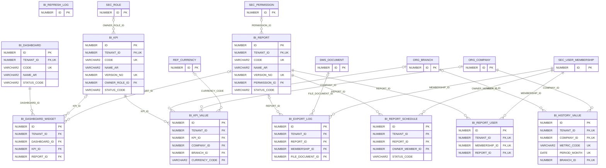

# ERD — الحزمة 22: التقارير وذكاء الأعمال

**Reporting & Business Intelligence** · الحزمة البرمجية `NOONA_BI_PKG` · عدد الجداول: **10**

طبقة تعريف المقاييس KPIs بإصدارات، وكتالوج التقارير ولوحات المعلومات، وسجل التصدير، وجدولة التقارير، ومتابعة تحديث الملخصات؛ مع تطبيق Tenant و Data Scope على المصدر والتصدير.

الجداول الخارجية المرتبطة (من حزم أخرى): `DMS_DOCUMENT`, `ORG_BRANCH`, `ORG_COMPANY`, `REF_CURRENCY`, `SEC_PERMISSION`, `SEC_ROLE`, `SEC_USER_MEMBERSHIP`

## الجداول

| الجدول | الاسم العربي | English | النطاق |
|---|---|---|---|
| `BI_KPI` | تعريفات المؤشرات | KPI Definitions | TO |
| `BI_KPI_VALUE` | قيم المؤشرات | KPI Snapshots | T |
| `BI_REPORT` | كتالوج التقارير | Report Catalog | TO |
| `BI_REPORT_USER` | تقارير المستخدم المفضلة والأخيرة | User Favourite & Recent Reports | T |
| `BI_DASHBOARD` | لوحات المعلومات | Dashboards | TO |
| `BI_DASHBOARD_WIDGET` | عناصر اللوحات | Dashboard Widgets | TO |
| `BI_REPORT_SCHEDULE` | جدولة التقارير | Report Schedules | T |
| `BI_EXPORT_LOG` | سجل التصدير | Export Log | T |
| `BI_REFRESH_LOG` | سجل تحديث الملخصات | Summary Refresh Log | G |
| `BI_HISTORY_VALUE` | أرقام السنوات السابقة | Prior Years Figures | C |
