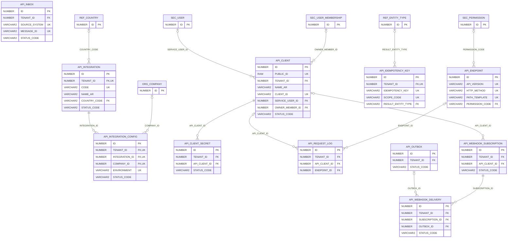

# ERD — الحزمة 23: ORDS وواجهات API والتكاملات

**ORDS, APIs & Integrations** · الحزمة البرمجية `NOONA_API_PKG` · عدد الجداول: **11**

Integration Matrix، وعملاء API وأسرارهم بمراجع Vault، وسجل نقاط النهاية بإصداراتها، وسجل الطلبات، ومفاتيح Idempotency، و Outbox/Inbox للأحداث الصادرة والواردة مع Retry و Dead-Letter، والـWebhooks.

الجداول الخارجية المرتبطة (من حزم أخرى): `ORG_COMPANY`, `REF_COUNTRY`, `REF_ENTITY_TYPE`, `SEC_PERMISSION`, `SEC_USER`, `SEC_USER_MEMBERSHIP`

## الجداول

| الجدول | الاسم العربي | English | النطاق |
|---|---|---|---|
| `API_INTEGRATION` | مصفوفة التكاملات | Integration Matrix | TO |
| `API_INTEGRATION_CONFIG` | إعدادات التكامل للمؤسسة | Tenant Integration Config | T |
| `API_CLIENT` | عملاء API | API Clients | T |
| `API_CLIENT_SECRET` | أسرار عملاء API | API Client Secrets | T |
| `API_ENDPOINT` | نقاط النهاية | API Endpoints | G |
| `API_REQUEST_LOG` | سجل طلبات API | API Request Log | TO |
| `API_IDEMPOTENCY_KEY` | مفاتيح منع التكرار | Idempotency Keys | T |
| `API_OUTBOX` | صندوق الأحداث الصادرة | Transactional Outbox | TO |
| `API_INBOX` | صندوق الرسائل الواردة | Inbound Message Inbox | TO |
| `API_WEBHOOK_SUBSCRIPTION` | اشتراكات Webhook | Webhook Subscriptions | T |
| `API_WEBHOOK_DELIVERY` | تسليمات Webhook | Webhook Deliveries | T |
