# ERD — الحزمة 24: الذكاء الاصطناعي و RAG والوكلاء

**AI, RAG & Agents** · الحزمة البرمجية `NOONA_AI_PKG` · عدد الجداول: **15**

بنية جاهزة لإضافة AI لاحقاً: المزودون والنماذج وإعدادات المؤسسة، ومصادر المعرفة والقطع المفهرسة (Embeddings تخزن BLOB على 21c وتنقل إلى VECTOR عند الترقية إلى 23ai/26ai)، والمحادثات والاسترجاع والاقتباسات، والأدوات READ/DRAFT/SUBMIT، والاستهلاك والتقييم. كل استرجاع يسبقه فحص Tenant والصلاحية.

الجداول الخارجية المرتبطة (من حزم أخرى): `COR_CORRESPONDENCE`, `DMS_DOCUMENT`, `DMS_DOCUMENT_VERSION`, `ORG_COMPANY`, `REF_LANGUAGE`, `SEC_PERMISSION`, `SEC_USER_MEMBERSHIP`

```mermaid
erDiagram
  AI_PROVIDER {
    NUMBER ID PK
    NUMBER TENANT_ID FK,UK
    VARCHAR2 CODE UK
    VARCHAR2 NAME_AR
    VARCHAR2 STATUS_CODE
  }
  AI_MODEL {
    NUMBER ID PK
    NUMBER TENANT_ID FK,UK
    VARCHAR2 CODE UK
    VARCHAR2 NAME_AR
    NUMBER PROVIDER_ID FK
    VARCHAR2 STATUS_CODE
  }
  AI_TENANT_SETTING {
    NUMBER ID PK
    NUMBER TENANT_ID FK,UK
    NUMBER CHAT_MODEL_ID FK
    NUMBER EMBEDDING_MODEL_ID FK
  }
  AI_KNOWLEDGE_SOURCE {
    NUMBER ID PK
    NUMBER TENANT_ID FK,UK
    VARCHAR2 CODE UK
    VARCHAR2 NAME_AR
    NUMBER COMPANY_ID FK
    VARCHAR2 STATUS_CODE
  }
  AI_DOCUMENT_CHUNK {
    NUMBER ID PK
    NUMBER TENANT_ID FK
    NUMBER SOURCE_ID FK
    NUMBER DOCUMENT_ID FK
    NUMBER VERSION_ID FK
    NUMBER CORRESPONDENCE_ID FK
    NUMBER COMPANY_ID FK
    VARCHAR2 LANGUAGE_CODE FK
    NUMBER EMBEDDING_MODEL_ID FK
    VARCHAR2 STATUS_CODE
  }
  AI_INDEX_JOB {
    NUMBER ID PK
    NUMBER TENANT_ID FK
    NUMBER DOCUMENT_ID FK
    NUMBER VERSION_ID FK
    NUMBER CORRESPONDENCE_ID FK
    VARCHAR2 STATUS_CODE
  }
  AI_CONVERSATION {
    NUMBER ID PK
    NUMBER TENANT_ID FK
    NUMBER MEMBERSHIP_ID FK
    NUMBER COMPANY_ID FK
    VARCHAR2 STATUS_CODE
  }
  AI_MESSAGE {
    NUMBER ID PK
    NUMBER TENANT_ID FK
    NUMBER CONVERSATION_ID FK
    NUMBER MODEL_ID FK
  }
  AI_RETRIEVAL {
    NUMBER ID PK
    NUMBER TENANT_ID FK
    NUMBER MESSAGE_ID FK
    NUMBER CHUNK_ID FK
  }
  AI_TOOL {
    NUMBER ID PK
    NUMBER TENANT_ID FK,UK
    VARCHAR2 CODE UK
    VARCHAR2 NAME_AR
    VARCHAR2 PERMISSION_CODE FK
    VARCHAR2 STATUS_CODE
  }
  AI_TOOL_CALL {
    NUMBER ID PK
    NUMBER TENANT_ID FK
    NUMBER MESSAGE_ID FK
    NUMBER TOOL_ID FK
    NUMBER ACTOR_MEMBER_ID FK
  }
  AI_PROMPT_TEMPLATE {
    NUMBER ID PK
    NUMBER TENANT_ID FK,UK
    VARCHAR2 CODE UK
    VARCHAR2 NAME_AR
    NUMBER VERSION_NO UK
    VARCHAR2 LANGUAGE_CODE FK
    VARCHAR2 STATUS_CODE
  }
  AI_USAGE {
    NUMBER ID PK
    NUMBER TENANT_ID FK,UK
    DATE USAGE_DATE UK
    NUMBER MODEL_ID FK,UK
    VARCHAR2 FEATURE_CODE UK
  }
  AI_FEEDBACK {
    NUMBER ID PK
    NUMBER TENANT_ID FK
    NUMBER MESSAGE_ID FK
    NUMBER MEMBERSHIP_ID FK
  }
  AI_EVAL_CASE {
    NUMBER ID PK
    NUMBER TENANT_ID FK,UK
    VARCHAR2 CODE UK
    VARCHAR2 STATUS_CODE
  }
  ORG_COMPANY {
    NUMBER ID PK
  }
  DMS_DOCUMENT {
    NUMBER ID PK
  }
  DMS_DOCUMENT_VERSION {
    NUMBER ID PK
  }
  COR_CORRESPONDENCE {
    NUMBER ID PK
  }
  REF_LANGUAGE {
    NUMBER ID PK
  }
  SEC_USER_MEMBERSHIP {
    NUMBER ID PK
  }
  SEC_PERMISSION {
    NUMBER ID PK
  }
  AI_CONVERSATION ||--o{ AI_MESSAGE : "CONVERSATION_ID"
  AI_DOCUMENT_CHUNK ||--o{ AI_RETRIEVAL : "CHUNK_ID"
  AI_KNOWLEDGE_SOURCE |o--o{ AI_DOCUMENT_CHUNK : "SOURCE_ID"
  AI_MESSAGE ||--o{ AI_FEEDBACK : "MESSAGE_ID"
  AI_MESSAGE ||--o{ AI_RETRIEVAL : "MESSAGE_ID"
  AI_MESSAGE ||--o{ AI_TOOL_CALL : "MESSAGE_ID"
  AI_MODEL |o--o{ AI_DOCUMENT_CHUNK : "EMBEDDING_MODEL_ID"
  AI_MODEL |o--o{ AI_MESSAGE : "MODEL_ID"
  AI_MODEL |o--o{ AI_TENANT_SETTING : "CHAT_MODEL_ID"
  AI_MODEL |o--o{ AI_TENANT_SETTING : "EMBEDDING_MODEL_ID"
  AI_MODEL ||--o{ AI_USAGE : "MODEL_ID"
  AI_PROVIDER ||--o{ AI_MODEL : "PROVIDER_ID"
  AI_TOOL ||--o{ AI_TOOL_CALL : "TOOL_ID"
  COR_CORRESPONDENCE |o--o{ AI_DOCUMENT_CHUNK : "CORRESPONDENCE_ID"
  COR_CORRESPONDENCE |o--o{ AI_INDEX_JOB : "CORRESPONDENCE_ID"
  DMS_DOCUMENT |o--o{ AI_DOCUMENT_CHUNK : "DOCUMENT_ID"
  DMS_DOCUMENT |o--o{ AI_INDEX_JOB : "DOCUMENT_ID"
  DMS_DOCUMENT_VERSION |o--o{ AI_DOCUMENT_CHUNK : "VERSION_ID"
  DMS_DOCUMENT_VERSION |o--o{ AI_INDEX_JOB : "VERSION_ID"
  ORG_COMPANY |o--o{ AI_CONVERSATION : "COMPANY_ID"
  ORG_COMPANY |o--o{ AI_DOCUMENT_CHUNK : "COMPANY_ID"
  ORG_COMPANY |o--o{ AI_KNOWLEDGE_SOURCE : "COMPANY_ID"
  REF_LANGUAGE |o--o{ AI_DOCUMENT_CHUNK : "LANGUAGE_CODE"
  REF_LANGUAGE |o--o{ AI_PROMPT_TEMPLATE : "LANGUAGE_CODE"
  SEC_PERMISSION |o--o{ AI_TOOL : "PERMISSION_CODE"
  SEC_USER_MEMBERSHIP ||--o{ AI_CONVERSATION : "MEMBERSHIP_ID"
  SEC_USER_MEMBERSHIP ||--o{ AI_FEEDBACK : "MEMBERSHIP_ID"
  SEC_USER_MEMBERSHIP ||--o{ AI_TOOL_CALL : "ACTOR_MEMBER_ID"
```

## الجداول

| الجدول | الاسم العربي | English | النطاق |
|---|---|---|---|
| `AI_PROVIDER` | مزودو الذكاء الاصطناعي | AI Providers | TO |
| `AI_MODEL` | النماذج | AI Models | TO |
| `AI_TENANT_SETTING` | إعدادات AI للمؤسسة | Tenant AI Settings | T |
| `AI_KNOWLEDGE_SOURCE` | مصادر المعرفة | Knowledge Sources | T |
| `AI_DOCUMENT_CHUNK` | قطع المعرفة المفهرسة | Indexed Knowledge Chunks | T |
| `AI_INDEX_JOB` | مهام الفهرسة | Indexing Jobs | T |
| `AI_CONVERSATION` | المحادثات | Conversations | T |
| `AI_MESSAGE` | رسائل المحادثة | Conversation Messages | T |
| `AI_RETRIEVAL` | سجل الاسترجاع | Retrieval Log | T |
| `AI_TOOL` | أدوات الوكيل | AI Tools | TO |
| `AI_TOOL_CALL` | استدعاءات الأدوات | Tool Calls | T |
| `AI_PROMPT_TEMPLATE` | قوالب التعليمات | Prompt Templates | TO |
| `AI_USAGE` | استهلاك AI | AI Usage | T |
| `AI_FEEDBACK` | تقييم الإجابات | Answer Feedback | T |
| `AI_EVAL_CASE` | حالات تقييم AI | AI Evaluation Cases | TO |
