# ERD — الحزمة 25: حزم الدول والتوطين والضرائب

**Country Packs, Localization & Tax Engine** · الحزمة البرمجية `NOONA_LOCALIZATION_PKG` · عدد الجداول: **15**

Country Pack لكل دولة بإصدارات مؤرخة (السعودية، الإمارات، قطر، عمان، البحرين، الكويت، السودان)، ومحرك الضرائب المركزي (تحديد ← قواعد ← احتساب ← محاسبة ← إقرار/فاتورة إلكترونية) وطبقة الفوترة الإلكترونية بمحولات مستقلة لكل دولة. القواعد إعدادات ذات إصدارات وليست قيماً ثابتة في PL/SQL.

الجداول الخارجية المرتبطة (من حزم أخرى): `DMS_DOCUMENT`, `GL_ACCOUNT`, `INV_ITEM`, `ORG_BRANCH`, `ORG_COMPANY`, `ORG_LEGAL_REGISTRATION`, `PRJ_PROJECT`, `PTY_PARTY`, `REF_COUNTRY`, `REF_CURRENCY`, `REF_ENTITY_TYPE`, `WF_INSTANCE`

```mermaid
erDiagram
  LOC_COUNTRY_PACK {
    NUMBER ID PK
    VARCHAR2 CODE
    VARCHAR2 NAME_AR
    VARCHAR2 COUNTRY_CODE FK,UK
    NUMBER VERSION_NO UK
    VARCHAR2 STATUS_CODE
  }
  LOC_LEGAL_FORM {
    NUMBER ID PK
    VARCHAR2 CODE UK
    VARCHAR2 NAME_AR
    NUMBER COUNTRY_PACK_ID FK,UK
  }
  LOC_REGISTRATION_TYPE {
    NUMBER ID PK
    NUMBER TENANT_ID FK,UK
    VARCHAR2 CODE UK
    VARCHAR2 NAME_AR
    NUMBER COUNTRY_PACK_ID FK,UK
  }
  LOC_TAX_TYPE {
    NUMBER ID PK
    NUMBER TENANT_ID FK,UK
    VARCHAR2 CODE UK
    VARCHAR2 NAME_AR
    NUMBER COUNTRY_PACK_ID FK,UK
  }
  LOC_TAX_CODE {
    NUMBER ID PK
    NUMBER TENANT_ID FK,UK
    VARCHAR2 CODE UK
    VARCHAR2 NAME_AR
    NUMBER TAX_TYPE_ID FK,UK
    VARCHAR2 STATUS_CODE
  }
  LOC_TAX_RATE {
    NUMBER ID PK
    NUMBER TENANT_ID FK
    NUMBER TAX_CODE_ID FK,UK
    NUMBER VERSION_NO UK
  }
  LOC_TAX_RULE {
    NUMBER ID PK
    NUMBER TENANT_ID FK,UK
    VARCHAR2 CODE UK
    VARCHAR2 NAME_AR
    NUMBER COUNTRY_PACK_ID FK
    NUMBER VERSION_NO UK
    NUMBER RESULT_TAX_CODE_ID FK
    VARCHAR2 STATUS_CODE
  }
  LOC_TAX_ACCOUNT {
    NUMBER ID PK
    NUMBER TENANT_ID FK,UK
    NUMBER COMPANY_ID FK,UK
    NUMBER TAX_CODE_ID FK,UK
    NUMBER PAYABLE_ACCOUNT_ID FK
    NUMBER RECOVERABLE_ACCOUNT_ID FK
    NUMBER NON_RECOVERABLE_ACCOUNT_ID FK
    NUMBER WITHHOLDING_ACCOUNT_ID FK
    NUMBER ROUNDING_ACCOUNT_ID FK
    DATE EFFECTIVE_FROM UK
  }
  LOC_TAX_EXEMPTION {
    NUMBER ID PK
    NUMBER TENANT_ID FK
    NUMBER PARTY_ID FK
    NUMBER ITEM_ID FK
    NUMBER PROJECT_ID FK
    NUMBER TAX_CODE_ID FK
    NUMBER DOCUMENT_ID FK
    VARCHAR2 STATUS_CODE
    NUMBER WF_INSTANCE_ID FK
  }
  LOC_TAX_LINE {
    NUMBER ID PK
    NUMBER TENANT_ID FK
    NUMBER COMPANY_ID FK
    VARCHAR2 SOURCE_ENTITY_TYPE FK
    NUMBER TAX_CODE_ID FK
    NUMBER TAX_RATE_ID FK
    NUMBER TAX_RULE_ID FK
    NUMBER EXEMPTION_ID FK
    VARCHAR2 CURRENCY_CODE FK
    NUMBER TAX_RETURN_ID FK
  }
  LOC_TAX_RETURN {
    NUMBER ID PK
    NUMBER TENANT_ID FK,UK
    NUMBER COMPANY_ID FK,UK
    NUMBER TAX_TYPE_ID FK,UK
    NUMBER REGISTRATION_ID FK
    DATE PERIOD_START UK
    NUMBER FILING_DOCUMENT_ID FK
    VARCHAR2 STATUS_CODE
    NUMBER WF_INSTANCE_ID FK
  }
  LOC_TAX_RETURN_LINE {
    NUMBER ID PK
    NUMBER TENANT_ID FK
    NUMBER TAX_RETURN_ID FK,UK
    VARCHAR2 BOX_CODE UK
  }
  LOC_WITHHOLDING_CERT {
    NUMBER ID PK
    NUMBER TENANT_ID FK,UK
    NUMBER COMPANY_ID FK,UK
    VARCHAR2 CERTIFICATE_NO UK
    NUMBER PARTY_ID FK
    NUMBER TAX_CODE_ID FK
    VARCHAR2 CURRENCY_CODE FK
    NUMBER DOCUMENT_ID FK
    VARCHAR2 STATUS_CODE
  }
  LOC_EINVOICE_PROFILE {
    NUMBER ID PK
    NUMBER TENANT_ID FK
    NUMBER COMPANY_ID FK
    NUMBER BRANCH_ID FK
    NUMBER COUNTRY_PACK_ID FK
    VARCHAR2 STATUS_CODE
  }
  LOC_EINVOICE_SUBMISSION {
    NUMBER ID PK
    NUMBER TENANT_ID FK,UK
    NUMBER COMPANY_ID FK
    VARCHAR2 SOURCE_ENTITY_TYPE FK
    NUMBER PROFILE_ID FK
    VARCHAR2 INVOICE_UUID UK
    VARCHAR2 IDEMPOTENCY_KEY UK
    NUMBER REQUEST_DOCUMENT_ID FK
    NUMBER RESPONSE_DOCUMENT_ID FK
    NUMBER LEGAL_DOCUMENT_ID FK
    VARCHAR2 STATUS_CODE
  }
  REF_COUNTRY {
    NUMBER ID PK
  }
  ORG_COMPANY {
    NUMBER ID PK
  }
  GL_ACCOUNT {
    NUMBER ID PK
  }
  PTY_PARTY {
    NUMBER ID PK
  }
  INV_ITEM {
    NUMBER ID PK
  }
  PRJ_PROJECT {
    NUMBER ID PK
  }
  DMS_DOCUMENT {
    NUMBER ID PK
  }
  WF_INSTANCE {
    NUMBER ID PK
  }
  REF_ENTITY_TYPE {
    NUMBER ID PK
  }
  REF_CURRENCY {
    NUMBER ID PK
  }
  ORG_LEGAL_REGISTRATION {
    NUMBER ID PK
  }
  ORG_BRANCH {
    NUMBER ID PK
  }
  DMS_DOCUMENT |o--o{ LOC_EINVOICE_SUBMISSION : "LEGAL_DOCUMENT_ID"
  DMS_DOCUMENT |o--o{ LOC_EINVOICE_SUBMISSION : "REQUEST_DOCUMENT_ID"
  DMS_DOCUMENT |o--o{ LOC_EINVOICE_SUBMISSION : "RESPONSE_DOCUMENT_ID"
  DMS_DOCUMENT |o--o{ LOC_TAX_EXEMPTION : "DOCUMENT_ID"
  DMS_DOCUMENT |o--o{ LOC_TAX_RETURN : "FILING_DOCUMENT_ID"
  DMS_DOCUMENT |o--o{ LOC_WITHHOLDING_CERT : "DOCUMENT_ID"
  GL_ACCOUNT |o--o{ LOC_TAX_ACCOUNT : "NON_RECOVERABLE_ACCOUNT_ID"
  GL_ACCOUNT |o--o{ LOC_TAX_ACCOUNT : "PAYABLE_ACCOUNT_ID"
  GL_ACCOUNT |o--o{ LOC_TAX_ACCOUNT : "RECOVERABLE_ACCOUNT_ID"
  GL_ACCOUNT |o--o{ LOC_TAX_ACCOUNT : "ROUNDING_ACCOUNT_ID"
  GL_ACCOUNT |o--o{ LOC_TAX_ACCOUNT : "WITHHOLDING_ACCOUNT_ID"
  INV_ITEM |o--o{ LOC_TAX_EXEMPTION : "ITEM_ID"
  LOC_COUNTRY_PACK |o--o{ LOC_REGISTRATION_TYPE : "COUNTRY_PACK_ID"
  LOC_COUNTRY_PACK |o--o{ LOC_TAX_RULE : "COUNTRY_PACK_ID"
  LOC_COUNTRY_PACK |o--o{ LOC_TAX_TYPE : "COUNTRY_PACK_ID"
  LOC_COUNTRY_PACK ||--o{ LOC_EINVOICE_PROFILE : "COUNTRY_PACK_ID"
  LOC_COUNTRY_PACK ||--o{ LOC_LEGAL_FORM : "COUNTRY_PACK_ID"
  LOC_EINVOICE_PROFILE ||--o{ LOC_EINVOICE_SUBMISSION : "PROFILE_ID"
  LOC_TAX_CODE ||--o{ LOC_TAX_ACCOUNT : "TAX_CODE_ID"
  LOC_TAX_CODE ||--o{ LOC_TAX_EXEMPTION : "TAX_CODE_ID"
  LOC_TAX_CODE ||--o{ LOC_TAX_LINE : "TAX_CODE_ID"
  LOC_TAX_CODE ||--o{ LOC_TAX_RATE : "TAX_CODE_ID"
  LOC_TAX_CODE ||--o{ LOC_TAX_RULE : "RESULT_TAX_CODE_ID"
  LOC_TAX_CODE ||--o{ LOC_WITHHOLDING_CERT : "TAX_CODE_ID"
  LOC_TAX_EXEMPTION |o--o{ LOC_TAX_LINE : "EXEMPTION_ID"
  LOC_TAX_RATE |o--o{ LOC_TAX_LINE : "TAX_RATE_ID"
  LOC_TAX_RETURN |o--o{ LOC_TAX_LINE : "TAX_RETURN_ID"
  LOC_TAX_RETURN ||--o{ LOC_TAX_RETURN_LINE : "TAX_RETURN_ID"
  LOC_TAX_RULE |o--o{ LOC_TAX_LINE : "TAX_RULE_ID"
  LOC_TAX_TYPE ||--o{ LOC_TAX_CODE : "TAX_TYPE_ID"
  LOC_TAX_TYPE ||--o{ LOC_TAX_RETURN : "TAX_TYPE_ID"
  ORG_BRANCH |o--o{ LOC_EINVOICE_PROFILE : "BRANCH_ID"
  ORG_COMPANY ||--o{ LOC_EINVOICE_PROFILE : "COMPANY_ID"
  ORG_COMPANY ||--o{ LOC_EINVOICE_SUBMISSION : "COMPANY_ID"
  ORG_COMPANY ||--o{ LOC_TAX_ACCOUNT : "COMPANY_ID"
  ORG_COMPANY ||--o{ LOC_TAX_LINE : "COMPANY_ID"
  ORG_COMPANY ||--o{ LOC_TAX_RETURN : "COMPANY_ID"
  ORG_COMPANY ||--o{ LOC_WITHHOLDING_CERT : "COMPANY_ID"
  ORG_LEGAL_REGISTRATION |o--o{ LOC_TAX_RETURN : "REGISTRATION_ID"
  PRJ_PROJECT |o--o{ LOC_TAX_EXEMPTION : "PROJECT_ID"
  PTY_PARTY |o--o{ LOC_TAX_EXEMPTION : "PARTY_ID"
  PTY_PARTY ||--o{ LOC_WITHHOLDING_CERT : "PARTY_ID"
  REF_COUNTRY ||--o{ LOC_COUNTRY_PACK : "COUNTRY_CODE"
  REF_CURRENCY ||--o{ LOC_TAX_LINE : "CURRENCY_CODE"
  REF_CURRENCY ||--o{ LOC_WITHHOLDING_CERT : "CURRENCY_CODE"
  REF_ENTITY_TYPE |o--o{ LOC_EINVOICE_SUBMISSION : "SOURCE_ENTITY_TYPE"
  REF_ENTITY_TYPE |o--o{ LOC_TAX_LINE : "SOURCE_ENTITY_TYPE"
  WF_INSTANCE |o--o{ LOC_TAX_EXEMPTION : "WF_INSTANCE_ID"
  WF_INSTANCE |o--o{ LOC_TAX_RETURN : "WF_INSTANCE_ID"
```

## الجداول

| الجدول | الاسم العربي | English | النطاق |
|---|---|---|---|
| `LOC_COUNTRY_PACK` | حزم الدول | Country Packs | G |
| `LOC_LEGAL_FORM` | الأشكال القانونية | Legal Entity Forms | G |
| `LOC_REGISTRATION_TYPE` | أنواع التسجيلات القانونية | Registration Types | TO |
| `LOC_TAX_TYPE` | أنواع الضرائب | Tax Types | TO |
| `LOC_TAX_CODE` | أكواد الضرائب | Tax Codes | TO |
| `LOC_TAX_RATE` | إصدارات نسب الضرائب | Tax Rate Versions | TO |
| `LOC_TAX_RULE` | قواعد تحديد الضريبة | Tax Determination Rules | TO |
| `LOC_TAX_ACCOUNT` | حسابات الضرائب للشركة | Company Tax Accounts | C |
| `LOC_TAX_EXEMPTION` | شهادات الإعفاء الضريبي | Tax Exemption Certificates | T |
| `LOC_TAX_LINE` | أسطر الضرائب المحتسبة | Tax Lines (Engine Output) | C |
| `LOC_TAX_RETURN` | الإقرارات الضريبية | Tax Returns | C |
| `LOC_TAX_RETURN_LINE` | خانات الإقرار | Tax Return Boxes | T |
| `LOC_WITHHOLDING_CERT` | شهادات الاستقطاع | Withholding Certificates | C |
| `LOC_EINVOICE_PROFILE` | إعدادات الفوترة الإلكترونية | E-Invoicing Profiles | C |
| `LOC_EINVOICE_SUBMISSION` | إرسالات الفوترة الإلكترونية | E-Invoice Submissions | C |
