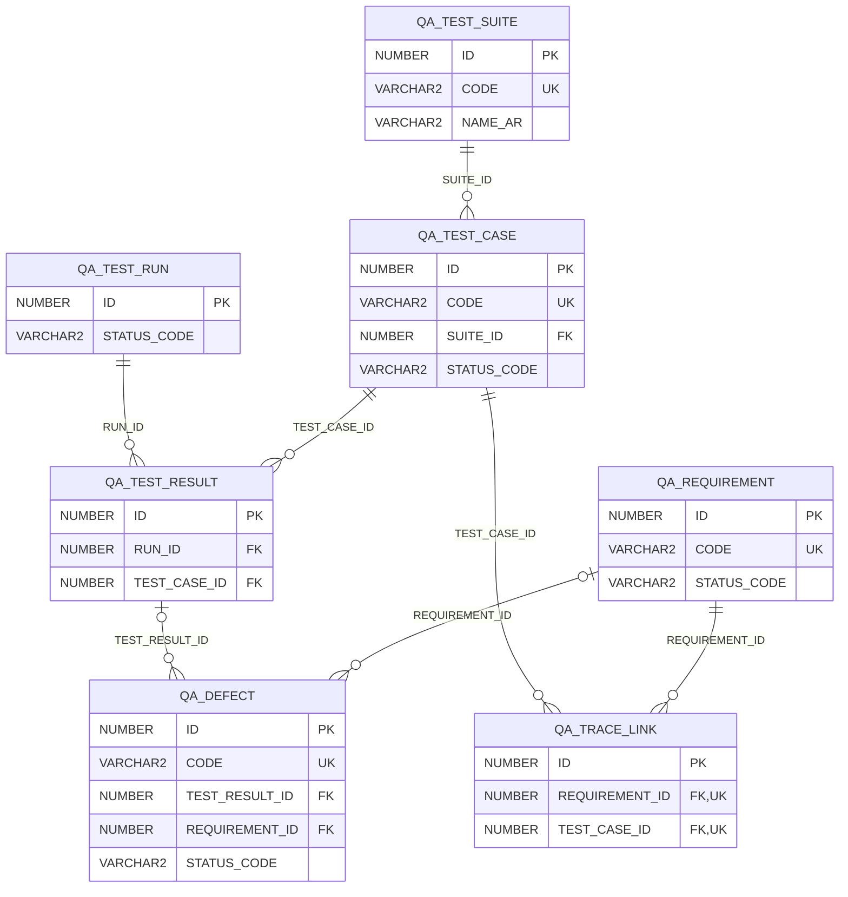

# ERD — الحزمة 26: الاختبار الشامل وضمان الجودة

**Quality Assurance & Traceability** · الحزمة البرمجية `NOONA_QA_PKG` · عدد الجداول: **7**

سجل المتطلبات وقواعد الأعمال (FR/NFR/BR) وربطها بحالات الاختبار وتشغيلاتها والعيوب، لتحقيق Traceability من المتطلب إلى الاختبار إلى الإصدار.

## الجداول

| الجدول | الاسم العربي | English | النطاق |
|---|---|---|---|
| `QA_REQUIREMENT` | سجل المتطلبات | Requirements Register | G |
| `QA_TEST_SUITE` | مجموعات الاختبار | Test Suites | G |
| `QA_TEST_CASE` | حالات الاختبار | Test Cases | G |
| `QA_TRACE_LINK` | روابط التتبع | Traceability Links | G |
| `QA_TEST_RUN` | تشغيلات الاختبار | Test Runs | G |
| `QA_TEST_RESULT` | نتائج الاختبار | Test Results | G |
| `QA_DEFECT` | العيوب | Defects | G |
