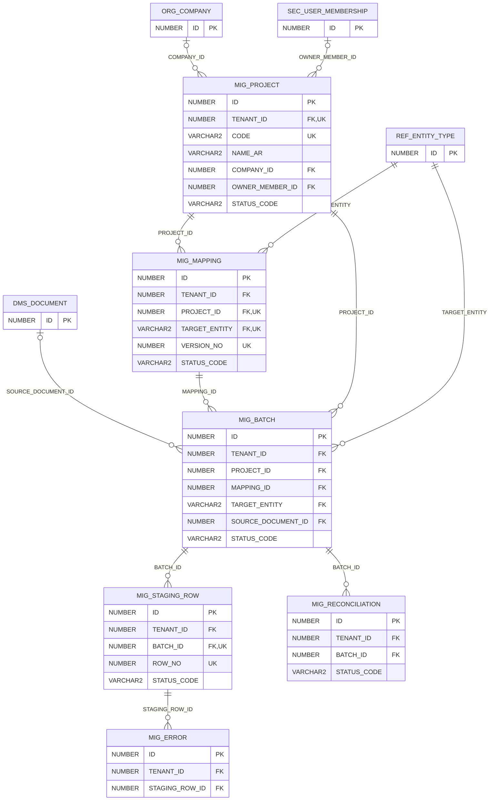

# ERD — الحزمة 27: ترحيل البيانات

**Data Migration** · الحزمة البرمجية `NOONA_MIGRATION_PKG` · عدد الجداول: **6**

تحميل بيانات العملاء من الأنظمة السابقة عبر Staging بحمولة JSON، وتعيين الحقول، والتحقق والمعاينة وتقرير الأخطاء قبل الاعتماد، ثم المطابقة (عدد السجلات والأرصدة) مع إمكانية الإلغاء.

الجداول الخارجية المرتبطة (من حزم أخرى): `DMS_DOCUMENT`, `ORG_COMPANY`, `REF_ENTITY_TYPE`, `SEC_USER_MEMBERSHIP`

## الجداول

| الجدول | الاسم العربي | English | النطاق |
|---|---|---|---|
| `MIG_PROJECT` | مشروعات الترحيل | Migration Projects | T |
| `MIG_MAPPING` | تعيين الحقول | Field Mappings | T |
| `MIG_BATCH` | دفعات الترحيل | Migration Batches | T |
| `MIG_STAGING_ROW` | سجلات التجهيز | Staging Rows | T |
| `MIG_ERROR` | أخطاء الترحيل | Migration Errors | T |
| `MIG_RECONCILIATION` | مطابقة الترحيل | Migration Reconciliation | T |
