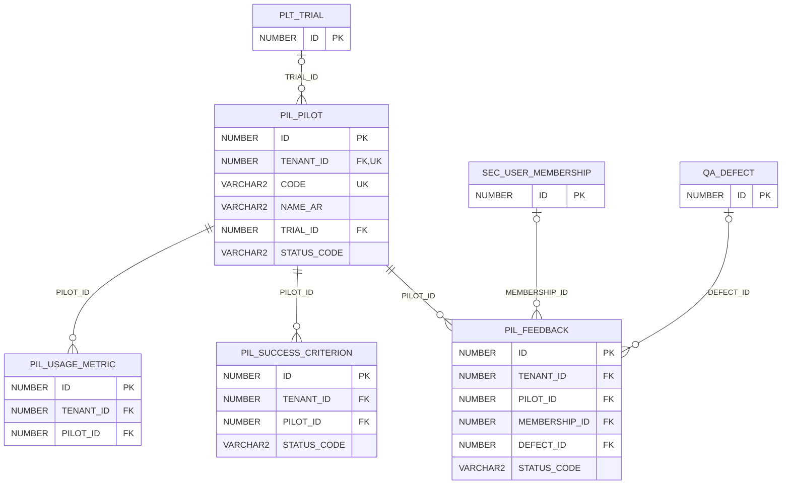

# ERD — الحزمة 28: الإطلاق التجريبي

**Pilot Launch** · الحزمة البرمجية `NOONA_PILOT_PKG` · عدد الجداول: **4**

إدارة الإطلاق التجريبي لعميل مؤسس: النطاق والمستخدمون ومعايير النجاح والملاحظات والقياس وقرار الانتقال إلى الإنتاج ومصير البيانات.

الجداول الخارجية المرتبطة (من حزم أخرى): `PLT_TRIAL`, `QA_DEFECT`, `SEC_USER_MEMBERSHIP`

## الجداول

| الجدول | الاسم العربي | English | النطاق |
|---|---|---|---|
| `PIL_PILOT` | المشروعات التجريبية | Pilots | T |
| `PIL_SUCCESS_CRITERION` | معايير النجاح | Success Criteria | T |
| `PIL_FEEDBACK` | ملاحظات المستخدمين | Pilot Feedback | T |
| `PIL_USAGE_METRIC` | مقاييس الاستخدام التجريبي | Pilot Usage Metrics | T |
