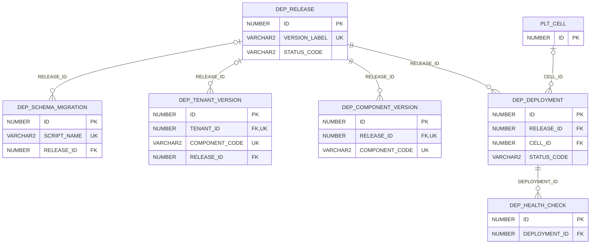

# ERD — الحزمة 29: النشر الإنتاجي والإصدارات

**Deployment & Release Management** · الحزمة البرمجية `NOONA_DEPLOYMENT_PKG` · عدد الجداول: **6**

سجل الإصدارات وقنوات النشر Internal → Pilot → Early Access → GA → On-Premises، وسجل ترحيلات المخطط (Migration Scripts مرقمة لا تعدل بعد النشر)، ونشر كل بيئة/خلية وفحوص الصحة وإصدارات مكونات كل Tenant.

الجداول الخارجية المرتبطة (من حزم أخرى): `PLT_CELL`

## الجداول

| الجدول | الاسم العربي | English | النطاق |
|---|---|---|---|
| `DEP_RELEASE` | الإصدارات | Releases | G |
| `DEP_COMPONENT_VERSION` | إصدارات المكونات | Release Component Versions | G |
| `DEP_SCHEMA_MIGRATION` | سجل ترحيلات المخطط | Schema Migrations | G |
| `DEP_DEPLOYMENT` | عمليات النشر | Deployments | G |
| `DEP_HEALTH_CHECK` | فحوص الصحة | Health Checks | G |
| `DEP_TENANT_VERSION` | إصدارات مكونات المؤسسة | Tenant Component Versions | T |
