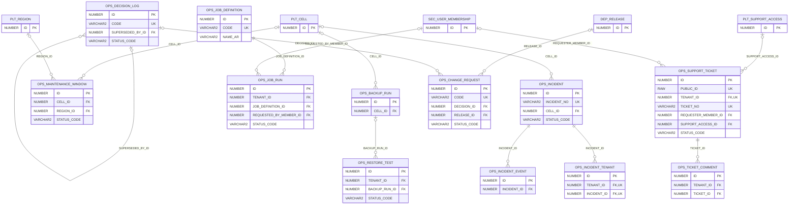

# ERD — الحزمة 30: التشغيل والدعم والتطوير المستمر

**Operations, Support & Continuous Improvement** · الحزمة البرمجية `NOONA_OPERATIONS_PKG` · عدد الجداول: **12**

الحوادث التشغيلية SEV-1..4 وخطها الزمني، ونوافذ الصيانة، وتذاكر الدعم، والمهام الخلفية بطوابير Interactive/Background/Critical لكل Tenant، والنسخ الاحتياطي واختبارات الاستعادة، وسجل القرارات وطلبات التغيير (Change Control).

الجداول الخارجية المرتبطة (من حزم أخرى): `DEP_RELEASE`, `PLT_CELL`, `PLT_REGION`, `PLT_SUPPORT_ACCESS`, `SEC_USER_MEMBERSHIP`

## الجداول

| الجدول | الاسم العربي | English | النطاق |
|---|---|---|---|
| `OPS_INCIDENT` | الحوادث التشغيلية | Operational Incidents | G |
| `OPS_INCIDENT_EVENT` | الخط الزمني للحادث | Incident Timeline | G |
| `OPS_INCIDENT_TENANT` | المؤسسات المتأثرة بالحادث | Incident Affected Tenants | T |
| `OPS_MAINTENANCE_WINDOW` | نوافذ الصيانة | Maintenance Windows | G |
| `OPS_SUPPORT_TICKET` | تذاكر الدعم | Support Tickets | T |
| `OPS_TICKET_COMMENT` | تعليقات التذاكر | Ticket Comments | T |
| `OPS_JOB_DEFINITION` | تعريفات المهام الخلفية | Background Job Definitions | G |
| `OPS_JOB_RUN` | تشغيلات المهام الخلفية | Background Job Runs | TO |
| `OPS_BACKUP_RUN` | عمليات النسخ الاحتياطي | Backup Runs | G |
| `OPS_RESTORE_TEST` | اختبارات الاستعادة | Restore Tests | TO |
| `OPS_DECISION_LOG` | سجل القرارات | Decision Log | G |
| `OPS_CHANGE_REQUEST` | طلبات التغيير | Change Requests | G |
