# ERD — الحزمة 31: المستشفيات والمراكز الطبية

**Hospital & Clinics** · الحزمة البرمجية `NOONA_HIS_PKG` · عدد الجداول: **40**

الأقسام والعيادات والمعامل والأشعة والصيدليات الداخلية والوحدات العلاجية كأقسام مستقلة بمستودعاتها ومراكز تكلفتها، الأطباء وساعات العمل، دليل الخدمات الطبية ومواد كل فحص، شركات التأمين والجهات المتعاقدة بفئاتها وأسعارها، المرضى والحجوزات والزيارات والطلبات الطبية ونتائجها، والفواتير بحصة المريض وحصة الجهة والقيد المحاسبي.

الجداول الخارجية المرتبطة (من حزم أخرى): `ACE_ACCOUNTING_EVENT`, `AR_CUSTOMER_ACCOUNT`, `FA_ASSET`, `GL_ACCOUNT`, `GL_COST_CENTER`, `HR_EMPLOYEE`, `INV_ITEM`, `INV_TRANSACTION`, `INV_WAREHOUSE`, `ORG_BRANCH`, `ORG_COMPANY`, `REF_COUNTRY`, `SAL_BUNDLE`

```mermaid
erDiagram
  HIS_DEPARTMENT {
    NUMBER ID PK
    NUMBER TENANT_ID FK,UK
    NUMBER COMPANY_ID FK,UK
    VARCHAR2 CODE UK
    VARCHAR2 NAME_AR
    NUMBER WAREHOUSE_ID FK
    NUMBER COST_CENTER_ID FK
    NUMBER REVENUE_ACCOUNT_ID FK
    VARCHAR2 STATUS_CODE
  }
  HIS_SERVICE {
    NUMBER ID PK
    NUMBER TENANT_ID FK,UK
    NUMBER COMPANY_ID FK,UK
    VARCHAR2 CODE UK
    VARCHAR2 NAME_AR
    NUMBER DEPARTMENT_ID FK
    NUMBER ITEM_ID FK
    VARCHAR2 STATUS_CODE
  }
  HIS_SERVICE_MATERIAL {
    NUMBER ID PK
    NUMBER TENANT_ID FK
    NUMBER COMPANY_ID FK
    NUMBER SERVICE_ID FK,UK
    NUMBER ITEM_ID FK,UK
  }
  HIS_DOCTOR {
    NUMBER ID PK
    NUMBER TENANT_ID FK,UK
    NUMBER COMPANY_ID FK,UK
    VARCHAR2 CODE UK
    VARCHAR2 NAME_AR
    NUMBER DEPARTMENT_ID FK
    NUMBER EMPLOYEE_ID FK
    NUMBER CONSULT_SERVICE_ID FK
    VARCHAR2 STATUS_CODE
  }
  HIS_DOCTOR_SCHEDULE {
    NUMBER ID PK
    NUMBER TENANT_ID FK
    NUMBER COMPANY_ID FK
    NUMBER DOCTOR_ID FK
    NUMBER DEPARTMENT_ID FK
  }
  HIS_PAYER {
    NUMBER ID PK
    NUMBER TENANT_ID FK,UK
    NUMBER COMPANY_ID FK,UK
    VARCHAR2 CODE UK
    VARCHAR2 NAME_AR
    NUMBER CUSTOMER_ACCOUNT_ID FK
    NUMBER INTEGRATION_ID FK
    VARCHAR2 STATUS_CODE
  }
  HIS_PAYER_PLAN {
    NUMBER ID PK
    NUMBER TENANT_ID FK
    NUMBER COMPANY_ID FK
    VARCHAR2 CODE UK
    VARCHAR2 NAME_AR
    NUMBER PAYER_ID FK,UK
  }
  HIS_PAYER_PRICE {
    NUMBER ID PK
    NUMBER TENANT_ID FK
    NUMBER COMPANY_ID FK
    NUMBER PAYER_ID FK,UK
    NUMBER SERVICE_ID FK,UK
  }
  HIS_PATIENT {
    NUMBER ID PK
    RAW PUBLIC_ID UK
    NUMBER TENANT_ID FK,UK
    NUMBER COMPANY_ID FK,UK
    VARCHAR2 MRN UK
    VARCHAR2 NAME_AR
    VARCHAR2 NATIONALITY FK
    NUMBER PAYER_PLAN_ID FK
    NUMBER CUSTOMER_ACCOUNT_ID FK
    VARCHAR2 STATUS_CODE
  }
  HIS_APPOINTMENT {
    NUMBER ID PK
    NUMBER TENANT_ID FK,UK
    NUMBER COMPANY_ID FK,UK
    VARCHAR2 APPT_NO UK
    NUMBER PATIENT_ID FK
    NUMBER DOCTOR_ID FK
    NUMBER DEPARTMENT_ID FK
    NUMBER SERVICE_ID FK
    VARCHAR2 STATUS_CODE
  }
  HIS_VISIT {
    NUMBER ID PK
    RAW PUBLIC_ID UK
    NUMBER TENANT_ID FK,UK
    NUMBER COMPANY_ID FK,UK
    NUMBER BRANCH_ID FK
    VARCHAR2 VISIT_NO UK
    NUMBER PATIENT_ID FK
    NUMBER DEPARTMENT_ID FK
    NUMBER DOCTOR_ID FK
    NUMBER APPOINTMENT_ID FK
    NUMBER PAYER_PLAN_ID FK
    VARCHAR2 STATUS_CODE
  }
  HIS_INVOICE {
    NUMBER ID PK
    RAW PUBLIC_ID UK
    NUMBER TENANT_ID FK,UK
    NUMBER COMPANY_ID FK,UK
    NUMBER BRANCH_ID FK
    VARCHAR2 DOC_NO UK
    NUMBER VISIT_ID FK
    NUMBER PATIENT_ID FK
    NUMBER PAYER_ID FK
    VARCHAR2 STATUS_CODE
    NUMBER ACCOUNTING_EVENT_ID FK
  }
  HIS_ORDER {
    NUMBER ID PK
    NUMBER TENANT_ID FK
    NUMBER COMPANY_ID FK
    NUMBER VISIT_ID FK,UK
    NUMBER LINE_NO UK
    NUMBER SERVICE_ID FK
    NUMBER DEPARTMENT_ID FK
    NUMBER ORDERED_BY_ID FK
    NUMBER PERFORMED_BY_ID FK
    NUMBER BUNDLE_ID FK
    NUMBER INVOICE_ID FK
    NUMBER MATERIAL_TXN_ID FK
    NUMBER COMMISSION_ID FK
    VARCHAR2 STATUS_CODE
  }
  HIS_LAB_PARAM {
    NUMBER ID PK
    NUMBER TENANT_ID FK
    NUMBER COMPANY_ID FK
    NUMBER SERVICE_ID FK
    VARCHAR2 CODE
    VARCHAR2 NAME_AR
  }
  HIS_LAB_RESULT {
    NUMBER ID PK
    NUMBER TENANT_ID FK
    NUMBER COMPANY_ID FK
    NUMBER ORDER_ID FK,UK
    NUMBER PARAM_ID FK,UK
  }
  HIS_REPORT_TEMPLATE {
    NUMBER ID PK
    NUMBER TENANT_ID FK,UK
    NUMBER COMPANY_ID FK,UK
    VARCHAR2 CODE UK
    VARCHAR2 NAME_AR
    NUMBER SERVICE_ID FK
  }
  HIS_PRESCRIPTION {
    NUMBER ID PK
    NUMBER TENANT_ID FK,UK
    NUMBER COMPANY_ID FK,UK
    VARCHAR2 RX_NO UK
    NUMBER VISIT_ID FK
    NUMBER DOCTOR_ID FK
    NUMBER PHARMACY_ID FK
    VARCHAR2 STATUS_CODE
  }
  HIS_PRESCRIPTION_LINE {
    NUMBER ID PK
    NUMBER TENANT_ID FK
    NUMBER COMPANY_ID FK
    NUMBER PRESCRIPTION_ID FK,UK
    NUMBER LINE_NO UK
    NUMBER ITEM_ID FK
    NUMBER ORDER_ID FK
  }
  HIS_BED {
    NUMBER ID PK
    NUMBER TENANT_ID FK,UK
    NUMBER COMPANY_ID FK,UK
    NUMBER WARD_ID FK
    VARCHAR2 BED_NO UK
    NUMBER DAY_SERVICE_ID FK
    VARCHAR2 STATUS_CODE
  }
  HIS_ADMISSION {
    NUMBER ID PK
    NUMBER TENANT_ID FK,UK
    NUMBER COMPANY_ID FK,UK
    VARCHAR2 ADMISSION_NO UK
    NUMBER VISIT_ID FK,UK
    NUMBER BED_ID FK
    NUMBER DOCTOR_ID FK
    VARCHAR2 STATUS_CODE
  }
  HIS_BED_MOVE {
    NUMBER ID PK
    NUMBER TENANT_ID FK
    NUMBER COMPANY_ID FK
    NUMBER ADMISSION_ID FK
    NUMBER FROM_BED_ID FK
    NUMBER TO_BED_ID FK
  }
  HIS_SURGERY {
    NUMBER ID PK
    NUMBER TENANT_ID FK
    NUMBER COMPANY_ID FK
    NUMBER VISIT_ID FK
    NUMBER ORDER_ID FK
    NUMBER SERVICE_ID FK
    NUMBER SURGEON_ID FK
    NUMBER ANESTHETIST_ID FK
    VARCHAR2 STATUS_CODE
  }
  HIS_THERAPY_PLAN {
    NUMBER ID PK
    NUMBER TENANT_ID FK
    NUMBER COMPANY_ID FK
    NUMBER VISIT_ID FK
    NUMBER SERVICE_ID FK
    NUMBER ORDER_ID FK
    NUMBER THERAPIST_ID FK
    VARCHAR2 STATUS_CODE
  }
  HIS_THERAPY_SESSION {
    NUMBER ID PK
    NUMBER TENANT_ID FK
    NUMBER COMPANY_ID FK
    NUMBER PLAN_ID FK,UK
    NUMBER SESSION_NO UK
    NUMBER THERAPIST_ID FK
  }
  HIS_DEVICE {
    NUMBER ID PK
    NUMBER TENANT_ID FK,UK
    NUMBER COMPANY_ID FK,UK
    VARCHAR2 CODE UK
    VARCHAR2 NAME_AR
    NUMBER DEPARTMENT_ID FK
    NUMBER FA_ASSET_ID FK
    VARCHAR2 STATUS_CODE
  }
  HIS_DEVICE_LOG {
    NUMBER ID PK
    NUMBER TENANT_ID FK
    NUMBER COMPANY_ID FK
    NUMBER DEVICE_ID FK
  }
  HIS_CLAIM_BATCH {
    NUMBER ID PK
    RAW PUBLIC_ID UK
    NUMBER TENANT_ID FK,UK
    NUMBER COMPANY_ID FK,UK
    VARCHAR2 DOC_NO UK
    NUMBER PAYER_ID FK
    VARCHAR2 STATUS_CODE
    NUMBER ACCOUNTING_EVENT_ID FK
  }
  HIS_CLAIM_LINE {
    NUMBER ID PK
    NUMBER TENANT_ID FK
    NUMBER COMPANY_ID FK
    NUMBER BATCH_ID FK,UK
    NUMBER INVOICE_ID FK,UK
  }
  HIS_INTEGRATION {
    NUMBER ID PK
    NUMBER TENANT_ID FK,UK
    NUMBER COMPANY_ID FK,UK
    VARCHAR2 CODE UK
    VARCHAR2 NAME_AR
    VARCHAR2 STATUS_CODE
  }
  HIS_LINK_MESSAGE {
    NUMBER ID PK
    NUMBER TENANT_ID FK,UK
    NUMBER COMPANY_ID FK,UK
    VARCHAR2 MSG_NO UK
    NUMBER INTEGRATION_ID FK
    NUMBER PAYER_ID FK
    VARCHAR2 STATUS_CODE
  }
  HIS_VITAL_SIGN {
    NUMBER ID PK
    NUMBER TENANT_ID FK
    NUMBER COMPANY_ID FK
    NUMBER VISIT_ID FK
  }
  HIS_CLINICAL_NOTE {
    NUMBER ID PK
    NUMBER TENANT_ID FK
    NUMBER COMPANY_ID FK
    NUMBER VISIT_ID FK
    NUMBER AUTHOR_ID FK
  }
  HIS_MED_ADMIN {
    NUMBER ID PK
    NUMBER TENANT_ID FK
    NUMBER COMPANY_ID FK
    NUMBER VISIT_ID FK
    NUMBER LINE_ID FK
    NUMBER NURSE_ID FK
  }
  HIS_CERTIFICATE {
    NUMBER ID PK
    RAW PUBLIC_ID UK
    NUMBER TENANT_ID FK,UK
    NUMBER COMPANY_ID FK,UK
    VARCHAR2 CERT_NO UK
    NUMBER VISIT_ID FK
    NUMBER DOCTOR_ID FK
    VARCHAR2 STATUS_CODE
  }
  HIS_COMMISSION {
    NUMBER ID PK
    RAW PUBLIC_ID UK
    NUMBER TENANT_ID FK,UK
    NUMBER COMPANY_ID FK,UK
    VARCHAR2 DOC_NO UK
    NUMBER DOCTOR_ID FK
    VARCHAR2 STATUS_CODE
    NUMBER ACCOUNTING_EVENT_ID FK
  }
  HIS_NURSE_SHIFT {
    NUMBER ID PK
    NUMBER TENANT_ID FK,UK
    NUMBER COMPANY_ID FK,UK
    VARCHAR2 CODE UK
    VARCHAR2 NAME_AR
  }
  HIS_NURSE_ROSTER {
    NUMBER ID PK
    NUMBER TENANT_ID FK,UK
    NUMBER COMPANY_ID FK
    DATE DUTY_DATE UK
    NUMBER SHIFT_ID FK,UK
    NUMBER WARD_ID FK
    NUMBER NURSE_ID FK,UK
  }
  HIS_MED_SCHEDULE {
    NUMBER ID PK
    NUMBER TENANT_ID FK
    NUMBER COMPANY_ID FK
    NUMBER VISIT_ID FK
    NUMBER LINE_ID FK,UK
    TIMESTAMP DUE_AT UK
    NUMBER ADMIN_ID FK
    NUMBER NURSE_ID FK
    VARCHAR2 STATUS_CODE
  }
  HIS_CARE_TASK {
    NUMBER ID PK
    NUMBER TENANT_ID FK
    NUMBER COMPANY_ID FK
    NUMBER VISIT_ID FK
    VARCHAR2 STATUS_CODE
  }
  HIS_CARE_LOG {
    NUMBER ID PK
    NUMBER TENANT_ID FK
    NUMBER COMPANY_ID FK
    NUMBER TASK_ID FK
    NUMBER VISIT_ID FK
    NUMBER NURSE_ID FK
  }
  ORG_COMPANY {
    NUMBER ID PK
  }
  INV_WAREHOUSE {
    NUMBER ID PK
  }
  GL_COST_CENTER {
    NUMBER ID PK
  }
  GL_ACCOUNT {
    NUMBER ID PK
  }
  INV_ITEM {
    NUMBER ID PK
  }
  HR_EMPLOYEE {
    NUMBER ID PK
  }
  AR_CUSTOMER_ACCOUNT {
    NUMBER ID PK
  }
  REF_COUNTRY {
    NUMBER ID PK
  }
  ORG_BRANCH {
    NUMBER ID PK
  }
  ACE_ACCOUNTING_EVENT {
    NUMBER ID PK
  }
  SAL_BUNDLE {
    NUMBER ID PK
  }
  INV_TRANSACTION {
    NUMBER ID PK
  }
  FA_ASSET {
    NUMBER ID PK
  }
  ACE_ACCOUNTING_EVENT |o--o{ HIS_CLAIM_BATCH : "ACCOUNTING_EVENT_ID"
  ACE_ACCOUNTING_EVENT |o--o{ HIS_COMMISSION : "ACCOUNTING_EVENT_ID"
  ACE_ACCOUNTING_EVENT |o--o{ HIS_INVOICE : "ACCOUNTING_EVENT_ID"
  AR_CUSTOMER_ACCOUNT |o--o{ HIS_PATIENT : "CUSTOMER_ACCOUNT_ID"
  AR_CUSTOMER_ACCOUNT |o--o{ HIS_PAYER : "CUSTOMER_ACCOUNT_ID"
  FA_ASSET |o--o{ HIS_DEVICE : "FA_ASSET_ID"
  GL_ACCOUNT |o--o{ HIS_DEPARTMENT : "REVENUE_ACCOUNT_ID"
  GL_COST_CENTER |o--o{ HIS_DEPARTMENT : "COST_CENTER_ID"
  HIS_ADMISSION ||--o{ HIS_BED_MOVE : "ADMISSION_ID"
  HIS_APPOINTMENT |o--o{ HIS_VISIT : "APPOINTMENT_ID"
  HIS_BED |o--o{ HIS_ADMISSION : "BED_ID"
  HIS_BED |o--o{ HIS_BED_MOVE : "FROM_BED_ID"
  HIS_BED ||--o{ HIS_BED_MOVE : "TO_BED_ID"
  HIS_CARE_TASK ||--o{ HIS_CARE_LOG : "TASK_ID"
  HIS_CLAIM_BATCH ||--o{ HIS_CLAIM_LINE : "BATCH_ID"
  HIS_COMMISSION |o--o{ HIS_ORDER : "COMMISSION_ID"
  HIS_DEPARTMENT |o--o{ HIS_DOCTOR_SCHEDULE : "DEPARTMENT_ID"
  HIS_DEPARTMENT |o--o{ HIS_PRESCRIPTION : "PHARMACY_ID"
  HIS_DEPARTMENT |o--o{ HIS_SERVICE : "DEPARTMENT_ID"
  HIS_DEPARTMENT ||--o{ HIS_APPOINTMENT : "DEPARTMENT_ID"
  HIS_DEPARTMENT ||--o{ HIS_BED : "WARD_ID"
  HIS_DEPARTMENT ||--o{ HIS_DEVICE : "DEPARTMENT_ID"
  HIS_DEPARTMENT ||--o{ HIS_DOCTOR : "DEPARTMENT_ID"
  HIS_DEPARTMENT ||--o{ HIS_NURSE_ROSTER : "WARD_ID"
  HIS_DEPARTMENT ||--o{ HIS_ORDER : "DEPARTMENT_ID"
  HIS_DEPARTMENT ||--o{ HIS_VISIT : "DEPARTMENT_ID"
  HIS_DEVICE ||--o{ HIS_DEVICE_LOG : "DEVICE_ID"
  HIS_DOCTOR |o--o{ HIS_ADMISSION : "DOCTOR_ID"
  HIS_DOCTOR |o--o{ HIS_APPOINTMENT : "DOCTOR_ID"
  HIS_DOCTOR |o--o{ HIS_CARE_LOG : "NURSE_ID"
  HIS_DOCTOR |o--o{ HIS_CERTIFICATE : "DOCTOR_ID"
  HIS_DOCTOR |o--o{ HIS_CLINICAL_NOTE : "AUTHOR_ID"
  HIS_DOCTOR |o--o{ HIS_MED_ADMIN : "NURSE_ID"
  HIS_DOCTOR |o--o{ HIS_MED_SCHEDULE : "NURSE_ID"
  HIS_DOCTOR |o--o{ HIS_ORDER : "ORDERED_BY_ID"
  HIS_DOCTOR |o--o{ HIS_ORDER : "PERFORMED_BY_ID"
  HIS_DOCTOR |o--o{ HIS_PRESCRIPTION : "DOCTOR_ID"
  HIS_DOCTOR |o--o{ HIS_SURGERY : "ANESTHETIST_ID"
  HIS_DOCTOR |o--o{ HIS_THERAPY_PLAN : "THERAPIST_ID"
  HIS_DOCTOR |o--o{ HIS_THERAPY_SESSION : "THERAPIST_ID"
  HIS_DOCTOR |o--o{ HIS_VISIT : "DOCTOR_ID"
  HIS_DOCTOR ||--o{ HIS_COMMISSION : "DOCTOR_ID"
  HIS_DOCTOR ||--o{ HIS_DOCTOR_SCHEDULE : "DOCTOR_ID"
  HIS_DOCTOR ||--o{ HIS_NURSE_ROSTER : "NURSE_ID"
  HIS_DOCTOR ||--o{ HIS_SURGERY : "SURGEON_ID"
  HIS_INTEGRATION |o--o{ HIS_PAYER : "INTEGRATION_ID"
  HIS_INTEGRATION ||--o{ HIS_LINK_MESSAGE : "INTEGRATION_ID"
  HIS_INVOICE |o--o{ HIS_ORDER : "INVOICE_ID"
  HIS_INVOICE ||--o{ HIS_CLAIM_LINE : "INVOICE_ID"
  HIS_LAB_PARAM ||--o{ HIS_LAB_RESULT : "PARAM_ID"
  HIS_MED_ADMIN |o--o{ HIS_MED_SCHEDULE : "ADMIN_ID"
  HIS_NURSE_SHIFT ||--o{ HIS_NURSE_ROSTER : "SHIFT_ID"
  HIS_ORDER |o--o{ HIS_PRESCRIPTION_LINE : "ORDER_ID"
  HIS_ORDER |o--o{ HIS_SURGERY : "ORDER_ID"
  HIS_ORDER |o--o{ HIS_THERAPY_PLAN : "ORDER_ID"
  HIS_ORDER ||--o{ HIS_LAB_RESULT : "ORDER_ID"
  HIS_PATIENT ||--o{ HIS_APPOINTMENT : "PATIENT_ID"
  HIS_PATIENT ||--o{ HIS_INVOICE : "PATIENT_ID"
  HIS_PATIENT ||--o{ HIS_VISIT : "PATIENT_ID"
  HIS_PAYER |o--o{ HIS_INVOICE : "PAYER_ID"
  HIS_PAYER |o--o{ HIS_LINK_MESSAGE : "PAYER_ID"
  HIS_PAYER ||--o{ HIS_CLAIM_BATCH : "PAYER_ID"
  HIS_PAYER ||--o{ HIS_PAYER_PLAN : "PAYER_ID"
  HIS_PAYER ||--o{ HIS_PAYER_PRICE : "PAYER_ID"
  HIS_PAYER_PLAN |o--o{ HIS_PATIENT : "PAYER_PLAN_ID"
  HIS_PAYER_PLAN |o--o{ HIS_VISIT : "PAYER_PLAN_ID"
  HIS_PRESCRIPTION ||--o{ HIS_PRESCRIPTION_LINE : "PRESCRIPTION_ID"
  HIS_PRESCRIPTION_LINE ||--o{ HIS_MED_ADMIN : "LINE_ID"
  HIS_PRESCRIPTION_LINE ||--o{ HIS_MED_SCHEDULE : "LINE_ID"
  HIS_SERVICE |o--o{ HIS_APPOINTMENT : "SERVICE_ID"
  HIS_SERVICE |o--o{ HIS_BED : "DAY_SERVICE_ID"
  HIS_SERVICE |o--o{ HIS_DOCTOR : "CONSULT_SERVICE_ID"
  HIS_SERVICE |o--o{ HIS_REPORT_TEMPLATE : "SERVICE_ID"
  HIS_SERVICE ||--o{ HIS_LAB_PARAM : "SERVICE_ID"
  HIS_SERVICE ||--o{ HIS_ORDER : "SERVICE_ID"
  HIS_SERVICE ||--o{ HIS_PAYER_PRICE : "SERVICE_ID"
  HIS_SERVICE ||--o{ HIS_SERVICE_MATERIAL : "SERVICE_ID"
  HIS_SERVICE ||--o{ HIS_SURGERY : "SERVICE_ID"
  HIS_SERVICE ||--o{ HIS_THERAPY_PLAN : "SERVICE_ID"
  HIS_THERAPY_PLAN ||--o{ HIS_THERAPY_SESSION : "PLAN_ID"
  HIS_VISIT ||--o{ HIS_CARE_LOG : "VISIT_ID"
  HIS_VISIT ||--o{ HIS_CARE_TASK : "VISIT_ID"
  HIS_VISIT ||--o{ HIS_CERTIFICATE : "VISIT_ID"
  HIS_VISIT ||--o{ HIS_CLINICAL_NOTE : "VISIT_ID"
  HIS_VISIT ||--o{ HIS_INVOICE : "VISIT_ID"
  HIS_VISIT ||--o{ HIS_MED_ADMIN : "VISIT_ID"
  HIS_VISIT ||--o{ HIS_MED_SCHEDULE : "VISIT_ID"
  HIS_VISIT ||--o{ HIS_ORDER : "VISIT_ID"
  HIS_VISIT ||--o{ HIS_PRESCRIPTION : "VISIT_ID"
  HIS_VISIT ||--o{ HIS_SURGERY : "VISIT_ID"
  HIS_VISIT ||--o{ HIS_THERAPY_PLAN : "VISIT_ID"
  HIS_VISIT ||--o{ HIS_VITAL_SIGN : "VISIT_ID"
  HIS_VISIT ||--o| HIS_ADMISSION : "VISIT_ID"
  HR_EMPLOYEE |o--o{ HIS_DOCTOR : "EMPLOYEE_ID"
  INV_ITEM |o--o{ HIS_SERVICE : "ITEM_ID"
  INV_ITEM ||--o{ HIS_PRESCRIPTION_LINE : "ITEM_ID"
  INV_ITEM ||--o{ HIS_SERVICE_MATERIAL : "ITEM_ID"
  INV_TRANSACTION |o--o{ HIS_ORDER : "MATERIAL_TXN_ID"
  INV_WAREHOUSE |o--o{ HIS_DEPARTMENT : "WAREHOUSE_ID"
  ORG_BRANCH |o--o{ HIS_INVOICE : "BRANCH_ID"
  ORG_BRANCH |o--o{ HIS_VISIT : "BRANCH_ID"
  ORG_COMPANY ||--o{ HIS_ADMISSION : "COMPANY_ID"
  ORG_COMPANY ||--o{ HIS_APPOINTMENT : "COMPANY_ID"
  ORG_COMPANY ||--o{ HIS_BED : "COMPANY_ID"
  ORG_COMPANY ||--o{ HIS_BED_MOVE : "COMPANY_ID"
  ORG_COMPANY ||--o{ HIS_CARE_LOG : "COMPANY_ID"
  ORG_COMPANY ||--o{ HIS_CARE_TASK : "COMPANY_ID"
  ORG_COMPANY ||--o{ HIS_CERTIFICATE : "COMPANY_ID"
  ORG_COMPANY ||--o{ HIS_CLAIM_BATCH : "COMPANY_ID"
  ORG_COMPANY ||--o{ HIS_CLAIM_LINE : "COMPANY_ID"
  ORG_COMPANY ||--o{ HIS_CLINICAL_NOTE : "COMPANY_ID"
  ORG_COMPANY ||--o{ HIS_COMMISSION : "COMPANY_ID"
  ORG_COMPANY ||--o{ HIS_DEPARTMENT : "COMPANY_ID"
  ORG_COMPANY ||--o{ HIS_DEVICE : "COMPANY_ID"
  ORG_COMPANY ||--o{ HIS_DEVICE_LOG : "COMPANY_ID"
  ORG_COMPANY ||--o{ HIS_DOCTOR : "COMPANY_ID"
  ORG_COMPANY ||--o{ HIS_DOCTOR_SCHEDULE : "COMPANY_ID"
  ORG_COMPANY ||--o{ HIS_INTEGRATION : "COMPANY_ID"
  ORG_COMPANY ||--o{ HIS_INVOICE : "COMPANY_ID"
  ORG_COMPANY ||--o{ HIS_LAB_PARAM : "COMPANY_ID"
  ORG_COMPANY ||--o{ HIS_LAB_RESULT : "COMPANY_ID"
  ORG_COMPANY ||--o{ HIS_LINK_MESSAGE : "COMPANY_ID"
  ORG_COMPANY ||--o{ HIS_MED_ADMIN : "COMPANY_ID"
  ORG_COMPANY ||--o{ HIS_MED_SCHEDULE : "COMPANY_ID"
  ORG_COMPANY ||--o{ HIS_NURSE_ROSTER : "COMPANY_ID"
  ORG_COMPANY ||--o{ HIS_NURSE_SHIFT : "COMPANY_ID"
  ORG_COMPANY ||--o{ HIS_ORDER : "COMPANY_ID"
  ORG_COMPANY ||--o{ HIS_PATIENT : "COMPANY_ID"
  ORG_COMPANY ||--o{ HIS_PAYER : "COMPANY_ID"
  ORG_COMPANY ||--o{ HIS_PAYER_PLAN : "COMPANY_ID"
  ORG_COMPANY ||--o{ HIS_PAYER_PRICE : "COMPANY_ID"
  ORG_COMPANY ||--o{ HIS_PRESCRIPTION : "COMPANY_ID"
  ORG_COMPANY ||--o{ HIS_PRESCRIPTION_LINE : "COMPANY_ID"
  ORG_COMPANY ||--o{ HIS_REPORT_TEMPLATE : "COMPANY_ID"
  ORG_COMPANY ||--o{ HIS_SERVICE : "COMPANY_ID"
  ORG_COMPANY ||--o{ HIS_SERVICE_MATERIAL : "COMPANY_ID"
  ORG_COMPANY ||--o{ HIS_SURGERY : "COMPANY_ID"
  ORG_COMPANY ||--o{ HIS_THERAPY_PLAN : "COMPANY_ID"
  ORG_COMPANY ||--o{ HIS_THERAPY_SESSION : "COMPANY_ID"
  ORG_COMPANY ||--o{ HIS_VISIT : "COMPANY_ID"
  ORG_COMPANY ||--o{ HIS_VITAL_SIGN : "COMPANY_ID"
  REF_COUNTRY |o--o{ HIS_PATIENT : "NATIONALITY"
  SAL_BUNDLE |o--o{ HIS_ORDER : "BUNDLE_ID"
```

## الجداول

| الجدول | الاسم العربي | English | النطاق |
|---|---|---|---|
| `HIS_DEPARTMENT` | الأقسام الطبية | Medical Departments | C |
| `HIS_SERVICE` | دليل الخدمات الطبية | Medical Services Catalogue | C |
| `HIS_SERVICE_MATERIAL` | مواد الخدمة المستهلكة | Service Consumables | C |
| `HIS_DOCTOR` | الأطباء والممارسون | Doctors & Practitioners | C |
| `HIS_DOCTOR_SCHEDULE` | ساعات عمل الأطباء | Doctor Working Hours | C |
| `HIS_PAYER` | شركات التأمين والجهات المتعاقدة | Insurers & Contracted Companies | C |
| `HIS_PAYER_PLAN` | فئات التغطية | Coverage Plans / Classes | C |
| `HIS_PAYER_PRICE` | أسعار العقود | Contract Prices | C |
| `HIS_PATIENT` | المرضى | Patients | C |
| `HIS_APPOINTMENT` | المواعيد والحجوزات | Appointments | C |
| `HIS_VISIT` | الزيارات | Visits / Encounters | C |
| `HIS_INVOICE` | فواتير الزيارات | Visit Invoices | C |
| `HIS_ORDER` | الطلبات والخدمات الطبية | Medical Orders | C |
| `HIS_LAB_PARAM` | مكونات التحاليل والمعدلات | Lab Test Parameters | C |
| `HIS_LAB_RESULT` | نتائج مكونات التحاليل | Lab Results | C |
| `HIS_REPORT_TEMPLATE` | قوالب التقارير | Report Templates | C |
| `HIS_PRESCRIPTION` | الوصفات الطبية | Prescriptions | C |
| `HIS_PRESCRIPTION_LINE` | أصناف الوصفة | Prescription Lines | C |
| `HIS_BED` | الأسرة | Beds | C |
| `HIS_ADMISSION` | التنويم | Admissions | C |
| `HIS_BED_MOVE` | حركات الأسرة | Bed Movements | C |
| `HIS_SURGERY` | جدول العمليات | Surgery Schedule | C |
| `HIS_THERAPY_PLAN` | خطط العلاج والجلسات | Therapy Plans | C |
| `HIS_THERAPY_SESSION` | الجلسات المنفذة | Therapy Sessions | C |
| `HIS_DEVICE` | الأجهزة الطبية | Medical Devices | C |
| `HIS_DEVICE_LOG` | سجل صيانة ومعايرة الأجهزة | Device Service Log | C |
| `HIS_CLAIM_BATCH` | دفعات المطالبات | Claim Batches | C |
| `HIS_CLAIM_LINE` | فواتير الدفعة | Claim Lines | C |
| `HIS_INTEGRATION` | قنوات الربط الإلكتروني | Integration Channels | C |
| `HIS_LINK_MESSAGE` | رسائل الربط الإلكتروني | Integration Messages | C |
| `HIS_VITAL_SIGN` | العلامات الحيوية | Vital Signs | C |
| `HIS_CLINICAL_NOTE` | الملاحظات السريرية | Clinical Notes | C |
| `HIS_MED_ADMIN` | سجل إعطاء الأدوية | Medication Administration Record | C |
| `HIS_CERTIFICATE` | التقارير الطبية والإجازات | Medical Certificates & Reports | C |
| `HIS_COMMISSION` | تسويات عمولات الأطباء | Doctor Commission Settlements | C |
| `HIS_NURSE_SHIFT` | ورديات التمريض | Nursing Shifts | C |
| `HIS_NURSE_ROSTER` | جدول مناوبات التمريض | Nursing Duty Roster | C |
| `HIS_MED_SCHEDULE` | جدول جرعات المنومين | Inpatient Dose Schedule | C |
| `HIS_CARE_TASK` | مهام المتابعة التمريضية | Nursing Care Tasks | C |
| `HIS_CARE_LOG` | سجل تنفيذ مهام المتابعة | Care Task Log | C |
