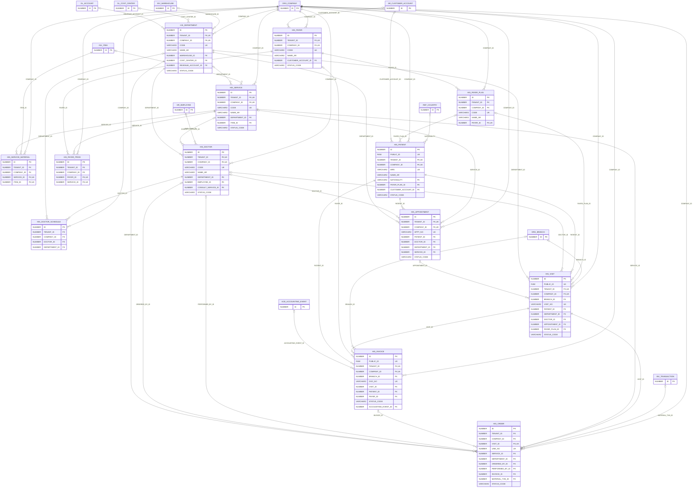

# ERD — الحزمة 31: المستشفيات والمراكز الطبية

**Hospital & Clinics** · الحزمة البرمجية `NOONA_HIS_PKG` · عدد الجداول: **13**

الأقسام والعيادات والمعامل والأشعة والصيدليات الداخلية والوحدات العلاجية كأقسام مستقلة بمستودعاتها ومراكز تكلفتها، الأطباء وساعات العمل، دليل الخدمات الطبية ومواد كل فحص، شركات التأمين والجهات المتعاقدة بفئاتها وأسعارها، المرضى والحجوزات والزيارات والطلبات الطبية ونتائجها، والفواتير بحصة المريض وحصة الجهة والقيد المحاسبي.

الجداول الخارجية المرتبطة (من حزم أخرى): `ACE_ACCOUNTING_EVENT`, `AR_CUSTOMER_ACCOUNT`, `GL_ACCOUNT`, `GL_COST_CENTER`, `HR_EMPLOYEE`, `INV_ITEM`, `INV_TRANSACTION`, `INV_WAREHOUSE`, `ORG_BRANCH`, `ORG_COMPANY`, `REF_COUNTRY`

## الجداول

| الجدول | الاسم العربي | English | النطاق |
|---|---|---|---|
| `HIS_DEPARTMENT` | الأقسام الطبية | Medical Departments | C |
| `HIS_SERVICE` | دليل الخدمات الطبية | Medical Services Catalogue | C |
| `HIS_SERVICE_MATERIAL` | مواد الخدمة المستهلكة | Service Consumables | C |
| `HIS_DOCTOR` | الأطباء والممارسون | Doctors & Practitioners | C |
| `HIS_DOCTOR_SCHEDULE` | ساعات عمل الأطباء | Doctor Working Hours | C |
| `HIS_PAYER` | شركات التأمين والجهات المتعاقدة | Insurers & Contracted Companies | C |
| `HIS_PAYER_PLAN` | فئات التغطية | Coverage Plans / Classes | C |
| `HIS_PAYER_PRICE` | أسعار العقود | Contract Prices | C |
| `HIS_PATIENT` | المرضى | Patients | C |
| `HIS_APPOINTMENT` | المواعيد والحجوزات | Appointments | C |
| `HIS_VISIT` | الزيارات | Visits / Encounters | C |
| `HIS_INVOICE` | فواتير الزيارات | Visit Invoices | C |
| `HIS_ORDER` | الطلبات والخدمات الطبية | Medical Orders | C |
