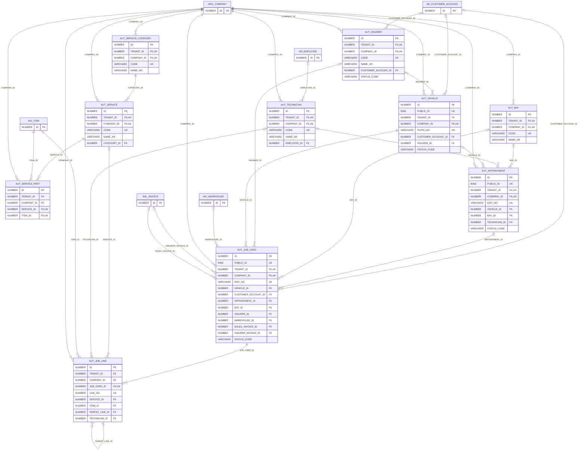

# ERD — الحزمة 32: مراكز خدمة السيارات

**Auto Service Centers** · الحزمة البرمجية `NOONA_AUT_PKG` · عدد الجداول: **10**

المركبات وملاكها، كتالوج الخدمات ككروت مع قطعها الافتراضية، الرافعات والفنيون، الحجوزات، أوامر الإصلاح بالخدمات وقطع الغيار والفني المنفذ ومدة البقاء، فاتورة واحدة تصرف القطع من المخزون، ومطالبات شركات التأمين وتحمل العميل.

الجداول الخارجية المرتبطة (من حزم أخرى): `AR_CUSTOMER_ACCOUNT`, `HR_EMPLOYEE`, `INV_ITEM`, `INV_WAREHOUSE`, `ORG_COMPANY`, `SAL_INVOICE`

## الجداول

| الجدول | الاسم العربي | English | النطاق |
|---|---|---|---|
| `AUT_SERVICE_CATEGORY` | فئات خدمات السيارات | Service Categories | C |
| `AUT_SERVICE` | خدمات السيارات | Auto Services | C |
| `AUT_SERVICE_PART` | القطع الافتراضية للخدمة | Service Default Parts | C |
| `AUT_BAY` | الرافعات ومواقع العمل | Service Bays | C |
| `AUT_TECHNICIAN` | الفنيون | Technicians | C |
| `AUT_INSURER` | شركات التأمين | Insurers | C |
| `AUT_VEHICLE` | المركبات | Vehicles | C |
| `AUT_APPOINTMENT` | حجوزات الصيانة | Service Appointments | C |
| `AUT_JOB_CARD` | أوامر الإصلاح | Job Cards | C |
| `AUT_JOB_LINE` | بنود أمر الإصلاح | Job Card Lines | C |
