# ERD — الحزمة 33: النقل والشحن والترحيل

**Transport & Logistics** · الحزمة البرمجية `NOONA_TRN_PKG` · عدد الجداول: **15**

أسطول الشاحنات والعربات والسائقين، المدن والمواقع والمسارات والمسافات، أنواع الشحنات، تعرفة الترحيل بالطن المتري والطن القصير والطويل والكيلوجرام والمتر المكعب والكيلومتر والطن-كيلومتر والرحلة والحاوية، أوامر الشحن، الرحلات بمواعيدها وزمن الوصول المتوقع ونقاط التوقف، التسليم والتفريغ والعجز، مصروفات الرحلة، والأعطال والبلاغات وزمن الاستجابة، وفوترة الترحيل في المبيعات.

الجداول الخارجية المرتبطة (من حزم أخرى): `AR_CUSTOMER_ACCOUNT`, `DMS_DOCUMENT`, `FA_ASSET`, `FA_MAINTENANCE`, `HR_EMPLOYEE`, `INV_ITEM`, `INV_TRANSACTION`, `INV_WAREHOUSE`, `ORG_BRANCH`, `ORG_COMPANY`, `PTY_PARTY`, `REF_COUNTRY`, `SAL_INVOICE`

```mermaid
erDiagram
  TRN_LOCATION {
    NUMBER ID PK
    NUMBER TENANT_ID FK,UK
    NUMBER COMPANY_ID FK,UK
    VARCHAR2 CODE UK
    VARCHAR2 NAME_AR
    VARCHAR2 COUNTRY_CODE FK
  }
  TRN_ROUTE {
    NUMBER ID PK
    NUMBER TENANT_ID FK,UK
    NUMBER COMPANY_ID FK,UK
    VARCHAR2 CODE UK
    VARCHAR2 NAME_AR
    NUMBER FROM_LOCATION_ID FK
    NUMBER TO_LOCATION_ID FK
  }
  TRN_CARGO_TYPE {
    NUMBER ID PK
    NUMBER TENANT_ID FK,UK
    NUMBER COMPANY_ID FK,UK
    VARCHAR2 CODE UK
    VARCHAR2 NAME_AR
  }
  TRN_VEHICLE {
    NUMBER ID PK
    NUMBER TENANT_ID FK,UK
    NUMBER COMPANY_ID FK,UK
    VARCHAR2 CODE UK
    VARCHAR2 PLATE_NO UK
    NUMBER ASSET_ID FK
    NUMBER BRANCH_ID FK
    VARCHAR2 STATUS_CODE
  }
  TRN_DRIVER {
    NUMBER ID PK
    NUMBER TENANT_ID FK,UK
    NUMBER COMPANY_ID FK,UK
    VARCHAR2 CODE UK
    NUMBER EMPLOYEE_ID FK
    NUMBER BRANCH_ID FK
    VARCHAR2 STATUS_CODE
  }
  TRN_RATE {
    NUMBER ID PK
    NUMBER TENANT_ID FK,UK
    NUMBER COMPANY_ID FK,UK
    VARCHAR2 CODE UK
    VARCHAR2 NAME_AR
    NUMBER CUSTOMER_ACCOUNT_ID FK
    NUMBER ROUTE_ID FK
    NUMBER CARGO_TYPE_ID FK
    VARCHAR2 STATUS_CODE
  }
  TRN_ORDER {
    NUMBER ID PK
    RAW PUBLIC_ID UK
    NUMBER TENANT_ID FK,UK
    NUMBER COMPANY_ID FK,UK
    NUMBER BRANCH_ID FK
    VARCHAR2 DOC_NO UK
    NUMBER CUSTOMER_ACCOUNT_ID FK
    NUMBER FROM_LOCATION_ID FK
    NUMBER TO_LOCATION_ID FK
    NUMBER ROUTE_ID FK
    NUMBER CARGO_TYPE_ID FK
    NUMBER RATE_ID FK
    NUMBER POD_DOCUMENT_ID FK
    NUMBER SALES_INVOICE_ID FK
    VARCHAR2 STATUS_CODE
  }
  TRN_TRIP {
    NUMBER ID PK
    RAW PUBLIC_ID UK
    NUMBER TENANT_ID FK,UK
    NUMBER COMPANY_ID FK,UK
    NUMBER BRANCH_ID FK
    VARCHAR2 DOC_NO UK
    NUMBER VEHICLE_ID FK
    NUMBER DRIVER_ID FK
    NUMBER CO_DRIVER_ID FK
    NUMBER ROUTE_ID FK
    NUMBER FROM_LOCATION_ID FK
    NUMBER TO_LOCATION_ID FK
    VARCHAR2 STATUS_CODE
  }
  TRN_TRIP_ORDER {
    NUMBER ID PK
    NUMBER TENANT_ID FK
    NUMBER COMPANY_ID FK
    NUMBER TRIP_ID FK,UK
    NUMBER ORDER_ID FK,UK
  }
  TRN_TRIP_STOP {
    NUMBER ID PK
    NUMBER TENANT_ID FK
    NUMBER COMPANY_ID FK
    NUMBER TRIP_ID FK
    NUMBER LOCATION_ID FK
  }
  TRN_TRIP_EXPENSE {
    NUMBER ID PK
    NUMBER TENANT_ID FK
    NUMBER COMPANY_ID FK
    NUMBER TRIP_ID FK
  }
  TRN_INCIDENT {
    NUMBER ID PK
    RAW PUBLIC_ID UK
    NUMBER TENANT_ID FK,UK
    NUMBER COMPANY_ID FK,UK
    VARCHAR2 DOC_NO UK
    NUMBER TRIP_ID FK
    NUMBER VEHICLE_ID FK
    NUMBER DRIVER_ID FK
    NUMBER LOCATION_ID FK
    VARCHAR2 STATUS_CODE
  }
  TRN_MAINT_PLAN {
    NUMBER ID PK
    NUMBER TENANT_ID FK
    NUMBER COMPANY_ID FK
    NUMBER VEHICLE_ID FK
    VARCHAR2 STATUS_CODE
  }
  TRN_MAINT_ORDER {
    NUMBER ID PK
    RAW PUBLIC_ID UK
    NUMBER TENANT_ID FK,UK
    NUMBER COMPANY_ID FK,UK
    NUMBER BRANCH_ID FK
    VARCHAR2 DOC_NO UK
    NUMBER VEHICLE_ID FK
    NUMBER PLAN_ID FK
    NUMBER INCIDENT_ID FK
    NUMBER VENDOR_PARTY_ID FK
    NUMBER WAREHOUSE_ID FK
    NUMBER FA_MAINTENANCE_ID FK
    VARCHAR2 STATUS_CODE
  }
  TRN_MAINT_LINE {
    NUMBER ID PK
    NUMBER TENANT_ID FK
    NUMBER COMPANY_ID FK
    NUMBER ORDER_ID FK
    NUMBER ITEM_ID FK
    NUMBER INV_TXN_ID FK
  }
  ORG_COMPANY {
    NUMBER ID PK
  }
  REF_COUNTRY {
    NUMBER ID PK
  }
  FA_ASSET {
    NUMBER ID PK
  }
  ORG_BRANCH {
    NUMBER ID PK
  }
  HR_EMPLOYEE {
    NUMBER ID PK
  }
  AR_CUSTOMER_ACCOUNT {
    NUMBER ID PK
  }
  DMS_DOCUMENT {
    NUMBER ID PK
  }
  SAL_INVOICE {
    NUMBER ID PK
  }
  PTY_PARTY {
    NUMBER ID PK
  }
  INV_WAREHOUSE {
    NUMBER ID PK
  }
  FA_MAINTENANCE {
    NUMBER ID PK
  }
  INV_ITEM {
    NUMBER ID PK
  }
  INV_TRANSACTION {
    NUMBER ID PK
  }
  AR_CUSTOMER_ACCOUNT |o--o{ TRN_RATE : "CUSTOMER_ACCOUNT_ID"
  AR_CUSTOMER_ACCOUNT ||--o{ TRN_ORDER : "CUSTOMER_ACCOUNT_ID"
  DMS_DOCUMENT |o--o{ TRN_ORDER : "POD_DOCUMENT_ID"
  FA_ASSET |o--o{ TRN_VEHICLE : "ASSET_ID"
  FA_MAINTENANCE |o--o{ TRN_MAINT_ORDER : "FA_MAINTENANCE_ID"
  HR_EMPLOYEE |o--o{ TRN_DRIVER : "EMPLOYEE_ID"
  INV_ITEM |o--o{ TRN_MAINT_LINE : "ITEM_ID"
  INV_TRANSACTION |o--o{ TRN_MAINT_LINE : "INV_TXN_ID"
  INV_WAREHOUSE |o--o{ TRN_MAINT_ORDER : "WAREHOUSE_ID"
  ORG_BRANCH |o--o{ TRN_DRIVER : "BRANCH_ID"
  ORG_BRANCH |o--o{ TRN_MAINT_ORDER : "BRANCH_ID"
  ORG_BRANCH |o--o{ TRN_ORDER : "BRANCH_ID"
  ORG_BRANCH |o--o{ TRN_TRIP : "BRANCH_ID"
  ORG_BRANCH |o--o{ TRN_VEHICLE : "BRANCH_ID"
  ORG_COMPANY ||--o{ TRN_CARGO_TYPE : "COMPANY_ID"
  ORG_COMPANY ||--o{ TRN_DRIVER : "COMPANY_ID"
  ORG_COMPANY ||--o{ TRN_INCIDENT : "COMPANY_ID"
  ORG_COMPANY ||--o{ TRN_LOCATION : "COMPANY_ID"
  ORG_COMPANY ||--o{ TRN_MAINT_LINE : "COMPANY_ID"
  ORG_COMPANY ||--o{ TRN_MAINT_ORDER : "COMPANY_ID"
  ORG_COMPANY ||--o{ TRN_MAINT_PLAN : "COMPANY_ID"
  ORG_COMPANY ||--o{ TRN_ORDER : "COMPANY_ID"
  ORG_COMPANY ||--o{ TRN_RATE : "COMPANY_ID"
  ORG_COMPANY ||--o{ TRN_ROUTE : "COMPANY_ID"
  ORG_COMPANY ||--o{ TRN_TRIP : "COMPANY_ID"
  ORG_COMPANY ||--o{ TRN_TRIP_EXPENSE : "COMPANY_ID"
  ORG_COMPANY ||--o{ TRN_TRIP_ORDER : "COMPANY_ID"
  ORG_COMPANY ||--o{ TRN_TRIP_STOP : "COMPANY_ID"
  ORG_COMPANY ||--o{ TRN_VEHICLE : "COMPANY_ID"
  PTY_PARTY |o--o{ TRN_MAINT_ORDER : "VENDOR_PARTY_ID"
  REF_COUNTRY |o--o{ TRN_LOCATION : "COUNTRY_CODE"
  SAL_INVOICE |o--o{ TRN_ORDER : "SALES_INVOICE_ID"
  TRN_CARGO_TYPE |o--o{ TRN_RATE : "CARGO_TYPE_ID"
  TRN_CARGO_TYPE ||--o{ TRN_ORDER : "CARGO_TYPE_ID"
  TRN_DRIVER |o--o{ TRN_INCIDENT : "DRIVER_ID"
  TRN_DRIVER |o--o{ TRN_TRIP : "CO_DRIVER_ID"
  TRN_DRIVER ||--o{ TRN_TRIP : "DRIVER_ID"
  TRN_INCIDENT |o--o{ TRN_MAINT_ORDER : "INCIDENT_ID"
  TRN_LOCATION |o--o{ TRN_INCIDENT : "LOCATION_ID"
  TRN_LOCATION ||--o{ TRN_ORDER : "FROM_LOCATION_ID"
  TRN_LOCATION ||--o{ TRN_ORDER : "TO_LOCATION_ID"
  TRN_LOCATION ||--o{ TRN_ROUTE : "FROM_LOCATION_ID"
  TRN_LOCATION ||--o{ TRN_ROUTE : "TO_LOCATION_ID"
  TRN_LOCATION ||--o{ TRN_TRIP : "FROM_LOCATION_ID"
  TRN_LOCATION ||--o{ TRN_TRIP : "TO_LOCATION_ID"
  TRN_LOCATION ||--o{ TRN_TRIP_STOP : "LOCATION_ID"
  TRN_MAINT_ORDER ||--o{ TRN_MAINT_LINE : "ORDER_ID"
  TRN_MAINT_PLAN |o--o{ TRN_MAINT_ORDER : "PLAN_ID"
  TRN_ORDER ||--o{ TRN_TRIP_ORDER : "ORDER_ID"
  TRN_RATE |o--o{ TRN_ORDER : "RATE_ID"
  TRN_ROUTE |o--o{ TRN_ORDER : "ROUTE_ID"
  TRN_ROUTE |o--o{ TRN_RATE : "ROUTE_ID"
  TRN_ROUTE |o--o{ TRN_TRIP : "ROUTE_ID"
  TRN_TRIP |o--o{ TRN_INCIDENT : "TRIP_ID"
  TRN_TRIP ||--o{ TRN_TRIP_EXPENSE : "TRIP_ID"
  TRN_TRIP ||--o{ TRN_TRIP_ORDER : "TRIP_ID"
  TRN_TRIP ||--o{ TRN_TRIP_STOP : "TRIP_ID"
  TRN_VEHICLE |o--o{ TRN_MAINT_PLAN : "VEHICLE_ID"
  TRN_VEHICLE ||--o{ TRN_INCIDENT : "VEHICLE_ID"
  TRN_VEHICLE ||--o{ TRN_MAINT_ORDER : "VEHICLE_ID"
  TRN_VEHICLE ||--o{ TRN_TRIP : "VEHICLE_ID"
```

## الجداول

| الجدول | الاسم العربي | English | النطاق |
|---|---|---|---|
| `TRN_LOCATION` | المدن والمواقع | Cities & Locations | C |
| `TRN_ROUTE` | المسارات والمسافات | Routes & Distances | C |
| `TRN_CARGO_TYPE` | أنواع الشحنات | Cargo Types | C |
| `TRN_VEHICLE` | العربات والشاحنات | Fleet Vehicles | C |
| `TRN_DRIVER` | السائقون | Drivers | C |
| `TRN_RATE` | تعرفة الترحيل | Freight Rates | C |
| `TRN_ORDER` | أوامر الشحن | Shipment Orders | C |
| `TRN_TRIP` | الرحلات | Trips | C |
| `TRN_TRIP_ORDER` | شحنات الرحلة | Trip Shipments | C |
| `TRN_TRIP_STOP` | نقاط التوقف | Trip Stops | C |
| `TRN_TRIP_EXPENSE` | مصروفات الرحلة | Trip Expenses | C |
| `TRN_INCIDENT` | الأعطال والبلاغات | Road Incidents & Reports | C |
| `TRN_MAINT_PLAN` | برامج الصيانة الدورية للأسطول | Fleet Service Programs | C |
| `TRN_MAINT_ORDER` | أوامر صيانة العربات | Vehicle Maintenance Orders | C |
| `TRN_MAINT_LINE` | بنود أمر الصيانة | Maintenance Order Lines | C |
