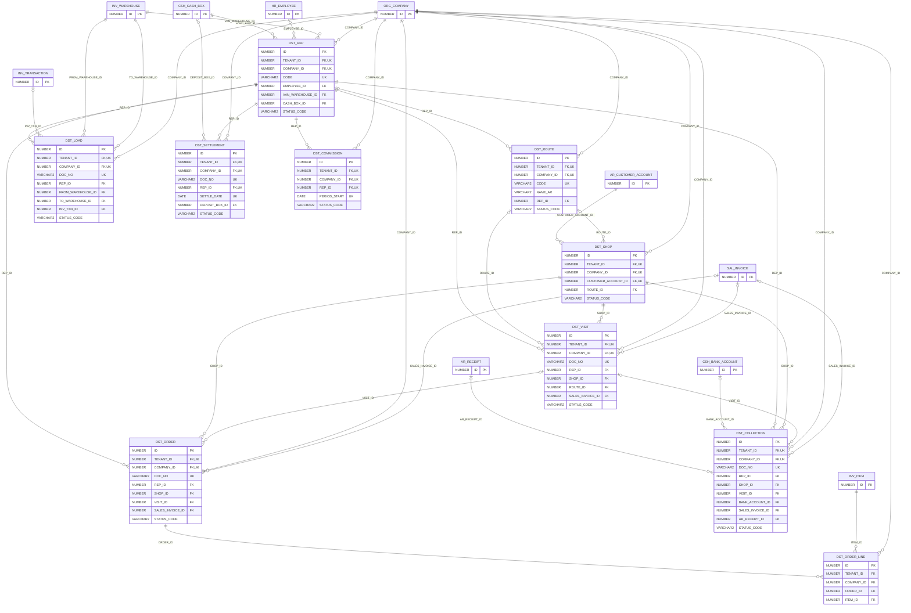

# ERD — الحزمة 36: التوزيع والمبيعات الميدانية

**Distribution & Field Sales** · الحزمة البرمجية `NOONA_DST_PKG` · عدد الجداول: **10**

شركات التوزيع على المحلات: المندوبون وسيارات التوزيع (مستودع متنقل وعهدة نقدية)، خطوط السير والمناطق وأيام الزيارة، المحلات بمواقعها على الخريطة، خطة اليوم والزيارات بالموقع والوقت، البيع من السيارة وأوامر التوريد المسبقة، التحصيل بطرق الدفع ورقم المرجع (الإشعار البنكي، الشيك، العملية)، المرتجعات، أسباب عدم الشراء، تسوية نهاية اليوم، العمولات والأهداف.

الجداول الخارجية المرتبطة (من حزم أخرى): `AR_CUSTOMER_ACCOUNT`, `AR_RECEIPT`, `CSH_BANK_ACCOUNT`, `CSH_CASH_BOX`, `HR_EMPLOYEE`, `INV_ITEM`, `INV_TRANSACTION`, `INV_WAREHOUSE`, `ORG_COMPANY`, `SAL_INVOICE`

## الجداول

| الجدول | الاسم العربي | English | النطاق |
|---|---|---|---|
| `DST_REP` | المندوبون | Field Sales Reps | C |
| `DST_ROUTE` | خطوط السير | Delivery Routes | C |
| `DST_SHOP` | المحلات | Shops & Outlets | C |
| `DST_VISIT` | الزيارات | Shop Visits | C |
| `DST_LOAD` | تحميل وتفريغ السيارات | Van Loads | C |
| `DST_ORDER` | أوامر التوريد | Pre-sale Orders | C |
| `DST_ORDER_LINE` | أسطر أوامر التوريد | Pre-sale Order Lines | C |
| `DST_COLLECTION` | تحصيلات المندوبين | Field Collections | C |
| `DST_SETTLEMENT` | تسويات نهاية اليوم | Daily Rep Settlements | C |
| `DST_COMMISSION` | عمولات المندوبين | Rep Commissions | C |
