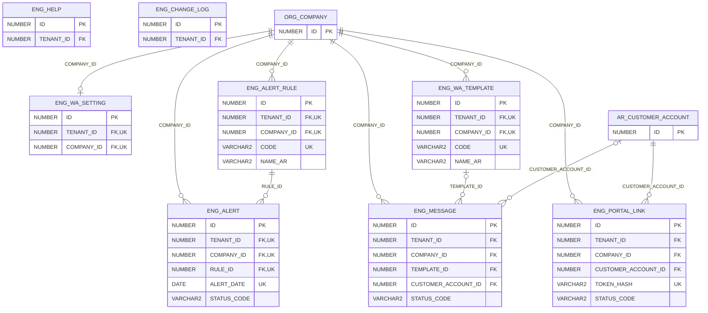

# ERD — الحزمة 37: مركز الإدارة والتواصل

**Management & Engagement Hub** · الحزمة البرمجية `NOONA_ENG_PKG` · عدد الجداول: **8**

بوابة العملاء والمحلات برابط آمن (الفواتير، الرصيد، كشف الحساب، تتبع الشحنات)، محرك واتساب (Cloud API أو روابط wa.me) بالقوالب وسجل الرسائل، توقع النقد 90 يوماً، قواعد الإنذار المبكر وتنبيهاتها، لوحة المدير على الهاتف، مركز المساعدة لكل شاشة، تصدير البيانات إلى Excel، وسجل التغييرات المقروء.

الجداول الخارجية المرتبطة (من حزم أخرى): `AR_CUSTOMER_ACCOUNT`, `ORG_COMPANY`

## الجداول

| الجدول | الاسم العربي | English | النطاق |
|---|---|---|---|
| `ENG_PORTAL_LINK` | روابط بوابة العملاء | Customer Portal Links | C |
| `ENG_WA_SETTING` | إعدادات واتساب | WhatsApp Settings | C |
| `ENG_WA_TEMPLATE` | قوالب الرسائل | Message Templates | C |
| `ENG_MESSAGE` | سجل الرسائل | Message Log | C |
| `ENG_ALERT_RULE` | قواعد الإنذار المبكر | Early-warning Rules | C |
| `ENG_ALERT` | تنبيهات الإنذار المبكر | Early-warning Alerts | C |
| `ENG_HELP` | مساعدة الشاشات | Screen Help | TO |
| `ENG_CHANGE_LOG` | سجل التغييرات | Change Log | T |
